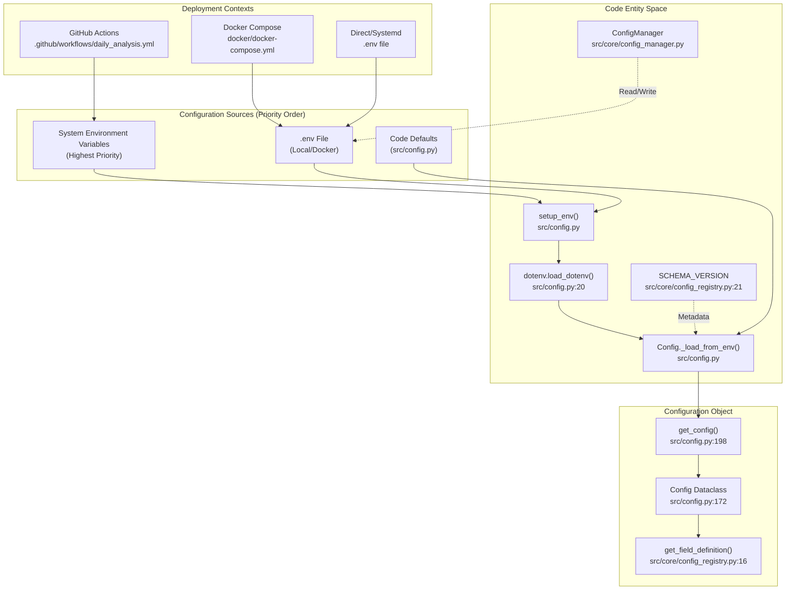
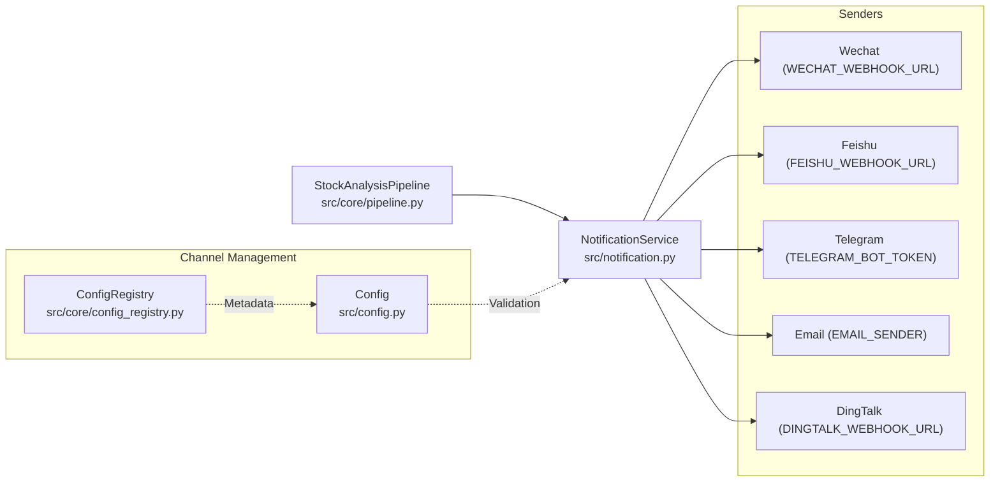

<!-- source: DeepWiki mcp.deepwiki.com · repo ZhuLinsen/daily_stock_analysis · page 7.5 Environment Variables Guide · fetched 2026-10-29 -->

# Environment Variables Guide

<details>
<summary>Relevant source files</summary>

The following files were used as context for generating this wiki page:

- [.env.example](.env.example)
- [apps/dsa-web/src/locales/settingsHelp.ts](apps/dsa-web/src/locales/settingsHelp.ts)
- [apps/dsa-web/src/utils/systemConfigI18n.ts](apps/dsa-web/src/utils/systemConfigI18n.ts)
- [docs/CHANGELOG.md](docs/CHANGELOG.md)
- [docs/full-guide.md](docs/full-guide.md)
- [docs/full-guide_EN.md](docs/full-guide_EN.md)
- [src/config.py](src/config.py)
- [src/core/config_registry.py](src/core/config_registry.py)
- [src/core/pipeline.py](src/core/pipeline.py)
- [tests/test_config_registry.py](tests/test_config_registry.py)

</details>


This page provides a comprehensive reference for configuring the **A-share/HK/US intelligent stock analysis system** through environment variables. It covers all configuration options organized by functional category, with specific examples for each deployment method (GitHub Actions, Docker, Direct/Systemd).

For broader deployment architecture and choosing between deployment methods, see [7.1 Deployment Overview](). For execution mode configuration flags (`--schedule`, `--dry-run`, etc.), see [7.6 Execution Modes]().

---

## Configuration Architecture

The system supports multiple configuration sources with a clear priority hierarchy. The `Config` class (a singleton) manages the loading process, starting from system environment variables down to the `.env` file and finally code-defined defaults.

### Data Flow & Entity Mapping

The following diagram bridges the configuration concepts to the specific code entities responsible for managing them.

**Title: Configuration Management Flow**


**Sources:** [src/config.py:1-20](), [src/config.py:172-198](), [src/core/config_registry.py:1-21](), [src/core/pipeline.py:198-202]()

---

## Configuration Categories

### AI Model Configuration

The system supports a powerful multi-tier AI model configuration using **LiteLLM** and experimental local CLI backends.

| Variable | Type | Default | Description |
|----------|------|---------|-------------|
| `GENERATION_BACKEND` | string | `litellm` | Generation method: `litellm`, `codex_cli`, `claude_code_cli`, `opencode_cli` [src/core/config_registry.py:121-136]() |
| `LITELLM_MODEL` | string | - | Primary model (e.g., `gemini/gemini-2.0-flash`, `deepseek/deepseek-v4-flash`) [apps/dsa-web/src/locales/settingsHelp.ts:103-106]() |
| `GEMINI_API_KEY` | string | - | Google Gemini API key [.env.example:150]() |
| `DEEPSEEK_API_KEY` | string | - | Official DeepSeek API key [.env.example:155]() |
| `AIHUBMIX_KEY` | string | - | All-in-one key for multiple models via aihubmix.com [.env.example:159]() |
| `LLM_CHANNELS` | string | - | Comma-separated channel names for multi-provider setup [apps/dsa-web/src/locales/settingsHelp.ts:120-123]() |
| `GENERATION_FALLBACK_BACKEND` | string | `litellm` | Backend-level fallback method [.env.example:138]() |
| `LLM_TEMPERATURE` | float | `0.7` | Unified sampling temperature (0.0-2.0) [apps/dsa-web/src/locales/settingsHelp.ts:170-176]() |

**Priority Rule:** `LITELLM_CONFIG` (YAML) > `LLM_CHANNELS` > Legacy Keys (e.g., `GEMINI_API_KEY`). [apps/dsa-web/src/locales/settingsHelp.ts:108-111]()

**Sources:** [.env.example:115-163](), [src/core/config_registry.py:121-153](), [apps/dsa-web/src/locales/settingsHelp.ts:35-136]()

---

### Data Source Configuration

Market data providers are managed with a priority-based failover system.

| Variable | Type | Default | Description |
|----------|------|---------|-------------|
| `TUSHARE_TOKEN` | string | - | Tushare Pro token [.env.example:24]() |
| `LONGBRIDGE_APP_KEY` | string | - | Longbridge App Key for HK/US stocks [.env.example:86]() |
| `LONGBRIDGE_ACCESS_TOKEN` | string | - | Longbridge Access Token [.env.example:88]() |
| `STOCK_LIST` | string | - | Watchlist stock codes (supports various separators) [.env.example:9](), [docs/CHANGELOG.md:18]() |
| `TICKFLOW_API_KEY` | string | - | API Key for enhanced A-share data [.env.example:26]() |

**Longbridge Priority:** When `LONGBRIDGE_*` credentials are provided, the system prioritizes Longbridge for HK/US daily and real-time quotes. [.env.example:78-89](), [docs/full-guide.md:144-146]()

**Sources:** [.env.example:6-114](), [docs/CHANGELOG.md:18-22](), [docs/full-guide.md:133-146]()

---

### Real-time Quote & Search Enhancement

The system enhances analysis with real-time quotes and multi-provider search.

**Real-time Quotes:**
| Variable | Type | Default | Description |
|----------|------|---------|-------------|
| `ENABLE_REALTIME_QUOTE` | bool | `true` | Enable real-time quote fetching [apps/dsa-web/src/utils/systemConfigI18n.ts:70]() |
| `ENABLE_CHIP_DISTRIBUTION` | bool | `false` | Enable chip distribution analysis [apps/dsa-web/src/utils/systemConfigI18n.ts:72]() |

**Search Engines:**
| Variable | Type | Default | Description |
|----------|------|---------|-------------|
| `ANSPIRE_API_KEYS` | string | - | Anspire Search (Optimized for A-shares) [.env.example:18]() |
| `NEWS_INTEL_AUTO_FETCH_ENABLED` | bool | `false` | Auto-refresh local news RSS/Atom pool [docs/CHANGELOG.md:19]() |
| `NEWS_STRATEGY_PROFILE` | string | `short` | News window: `ultra_short`(1d), `short`(3d), `medium`(7d), `long`(30d) [src/config.py:164-169]() |

**Sources:** [.env.example:11-21](), [docs/CHANGELOG.md:19-20](), [src/config.py:162-170]()

---

### Agent & Strategy Configuration

Advanced "Agent Mode" (Skills) for deep technical and emotional analysis.

| Variable | Type | Default | Description |
|----------|------|---------|-------------|
| `AGENT_MODE` | bool | `false` | Enable Agent strategy dialogue [apps/dsa-web/src/utils/systemConfigI18n.ts:187]() |
| `AGENT_SKILLS` | string | - | Comma-separated strategies (e.g., `bull_trend,ma_golden_cross`) [apps/dsa-web/src/utils/systemConfigI18n.ts:190]() |
| `AGENT_ORCHESTRATOR_MODE` | string | `standard` | Orchestration depth: `quick`, `standard`, `full`, `specialist` [apps/dsa-web/src/utils/systemConfigI18n.ts:193]() |
| `AGENT_MAX_STEPS` | int | `10` | Max reasoning steps for agents [src/config.py:162]() |
| `AGENT_LITELLM_MODEL` | string | - | Independent model for Agent tasks [apps/dsa-web/src/locales/settingsHelp.ts:137-140]() |

**Sources:** [src/config.py:162-206](), [apps/dsa-web/src/locales/settingsHelp.ts:137-147](), [apps/dsa-web/src/utils/systemConfigI18n.ts:187-195]()

---

### Notification Channels

The system supports 10+ channels. Multiple channels can be active simultaneously.

**Title: Notification System Integration**


| Channel | Key Variable(s) | Notes |
|---------|-----------------|-------|
| **WeChat** | `WECHAT_WEBHOOK_URL` | Corporate WeChat bot [docs/full-guide.md:76]() |
| **Feishu** | `FEISHU_WEBHOOK_URL`, `FEISHU_SEND_AS_FILE` | Supports file upload mode [docs/CHANGELOG.md:27]() |
| **Telegram** | `TELEGRAM_BOT_TOKEN`, `TELEGRAM_CHAT_ID` | Bot API [docs/full-guide.md:80-81]() |
| **Email** | `EMAIL_SENDER`, `EMAIL_PASSWORD` | SMTP configuration [docs/full-guide.md:90-91]() |
| **DingTalk** | `DINGTALK_WEBHOOK_URL`, `DINGTALK_SECRET` | Supports 20KB chunking [docs/CHANGELOG.md:42]() |
| **Discord** | `DISCORD_WEBHOOK_URL` | Supports 2000-char splitting [docs/CHANGELOG.md:63]() |

**Sources:** [docs/CHANGELOG.md:27-63](), [docs/full-guide.md:70-107](), [apps/dsa-web/src/utils/systemConfigI18n.ts:106-163]()

---

## Deployment-Specific Examples

### GitHub Actions (Secrets & Variables)
In GitHub, sensitive keys must be in **Secrets**, while non-sensitive items like `STOCK_LIST` can be in **Variables**.

```yaml
# .github/workflows/00-daily-analysis.yml
env:
  GEMINI_API_KEY: ${{ secrets.GEMINI_API_KEY }}
  STOCK_LIST: ${{ vars.STOCK_LIST }}
  REPORT_LANGUAGE: ${{ vars.REPORT_LANGUAGE || 'zh' }}
```

**Note:** Default workflows only map fixed Secret names. Custom numbered variables like `STOCK_GROUP_1` require explicit mapping in your fork. [docs/full-guide.md:111-112]()

### Docker Compose
Docker uses the `.env` file. Volumes ensure that settings saved via Web UI persist across restarts.

```yaml
# Example docker-compose fragment
services:
  analyzer:
    env_file: .env
    environment:
      - TZ=Asia/Shanghai
    volumes:
      - ./data:/app/data
      - ./.env:/app/.env
```

### Direct/Systemd
Uses the `.env` file in the project root. You can specify a custom path via system environment variables.

```bash
# Manual execution with specific env
export WEBUI_PORT=8080
python main.py --schedule
```

**Sources:** [docs/CHANGELOG.md:12-17](), [docs/full-guide.md:42-152](), [src/config.py:1-20]()

---

## Configuration Management via Web UI

The system provides a robust interface for managing environment variables without manual file editing.

1. **Validation:** All inputs are validated against metadata in `ConfigRegistry` before saving. [src/core/config_registry.py:87-117]()
2. **I18n Support:** Field titles and help text are localized (ZH/EN). [apps/dsa-web/src/utils/systemConfigI18n.ts:4-25]()
3. **Sensitive Handling:** Fields like `SLACK_BOT_TOKEN` are marked as sensitive and use password-style UI controls. [tests/test_config_registry.py:35-39]()
4. **Hot Reload:** Changes to `STOCK_LIST` are unified across CLI, Web, and API. [docs/CHANGELOG.md:18]()

**Sources:** [src/core/config_registry.py:87-211](), [apps/dsa-web/src/utils/systemConfigI18n.ts:1-195](), [tests/test_config_registry.py:21-174]()

---

