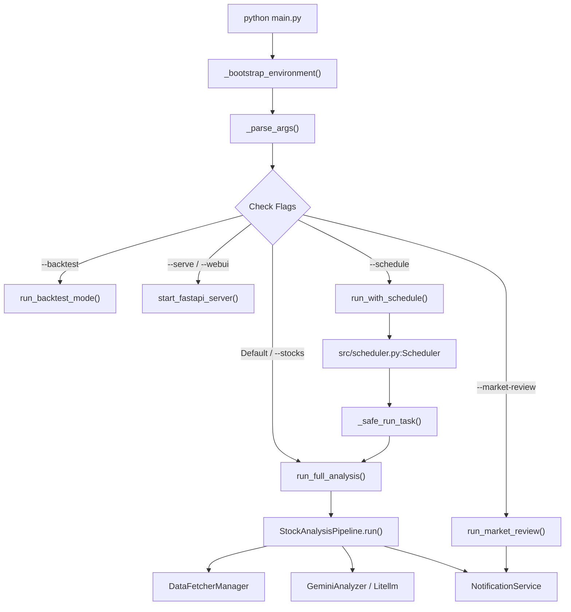
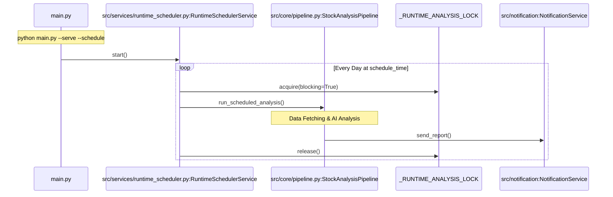

<!-- source: DeepWiki mcp.deepwiki.com · repo ZhuLinsen/daily_stock_analysis · page 7.6 Execution Modes · fetched 2026-10-29 -->

# Execution Modes

Relevant source files

The following files were used as context for generating this wiki page:

- [main.py](main.py)
- [src/services/runtime_scheduler.py](src/services/runtime_scheduler.py)
- [tests/test_main_schedule_mode.py](tests/test_main_schedule_mode.py)
- [tests/test_runtime_scheduler_service.py](tests/test_runtime_scheduler_service.py)

This document explains the different execution modes available in the A-share Stock Intelligent Analysis System, their technical implementation in `main.py`, and how they interact with the system's core components including the scheduler and search services.

## Purpose and Scope

The system supports multiple execution patterns ranging from one-time CLI runs to long-lived API servers and scheduled daemons. This page details the implementation logic within `main.py`, the data flow for each mode, and the command-line arguments that trigger them. It also covers how the system handles environment bootstrapping and proxy configuration.

## Overview of Execution Modes

The system provides several primary execution categories that control component invocation and lifecycle:

| Mode | CLI Argument | Primary Component | Lifecycle | Use Case |
|------|--------------|-------------------|-----------|----------|
| **Full Analysis** | (None) | `StockAnalysisPipeline` | One-shot | Daily comprehensive review |
| **Market-Only** | `--market-review` | `run_market_review` | One-shot | Quick market snapshot |
| **API Server** | `--serve` | `FastAPI` + `uvicorn` | Continuous | Web UI & remote triggers |
| **Scheduled** | `--schedule` | `Scheduler` or `RuntimeSchedulerService` | Continuous | Server-side automation |
| **Dry-Run** | `--dry-run` | `StockAnalysisPipeline` | One-shot | Data validation (no AI) |

Sources: [main.py:14-17](), [main.py:107-112](), [src/services/runtime_scheduler.py:99-102]()

## Execution Mode Selection Architecture

The `main.py` entry point acts as the central orchestrator, parsing arguments to route execution to the appropriate service or pipeline. It handles environment setup through `_bootstrap_environment()` [main.py:142-163]() and manages lazy loading of the `StockAnalysisPipeline` [main.py:204-214]().

**Diagram: Execution Routing and Code Entity Mapping**

Sources: [main.py:142-163](), [main.py:204-214](), [src/services/runtime_scheduler.py:173-190]()

## Detailed Execution Modes

### 1. Full Analysis Mode (Default)
This is the standard operational mode. It orchestrates the entire lifecycle from data acquisition to AI synthesis.

*   **Implementation**: Triggered by `run_full_analysis` in `main.py`.
*   **Data Flow**:
    1.  **Stock Filtering**: Checks trading calendars via `_compute_trading_day_filter` and filters out non-trading days unless `--force-run` is specified.
    2.  **Pipeline Initialization**: Instantiates `StockAnalysisPipeline` via `_get_stock_analysis_pipeline()` [main.py:204-214]().
    3.  **Concurrent Execution**: Uses a thread pool (configured via `--workers`) to process stocks in parallel, ensuring a single failure doesn't halt the entire run.
    4.  **Notification**: Aggregates results and dispatches via `NotificationService`.

Sources: [main.py:204-214](), [tests/test_main_schedule_mode.py:167-190]()

### 2. API Server Mode (`--serve` or `--webui`)
Turns the application into a backend service capable of handling HTTP requests for on-demand analysis and supporting the Web UI.

*   **Implementation**: Uses `uvicorn` to host the FastAPI application defined in `api/app.py`.
*   **Behavior**:
    *   `--serve`: Starts the server and may trigger background scheduling via `RuntimeSchedulerService`.
    *   `--webui`: Specifically targets the frontend-enabled server mode.
*   **Static Assets**: Prepares Web UI assets via `prepare_webui_frontend_assets()` [main.py:68]().
*   **Security**: Includes a check `_warn_if_public_webui_without_auth` to warn if the UI is exposed publicly without authentication [main.py:91-104]().

Sources: [main.py:68](), [main.py:91-104](), [src/services/runtime_scheduler.py:99-130]()

### 3. Scheduled Mode (`--schedule`)
Designed for persistent deployments. In modern versions, this is often managed by `RuntimeSchedulerService` when running alongside the API server.

*   **Implementation**: Uses the `Scheduler` class or `RuntimeSchedulerService` to trigger tasks at `schedule_time` [src/services/runtime_scheduler.py:92-96]().
*   **Key Features**:
    *   **Global Analysis Lock**: Uses `_RUNTIME_ANALYSIS_LOCK` to ensure only one analysis task runs at a time, preventing resource exhaustion [src/services/runtime_scheduler.py:23-50]().
    *   **Hot Reload**: The `RuntimeSchedulerService` re-reads configuration via `_reload_config()` before each run [src/services/runtime_scheduler.py:175-180]().
    *   **Event Monitoring**: Can optionally run an `AlertWorker` in the background to monitor specific agent events [src/services/runtime_scheduler.py:67-96]().
    *   **Immediate Run**: Controlled by `RUNTIME_SCHEDULER_RUN_IMMEDIATELY_ENV` or `schedule_run_immediately` config [src/services/runtime_scheduler.py:19-20]().

Sources: [src/services/runtime_scheduler.py:23-50](), [src/services/runtime_scheduler.py:175-180](), [tests/test_runtime_scheduler_service.py:113-152]()

### 4. Dry-Run Mode (`--dry-run`)
A diagnostic mode to verify data provider connectivity and search service health without consuming AI API tokens.

*   **Implementation**: Passed as a flag in the `args` namespace to the pipeline.
*   **Effect**: The pipeline performs all data fetching (K-lines, News, Real-time quotes) but skips the actual LLM analysis call.
*   **Argument Propagation**: `RuntimeSchedulerService` preserves the `dry_run` flag when triggering scheduled tasks if it was set at startup [src/services/runtime_scheduler.py:124-130]().

Sources: [src/services/runtime_scheduler.py:124-130](), [tests/test_runtime_scheduler_service.py:113-152]()

## Component Interaction Diagram

**Diagram: Runtime Scheduler Execution Sequence and Locking**

Sources: [src/services/runtime_scheduler.py:35-50](), [src/services/runtime_scheduler.py:173-190](), [tests/test_runtime_scheduler_service.py:171-190]()

## Command-Line Arguments Reference

The following arguments in `main.py` control the execution behavior:

| Flag | Description |
|------|-------------|
| `--debug` | Enables detailed logging and sets level to `DEBUG` [main.py:166-173](). |
| `--dry-run` | Fetches data but skips AI analysis [main.py:16](). |
| `--stocks` | Comma-separated list of stock codes to analyze, overriding config [main.py:71](). |
| `--no-notify` | Suppresses all notification channel output [tests/test_main_schedule_mode.py:101](). |
| `--single-notify` | Sends notifications immediately after each stock is analyzed [tests/test_main_schedule_mode.py:107](). |
| `--schedule` | Enables the internal scheduler mode [tests/test_main_schedule_mode.py:99](). |
| `--market-review` | Runs macro market review [tests/test_main_schedule_mode.py:98](). |
| `--workers` | Number of concurrent threads for analysis [tests/test_main_schedule_mode.py:105](). |

Sources: [main.py:14-17](), [tests/test_main_schedule_mode.py:87-111]()

---

