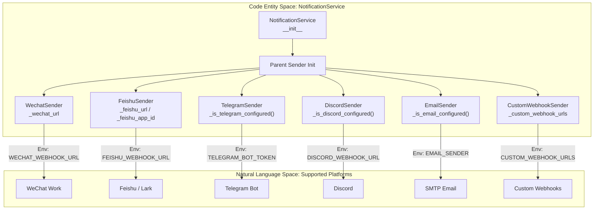
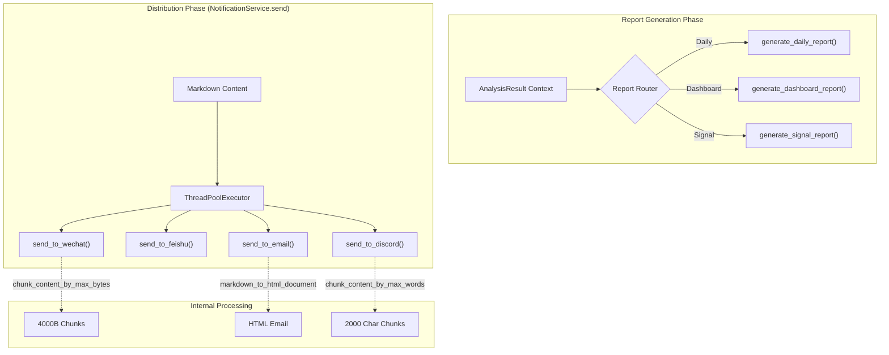

<!-- source: DeepWiki mcp.deepwiki.com · repo ZhuLinsen/daily_stock_analysis · page 8 Notification Channels · fetched 2026-10-29 -->

# Notification Channels

Relevant source files

The following files were used as context for generating this wiki page:

- [.github/workflows/00-daily-analysis.yml](.github/workflows/00-daily-analysis.yml)
- [docs/bot/feishu-bot-config.md](docs/bot/feishu-bot-config.md)
- [docs/notifications.md](docs/notifications.md)
- [src/notification.py](src/notification.py)
- [src/notification_sender/astrbot_sender.py](src/notification_sender/astrbot_sender.py)
- [src/notification_sender/custom_webhook_sender.py](src/notification_sender/custom_webhook_sender.py)
- [src/notification_sender/discord_sender.py](src/notification_sender/discord_sender.py)
- [src/notification_sender/email_sender.py](src/notification_sender/email_sender.py)
- [src/notification_sender/feishu_sender.py](src/notification_sender/feishu_sender.py)
- [src/notification_sender/pushover_sender.py](src/notification_sender/pushover_sender.py)
- [src/notification_sender/pushplus_sender.py](src/notification_sender/pushplus_sender.py)
- [src/notification_sender/serverchan3_sender.py](src/notification_sender/serverchan3_sender.py)
- [src/notification_sender/wechat_sender.py](src/notification_sender/wechat_sender.py)
- [tests/test_notification.py](tests/test_notification.py)
- [tests/test_notification_sender.py](tests/test_notification_sender.py)

This page documents the multi-channel notification distribution system, including supported platforms, report generation formats, delivery modes, and channel-specific handling logic. The notification layer is responsible for formatting analysis results and distributing them to all configured channels concurrently.

For information about the overall system architecture, see [System Architecture](#3). For API service notification triggering, see [Web UI (FastAPI + React)](#6.2). For deployment-specific notification configuration, see [Environment Variables Guide](#7.5).

---

## Overview

The notification system implements a multi-channel routing architecture that supports 10+ platforms. All channels are detected automatically from environment variables and receive notifications concurrently via a `ThreadPoolExecutor` [src/notification.py:2465-2470]().

**Key Components:**

| Component | File | Purpose |
|-----------|------|---------|
| `NotificationService` | [src/notification.py:177-192]() | Main orchestrator for all notification operations, inheriting from 14 specialized sender classes. |
| `NotificationChannel` | [src/notification.py:105-122]() | Enum defining all supported channel types (WECHAT, FEISHU, TELEGRAM, EMAIL, etc.). |
| `ChannelDetector` | [src/notification.py:147-175]() | Maps channel types to localized display names (e.g., `WECHAT` -> "企业微信"). |
| `ChannelAttemptResult` | [src/notification.py:124-133]() | Data class for tracking individual channel success, latency, and diagnostics. |
| Channel Senders | [src/notification_sender/]() | Modular sender classes for each platform (e.g., `FeishuSender`, `EmailSender`). |

Sources: [src/notification.py:105-245](), [docs/notifications.md:5-26]()

---

## Supported Notification Channels

The system supports the following channels, detected automatically from environment variable presence during `NotificationService` initialization [src/notification.py:211-218]().

### Channel Detection Logic
The `NotificationService` initializes by scanning the `Config` singleton for required credentials and initializing parent sender classes [src/notification.py:236-250]().

**Channel Configuration Matrix:**

| Channel | Sender Class | Configuration Key | Format Support |
|---------|--------------|-------------------|----------------|
| **WeChat Work** | `WechatSender` | `WECHAT_WEBHOOK_URL` | Markdown, Text, Image [src/notification_sender/wechat_sender.py:40-72]() |
| **Feishu** | `FeishuSender` | `FEISHU_WEBHOOK_URL` | Webhook Card, App Bot, Cloud Doc [src/notification_sender/feishu_sender.py:88-94]() |
| **Telegram** | `TelegramSender` | `TELEGRAM_BOT_TOKEN` | MarkdownV2, HTML, Image |
| **Discord** | `DiscordSender` | `DISCORD_WEBHOOK_URL` | Markdown (2000 char limit), Bot API [src/notification_sender/discord_sender.py:73-89]() |
| **Email** | `EmailSender` | `EMAIL_SENDER` | HTML (Markdown converted), SMTP Auto-detect [src/notification_sender/email_sender.py:168-181]() |
| **Custom Webhook** | `CustomWebhookSender` | `CUSTOM_WEBHOOK_URLS` | Generic JSON, Bearer Token [src/notification_sender/custom_webhook_sender.py:42-49]() |
| **PushPlus** | `PushplusSender` | `PUSHPLUS_TOKEN` | Markdown (Paginated) [src/notification_sender/pushplus_sender.py:103-112]() |
| **ntfy / Gotify** | `NtfySender` / `GotifySender` | `NTFY_URL` / `GOTIFY_URL` | Push Notifications [docs/notifications.md:15-16]() |

Sources: [src/notification.py:105-122](), [docs/notifications.md:7-22](), [src/notification_sender/email_sender.py:27-48]()

---

## Notification Service Architecture

The distribution pipeline converts generic Markdown reports into platform-specific payloads using specialized sender methods.

Sources: [src/notification.py:2465-2475](), [src/notification_sender/wechat_sender.py:84-87](), [src/notification_sender/email_sender.py:169-181]()

---

## Report Generation Types

The system generates different report formats optimized for various screen sizes and use cases:

- **Daily Report:** Full detailed format with technical analysis, chip structure, and AI reasoning [src/notification.py:402-604]().
- **Dashboard Report:** Structured decision dashboard focusing on Core Metrics and Battle Plans [src/notification.py:673-939]().
- **Brief Report:** Minimalist summary suitable for mobile push notifications [src/notification.py:1019-1082]().
- **Market Review:** Macro-level summary of indices and sector rankings [src/notification.py:1146-1262]().

For details, see [Notification System Overview](#8.1).

---

## Delivery Modes & Features

### Single vs. Batch Mode
The system can send notifications immediately after each stock analysis (`send_to_context`) or aggregate them into a single report (`send`) [src/notification.py:2349-2410]().

### Markdown-to-Image
To bypass character limits or improve readability, specific channels can be configured to convert Markdown to images via `markdown_to_image_channels` [src/notification.py:223-228]().

### Group Routing (Email)
Email notifications support `stock_email_groups`, allowing specific stock analysis to be routed to specific sets of receivers based on stock codes [src/notification_sender/email_sender.py:72-92]().

---

## Format Conversion & Chunking

Because platforms have strict message size limits, the system implements intelligent chunking:

- **WeChat Work:** Chunks at 4000 bytes for Markdown or 2000 bytes for Text [src/notification_sender/wechat_sender.py:78-87]().
- **Discord:** Chunks at 2000 characters with a retry mechanism for HTTP 429 Rate Limits [src/notification_sender/discord_sender.py:94-111]().
- **PushPlus:** Uses a budget-based chunking logic (max_bytes - 1500) to account for JSON overhead [src/notification_sender/pushplus_sender.py:128-148]().
- **Email:** Converts Markdown to full HTML documents using `markdown_to_html_document` [src/notification_sender/email_sender.py:169-172]().

---

## Detailed Channel Documentation

For specific configuration steps and troubleshooting for each channel, refer to the child pages:

- [Notification System Overview](#8.1) — Architecture, report types, and delivery logic.
- [WeChat Work & Feishu](#8.2) — Webhook setup, message chunking, and Cloud Doc integration.
- [Telegram & Discord](#8.3) — Bot API configuration, Markdown support, and threading.
- [Email & Group Routing](#8.4) — SMTP setup and stock-based receiver routing.
- [Custom Webhooks](#8.5) — Generic JSON webhooks, Bearer Token auth, and SSL verification.
- [Other Channels](#8.6) — PushPlus, ServerChan3, Pushover, and AstrBot configuration.

Sources: [src/notification.py:177-245](), [src/notification_sender/email_sender.py:51-115](), [src/notification_sender/discord_sender.py:26-92]()

---

