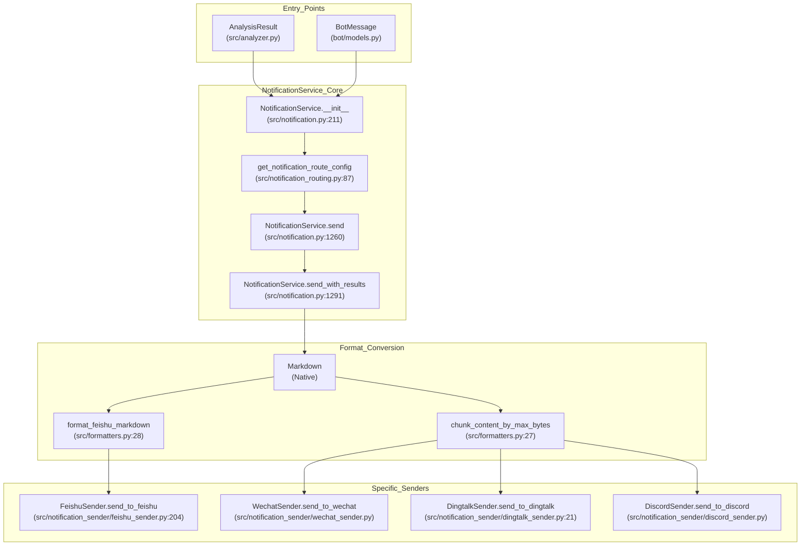
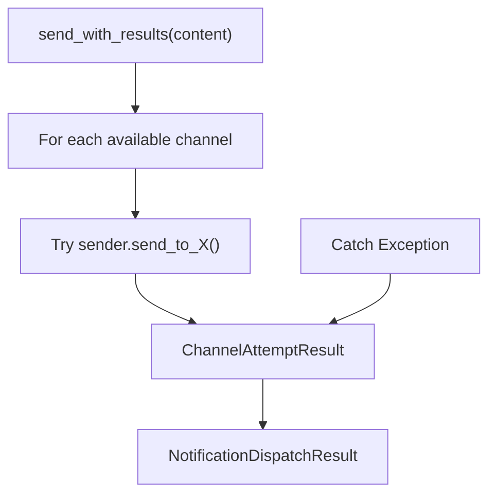

<!-- source: DeepWiki mcp.deepwiki.com · repo ZhuLinsen/daily_stock_analysis · page 8.1 Notification System Overview · fetched 2026-10-29 -->

# Notification System Overview

Relevant source files

The following files were used as context for generating this wiki page:

- [.github/workflows/00-daily-analysis.yml](.github/workflows/00-daily-analysis.yml)
- [docs/bot/feishu-bot-config.md](docs/bot/feishu-bot-config.md)
- [docs/notifications.md](docs/notifications.md)
- [src/notification.py](src/notification.py)
- [src/notification_capabilities.py](src/notification_capabilities.py)
- [src/notification_routing.py](src/notification_routing.py)
- [src/notification_sender/__init__.py](src/notification_sender/__init__.py)
- [src/notification_sender/dingtalk_sender.py](src/notification_sender/dingtalk_sender.py)
- [src/notification_sender/feishu_sender.py](src/notification_sender/feishu_sender.py)
- [tests/test_notification.py](tests/test_notification.py)
- [tests/test_notification_sender.py](tests/test_notification_sender.py)

## Purpose and Scope

This document describes the notification distribution system responsible for delivering analysis reports to multiple channels simultaneously. The system transforms analysis results into channel-specific formats (Markdown, HTML, images) and distributes them concurrently to all configured endpoints. It supports a wide range of platforms including WeChat Work, Feishu, Telegram, Discord, and Email.

For individual channel configuration details, see:
- WeChat Work & Feishu: [8.2]()
- Telegram & Discord: [8.3]()
- Email & Group Routing: [8.4]()
- Custom Webhooks: [8.5]()
- Other Channels: [8.6]()

For the core analysis pipeline, see [4.2](). For configuration management, see [4.6]().

---

## System Architecture

The notification system consists of three primary components: `NotificationService` (orchestrator), `ChannelDetector` (channel identification), and channel-specific handlers inherited from specialized sender classes. The system supports 10+ notification channels with automatic format conversion, routing, and concurrent delivery.

### Core Classes

| Class | Location | Responsibility |
|-------|----------|----------------|
| `NotificationService` | [src/notification.py:177-192]() | Main orchestrator; inherits from 14 specialized sender classes (e.g., `WechatSender`, `TelegramSender`, `FeishuSender`). |
| `ChannelDetector` | [src/notification.py:147-175]() | Static utility for channel type identification and localized naming. |
| `NotificationChannel` | [src/notification.py:105-122]() | Enum defining supported channel types (WECHAT, FEISHU, TELEGRAM, GOTIFY, etc.). |
| `ChannelProfile` | [src/notification_capabilities.py:16-28]() | Static metadata defining rendering capabilities (max bytes, markdown flavor, image support) for each channel. |

### Notification Service Architecture

**Sources:** [src/notification.py:105-192](), [src/notification.py:211-250](), [src/notification_routing.py:13-47](), [src/notification_capabilities.py:75-190](), [src/notification_sender/feishu_sender.py:204-230]()

---

## Report Types and Language

The system generates reports optimized for different delivery contexts, supporting localized names and labels.

### Localization and Formatting
The system uses `src/report_language.py` to normalize and localize report content:
- **Localized Labels**: `get_report_labels` provides localized headers for report sections [src/report_language.py:43]().
- **Signal Normalization**: `get_signal_level` and `localize_operation_advice` convert raw analysis data into human-readable strings [src/report_language.py:44-48]().

### Report Summary Logic
- **Summary Only Mode**: If `REPORT_SUMMARY_ONLY` is set to `True`, the system pushes only a summary/briefing without individual stock details [src/notification.py:231]().
- **LLM Model Display**: Controlled by `REPORT_SHOW_LLM_MODEL`, it toggles the visibility of the AI model used at the bottom of the report [src/notification.py:232]().

**Sources:** [src/notification.py:211-234](), [src/report_language.py:41-51]()

---

## Channel Routing and Noise Control

The system implements advanced routing to ensure different types of notifications (reports, alerts, system errors) reach the appropriate channels.

### Notification Routing
Routing is governed by `src/notification_routing.py`. Channels are categorized into sets such as `ROUTABLE_NOTIFICATION_CHANNELS` [src/notification_routing.py:13-28]().
- **Report Routing**: `NOTIFICATION_REPORT_CHANNELS` [src/notification_routing.py:32-36]().
- **Alert Routing**: `NOTIFICATION_ALERT_CHANNELS` [src/notification_routing.py:37-41]().
- **System Error Routing**: `NOTIFICATION_SYSTEM_ERROR_CHANNELS` [src/notification_routing.py:42-46]().

### Noise Reduction
The system evaluates and records notification "noise" to prevent spamming:
- **Evaluation**: `evaluate_notification_noise` checks if a message should be suppressed [src/notification.py:37]().
- **State Management**: `record_notification_noise` and `release_notification_noise` track the frequency of messages [src/notification.py:38-39]().

**Sources:** [src/notification_routing.py:13-47](), [src/notification.py:35-40]()

---

## Channel Capabilities Matrix

Each channel has a defined profile in `src/notification_capabilities.py` that dictates how messages are prepared.

| Channel | Max Bytes/Chars | Markdown Flavor | Image Support | File Support |
|---------|-----------------|-----------------|---------------|--------------|
| **WeChat** | 4096 bytes | `wechat_markdown` | Yes | No |
| **Feishu** | 20000 bytes | `lark_md` | No (via Card) | Yes |
| **DingTalk**| 20000 bytes | `markdown` | No | No |
| **Telegram**| 4096 chars | `markdown_v2` | Yes | No |
| **Discord** | 2000 chars | `discord_markdown`| No | No |
| **Email** | Unlimited | `html` | Yes | Yes |

**Sources:** [src/notification_capabilities.py:75-190]()

---

## Channel-Specific Implementations

### Feishu (App Bot vs. Webhook)
Feishu supports two distinct modes:
1. **Webhook**: Legacy mode using `FEISHU_WEBHOOK_URL` [src/notification_sender/feishu_sender.py:96]().
2. **App Bot**: Modern mode using `lark-oapi` SDK, requiring `FEISHU_APP_ID`, `FEISHU_APP_SECRET`, and `FEISHU_CHAT_ID` [src/notification_sender/feishu_sender.py:104-106]().
- **File Mode**: `FEISHU_SEND_AS_FILE` allows sending reports as `.md` files via the App Bot [src/notification_sender/feishu_sender.py:100]().

### DingTalk (Security & Chunking)
DingTalk implementation in `DingtalkSender` includes:
- **Signature Security**: Supports `DINGTALK_SECRET` for HMAC-SHA256 signing [src/notification_sender/dingtalk_sender.py:27-38]().
- **Intelligent Chunking**: Uses `chunk_content_by_max_bytes` with a 19,000-byte safety limit to avoid the 20,000-byte API restriction [src/notification_sender/dingtalk_sender.py:45-48]().

### Discord (Rate Limiting)
The `DiscordSender` handles long reports by:
- **Chunking**: Splitting content into 2000-character segments [src/notification_sender/discord_sender.py:141-152]().
- **Retry Logic**: Automatically handles HTTP 429 (Rate Limit) by respecting the `retry_after` header [src/notification_sender/discord_sender.py:154-172]().

**Sources:** [src/notification_sender/feishu_sender.py:84-128](), [src/notification_sender/dingtalk_sender.py:16-48](), [src/notification_sender/discord_sender.py:84-172](), [docs/notifications.md:5-28]()

---

## Delivery and Diagnostics

The `NotificationService.send_with_results` method provides detailed feedback on delivery attempts.

- **ChannelAttemptResult**: Captures success status, error codes, and latency for a single channel [src/notification.py:124-133]().
- **NotificationDispatchResult**: Summarizes the entire dispatch operation across all channels [src/notification.py:136-145]().
- **Exception Isolation**: Failures in one channel (e.g., a timeout in Email) do not prevent delivery to other channels [tests/test_notification.py:178-195]().

**Sources:** [src/notification.py:124-145](), [src/notification.py:1291-1350](), [tests/test_notification.py:178-216]()

---

