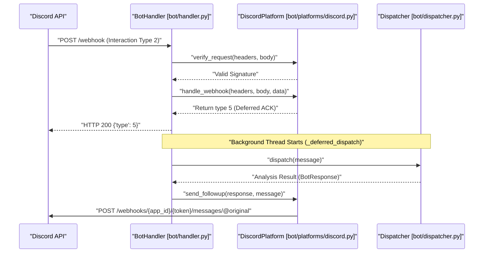
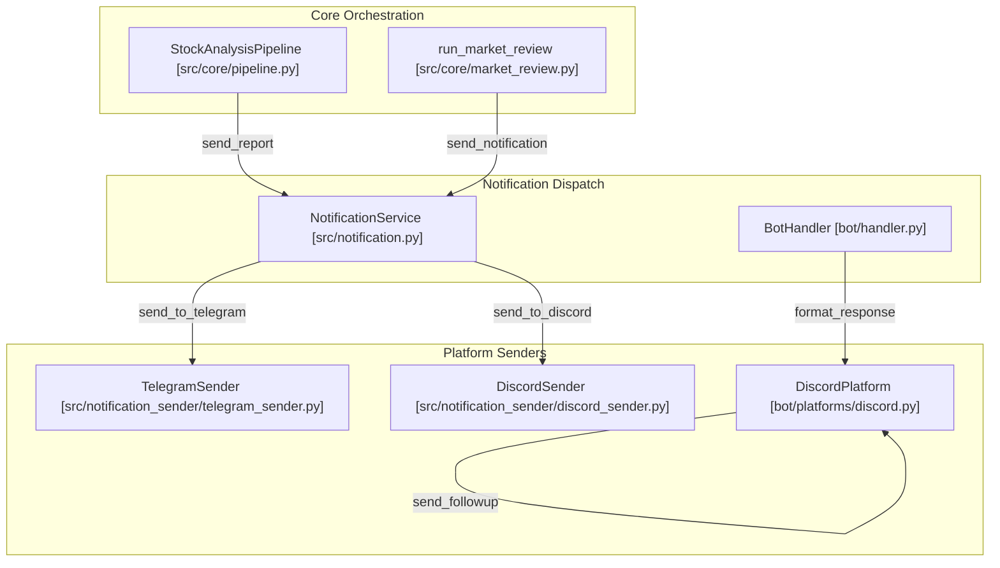

<!-- source: DeepWiki mcp.deepwiki.com · repo ZhuLinsen/daily_stock_analysis · page 8.3 Telegram & Discord · fetched 2026-10-29 -->

# Telegram & Discord

Relevant source files

The following files were used as context for generating this wiki page:

- [bot/handler.py](bot/handler.py)
- [bot/platforms/base.py](bot/platforms/base.py)
- [bot/platforms/discord.py](bot/platforms/discord.py)
- [docs/bot/discord-bot-config.md](docs/bot/discord-bot-config.md)
- [src/notification_sender/astrbot_sender.py](src/notification_sender/astrbot_sender.py)
- [src/notification_sender/custom_webhook_sender.py](src/notification_sender/custom_webhook_sender.py)
- [src/notification_sender/discord_sender.py](src/notification_sender/discord_sender.py)
- [src/notification_sender/email_sender.py](src/notification_sender/email_sender.py)
- [src/notification_sender/pushover_sender.py](src/notification_sender/pushover_sender.py)
- [src/notification_sender/pushplus_sender.py](src/notification_sender/pushplus_sender.py)
- [src/notification_sender/serverchan3_sender.py](src/notification_sender/serverchan3_sender.py)
- [src/notification_sender/wechat_sender.py](src/notification_sender/wechat_sender.py)

This page documents the Telegram and Discord notification channel integrations, covering configuration, message formatting, delivery modes, and implementation details. Both channels support Markdown formatting and provide reliable message delivery with specialized handling for long content and media.

For configuration of other channels, see [WeChat Work & Feishu](#8.2), [Email & Group Routing](#8.4), or [Custom Webhooks](#8.5). For the overall notification architecture, see [Notification System Overview](#8.1).

---

## Channel Overview

Both Telegram and Discord are modern messaging platforms with robust bot APIs. The system treats them as first-class notification channels, managed by `TelegramSender` [src/notification_sender/telegram_sender.py:21-21]() and `DiscordSender` [src/notification_sender/discord_sender.py:26-26](). Inbound command handling for Discord is managed by `DiscordPlatform` [bot/platforms/discord.py:29-29]().

**Key Differences:**

| Feature | Telegram | Discord |
|---------|----------|---------|
| **Setup Complexity** | Moderate (Bot + Chat ID) | Moderate (Bot + Channel ID) |
| **Delivery Modes** | Bot API only | Webhook (simple) or Bot API (advanced) |
| **Markdown Support** | Native (Telegram Markdown) | Native (Discord Markdown) |
| **Message Threading** | Topics (`message_thread_id`) | Channels (built-in) |
| **Character Limit** | 4096 chars [src/notification_sender/telegram_sender.py:71-71]() | 2000 chars [src/notification_sender/discord_sender.py:21-21]() |
| **Verification** | None (Outbound) | Ed25519 Signature (Inbound) [bot/platforms/discord.py:45-58]() |

Sources: [src/notification_sender/telegram_sender.py:21-34](), [bot/platforms/discord.py:29-43](), [src/notification_sender/discord_sender.py:21-21]()

---

## Telegram Configuration

### Bot Setup

Telegram requires a Bot Token and Chat ID. The system supports optional message threading via Topic IDs for group chats using the `message_thread_id` parameter [src/notification_sender/telegram_sender.py:33-33]().

**Configuration Steps:**
1. **Create Bot:** Talk to [@BotFather](https://t.me/BotFather) and send `/newbot`.
2. **Get Bot Token:** Copy the token provided (stored in `TELEGRAM_BOT_TOKEN`).
3. **Get Chat ID:** Send a message to your bot and visit `https://api.telegram.org/bot<TOKEN>/getUpdates` (stored in `TELEGRAM_CHAT_ID`).
4. **Optional Topic ID:** For groups with topics, copy the thread ID from the topic URL (stored in `TELEGRAM_MESSAGE_THREAD_ID`).

Sources: [src/notification_sender/telegram_sender.py:30-34]()

### Implementation Details

The `TelegramSender` handles delivery with robust error recovery:
- **Chunking:** Messages exceeding 4096 characters are split into segments [src/notification_sender/telegram_sender.py:71-78]().
- **Retries:** Implements exponential backoff (2s, 4s) for connection errors [src/notification_sender/telegram_sender.py:102-111]().
- **Rate Limiting:** Respects the `Retry-After` header when receiving HTTP 429 [src/notification_sender/telegram_sender.py:131-137]().
- **Graceful Fallback:** If Markdown parsing fails (e.g., "can't parse entities"), it automatically retries as plain text [src/notification_sender/telegram_sender.py:126-128]().

Sources: [src/notification_sender/telegram_sender.py:86-156]()

---

## Discord Configuration

### Integration Modes

Discord offers two integration modes:
1. **Webhook Mode (Outbound Only):** Simple POST request to Discord's webhook endpoint. This is the preferred method for simple notifications [src/notification_sender/discord_sender.py:74-80]().
2. **Bot API Mode (Inbound/Outbound):** Requires `DISCORD_BOT_TOKEN` and `DISCORD_MAIN_CHANNEL_ID`. This mode supports Slash Commands like `/analyze` and `/market_review` [docs/bot/discord-bot-config.md:72-89]().

### Security & Webhooks

When using Discord as an inbound bot (receiving commands), the system implements mandatory signature verification in `DiscordPlatform.verify_request` [bot/platforms/discord.py:45-45]():
- **Signature Algorithm:** Ed25519 using the `X-Signature-Ed25519` and `X-Signature-Timestamp` headers [bot/platforms/discord.py:48-50]().
- **Public Key:** Configured via `DISCORD_INTERACTIONS_PUBLIC_KEY` [bot/platforms/discord.py:36-38]().
- **Replay Protection:** Rejects requests where the timestamp is older than 5 minutes (300 seconds) [bot/platforms/discord.py:85-91]().

### Interaction Lifecycle

Discord requires an initial response within 3 seconds. The system uses a deferred acknowledgement pattern:
1. **Immediate ACK:** `DiscordPlatform.handle_webhook` returns a `type 5` (DEFERRED_CHANNEL_MESSAGE_WITH_SOURCE) response for slash commands (type 2) [bot/platforms/discord.py:129-134]().
2. **Background Processing:** The `BotHandler` dispatches the command to a background thread [bot/handler.py:108-117]().
3. **Follow-up:** Once analysis is complete, results are delivered via `DiscordPlatform.send_followup` using the interaction token [bot/platforms/discord.py:224-224]().

**Discord Interaction Flow Diagram**

Sources: [bot/platforms/discord.py:120-136](), [bot/handler.py:105-118](), [docs/bot/discord-bot-config.md:52-61]()

---

## Message Processing & Delivery

### Content Chunking

Both platforms have strict limits on message size:
- **Telegram:** Splits at 4096 characters [src/notification_sender/telegram_sender.py:71-71]().
- **Discord:** Default limit is 2000 characters [src/notification_sender/discord_sender.py:21-21](). `DiscordSender._split_discord_content` uses `chunk_content_by_max_words` to ensure messages fit within limits while adding page markers for multi-part reports [src/notification_sender/discord_sender.py:94-111]().

### Markdown Support

The system converts standard Markdown to platform-specific variants:
- **Telegram:** Uses `_convert_to_telegram_markdown` to escape reserved characters and handle nested formatting [src/notification_sender/telegram_sender.py:89-89]().
- **Discord:** Supports standard Discord Markdown natively in the `content` payload [bot/platforms/discord.py:207-213]().

### Data Flow & Entity Mapping

The following diagram associates the notification data flow with the specific code entities responsible for Telegram and Discord delivery.

**Notification Entity Mapping**

Sources: [src/notification_sender/discord_sender.py:60-69](), [src/notification_sender/telegram_sender.py:40-40](), [bot/handler.py:133-134](), [bot/platforms/discord.py:29-29]()

---

## Environment Variables Reference

| Variable | Channel | Description |
|----------|---------|-------------|
| `TELEGRAM_BOT_TOKEN` | Telegram | Bot API Token from @BotFather |
| `TELEGRAM_CHAT_ID` | Telegram | Target user or group ID |
| `TELEGRAM_MESSAGE_THREAD_ID` | Telegram | Optional: Topic ID for group threads |
| `DISCORD_BOT_TOKEN` | Discord | Token for Bot API mode |
| `DISCORD_MAIN_CHANNEL_ID` | Discord | Default channel for Bot API notifications |
| `DISCORD_WEBHOOK_URL` | Discord | Webhook URL for simple outbound mode |
| `DISCORD_INTERACTIONS_PUBLIC_KEY` | Discord | Ed25519 Public Key for verifying commands |
| `DISCORD_MAX_WORDS` | Discord | Max character length for Discord messages (default 2000) |

Sources: [docs/bot/discord-bot-config.md:52-61](), [src/notification_sender/discord_sender.py:35-42]()

---

