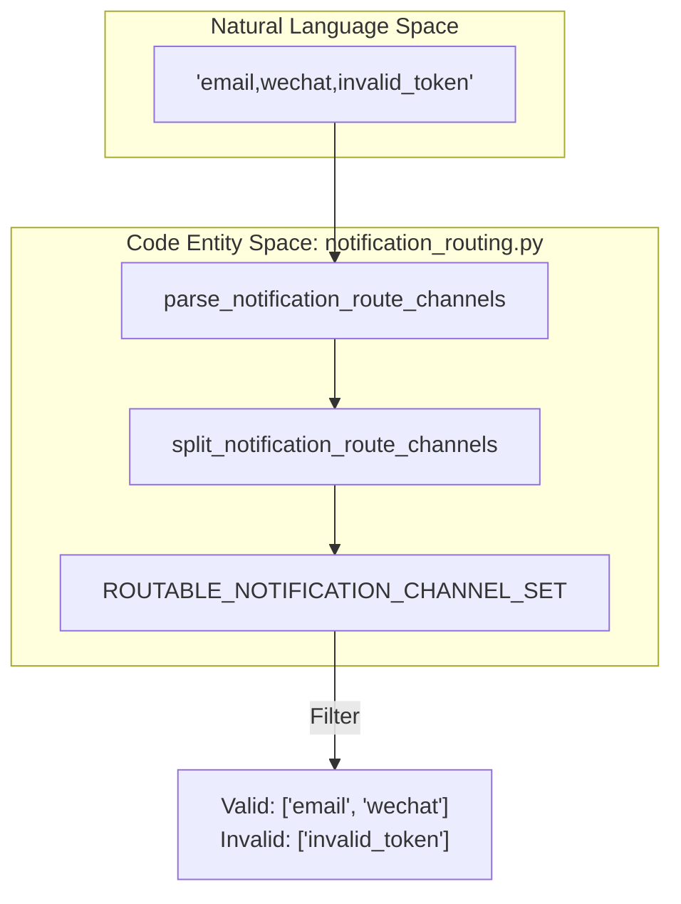
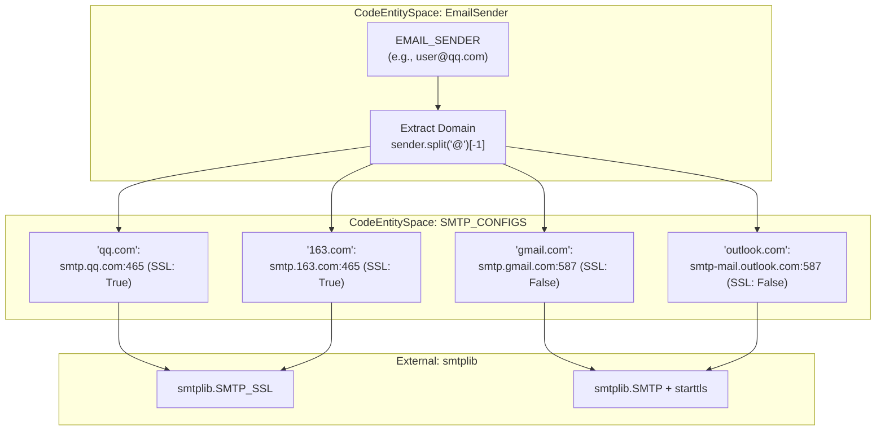

<!-- source: DeepWiki mcp.deepwiki.com · repo ZhuLinsen/daily_stock_analysis · page 8.4 Email & Group Routing · fetched 2026-10-29 -->

# Email & Group Routing

Relevant source files

The following files were used as context for generating this wiki page:

- [src/notification_routing.py](src/notification_routing.py)
- [src/notification_sender/__init__.py](src/notification_sender/__init__.py)
- [src/notification_sender/astrbot_sender.py](src/notification_sender/astrbot_sender.py)
- [src/notification_sender/custom_webhook_sender.py](src/notification_sender/custom_webhook_sender.py)
- [src/notification_sender/discord_sender.py](src/notification_sender/discord_sender.py)
- [src/notification_sender/email_sender.py](src/notification_sender/email_sender.py)
- [src/notification_sender/pushover_sender.py](src/notification_sender/pushover_sender.py)
- [src/notification_sender/pushplus_sender.py](src/notification_sender/pushplus_sender.py)
- [src/notification_sender/serverchan3_sender.py](src/notification_sender/serverchan3_sender.py)
- [src/notification_sender/wechat_sender.py](src/notification_sender/wechat_sender.py)

## Purpose and Scope

This page documents the email notification system and the advanced notification routing logic. It covers SMTP auto-detection, HTML report conversion from Markdown, and the advanced stock-to-email group routing feature. Additionally, it details the routing mechanism that allows different types of notifications (reports, alerts, system errors) to be directed to specific sets of channels.

The system is designed for high reliability with best-effort SMTP cleanup [src/notification_sender/email_sender.py:118-132]() and automatic provider detection [src/notification_sender/email_sender.py:26-48]().

---

## Configuration Overview

Email notifications and group routing require configuration of both SMTP credentials and routing rules. The system supports basic delivery and advanced multi-recipient scenarios.

### Basic Email Configuration

The simplest email setup requires two environment variables:

| Variable | Description | Required |
|----------|-------------|:--------:|
| `EMAIL_SENDER` | Sender email address (e.g., `your_email@qq.com`) [src/notification_sender/email_sender.py:61]() | ✅ |
| `EMAIL_PASSWORD` | Email authorization code (not login password) [src/notification_sender/email_sender.py:63]() | ✅ |
| `EMAIL_RECEIVERS` | Comma-separated list of recipients (defaults to sender if empty) [src/notification_sender/email_sender.py:64]() | Optional |
| `EMAIL_SENDER_NAME` | Display name for sender (defaults to `"daily_stock_analysis股票分析助手"`) [src/notification_sender/email_sender.py:62]() | Optional |

**Sources:** [src/notification_sender/email_sender.py:53-65]()

### Stock-to-Email Group Routing

This feature routes analysis reports for specific stocks to designated email addresses. Each group maps a set of stock codes to a set of email recipients.

| Variable Pattern | Description |
|-----------------|-------------|
| `STOCK_GROUP_N` | Comma-separated stock codes for group N |
| `EMAIL_GROUP_N` | Comma-separated emails for group N |

**Rules:**
- N must be a positive integer (1, 2, 3, ...) [src/notification_sender/email_sender.py:66]().
- Market review reports are sent to **all configured email addresses** (union of all groups + default receivers) via `get_all_email_receivers()` [src/notification_sender/email_sender.py:94-110]().
- If a stock doesn't match any group, it uses the default `EMAIL_RECEIVERS` [src/notification_sender/email_sender.py:92]().
- Stock codes are canonicalized via `normalize_stock_code` before comparison [src/notification_sender/email_sender.py:81]().

**Sources:** [src/notification_sender/email_sender.py:66-92](), [src/notification_sender/email_sender.py:94-110]()

---

## Notification Routing System

The `notification_routing.py` module provides helpers to route different message types to specific channels.

### Routable Channels and Types

The system defines a set of `ROUTABLE_NOTIFICATION_CHANNELS` including `wechat`, `dingtalk`, `feishu`, `telegram`, `email`, `discord`, and others [src/notification_routing.py:13-28](). 

Notifications are categorized into three routes [src/notification_routing.py:31-47]():
1.  **`report`**: Routes stock, daily, and market-review reports.
2.  **`alert`**: Routes event-driven alert notifications.
3.  **`system_error`**: Routes system-level error notifications.

### Routing Logic Diagram

**Sources:** [src/notification_routing.py:13-84]()

---

## SMTP Auto-Detection

The `EmailSender` class contains a `SMTP_CONFIGS` dictionary that maps email domains to their respective SMTP servers, ports, and SSL requirements [src/notification_sender/email_sender.py:26-48]().

### Email Provider Configuration Diagram

**Sources:** [src/notification_sender/email_sender.py:26-48](), [src/notification_sender/email_sender.py:184-192]()

---

## Email Format & Delivery

### Format Conversion
Emails are sent as `MIMEMultipart('alternative')` [src/notification_sender/email_sender.py:172](). The system converts Markdown to HTML using `markdown_to_html_document` [src/notification_sender/email_sender.py:169](). Both `text/plain` and `text/html` parts are attached to ensure compatibility [src/notification_sender/email_sender.py:178-181]().

### Delivery Workflow
1.  **Validation**: Checks credentials via `_is_email_configured()` [src/notification_sender/email_sender.py:153-155]().
2.  **Encoding**: Encodes sender display names safely via `_format_sender_address` [src/notification_sender/email_sender.py:112-116]().
3.  **Connection**: Uses `smtplib.SMTP_SSL` for SSL ports (465) or `smtplib.SMTP` with `starttls()` for TLS ports (587) [src/notification_sender/email_sender.py:195-212]().
4.  **Cleanup**: Employs `_close_server` for best-effort socket cleanup [src/notification_sender/email_sender.py:118-132]().

**Sources:** [src/notification_sender/email_sender.py:112-220]()

---

## Implementation Details

### Key Entities

| Entity | Location | Responsibility |
|--------|----------|----------------|
| `EmailSender` | [src/notification_sender/email_sender.py:51]() | SMTP configuration, group routing, and transmission. |
| `SMTP_CONFIGS` | [src/notification_sender/email_sender.py:27]() | Dictionary of known email provider SMTP settings. |
| `NOTIFICATION_ROUTE_CONFIGS` | [src/notification_routing.py:31]() | Metadata for routing reports, alerts, and errors. |
| `split_notification_route_channels` | [src/notification_routing.py:69]() | Validates and splits channel tokens for routing. |

**Sources:** [src/notification_sender/email_sender.py:27-51](), [src/notification_routing.py:31-69]()

---

