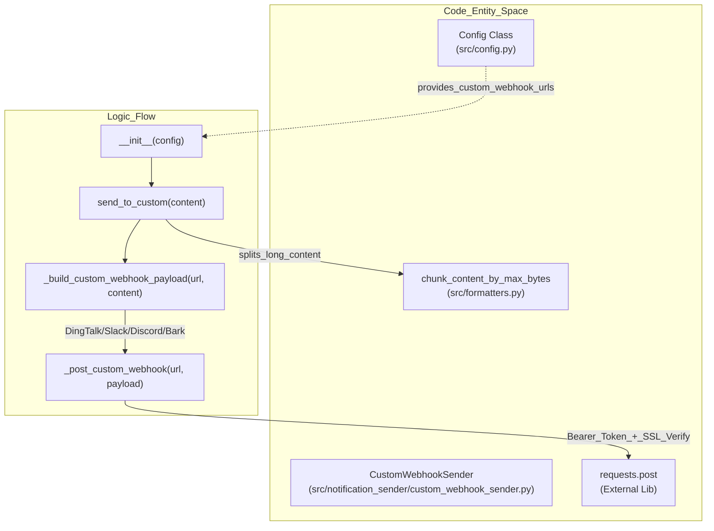
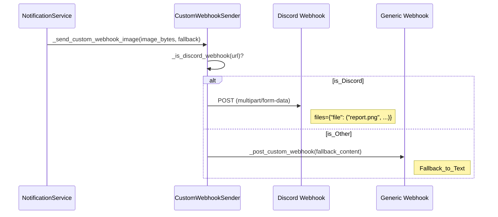

<!-- source: DeepWiki mcp.deepwiki.com · repo ZhuLinsen/daily_stock_analysis · page 8.5 Custom Webhooks · fetched 2026-10-29 -->

# Custom Webhooks

Relevant source files

The following files were used as context for generating this wiki page:

- [src/notification_capabilities.py](src/notification_capabilities.py)
- [src/notification_sender/astrbot_sender.py](src/notification_sender/astrbot_sender.py)
- [src/notification_sender/custom_webhook_sender.py](src/notification_sender/custom_webhook_sender.py)
- [src/notification_sender/dingtalk_sender.py](src/notification_sender/dingtalk_sender.py)
- [src/notification_sender/discord_sender.py](src/notification_sender/discord_sender.py)
- [src/notification_sender/email_sender.py](src/notification_sender/email_sender.py)
- [src/notification_sender/pushover_sender.py](src/notification_sender/pushover_sender.py)
- [src/notification_sender/pushplus_sender.py](src/notification_sender/pushplus_sender.py)
- [src/notification_sender/serverchan3_sender.py](src/notification_sender/serverchan3_sender.py)
- [src/notification_sender/wechat_sender.py](src/notification_sender/wechat_sender.py)

## Purpose and Scope

This page documents the custom webhook notification channel, implemented via the `CustomWebhookSender` class [src/notification_sender/custom_webhook_sender.py:23-26](). This component provides a flexible integration point for any HTTP-based notification service, supporting multiple concurrent URLs, automatic service format detection (DingTalk, Slack, Discord, Bark), Bearer Token authentication, and SSL verification control.

The system treats custom webhooks as a first-class notification channel alongside native integrations like WeChat Work and Feishu, allowing users to extend notifications to unsupported platforms [src/notification_capabilities.py:153-160]().

---

## Architecture and Data Flow

The custom webhook system is designed for maximum compatibility with third-party services while maintaining security and reliability. The `NotificationService` orchestrates delivery by identifying the custom channel and delegating to `CustomWebhookSender`.

### System Entity Mapping

The following diagram bridges the conceptual notification flow to the specific code entities responsible for custom webhook delivery.

**Diagram: Custom Webhook Code Entity Map**

**Sources:** [src/notification_sender/custom_webhook_sender.py:25-36](), [src/notification_sender/custom_webhook_sender.py:149-163]()

---

## Implementation Details

### Format Auto-Detection Logic

The `CustomWebhookSender` inspects the webhook URL and automatically selects the appropriate JSON payload format or uses a template if provided [src/notification_sender/custom_webhook_sender.py:63-95]().

| Target Service | Detection Mechanism | Payload Structure |
| :--- | :--- | :--- |
| **DingTalk** | `_is_dingtalk_webhook(url)` | `{"msgtype": "markdown", "markdown": {"title": "...", "text": "..."}}` |
| **Discord** | `_is_discord_webhook(url)` | `{"content": "..."}` |
| **Slack** | `_is_slack_webhook(url)` | `{"text": "...", "mrkdwn": true}` |
| **Bark** | `_is_bark_webhook(url)` | `{"title": "...", "body": "...", "group": "stock"}` |
| **Generic** | Fallback | `{"text": "...", "content": "...", "message": "...", "body": "..."}` |

**Sources:** [src/notification_sender/custom_webhook_sender.py:192-233]()

### Chunking and Payload Constraints

For services with strict size limits, the sender utilizes `chunk_content_by_max_bytes` [src/notification_sender/custom_webhook_sender.py:17-18]().

- **DingTalk**: Specifically detected and processed through `_send_dingtalk_chunked` with a 20,000-byte limit to prevent API rejection [src/notification_sender/custom_webhook_sender.py:71-87]().
- **Discord**: Content is automatically truncated or split to adhere to Discord's character limits [src/notification_sender/discord_sender.py:21-23]().
- **General Chunking**: Uses `chunk_content_by_max_bytes` to split content into manageable segments while preserving Markdown structure [src/notification_sender/custom_webhook_sender.py:17-18]().

---

## Configuration

### Environment Variables

| Variable | Type | Default | Description |
| :--- | :--- | :--- | :--- |
| `CUSTOM_WEBHOOK_URLS` | `List[str]` | `[]` | Comma-separated list of webhook URLs [src/notification_sender/custom_webhook_sender.py:32](). |
| `CUSTOM_WEBHOOK_BEARER_TOKEN` | `str` | `None` | Optional Bearer token for the `Authorization` header [src/notification_sender/custom_webhook_sender.py:33](). |
| `CUSTOM_WEBHOOK_BODY_TEMPLATE` | `str` | `None` | Optional string template for custom JSON body [src/notification_sender/custom_webhook_sender.py:34](). |
| `WEBHOOK_VERIFY_SSL` | `bool` | `True` | Whether to verify SSL certificates for requests [src/notification_sender/custom_webhook_sender.py:35](). |

**Sources:** [src/notification_sender/custom_webhook_sender.py:32-35]()

### Authentication and SSL

The `_post_custom_webhook` method handles the low-level HTTP request:
1. **Headers**: Sets `Content-Type: application/json; charset=utf-8` and a custom `User-Agent: StockAnalysis/1.0` [src/notification_sender/custom_webhook_sender.py:150-153]().
2. **Bearer Token**: If `custom_webhook_bearer_token` is configured, it adds `Authorization: Bearer <token>` [src/notification_sender/custom_webhook_sender.py:155-156]().
3. **SSL Verification**: Uses the `verify` parameter in `requests.post` based on the `webhook_verify_ssl` config [src/notification_sender/custom_webhook_sender.py:158]().

---

## Image Support

The system supports sending images to custom webhooks, specifically optimized for Discord which supports file attachments via `multipart/form-data` [src/notification_sender/custom_webhook_sender.py:113-125]().

**Diagram: Webhook Image Delivery Pipeline**

**Sources:** [src/notification_sender/custom_webhook_sender.py:104-147]()

---

## Troubleshooting and Testing

### Testing Interface

The `CustomWebhookSender` includes a `test_custom_webhooks` method that allows the Web UI or CLI to verify connectivity to each configured URL [src/notification_sender/custom_webhook_sender.py:165-177]().

### Common Failure Points

1. **SSL Errors**: If using internal webhooks with self-signed certs, `WEBHOOK_VERIFY_SSL=false` must be set [src/notification_sender/custom_webhook_sender.py:35]().
2. **Rate Limiting**: Services like DingTalk have strict limits. The sender logs `HTTP 429` or error codes if these are hit [src/notification_sender/dingtalk_sender.py:73-77]().
3. **Token Mismatch**: Ensure `CUSTOM_WEBHOOK_BEARER_TOKEN` does not include the "Bearer " prefix, as the code adds it automatically [src/notification_sender/custom_webhook_sender.py:156]().

**Sources:** [src/notification_sender/custom_webhook_sender.py:158-163](), [src/notification_sender/dingtalk_sender.py:73-80]()

---

