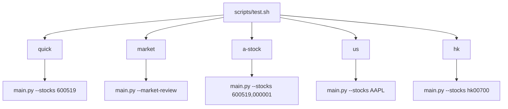
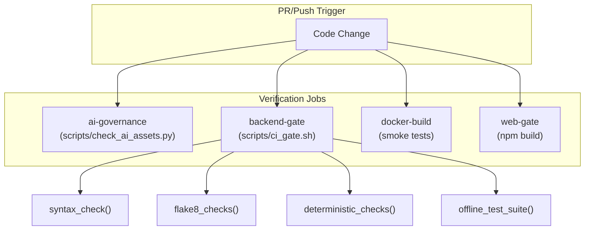

<!-- source: DeepWiki mcp.deepwiki.com · repo ZhuLinsen/daily_stock_analysis · page 9 Development & Contributing · fetched 2026-10-29 -->

# Development & Contributing

<details>
<summary>Relevant source files</summary>

The following files were used as context for generating this wiki page:

- [.claude/skills/analyze-issue/SKILL.md](.claude/skills/analyze-issue/SKILL.md)
- [.claude/skills/analyze-pr/SKILL.md](.claude/skills/analyze-pr/SKILL.md)
- [.claude/skills/fix-issue/SKILL.md](.claude/skills/fix-issue/SKILL.md)
- [.github/PULL_REQUEST_TEMPLATE.md](.github/PULL_REQUEST_TEMPLATE.md)
- [.github/copilot-instructions.md](.github/copilot-instructions.md)
- [.github/instructions/governance.instructions.md](.github/instructions/governance.instructions.md)
- [.github/workflows/auto-tag.yml](.github/workflows/auto-tag.yml)
- [.github/workflows/docker-publish.yml](.github/workflows/docker-publish.yml)
- [.github/workflows/ghcr-dockerhub.yml](.github/workflows/ghcr-dockerhub.yml)
- [.github/workflows/network-smoke.yml](.github/workflows/network-smoke.yml)
- [AGENTS.md](AGENTS.md)
- [docs/CONTRIBUTING.md](docs/CONTRIBUTING.md)
- [docs/CONTRIBUTING_EN.md](docs/CONTRIBUTING_EN.md)
- [scripts/ci_gate.sh](scripts/ci_gate.sh)
- [setup.cfg](setup.cfg)

</details>


This page provides comprehensive guidelines for developers contributing to the A-share/HK/US intelligent stock analysis system. It covers the development workflow, testing framework, CI/CD pipeline, and code quality standards.

For deployment instructions, see page 7. For architecture overview, see page 3. For API reference, see page 10.4.

---

## Overview

The project follows a structured development process with automated quality checks, comprehensive testing, and multi-stage CI/CD pipelines. All contributions undergo automated review and validation before human review.

**Contribution Areas:**

| Area | Files | Key Classes/Functions |
|------|-------|---------------------|
| **Data Providers** | `data_provider/` | `BaseFetcher`, `DataFetcherManager` |
| **AI Analysis** | `src/analyzer.py`, `src/core/` | `GeminiAnalyzer`, `StockAnalysisPipeline` |
| **Notifications** | `src/notification.py` | `NotificationService` |
| **Configuration** | `src/config.py` | `Config` singleton |
| **Search Intelligence** | `src/search_service.py` | `SearchService` |
| **Web Interface** | `apps/dsa-web/` | FastAPI backend + React frontend |
| **Desktop App** | `apps/dsa-desktop/` | Electron shell |
| **CI/CD** | `.github/workflows/` | GitHub Actions workflows |

Sources: [AGENTS.md:58-80](), [AGENTS.md:163-202]()

---

## Development Workflow

For details, see [Development Workflow](#9.1).

### Environment Setup

**Prerequisites:**
- Python 3.11 or higher (3.11 is the CI baseline [AGENTS.md:101]())
- Node.js (for Web and Desktop development [AGENTS.md:108-119]())

**Initial Setup:**

```bash
# 1. Clone and setup venv
git clone https://github.com/ZhuLinsen/daily_stock_analysis.git
cd daily_stock_analysis
python -m venv venv
source venv/bin/activate

# 2. Install dependencies
pip install -r requirements.txt
pip install flake8 pytest

# 3. Configure environment
cp .env.example .env
```

Sources: [docs/CONTRIBUTING.md:19-36](), [AGENTS.md:100-102]()

### Branching & Commit Strategy

The project uses semantic versioning triggered by commit message tokens in the `main` branch.

| Token | Version Bump | Purpose |
|-------|--------------|---------|
| `#major` | v2.1.0 -> v3.0.0 | Breaking changes |
| `#minor` | v2.1.0 -> v2.2.0 | New features |
| `#patch` | v2.1.0 -> v2.1.1 | Bug fixes (Default) |

Sources: [.github/workflows/auto-tag.yml:19-43](), [docs/CONTRIBUTING.md:46-67]()

---

## Testing Framework

For details, see [Testing Framework](#9.2).

### Local Validation Matrix

Developers must run validation scripts based on the area of modification as defined in the "Verification Matrix" [AGENTS.md:146-202]().

**Validation Commands:**

| Area | Primary Command | Source |
|------|-----------------|--------|
| **Backend** | `./scripts/ci_gate.sh` | [scripts/ci_gate.sh:1-35]() |
| **Syntax Only** | `python -m py_compile <files>` | [AGENTS.md:105]() |
| **Offline Tests** | `pytest -m "not network"` | [AGENTS.md:104]() |
| **Web UI** | `npm run lint && npm run build` | [AGENTS.md:113-114]() |
| **AI Governance** | `python scripts/check_ai_assets.py` | [AGENTS.md:55]() |

### test.sh Scenarios

The `test.sh` script provides high-level smoke tests for different market segments.

Title: "Mapping Test Scenarios to CLI Arguments"


Sources: [AGENTS.md:87-92](), [docs/CONTRIBUTING.md:84]()

---

## CI/CD Pipeline

For details, see [CI/CD Pipeline](#9.3).

The system employs a rigorous GitHub Actions pipeline to ensure stability before merging PRs or publishing Docker images.

Title: "CI Pipeline Gate Logic"


**Key Components:**
- **AI Governance**: Validates consistency between `AGENTS.md`, `CLAUDE.md`, and AI instructions [AGENTS.md:154]().
- **Backend Gate**: Executes syntax checks, critical Flake8 rules (E9, F63, F7, F82), and offline pytest suites [scripts/ci_gate.sh:1-35]().
- **Docker Smoke**: Builds the image and verifies core imports like `src.config`, `src.storage`, and `data_provider` [.github/workflows/docker-publish.yml:130-140]().

Sources: [AGENTS.md:148-159](), [.github/workflows/docker-publish.yml:63-64]()

---

## Code Standards

For details, see [Code Standards](#9.4).

### Core Principles (AGENTS.md)

The project adheres to the rules defined in `AGENTS.md`, which serves as the single source of truth for AI and human collaboration.

1. **Stability First**: Stability is prioritized over "convenience refactoring" [AGENTS.md:18]().
2. **Directory Boundaries**: Respect existing module boundaries (e.g., `data_provider/` for fetchers, `src/` for core logic) [AGENTS.md:9-13]().
3. **No Hardcoding**: Never hardcode secrets, ports, or model names [AGENTS.md:16]().
4. **Documentation Sync**: Any user-visible change must update `docs/CHANGELOG.md` using the flat format in the `[Unreleased]` section [AGENTS.md:20-23]().

### PR Quality Bottom Line

Contributors must provide "Visual Evidence" (screenshots) for any UI or report formatting changes [.github/PULL_REQUEST_TEMPLATE.md:81-110](). If a PR modifies the `EXTRACT_PROMPT` for image processing, the full prompt must be pasted into the PR description [.github/PULL_REQUEST_TEMPLATE.md:137-149]().

Sources: [AGENTS.md:7-43](), [.github/copilot-instructions.md:1-23](), [.github/PULL_REQUEST_TEMPLATE.md:1-160]()

---

