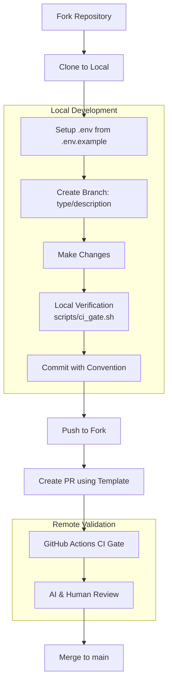
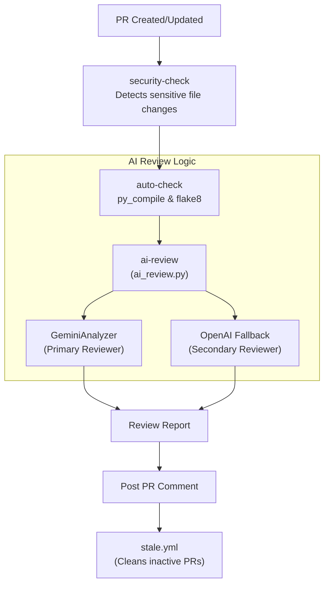

<!-- source: DeepWiki mcp.deepwiki.com · repo ZhuLinsen/daily_stock_analysis · page 9.1 Development Workflow · fetched 2026-10-29 -->

# Development Workflow

Relevant source files

The following files were used as context for generating this wiki page:

- [.claude/skills/analyze-issue/SKILL.md](.claude/skills/analyze-issue/SKILL.md)
- [.claude/skills/analyze-pr/SKILL.md](.claude/skills/analyze-pr/SKILL.md)
- [.claude/skills/fix-issue/SKILL.md](.claude/skills/fix-issue/SKILL.md)
- [.github/PULL_REQUEST_TEMPLATE.md](.github/PULL_REQUEST_TEMPLATE.md)
- [.github/copilot-instructions.md](.github/copilot-instructions.md)
- [.github/instructions/governance.instructions.md](.github/instructions/governance.instructions.md)
- [.github/scripts/ai_review.py](.github/scripts/ai_review.py)
- [.github/workflows/pr-review.yml](.github/workflows/pr-review.yml)
- [.github/workflows/stale.yml](.github/workflows/stale.yml)
- [.gitignore](.gitignore)
- [AGENTS.md](AGENTS.md)
- [data_provider/__init__.py](data_provider/__init__.py)

This document describes the standardized development workflow for the `daily_stock_analysis` project. It covers the branching strategy, commit conventions, pull request (PR) process, and the automated AI-driven review pipeline.

The project prioritizes stability and consistency, governed by the rules defined in `AGENTS.md`, which serves as the single source of truth for repository collaboration [AGENTS.md:7-43]().

---

## Git Workflow Overview

The project follows a **fork-and-branch** workflow. All changes must be submitted via Pull Requests and pass automated CI gates before being merged into the `main` branch.

### Contribution Process Flow

**Sources:** [AGENTS.md:129-145](), [.github/PULL_REQUEST_TEMPLATE.md:1-160]()

---

## Branching and Commit Conventions

### Branch Naming
Branches should use prefixes to indicate the nature of the change [AGENTS.md:31-31]():
*   `feat/`: New features (e.g., `feat/add-telegram-bot`)
*   `fix/`: Bug fixes (e.g., `fix/akshare-timeout`)
*   `refactor/`: Code restructuring without functional changes
*   `docs/`: Documentation updates
*   `chore/`: Maintenance tasks or dependency updates
*   `test/`: Testing related changes

### Commit Messages
The project adheres to standardized commit formats. Messages must be in English and exclude `Co-Authored-By` trailers [AGENTS.md:15-15]().

**Format:** `<type>: <description>`
**Example:** `feat: add fallback mechanism for efinance fetcher` [AGENTS.md:31-31]()

**Sources:** [AGENTS.md:15-15](), [AGENTS.md:31-33]()

---

## Pull Request Process

All PRs must use the provided template at [.github/PULL_REQUEST_TEMPLATE.md](). This template ensures that the AI reviewer and maintainers have the necessary context to evaluate the change.

### PR Template Requirements
| Section | Description |
| :--- | :--- |
| **PR Type** | Categorization (fix, feat, refactor, docs, chore, test) [.github/PULL_REQUEST_TEMPLATE.md:6-13]() |
| **Background** | Problem description and impact scope [.github/PULL_REQUEST_TEMPLATE.md:15-19]() |
| **Scope of Change** | List of modified modules and files [.github/PULL_REQUEST_TEMPLATE.md:20-24]() |
| **Verification** | Actual commands run and results (e.g., `./scripts/ci_gate.sh`) [.github/PULL_REQUEST_TEMPLATE.md:48-57]() |
| **Visual Evidence** | Required for Web UI or Report changes (screenshots or Playwright paths) [.github/PULL_REQUEST_TEMPLATE.md:81-110]() |
| **Compatibility** | Impact on API/Web/Desktop and configuration migration [.github/PULL_REQUEST_TEMPLATE.md:111-128]() |
| **Rollback Plan** | Mandatory actionable step to revert changes [.github/PULL_REQUEST_TEMPLATE.md:129-136]() |

### High-Risk Areas
Changes in the following areas require extra scrutiny and explicit verification in the PR description [AGENTS.md:203-219]():
*   **Configuration Semantics**: Changes to `.env` or `Config` singleton.
*   **API/Schema**: Modifications to `src/schemas/` or `api/` endpoints.
*   **Data Source Fallback**: Logic within `data_provider/` priority and circuit breakers.
*   **Notification Templates**: Changes to report structures or prompt logic.

**Sources:** [.github/PULL_REQUEST_TEMPLATE.md:1-160](), [AGENTS.md:203-219]()

---

## Automated Review Pipeline

The repository utilizes a sophisticated GitHub Actions workflow to perform static analysis and AI-powered semantic reviews.

### PR Review Architecture

### Review Criteria
The AI reviewer evaluates PRs against the rules defined in `AGENTS.md` and `ai_review.py` [AGENTS.md:148-162](), [.github/scripts/ai_review.py:133-154]():
1.  **Necessity**: Does the PR have a clear motivation? [.github/scripts/ai_review.py:134-134]()
2.  **Traceability**: Is there an associated Issue link? [.github/scripts/ai_review.py:135-135]()
3.  **Type Match**: Does the PR title match the actual change content? [.github/scripts/ai_review.py:136-136]()
4.  **Compatibility**: Does it break Web, Desktop, or API compatibility? [.github/scripts/ai_review.py:142-143]()
5.  **Rollback Plan**: Is there a clear recovery path? [.github/scripts/ai_review.py:146-146]()
6.  **Documentation**: Are `docs/CHANGELOG.md` updated using the flat format in `[Unreleased]`? [AGENTS.md:23-23]()

**Sources:** [AGENTS.md:148-162](), [.github/scripts/ai_review.py:111-169](), [.github/workflows/pr-review.yml:1-190]()

---

## Local Verification Matrix

Developers must execute the appropriate verification suite based on the modified files [AGENTS.md:163-202]().

| Change Area | Primary Verification Command |
| :--- | :--- |
| **Python Backend** | `./scripts/ci_gate.sh` or `python -m py_compile <files>` [AGENTS.md:165-170]() |
| **Web Frontend** | `cd apps/dsa-web && npm run lint && npm run build` [AGENTS.md:171-175]() |
| **Desktop App** | Build Web first, then build Electron [AGENTS.md:176-180]() |
| **AI Governance** | `python scripts/check_ai_assets.py` [AGENTS.md:52-56]() |
| **API/Schema** | Backend validation + affected client builds [AGENTS.md:181-185]() |

### Backend CI Gate (`scripts/ci_gate.sh`)
This script is the primary local guardrail. It performs syntax checks, linting, and unit tests [AGENTS.md:103-103]().

**Sources:** [AGENTS.md:163-202](), [AGENTS.md:103-106]()

---

## AI Collaboration Assets

The repository includes specialized instructions and skills for AI agents (Copilot, Claude, etc.) to ensure they follow the project's specific workflow.

### Asset Hierarchy
*   **`AGENTS.md`**: The canonical source of truth for all rules [AGENTS.md:46-46]().
*   **`CLAUDE.md`**: A symbolic link to `AGENTS.md` for Claude compatibility [AGENTS.md:47-47]().
*   **`.github/copilot-instructions.md`**: Mirror of `AGENTS.md` for GitHub Copilot [.github/copilot-instructions.md:1-7]().
*   **`.claude/skills/`**: Encapsulated workflows for AI agents, such as `fix-issue` and `analyze-pr` [.claude/skills/fix-issue/SKILL.md:1-5]().

### Automated Skills Protocol
The `fix-issue` and `analyze-pr` skills enforce safety protocols:
1.  **Baseline Sync**: Agents must run `git fetch --all --prune` and `git pull --ff-only` before starting work [.claude/skills/fix-issue/SKILL.md:25-32]().
2.  **No Auto-Commit**: AI cannot `git commit` or `git push` without explicit human confirmation [.claude/skills/fix-issue/SKILL.md:114-121]().
3.  **Verification Record**: Updates a local review file in `.claude/reviews/` before completing the task [.claude/skills/fix-issue/SKILL.md:62-88]().

**Sources:** [AGENTS.md:44-57](), [.claude/skills/fix-issue/SKILL.md:1-121](), [.claude/skills/analyze-pr/SKILL.md:1-162]()

---

## Release and Maintenance

### Changelog Management
In the `[Unreleased]` section of `docs/CHANGELOG.md`, entries must use a **flat format** (one line per entry) to minimize merge conflicts during concurrent PRs [AGENTS.md:23-23]().
*   Format: `- [Type] Description`
*   Allowed Types: `新功能`, `改进`, `修复`, `文档`, `测试`, `chore`.

### Stale Content
The repository automatically manages inactive issues and PRs [ .github/workflows/stale.yml:1-10]():
*   **Issues**: Marked stale after 7 days, closed after 14 days of inactivity [.github/workflows/stale.yml:27-28]().
*   **PRs**: Marked stale after 21 days, closed after 35 days of inactivity [.github/workflows/stale.yml:43-44]().

**Sources:** [AGENTS.md:23-23](), [.github/workflows/stale.yml:1-80]()

---

