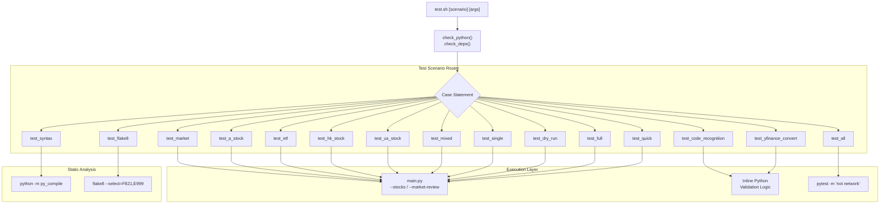
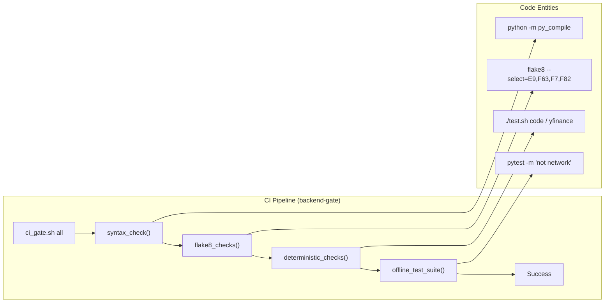
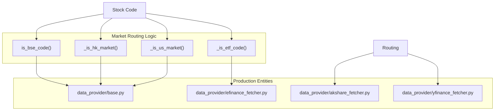

<!-- source: DeepWiki mcp.deepwiki.com · repo ZhuLinsen/daily_stock_analysis · page 9.2 Testing Framework · fetched 2026-10-29 -->

# Testing Framework

Relevant source files

The following files were used as context for generating this wiki page:

- [.claude/skills/analyze-issue/SKILL.md](.claude/skills/analyze-issue/SKILL.md)
- [.claude/skills/analyze-pr/SKILL.md](.claude/skills/analyze-pr/SKILL.md)
- [.claude/skills/fix-issue/SKILL.md](.claude/skills/fix-issue/SKILL.md)
- [.github/PULL_REQUEST_TEMPLATE.md](.github/PULL_REQUEST_TEMPLATE.md)
- [.github/copilot-instructions.md](.github/copilot-instructions.md)
- [.github/instructions/governance.instructions.md](.github/instructions/governance.instructions.md)
- [AGENTS.md](AGENTS.md)
- [api/v1/endpoints/backtest.py](api/v1/endpoints/backtest.py)
- [api/v1/schemas/backtest.py](api/v1/schemas/backtest.py)
- [apps/dsa-web/src/api/backtest.ts](apps/dsa-web/src/api/backtest.ts)
- [apps/dsa-web/src/pages/BacktestPage.tsx](apps/dsa-web/src/pages/BacktestPage.tsx)
- [apps/dsa-web/src/pages/__tests__/BacktestPage.test.tsx](apps/dsa-web/src/pages/__tests__/BacktestPage.test.tsx)
- [apps/dsa-web/src/types/backtest.ts](apps/dsa-web/src/types/backtest.ts)
- [data_provider/akshare_fetcher.py](data_provider/akshare_fetcher.py)
- [data_provider/baostock_fetcher.py](data_provider/baostock_fetcher.py)
- [data_provider/base.py](data_provider/base.py)
- [data_provider/efinance_fetcher.py](data_provider/efinance_fetcher.py)
- [data_provider/pytdx_fetcher.py](data_provider/pytdx_fetcher.py)
- [data_provider/tushare_fetcher.py](data_provider/tushare_fetcher.py)
- [data_provider/yfinance_fetcher.py](data_provider/yfinance_fetcher.py)
- [docs/run-diagnostics-p0.md](docs/run-diagnostics-p0.md)
- [src/repositories/backtest_repo.py](src/repositories/backtest_repo.py)
- [src/services/backtest_service.py](src/services/backtest_service.py)
- [tests/test_a_share_fetcher_code_conversion.py](tests/test_a_share_fetcher_code_conversion.py)
- [tests/test_backtest_service.py](tests/test_backtest_service.py)
- [tests/test_data_fetcher_prefetch_stock_names.py](tests/test_data_fetcher_prefetch_stock_names.py)
- [tests/test_stock_code_bse.py](tests/test_stock_code_bse.py)

## Purpose and Scope

This document describes the comprehensive testing framework used to validate the A-share/HK/US intelligent stock analysis system. The framework includes shell-based test scenarios, CI/CD integration, static analysis, and automated gate checks.

The testing framework supports multiple validation modes:
- **Local testing** via `test.sh` with 13+ scenarios covering different markets and analysis modes [test.sh:9-20]().
- **Automated PR review** via `ci.yml` including syntax checks, flake8 linting, and offline test suites [.github/workflows/ci.yml:41-78]().
- **Offline test suite** using `pytest` for logic that does not require network access [scripts/ci_gate.sh:24-27]().
- **Backtest Validation**: Specialized tests for verifying the AI analysis performance against historical data [tests/test_backtest_service.py:2-7]().

---

## Test Script Architecture

The primary testing interface is the `test.sh` shell script, which provides a unified command-line interface for executing various test scenarios.

### Test Execution Flow

**Sources**: [test.sh:1-286](), [scripts/ci_gate.sh:1-60]()

---

## Test Scenarios

The testing framework provides 13 distinct test scenarios, categorized by functionality and scope:

### Market Analysis Tests

| Scenario | Command | Stock Codes | Purpose |
|----------|---------|-------------|---------|
| **Market Review** | `test.sh market` | Indices (SH/SZ/NASDAQ) | Tests market-level analysis logic [test.sh:82-87]() |
| **Mixed Markets** | `test.sh mixed` | 600519, hk00700, AAPL | Tests cross-market analysis (A+HK+US) [test.sh:123-128]() |
| **Full Pipeline** | `test.sh full` | 600519 | Tests complete analysis flow (stocks + market) [test.sh:147-152]() |

### Individual Stock Tests

| Scenario | Command | Stock Codes | Purpose |
|----------|---------|-------------|---------|
| **A-Share** | `test.sh a-stock` | 600519, 000001 | Tests A-share fetchers (Moutai, PingAn) [test.sh:90-95]() |
| **ETF** | `test.sh etf` | 563230, 512400 | Tests ETF handling logic [test.sh:98-103]() |
| **HK Stock** | `test.sh hk-stock` | hk00700, hk09988 | Tests Hong Kong stock fetchers [test.sh:106-111]() |
| **US Stock** | `test.sh us-stock` | AAPL, TSLA | Tests US stock fetchers [test.sh:114-120]() |

### Code Validation & Linting

| Scenario | Command | Description |
|----------|---------|-------------|
| **Code Recognition** | `test.sh code` | Validates `_is_hk_code` and `_is_us_code` logic [test.sh:163-201]() |
| **YFinance Convert** | `test.sh yfinance` | Validates `_convert_stock_code` for Yahoo Finance [test.sh:204-241]() |
| **Syntax Check** | `test.sh syntax` | Python syntax validation with `py_compile` [test.sh:244-254]() |
| **Flake8 Lint** | `test.sh flake8` | Static analysis for critical errors [test.sh:257-267]() |

---

## CI/CD Testing Pipeline

The system implements a multi-stage CI/CD pipeline using GitHub Actions. The `ci.yml` workflow acts as a gatekeeper for pull requests.

### Backend Gate Architecture

The `backend-gate` job in CI executes a series of checks defined in `scripts/ci_gate.sh`.

**Sources**: [.github/workflows/ci.yml:41-78](), [scripts/ci_gate.sh:1-35]()

### Integration and Backtesting Tests

The system uses `pytest` to validate complex internal logic, such as the backtesting engine and data provider normalization.

- **Backtest Service**: `tests/test_backtest_service.py` uses a temporary SQLite DB to validate idempotency, result field correctness, and query methods for AI analysis performance evaluation [tests/test_backtest_service.py:9-24]().
- **Code Normalization**: `tests/test_a_share_fetcher_code_conversion.py` ensures that stock codes from various sources are correctly normalized into standard formats for fetchers [data_provider/base.py:70-97]().

---

## Data Provider Testing Logic

Testing the data provider system involves validating market-specific logic across multiple fetchers.

### Market Identification Logic

The framework validates classification functions used to route requests to the correct data fetcher.

**Sources**: [data_provider/base.py:155-195](), [data_provider/efinance_fetcher.py:152-167](), [test.sh:163-201]()

### YFinance Code Conversion

The `YfinanceFetcher` requires specific code transformations to match Yahoo Finance's ticker format (e.g., adding `.SS` or `.SZ`). The `test_yfinance_convert` scenario validates these transformations:

| Input Code | Expected Output | Logic |
|------------|-----------------|-------|
| `600519` | `600519.SS` | Shanghai A-share [data_provider/yfinance_fetcher.py:165-166]() |
| `000001` | `000001.SZ` | Shenzhen A-share [data_provider/yfinance_fetcher.py:167-168]() |
| `hk00700` | `0700.HK` | HK stock conversion [data_provider/yfinance_fetcher.py:139-143]() |
| `AAPL` | `AAPL` | US stock (no change) [data_provider/yfinance_fetcher.py:129-131]() |

**Sources**: [data_provider/yfinance_fetcher.py:96-172](), [test.sh:204-241]()

---

## Summary of Test Components

| Component | Responsibility | Implementation |
|-----------|----------------|----------------|
| **Syntax Gate** | Prevents syntax errors in PRs | `python -m py_compile` in `ci_gate.sh` [scripts/ci_gate.sh:5-11]() |
| **Linting Gate** | Enforces critical code standards | `flake8` with specific error codes [scripts/ci_gate.sh:13-16]() |
| **Logic Gate** | Validates market rules & config | `pytest` offline suite [scripts/ci_gate.sh:24-27]() |
| **Market Gate** | Validates data fetchers | `test.sh` scenarios (A/HK/US/ETF) [test.sh:79-161]() |
| **Docker Gate** | Validates container build & imports | `docker build` + import smoke tests [.github/workflows/ci.yml:79-102]() |
| **AI Governance** | Validates AI-related assets | `scripts/check_ai_assets.py` [.github/workflows/ci.yml:28-39]() |

**Sources**: [.github/workflows/ci.yml:1-127](), [scripts/ci_gate.sh:1-60](), [test.sh:1-286]()

---

