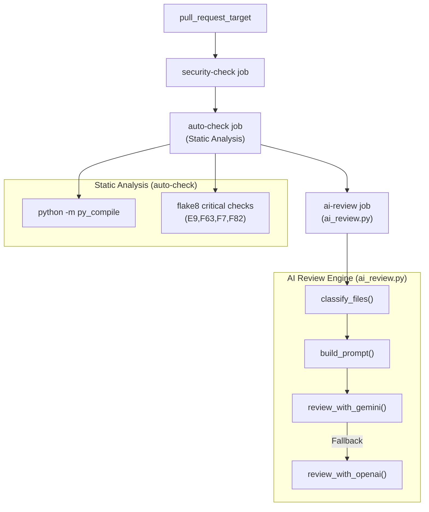
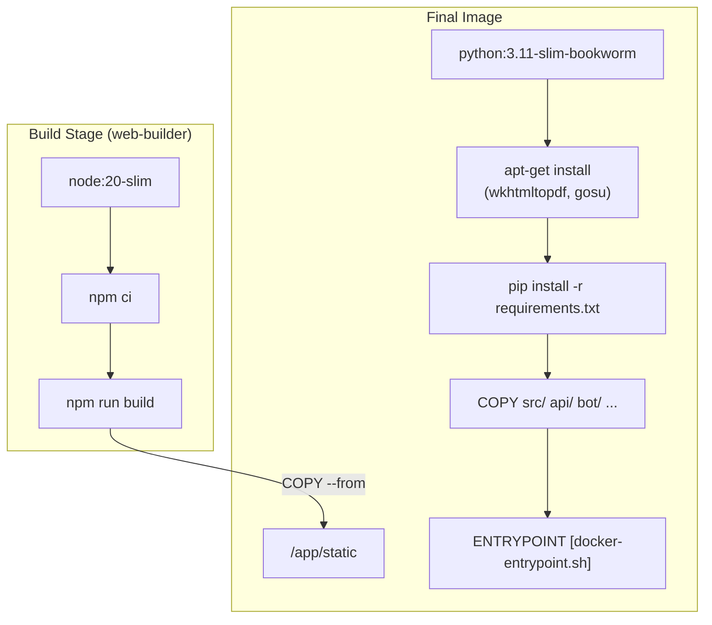

<!-- source: DeepWiki mcp.deepwiki.com · repo ZhuLinsen/daily_stock_analysis · page 9.3 CI/CD Pipeline · fetched 2026-10-29 -->

# CI/CD Pipeline

Relevant source files

The following files were used as context for generating this wiki page:

- [.dockerignore](.dockerignore)
- [.github/FUNDING.yml](.github/FUNDING.yml)
- [.github/ISSUE_TEMPLATE/bug_report.md](.github/ISSUE_TEMPLATE/bug_report.md)
- [.github/ISSUE_TEMPLATE/config.yml](.github/ISSUE_TEMPLATE/config.yml)
- [.github/ISSUE_TEMPLATE/feature_request.md](.github/ISSUE_TEMPLATE/feature_request.md)
- [.github/scripts/ai_review.py](.github/scripts/ai_review.py)
- [.github/workflows/auto-tag.yml](.github/workflows/auto-tag.yml)
- [.github/workflows/ci.yml](.github/workflows/ci.yml)
- [.github/workflows/docker-publish.yml](.github/workflows/docker-publish.yml)
- [.github/workflows/ghcr-dockerhub.yml](.github/workflows/ghcr-dockerhub.yml)
- [.github/workflows/network-smoke.yml](.github/workflows/network-smoke.yml)
- [.github/workflows/pr-review.yml](.github/workflows/pr-review.yml)
- [.github/workflows/stale.yml](.github/workflows/stale.yml)
- [.gitignore](.gitignore)
- [data_provider/__init__.py](data_provider/__init__.py)
- [docker/Dockerfile](docker/Dockerfile)
- [docs/CONTRIBUTING.md](docs/CONTRIBUTING.md)
- [docs/CONTRIBUTING_EN.md](docs/CONTRIBUTING_EN.md)
- [scripts/ci_gate.sh](scripts/ci_gate.sh)
- [setup.cfg](setup.cfg)

## Purpose and Scope

This document explains the continuous integration and continuous deployment (CI/CD) infrastructure that automates code quality checks, testing, deployment, and version management. The system uses GitHub Actions workflows to provide automated PR review (including AI-driven analysis), Docker image publishing, desktop release packaging, and network connectivity monitoring.

For information about manual deployment methods, see [7. Deployment Guide](). For testing procedures executed locally, see [9.2 Testing Framework](). For development workflow and contribution guidelines, see [9.1 Development Workflow]().

---

## CI/CD Architecture Overview

The CI/CD pipeline consists of several specialized GitHub Actions workflows that coordinate to maintain system stability and automate releases.

| Workflow | File | Purpose |
|----------|------|---------|
| **PR Review** | `.github/workflows/pr-review.yml` | Multi-stage gate: security check, static analysis, and AI-powered code review. |
| **CI (Main)** | `.github/workflows/ci.yml` | Core validation for backend (`ci_gate.sh`), frontend (`npm build`), and Docker imports. |
| **Docker Publish** | `.github/workflows/docker-publish.yml` | Validates code, runs container smoke tests, and pushes to GHCR/DockerHub on tags. |
| **Auto Tag** | `.github/workflows/auto-tag.yml` | Automatically increments semver tags based on commit message tokens (`#patch`, etc.). |
| **Network Smoke** | `.github/workflows/network-smoke.yml` | Scheduled checks for external API connectivity (non-blocking). |
| **Manual Docker** | `.github/workflows/ghcr-dockerhub.yml` | Manual trigger for building multi-arch `amd64/arm64` images. |

**Sources:** [.github/workflows/pr-review.yml:1-32](), [.github/workflows/ci.yml:1-11](), [.github/workflows/docker-publish.yml:1-17](), [.github/workflows/auto-tag.yml:1-23](), [.github/workflows/ghcr-dockerhub.yml:1-10]()

---

## PR Review & Quality Gates

The system implements a rigorous multi-stage quality gate for all Pull Requests to ensure code integrity and security.

### Workflow Orchestration

**Sources:** [.github/workflows/pr-review.yml:41-195](), [.github/scripts/ai_review.py:66-212]()

### Security and Static Analysis
1.  **Security Check:** Detects modifications to sensitive CI/CD infrastructure (e.g., `.github/workflows/*.yml`, `.github/scripts/*.py`). If found, it flags them for manual review in the `$GITHUB_STEP_SUMMARY` [[.github/workflows/pr-review.yml:59-80]]().
2.  **Syntax Validation:** Runs `python -m py_compile` on all changed `.py` files to catch basic syntax errors [[.github/workflows/pr-review.yml:137-162]]().
3.  **Flake8 Critical Checks:** Enforces a strict subset of linting rules (`E9, F63, F7, F82`) defined in `setup.cfg` to block PRs containing logic-breaking errors like undefined names or syntax issues [[.github/workflows/pr-review.yml:164-177](), [setup.cfg:1-20]()].

### AI Code Review
The `ai-review` job executes the `ai_review.py` script, which uses `google-genai` (primary) or `openai` (fallback) to perform semantic reviews based on the project's `AGENTS.md` philosophy [[.github/scripts/ai_review.py:172-212]]().

*   **File Classification:** The `classify_files()` function separates Python, documentation, frontend, and CI files to provide context to the LLM [[.github/scripts/ai_review.py:67-75]]().
*   **CI Context Injection:** The `_build_ci_context()` function injects current CI results (syntax/flake8) into the prompt so the AI doesn't report issues already caught by static tools [[.github/scripts/ai_review.py:78-100]]().
*   **Blocking Criteria:** AI is instructed to mark PRs as `Not Ready` only for correctness/security issues, missing rollback plans, or contradictions with the PR description [[.github/scripts/ai_review.py:141-146]]().
*   **AGENTS.md Alignment:** The prompt explicitly requires the AI to evaluate Necessity, Traceability, Type, and Description Completeness [[.github/scripts/ai_review.py:133-139]]().

**Sources:** [.github/workflows/pr-review.yml:188-245](), [.github/scripts/ai_review.py:103-169]()

---

## Release and Deployment Pipeline

The system automates the creation of version tags and the distribution of Docker images.

### Version Management (Auto Tag)
The `auto-tag.yml` workflow automates semantic versioning based on commit messages on the `main` branch [[.github/workflows/auto-tag.yml:4-23]]().

*   **Tokens:** Detects `#patch` (default), `#minor`, or `#major` in commit messages [[.github/workflows/auto-tag.yml:20-23](), [.github/workflows/auto-tag.yml:40-42]]().
*   **Action:** Uses `anothrNick/github-tag-action@v1` to push a new git tag with an initial version of `2.1.0` [[.github/workflows/auto-tag.yml:34-43]]().

### Docker Publishing
Triggered by tags (`v*.*.*`) or manual dispatch, the `docker-publish.yml` workflow ensures image quality before pushing to registries [[.github/workflows/docker-publish.yml:3-13]]().

1.  **CI Gate:** Executes `./scripts/ci_gate.sh` to run backend validation (syntax, flake8, and pytest) before starting the build [[.github/workflows/docker-publish.yml:63-64]]().
2.  **Tag Validation:** Ensures the git tag has an annotation message (`git tag -a`) before proceeding, ensuring release notes are documented [[.github/workflows/docker-publish.yml:78-85]]().
3.  **Smoke Test:** Builds the image locally and runs a series of Python import checks for core modules (`src.config`, `src.storage`, `src.notification`, `data_provider`, `src.analyzer`) to ensure the container is functional [[.github/workflows/docker-publish.yml:130-140]]().
4.  **Multi-Arch Support:** The `ghcr-dockerhub.yml` workflow supports `linux/amd64` and `linux/arm64` builds using QEMU and Docker Buildx, pushing to both `ghcr.io` and `docker.io` [[.github/workflows/ghcr-dockerhub.yml:49-115]]().

### Container Environment (Dockerfile)
The system uses a multi-stage Docker build to optimize image size and security.

**Sources:** [docker/Dockerfile:8-17](), [docker/Dockerfile:19-59](), [docker/Dockerfile:98-101]()

---

## Network Smoke Tests

The `network-smoke.yml` workflow runs on a schedule (Mon-Fri 02:00 UTC) to monitor the health of external data providers [[.github/workflows/network-smoke.yml:4-9]]().

*   **Pytest Network:** Runs tests specifically marked with `-m network` to verify API connectivity for data fetchers like `EfinanceFetcher` and `AkshareFetcher` [[.github/workflows/network-smoke.yml:33-37](), [data_provider/__init__.py:33-41]()].
*   **Quick Smoke:** Executes `./scripts/test.sh quick` to perform a minimal end-to-end analysis run without triggering external notifications [[.github/workflows/network-smoke.yml:39-43](), [docs/CONTRIBUTING.md:84-84]()].
*   **Non-Blocking:** Uses `continue-on-error: true` so that temporary network instability does not cause red CI status, but logs are preserved for debugging [[.github/workflows/network-smoke.yml:34-40]]().

**Sources:** [.github/workflows/network-smoke.yml:1-54]()

---

## Stale Resource Management

The `stale.yml` workflow runs daily to maintain repository health by identifying inactive Issues and Pull Requests [[.github/workflows/stale.yml:6-11]]().

*   **Issues:** Marked as `stale` after 7 days of inactivity and closed after another 7 days [[.github/workflows/stale.yml:27-28]]().
*   **PRs:** Marked as `stale` after 21 days of inactivity and closed after 14 more days [[.github/workflows/stale.yml:43-44]]().
*   **Exemptions:** Labels such as `pinned`, `security`, or `work-in-progress` prevent automatic stale marking [[.github/workflows/stale.yml:62-63]]().

**Sources:** [.github/workflows/stale.yml:1-80]()

---

