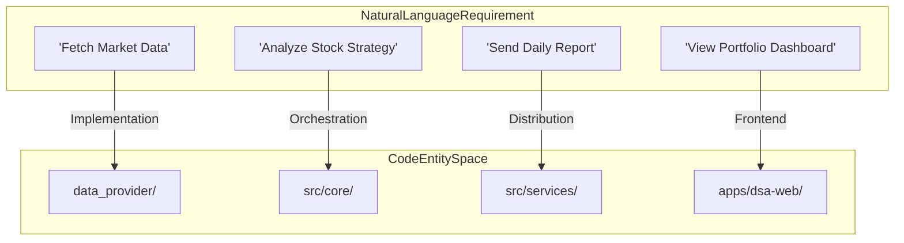
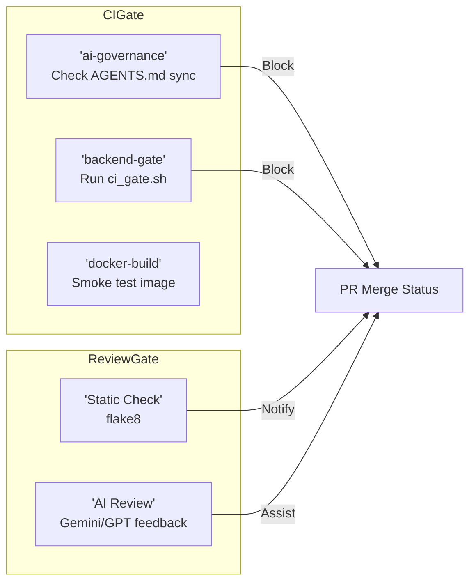
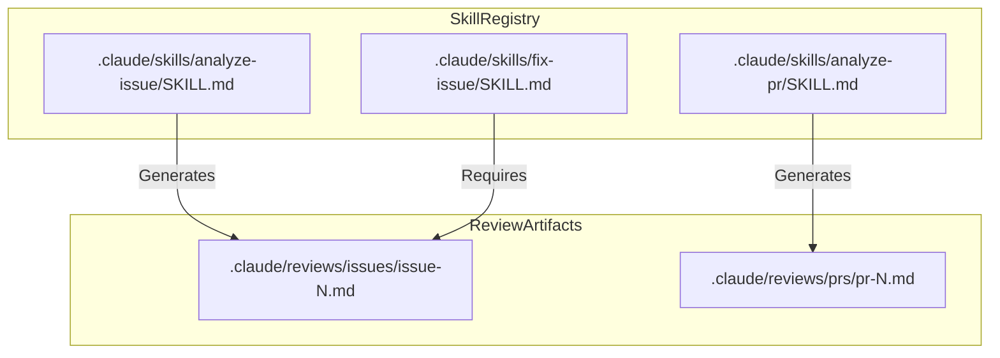

<!-- source: DeepWiki mcp.deepwiki.com · repo ZhuLinsen/daily_stock_analysis · page 9.4 Code Standards · fetched 2026-10-29 -->

# Code Standards

Relevant source files

The following files were used as context for generating this wiki page:

- [.claude/skills/analyze-issue/SKILL.md](.claude/skills/analyze-issue/SKILL.md)
- [.claude/skills/analyze-pr/SKILL.md](.claude/skills/analyze-pr/SKILL.md)
- [.claude/skills/fix-issue/SKILL.md](.claude/skills/fix-issue/SKILL.md)
- [.github/PULL_REQUEST_TEMPLATE.md](.github/PULL_REQUEST_TEMPLATE.md)
- [.github/copilot-instructions.md](.github/copilot-instructions.md)
- [.github/instructions/governance.instructions.md](.github/instructions/governance.instructions.md)
- [.github/scripts/ai_review.py](.github/scripts/ai_review.py)
- [.github/workflows/pr-review.yml](.github/workflows/pr-review.yml)
- [.github/workflows/stale.yml](.github/workflows/stale.yml)
- [.gitignore](.gitignore)
- [AGENTS.md](AGENTS.md)
- [data_provider/__init__.py](data_provider/__init__.py)

## Purpose and Scope

This document defines the coding standards, documentation requirements, and quality expectations for contributors to the `daily_stock_analysis` system. These standards ensure consistency across the multi-market (A-share, HK, US) AI-driven analysis platform. It covers mandatory "Hard Rules" from `AGENTS.md`, Python style guidelines, automated CI gates, and AI-assisted review protocols.

---

## Hard Rules and Development Philosophy

The repository enforces strict development boundaries to maintain stability across its backend, web, and desktop components.

| Category | Rule | Source |
| :--- | :--- | :--- |
| **Directory Boundaries** | Backend logic in `src/`, `data_provider/`, `api/`, `bot/`. Web in `apps/dsa-web/`. Desktop in `apps/dsa-desktop/`. | [AGENTS.md:9-13]() |
| **Stability** | Default stability over "convenience optimization." Restrain from refactoring unless required by the task. | [AGENTS.md:18-18]() |
| **Security** | No hardcoded secrets, accounts, ports, or model names. Use environment variables. | [AGENTS.md:16-16]() |
| **Documentation** | New config items must update `.env.example`. User-visible changes must update `docs/CHANGELOG.md`. | [AGENTS.md:19-20]() |
| **Git Hygiene** | No `git commit/push/tag` without explicit confirmation. Commit messages in English. | [AGENTS.md:14-15]() |

---

## Python Code Standards

### Linting and Formatting
The project uses `flake8` for linting and ensures code quality through strict verification matrices.

**Verification Matrix:**
- **Backend**: Requires `./scripts/ci_gate.sh` and `python -m py_compile` [AGENTS.md:165-168]().
- **Web**: Requires `npm run lint` and `npm run build` [AGENTS.md:171-173]().
- **Desktop**: Requires building the Web application before the Desktop shell [AGENTS.md:176-179]().

### Code Entity Mapping
The following diagram maps natural language requirements to specific code entities and their directory boundaries.

**System Responsibility Map**

Sources: [AGENTS.md:9-13](), [AGENTS.md:68-80]()

---

## Automated Quality Checks (CI Gate)

All backend changes must pass the local validation gate before submission.

### Backend Verification Matrix
| Level | Command | Purpose |
| :--- | :--- | :--- |
| **Mandatory** | `python -m py_compile <files>` | Catch syntax errors [AGENTS.md:168-168]() |
| **Recommended** | `./scripts/ci_gate.sh` | Run full linting and offline tests [AGENTS.md:167-167]() |
| **Testing** | `python -m pytest -m "not network"` | Run unit/integration tests without external APIs [AGENTS.md:104-104]() |

### CI Workflow Architecture
The GitHub Actions pipeline enforces these standards automatically on every Pull Request.

**CI Pipeline Flow**

Sources: [AGENTS.md:152-159](), [.github/workflows/pr-review.yml:83-177]()

---

## AI Collaboration and Asset Governance

This repository treats AI agents as first-class collaborators. Governance is centralized in `AGENTS.md`.

- **Single Source of Truth**: `AGENTS.md` is the master rulebook for AI collaboration [AGENTS.md:46-46]().
- **Symlinks**: `CLAUDE.md` must be a soft link to `AGENTS.md` for ecosystem compatibility [AGENTS.md:47-47]().
- **Skills**: Collaboration "skills" are versioned assets in `.claude/skills/` [AGENTS.md:49-49]().
- **Validation**: Changes to AI governance files must be verified with `python scripts/check_ai_assets.py` [AGENTS.md:52-56]().

### AI Review Dimensions
When a PR is submitted, an AI agent reviews it based on:
1. **Necessity**: Is there a clear business value? [.github/scripts/ai_review.py:134-134]()
2. **Traceability**: Is there an associated Issue? [.github/scripts/ai_review.py:135-135]()
3. **Completeness**: Does it follow the `.github/PULL_REQUEST_TEMPLATE.md`? [.github/scripts/ai_review.py:137-137]()
4. **Verification**: Are there actual command results provided? [.github/scripts/ai_review.py:137-137]()

---

## Pull Request Standards

### PR Template Enforcement
Every PR must include a background, scope of change, and a **Rollback Plan** [.github/PULL_REQUEST_TEMPLATE.md:129-136]().

**Mandatory Checklist:**
- [ ] Explicit motivation and business value [.github/PULL_REQUEST_TEMPLATE.md:153-153]()
- [ ] Reproducible verification results (not just "tested") [.github/PULL_REQUEST_TEMPLATE.md:154-154]()
- [ ] Rollback plan (actionable steps) [.github/PULL_REQUEST_TEMPLATE.md:156-156]()
- [ ] Prompt updates (if `EXTRACT_PROMPT` in `src/services/image_stock_extractor.py` was modified) [.github/PULL_REQUEST_TEMPLATE.md:137-149]()

### Commit Message Conventions
- Use **English** for commit messages [AGENTS.md:15-15]().
- Use conventional prefixes: `fix`, `feat`, `refactor`, `docs`, `chore`, `test` [AGENTS.md:31-31]().
- **PR Titles**: Recommended format is `<type>: <change summary>` [.github/copilot-instructions.md:16-16]().

---

## AI Skill Implementation

The repository includes specialized skills for AI agents to handle issues and PRs consistently.

**Skill Interaction Diagram**

Sources: [.claude/skills/fix-issue/SKILL.md:21-21](), [.claude/skills/analyze-issue/SKILL.md:76-76](), [.claude/skills/analyze-pr/SKILL.md:100-100]()

### CHANGELOG Management
Contributors must update `docs/CHANGELOG.md` using a **flat format** in the `[Unreleased]` section:
- Format: `- [Type] Description` [AGENTS.md:23-23]().
- Types: `新功能`, `改进`, `修复`, `文档`, `测试`, `chore` [.claude/skills/fix-issue/SKILL.md:47-47]().
- **Prohibited**: Do not add category headers (e.g., `### Features`) within `[Unreleased]` to prevent merge conflicts [AGENTS.md:23-23]().

Sources: [AGENTS.md:23-23](), [.claude/skills/fix-issue/SKILL.md:46-47](), [.github/copilot-instructions.md:20-20]()

---

