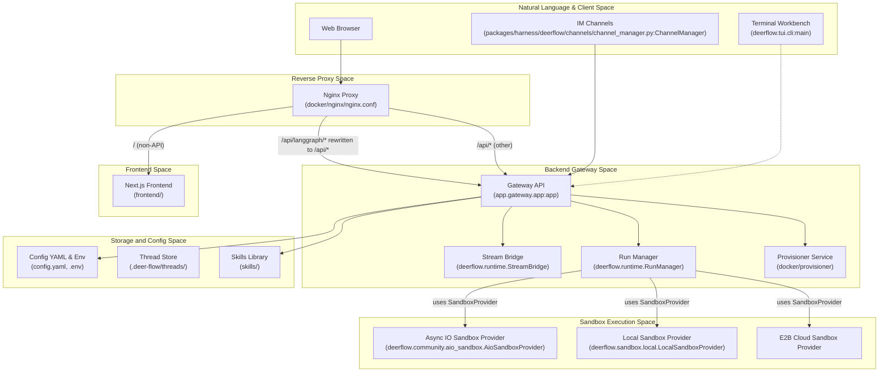
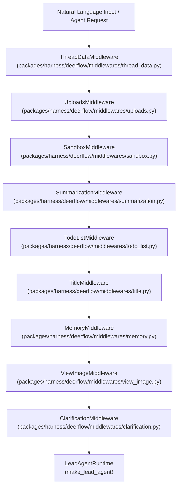

<!-- source: DeepWiki mcp.deepwiki.com · repo bytedance/deer-flow · page 1 Overview · fetched 2026-10-29 -->

# Overview

Relevant source files

The following files were used as context for generating this wiki page:

- [.env.example](.env.example)
- [AGENTS.md](AGENTS.md)
- [CHANGELOG.md](CHANGELOG.md)
- [CHANGELOG_zh.md](CHANGELOG_zh.md)
- [README.md](README.md)
- [README_fr.md](README_fr.md)
- [README_ja.md](README_ja.md)
- [README_ko.md](README_ko.md)
- [README_pt.md](README_pt.md)
- [README_ru.md](README_ru.md)
- [README_zh.md](README_zh.md)
- [backend/AGENTS.md](backend/AGENTS.md)
- [backend/CLAUDE.md](backend/CLAUDE.md)
- [backend/README.md](backend/README.md)
- [backend/docs/API.md](backend/docs/API.md)
- [backend/docs/ARCHITECTURE.md](backend/docs/ARCHITECTURE.md)
- [backend/docs/CONFIGURATION.md](backend/docs/CONFIGURATION.md)
- [backend/docs/README.md](backend/docs/README.md)
- [backend/docs/SANDBOX_MEMORY_PROFILING.md](backend/docs/SANDBOX_MEMORY_PROFILING.md)
- [backend/docs/TODO.md](backend/docs/TODO.md)
- [backend/packages/harness/deerflow/agents/middlewares/AGENTS.md](backend/packages/harness/deerflow/agents/middlewares/AGENTS.md)
- [backend/packages/harness/deerflow/agents/middlewares/llm_error_handling_middleware.py](backend/packages/harness/deerflow/agents/middlewares/llm_error_handling_middleware.py)
- [backend/tests/test_extensions_config_raw_writes.py](backend/tests/test_extensions_config_raw_writes.py)
- [backend/tests/test_llm_error_handling_middleware.py](backend/tests/test_llm_error_handling_middleware.py)
- [backend/tests/test_sandbox_memory_profile_script.py](backend/tests/test_sandbox_memory_profile_script.py)
- [backend/tests/test_support_bundle.py](backend/tests/test_support_bundle.py)
- [config.example.yaml](config.example.yaml)
- [scripts/AGENTS.md](scripts/AGENTS.md)
- [scripts/sandbox_memory_profile.py](scripts/sandbox_memory_profile.py)
- [scripts/support_bundle.py](scripts/support_bundle.py)

This page provides a comprehensive introduction to DeerFlow, its purpose as a super agent harness, and a detailed explanation of its high-level system architecture including key service components. It serves as the foundational reference for understanding DeerFlow's design, runtime composition, and modular subsystems `[README.md:12-13]`, `[backend/AGENTS.md:5-8]`.

DeerFlow (**D**eep **E**xploration and **E**fficient **R**esearch **Flow**) is an open-source **super agent harness** that orchestrates multipurpose AI agents powered by Large Language Models (LLMs) `[README.md:12-13]`. It integrates **sandboxed code execution**, **persistent memory**, **extensible skills**, and **subagent delegation** into a unified runtime environment to enable complex, multi-step, context-aware AI workflows `[backend/AGENTS.md:5-8]`.

Sources: `[README.md:12-13]`, `[backend/AGENTS.md:5-8]`

---

## System Purpose

DeerFlow provides a powerful runtime for orchestrating LLM-based super agents with the following core capabilities:

- **Code Execution in Isolated Sandboxes**: Supports running arbitrary code and bash commands safely within per-thread isolated sandbox environments (`LocalSandboxProvider`, `AioSandboxProvider`). These sandboxes encapsulate user data and outputs, preventing interference or security risks `[backend/README.md:77-86]`.
- **Persistent Long-Term Memory**: Maintains rich conversational context and facts across sessions using automated extraction, confidence scoring, and background updates `[backend/README.md:99-107]`.
- **Task Decomposition via Subagent Delegation**: Breaks down complex problems into parallel subtasks executed by recursive subagents via `SubagentExecutor` and the `task()` tool `[backend/README.md:88-96]`.
- **Extensible Skill-Based Workflows**: Dynamically loads specialized domain skills packaged as `.skill` archives with `SkillScan` validation and file-system projection `[backend/README.md:82-85]`.
- **Multi-Provider Model Integration**: Supports a broad range of LLM providers (Doubao, DeepSeek, OpenAI, Anthropic, vLLM, OpenRouter) through a pluggable model factory system `[config.example.yaml:128-175]`.
- **Rich External Tool Ecosystem**: Integrates external tools for web search, crawling, document parsing, and MCP (Model Context Protocol) servers `[backend/README.md:41-52]`.
- **Middleware Pipeline for Cross-Cutting Concerns**: Applies a strict middleware execution chain inside the lead agent runtime (`make_lead_agent`) to handle context management, sandbox acquisition, memory injection, summarization, and safety checks `[backend/README.md:43-68]`.

Sources: `[README.md:12-13]`, `[backend/AGENTS.md:5-8]`, `[backend/README.md:41-107]`, `[config.example.yaml:128-175]`

---

## Service Architecture

DeerFlow employs a modular multi-service architecture, where key services collaborate under a unifying reverse proxy. This design promotes separation of concerns, scalability, and clean runtime integration `[backend/README.md:9-32]`.

### Service Topology and Code Mapping

Sources: `[backend/AGENTS.md:8-16]`, `[backend/README.md:9-32]`, `[backend/pyproject.toml:72]`

| Service         | Port | Purpose                                              | Main Entry Point / Code Module                           |
|-----------------|------|------------------------------------------------------|---------------------------------------------------------|
| **Nginx**       | 2026 | Unified reverse proxy entry point, routes API & UI | `[backend/AGENTS.md:10-12]`, `[backend/README.md:13-15]` |
| **Gateway API** | 8001 | FastAPI REST API + embedded LangGraph agent runtime | `[backend/AGENTS.md:8-12]`, `[backend/README.md:21-31]`  |
| **Frontend**    | 3000 | Next.js React frontend web interface                 | `[backend/AGENTS.md:9-11]`                               |
| **Provisioner** | 8002 | Kubernetes sandbox provisioner (optional)            | `[backend/AGENTS.md:11-13]`                              |
| **Redis**       | 6379 | Redis Streams for SSE event bus between workers      | `[backend/pyproject.toml:72]`                            |

Sources: `[backend/AGENTS.md:8-16]`, `[backend/README.md:9-32]`, `[backend/pyproject.toml:72]`

---

## Core Components

### Lead Agent and Middleware Pipeline

At the heart of DeerFlow is a single **Lead Agent** runtime instance created via the factory function `make_lead_agent(config)` `[backend/README.md:43-45]`. This agent encapsulates prompt assembly, dynamic model selection, tool binding, and subagent delegation.

The Lead Agent executes a strict, ordered **Middleware Chain** mapping functional stages to concrete middleware classes. These middlewares manipulate request context, thread state, sandbox acquisition, summarization, memory injection, tool calls, and handle clarifications `[backend/README.md:53-68]`.

Sources: `[backend/README.md:43-68]`, `[backend/AGENTS.md:16-19]`

| #  | Middleware Class         | Purpose                                                   |
|-----|-------------------------|------------------------------------------------------------|
| 1   | `ThreadDataMiddleware`  | Creates per-thread isolated directories (workspace, uploads, outputs) `[backend/README.md:59]` |
| 2   | `UploadsMiddleware`     | Injects newly uploaded files into conversation context `[backend/README.md:60]` |
| 3   | `SandboxMiddleware`     | Acquires sandbox environment for code execution `[backend/README.md:61]` |
| 4   | `SummarizationMiddleware` | Context compression to reduce token usage when near limits `[backend/README.md:62]` |
| 5   | `TodoListMiddleware`    | Tracks multi-step tasks in planning mode `[backend/README.md:63]` |
| 6   | `TitleMiddleware`       | Auto-generates conversation titles from original user input `[backend/README.md:64]` |
| 7   | `MemoryMiddleware`      | Queues conversations for asynchronous memory extraction `[backend/README.md:65]` |
| 8   | `ViewImageMiddleware`   | Injects image data for vision-capable models (optional) `[backend/README.md:66]` |
| 9   | `ClarificationMiddleware` | Intercepts clarifications and interrupts execution `[backend/README.md:67]` |

Sources: `[backend/README.md:43-68]`, `[backend/AGENTS.md:16-19]`

---

### Sandbox Execution

DeerFlow’s sandbox system provides isolated, controlled execution environments on a per-thread basis, essential for safely running arbitrary code, scripts, and commands invoked by agents `[backend/README.md:75-86]`.

#### Virtual Path Mapping

Sandbox file system operations use a **virtualized file path scheme**, which maps thread-specific virtual directories to physical paths in backend storage:

| Virtual Path                | Physical Path Location                                     |
|----------------------------|------------------------------------------------------------|
| `/mnt/user-data/workspace` | `.deer-flow/threads/{thread_id}/user-data/workspace`      |
| `/mnt/user-data/uploads`   | `.deer-flow/threads/{thread_id}/user-data/uploads`        |
| `/mnt/user-data/outputs`   | `.deer-flow/threads/{thread_id}/user-data/outputs`        |
| `/mnt/skills`              | `skills/` directory for agent skills and modules           |

This virtualization isolates user data per thread and ensures clean separation of workspaces `[backend/README.md:77-83]`.

#### Sandbox Provider Implementations

- **`LocalSandboxProvider`**: Executes commands directly on the host filesystem, suitable for lightweight or development scenarios `[backend/README.md:80]`.
- **`AioSandboxProvider`**: An async Docker container-based sandbox provider that manages sandbox container lifecycle, warm pools, and supports multi-thread async execution `[backend/README.md:80]`.
- **`E2BSandboxProvider`**: Cloud microVM sandbox provider accessed via E2B API, enabling sandbox execution on remote infrastructure `[backend/packages/harness/pyproject.toml:61]`, `[.env.example:49-51]`.

Sources: `[backend/README.md:75-86]`, `[.env.example:49-51]`, `[backend/packages/harness/pyproject.toml:61]`

---

### Subagent System

To handle complex workflows efficiently, DeerFlow supports **subagent delegation**, enabling the lead agent to spawn multiple concurrent subagents that execute subtasks asynchronously `[backend/README.md:91-96]`.

- The lead agent invokes the `task()` tool to delegate work to subagents.
- `SubagentExecutor` manages background thread pools, executing delegated subagents asynchronously with status tracking, cancellation, and timeout support via SSE event streams.
- Concurrency is bounded by configuration defaults (max 3 subagents per turn, 15-minute timeout).
- Subagents run in isolated runtime environments but share the agent’s context via event coordination allowing complex, multi-step task orchestration `[backend/README.md:90-96]`.

Sources: `[backend/README.md:91-96]`

---

## Configuration System

DeerFlow adopts a layered and flexible configuration system allowing operators to tailor runtime behavior, model integration, middleware, and deployment options.

| Configuration File         | Purpose                                                    |
|----------------------------|------------------------------------------------------------|
| `config.yaml`              | Primary human-editable YAML for models, logging, limits, and agent settings `[config.example.yaml:1-24]` |
| `extensions_config.json`   | Runtime-managed JSON for MCP servers, enabled skills, and plugins `[backend/docs/CONFIGURATION.md:118-124]` |
| `.env` (environment file) | Environment variables for API keys, ports, deployment overrides, and external credentials `[.env.example:1-32]` |

### Configuration Highlights

- **Model and Provider Configuration**: Enables multi-provider LLM support including Doubao, Anthropic, OpenAI, OpenRouter, and custom VLLM with per-model request pacing and token budget enforcement `[config.example.yaml:128-175]`.
- **Middleware and Extension Management**: Middleware can be extended or replaced via config and `extensions_config.json` with operator-defined middlewares inserted into the agent runtime pipeline.
- **Token Budgeting and Limits**: Configurable per-run token limits with warning and hard stop thresholds prevent runaway API costs.
- **Timezone and Date Injection**: `DEER_FLOW_DATE_TIMEZONE` environment variable controls timezone for injected conversation timestamps.

Sources: `[config.example.yaml:1-24]`, `[backend/docs/CONFIGURATION.md:118-124]`, `[.env.example:1-32]`

---

# Summary

DeerFlow is a sophisticated, extensible open-source super agent harness designed to enable the orchestration of intelligent AI agents with complex workflows. Its architecture combines:

- A **modular multi-service backend** with API Gateway, LangGraph-driven agent runtime, sandbox provisioners, and a Next.js frontend.
- A robust **middleware-driven lead agent runtime** that manages prompt construction, resource acquisition, and the agent life cycle.
- A secure and flexible **sandbox execution environment** that virtualizes user workspace and supports multiple backend providers (local, Docker, cloud).
- A concurrent **subagent system** for decomposition of tasks into parallel subtasks.
- A flexible **configuration system** to customize models, middleware, skills, and deployment behavior.

These components together enable DeerFlow to empower developers and organizations to build and deploy highly capable AI-driven automation and research workflows.

Sources: `[README.md:12-13]`, `[backend/AGENTS.md:5-24]`, `[backend/README.md:9-107]`, `[config.example.yaml:1-175]`, `[.env.example:1-32]`

---

