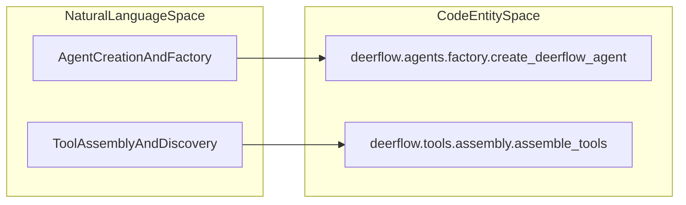
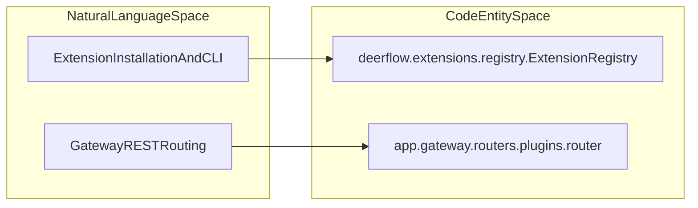

<!-- source: DeepWiki mcp.deepwiki.com · repo bytedance/deer-flow · page 10 Development Guide · fetched 2026-10-29 -->

# Development Guide

Relevant source files

The following files were used as context for generating this wiki page:

- [.github/workflows/backend-blocking-io-tests.yml](.github/workflows/backend-blocking-io-tests.yml)
- [.github/workflows/backend-unit-tests.yml](.github/workflows/backend-unit-tests.yml)
- [.github/workflows/e2e-tests.yml](.github/workflows/e2e-tests.yml)
- [.github/workflows/frontend-unit-tests.yml](.github/workflows/frontend-unit-tests.yml)
- [.github/workflows/lint-check.yml](.github/workflows/lint-check.yml)
- [.github/workflows/replay-e2e.yml](.github/workflows/replay-e2e.yml)
- [.github/workflows/skill-review-ci.yml](.github/workflows/skill-review-ci.yml)
- [.gitignore](.gitignore)
- [.pre-commit-config.yaml](.pre-commit-config.yaml)
- [backend/Makefile](backend/Makefile)
- [backend/packages/extension-api/deerflow_extension_api/__init__.py](backend/packages/extension-api/deerflow_extension_api/__init__.py)
- [backend/packages/extension-api/deerflow_extension_api/contracts.py](backend/packages/extension-api/deerflow_extension_api/contracts.py)
- [backend/packages/extension-api/pyproject.toml](backend/packages/extension-api/pyproject.toml)
- [backend/packages/harness/deerflow/extensions/AGENTS.md](backend/packages/harness/deerflow/extensions/AGENTS.md)
- [backend/packages/harness/deerflow/extensions/registry.py](backend/packages/harness/deerflow/extensions/registry.py)
- [backend/packages/harness/pyproject.toml](backend/packages/harness/pyproject.toml)
- [backend/pyproject.toml](backend/pyproject.toml)
- [backend/tests/test_extension_api_contracts.py](backend/tests/test_extension_api_contracts.py)
- [backend/uv.lock](backend/uv.lock)
- [frontend/src/components/workspace/command-palette.tsx](frontend/src/components/workspace/command-palette.tsx)
- [frontend/src/core/extensions/catalog.ts](frontend/src/core/extensions/catalog.ts)
- [frontend/tests/e2e/bookmark-plugin.spec.ts](frontend/tests/e2e/bookmark-plugin.spec.ts)

This page serves as the parent guide for extending, customizing, and debugging DeerFlow. It provides a high-level overview of architectural extension points and links to detailed child pages for specific development domains.

For detailed instructions, see the following child pages:
- [Adding New Tools](#10.1) — Tutorial for creating custom tools and integrating them with the agent, including deferred tool loading (`tool_search`) and ACP agent tools.
- [Creating Skills](#10.2) — Guide for developing custom skills, packaging `.skill` archives, frontmatter validation, the public skills library, and the skill review CI/waiver system.
- [Extension Plugin System](#10.3) — Document `deerflow-extension-api` contract package, contribution kinds, `ExtensionInstall`, `Registry`, `RuntimeDeps`, `make extension-*` commands, entry-point groups, and reference examples.
- [Frontend Development](#10.4) — Guide for developing frontend components, working with hooks, mock APIs, and styling.
- [Testing and Debugging](#10.5) — Explains testing strategies (backend unit tests, blocking-IO detection via `scripts/detect_thread_boundaries.py`, replay E2E, Playwright), CI workflows, debug helpers, and best practices.
- [Terminal Workbench (TUI)](#10.6) — Document the Textual-based terminal workbench (`deerflow` CLI): launch modes, `DeerFlowTUI` app, slash commands, session persistence, embedded runtime, and headless execution.

---

## Extension Architecture Overview

DeerFlow’s backend architecture distinguishes two primary layers:
- **Harness Layer** (`deerflow-harness`): The core super-agent framework under the `deerflow.*` namespace, providing the agent runtime, tooling system, middleware hooks, memory layers, and subagent orchestration [backend/packages/harness/pyproject.toml:1-67]().
- **Application Layer** (`app.*`): Contains deployment-specific components and services like the FastAPI Gateway and IM channel integrations [backend/pyproject.toml:1-43]().

Agent instantiation occurs via factory functions in the harness package, which assemble tools, skills, memory, and middleware for each session.

Title: "Agent and Tool Lifecycle Natural Language to Code Mapping"

Sources: [backend/packages/harness/pyproject.toml:1-67](), [backend/pyproject.toml:1-43]()

---

## Tool Extension

Tools expose programmable functionality for agent interactions. DeerFlow supports built-in utilities, user-defined custom tools, deferred tool loading via `tool_search`, community web tools, and MCP servers. Custom tool integration occurs during agent factory setup.

For an in-depth tutorial on creating new tools and advanced integrations, see [Adding New Tools](#10.1).

Sources: [backend/packages/harness/pyproject.toml:1-67]()

---

## Skill Development

Skills package domain knowledge, prompting instructions, and tooling glue into `.skill` archive files stored in public (`skills/public/`) and private (`skills/custom/`) libraries. DeerFlow's skill review CI pipeline enforces quality standards and security audits.

For comprehensive guidance on skill authoring, packaging, and the review process, see [Creating Skills](#10.2).

Sources: [.github/workflows/skill-review-ci.yml:1-77]()

---

## Extension Plugin System

The extension plugin system operates atop the `deerflow-extension-api` contract package [backend/packages/extension-api/deerflow_extension_api/__init__.py:1-188](). Plugins contribute middleware, runtime dependencies, Gateway HTTP routers, and experimental full-stack UI integrations. The `deerflow-extension-api` package is a direct dependency of the main `deer-flow` project [backend/pyproject.toml:15](), and is also a dependency of `deerflow-harness` [backend/packages/harness/pyproject.toml:16]().

Title: "Extension Management and API Gateway Natural Language to Code Mapping"

Extensions are managed through CLI commands and build helpers (`make extension-*`) [backend/Makefile:1-79](). The `ExtensionManager` handles package and configuration transactions, including `uv add` and `uv remove` operations to update `pyproject.toml` and `uv.lock` [backend/packages/harness/deerflow/extensions/AGENTS.md:31-43](). To learn about the extension API contract, lifecycle events, and example plugins, consult the [Extension Plugin System](#10.3) page.

Sources: [backend/packages/extension-api/deerflow_extension_api/__init__.py:1-188](), [backend/pyproject.toml:15](), [backend/packages/harness/pyproject.toml:16](), [backend/Makefile:1-79](), [backend/packages/harness/deerflow/extensions/AGENTS.md:31-43](), [backend/packages/harness/deerflow/extensions/registry.py:1-100]()

---

## Frontend Development

The frontend app is built with Next.js App Router, TypeScript, Tailwind CSS, Radix UI components, and TanStack Query. Features include multi-threaded chat interfaces, SSE streaming updates, message grouping, file viewers, and subtask tracking. Frontend dependencies are managed with `pnpm` [frontend/src/components/workspace/command-palette.tsx:1-133](), and linting/type-checking are enforced via CI workflows [.github/workflows/lint-check.yml:70-109]().

Refer to [Frontend Development](#10.4) for detailed instructions on building and extending the frontend.

Sources: [frontend/src/components/workspace/command-palette.tsx:1-133](), [.github/workflows/lint-check.yml:70-109]()

---

## Testing, Debugging, and Diagnostics

DeerFlow uses a layered testing strategy including backend unit tests, blocking I/O detection scripts, replayable E2E tests, and Playwright UI automation.

- **Backend Unit Tests**: Executed using `pytest` and sharded for parallel execution in CI [backend/Makefile:26-59](). The `uv.lock` file ensures consistent dependency resolution [backend/uv.lock:1-11]().
- **Blocking I/O Detection**: A static analysis script `scripts/detect_blocking_io_static.py` identifies potential blocking I/O operations [backend/Makefile:67-68]().
- **Replay E2E Tests**: These tests guard the front-back contract using a record/replay mechanism, ensuring the SSE event sequence matches committed golden files and the frontend renders correctly without requiring live API keys [.github/workflows/replay-e2e.yml:1-114]().
- **Playwright UI Automation**: Used for full E2E tests, including scenarios involving plugin gateways [frontend/tests/e2e/bookmark-plugin.spec.ts:1-100](), and authentication recovery [.github/workflows/e2e-tests.yml:91-96]().

Comprehensive testing, debugging, and CI workflows are explained fully in [Testing and Debugging](#10.5).

Sources: [backend/Makefile:26-59](), [backend/uv.lock:1-11](), [backend/Makefile:67-68](), [.github/workflows/replay-e2e.yml:1-114](), [frontend/tests/e2e/bookmark-plugin.spec.ts:1-100](), [.github/workflows/e2e-tests.yml:91-96](), [.github/workflows/backend-unit-tests.yml:1-116](), [.github/workflows/backend-blocking-io-tests.yml:1-49]()

---

## Terminal Workbench (TUI)

DeerFlow includes a Textual-based terminal user interface (TUI) accessible via the `deerflow` CLI, supporting interactive and headless launch modes, slash commands, session persistence, and an embedded runtime. The `deerflow` console script is defined in `deerflow-harness` [backend/packages/harness/pyproject.toml:70-71](), with `textual` as an optional dependency [backend/packages/harness/pyproject.toml:75]().

Visit [Terminal Workbench (TUI)](#10.6) for an in-depth explanation of its architecture, commands, and session management.

Sources: [backend/packages/harness/pyproject.toml:70-71](), [backend/packages/harness/pyproject.toml:75]()

---

