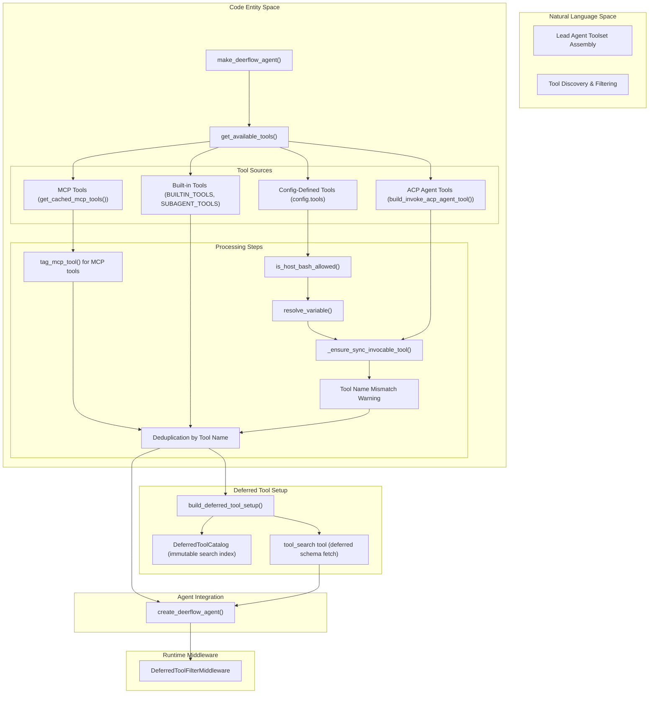
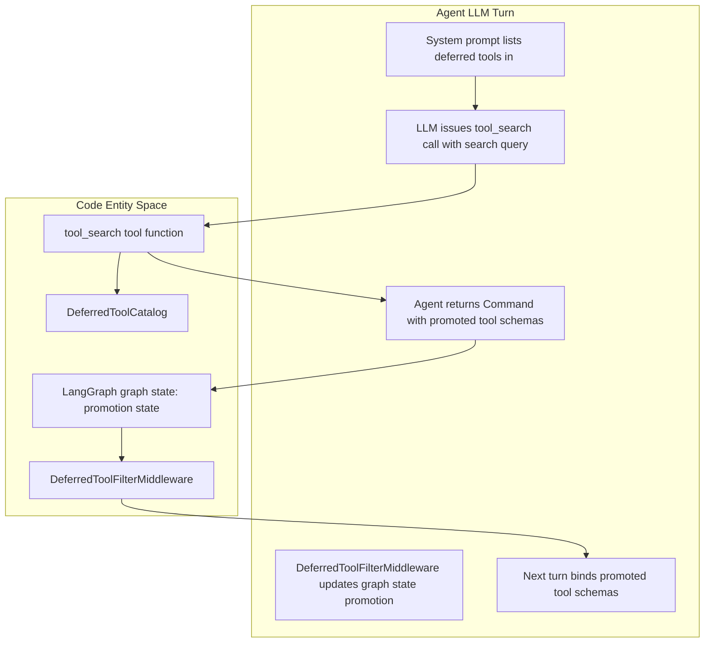
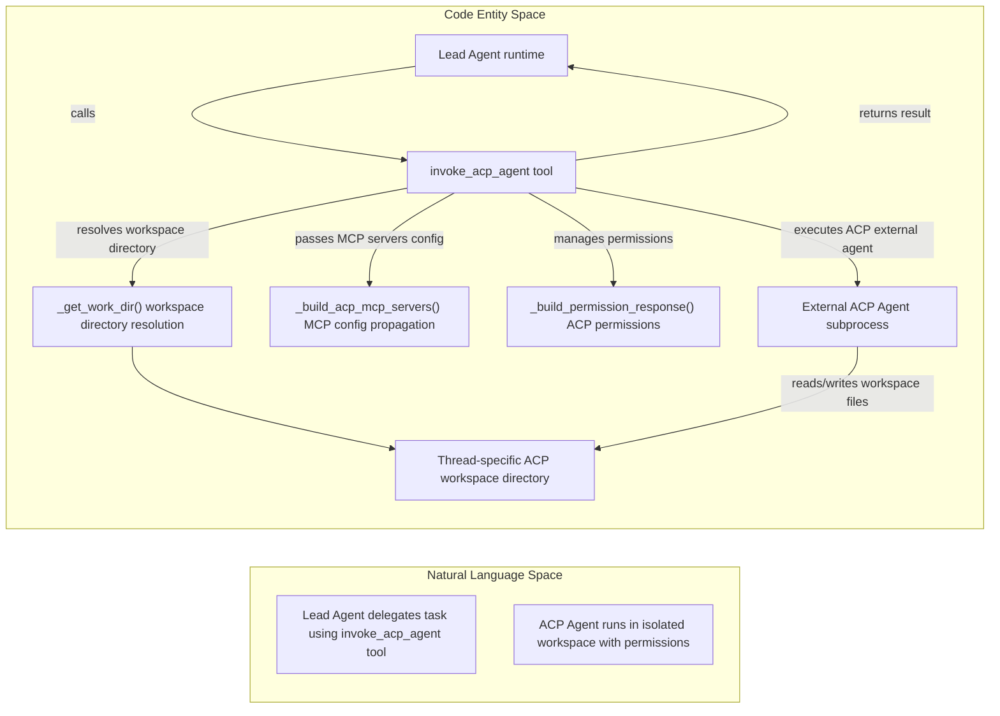
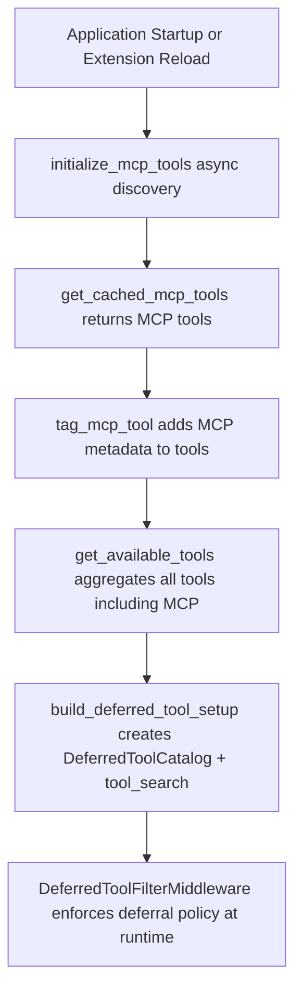

<!-- source: DeepWiki mcp.deepwiki.com · repo bytedance/deer-flow · page 10.1 Adding New Tools · fetched 2026-10-29 -->

# Adding New Tools

Relevant source files

The following files were used as context for generating this wiki page:

- [backend/packages/harness/deerflow/agents/middlewares/deferred_tool_filter_middleware.py](backend/packages/harness/deerflow/agents/middlewares/deferred_tool_filter_middleware.py)
- [backend/packages/harness/deerflow/config/acp_config.py](backend/packages/harness/deerflow/config/acp_config.py)
- [backend/packages/harness/deerflow/tools/AGENTS.md](backend/packages/harness/deerflow/tools/AGENTS.md)
- [backend/packages/harness/deerflow/tools/builtins/invoke_acp_agent_tool.py](backend/packages/harness/deerflow/tools/builtins/invoke_acp_agent_tool.py)
- [backend/packages/harness/deerflow/tools/builtins/tool_search.py](backend/packages/harness/deerflow/tools/builtins/tool_search.py)
- [backend/tests/blocking_io/test_invoke_acp_agent_tool.py](backend/tests/blocking_io/test_invoke_acp_agent_tool.py)
- [backend/tests/test_deferred_catalog.py](backend/tests/test_deferred_catalog.py)
- [backend/tests/test_deferred_keyword_search.py](backend/tests/test_deferred_keyword_search.py)
- [backend/tests/test_deferred_promotion_integration.py](backend/tests/test_deferred_promotion_integration.py)
- [backend/tests/test_deferred_setup.py](backend/tests/test_deferred_setup.py)
- [backend/tests/test_deferred_tool_crosscontext.py](backend/tests/test_deferred_tool_crosscontext.py)
- [backend/tests/test_doctor.py](backend/tests/test_doctor.py)
- [backend/tests/test_invoke_acp_agent_tool.py](backend/tests/test_invoke_acp_agent_tool.py)
- [backend/tests/test_tool_search.py](backend/tests/test_tool_search.py)
- [frontend/src/content/en/harness/tools.mdx](frontend/src/content/en/harness/tools.mdx)
- [frontend/src/content/zh/harness/tools.mdx](frontend/src/content/zh/harness/tools.mdx)
- [scripts/doctor.py](scripts/doctor.py)
- [scripts/wizard/providers.py](scripts/wizard/providers.py)

This page provides a tutorial and technical reference for creating custom tools and integrating them into the DeerFlow agent system. Tools are callable functions that extend the agent's capabilities, allowing it to interact with external systems, manipulate files, search the web, and perform specialized operations.

DeerFlow supports standard LangChain tools, Model Context Protocol (MCP) tools, and Agent Connect Protocol (ACP) external agents, with support for deferred tool loading to optimize resource usage.

---

## Tool System Architecture

Tools in DeerFlow are LangChain-compatible callable objects assembled into a unified toolset at runtime. The core function `get_available_tools()` is responsible for gathering tools from multiple sources, resolving them, filtering by policies, and ensuring synchronous execution compatibility even if implemented asynchronously. This assembly process happens primarily in the `tools.py` module [backend/packages/harness/deerflow/tools/tools.py:102-162]().

### Tool Assembly and Execution Flow

The diagram below bridges the conceptual **Natural Language Space** of agents and external systems to the concrete **Code Entity Space** of Python classes and functions implementing the tool system:

**Key points:**

- `get_available_tools()` aggregates tools from configuration, built-in lists, MCP tool cache, and ACP tools [backend/packages/harness/deerflow/tools/tools.py:102-162]().
- It filters tools disallowed by policy or environment (e.g., disallowing host-bash tools) [backend/packages/harness/deerflow/tools/tools.py:158-160]().
- Async-only tools receive a synchronous wrapper using `make_sync_tool_wrapper()` via `_ensure_sync_invocable_tool()` to enable sync calls from agent runtimes that do not support async directly [backend/packages/harness/deerflow/tools/tools.py:58-71]().
- `build_deferred_tool_setup()` builds the deferred tool catalog and adds the `tool_search` tool for deferred schema discovery [backend/packages/harness/deerflow/tools/builtins/tool_search.py:120-141]().
- The agent binds tools and applies the `DeferredToolFilterMiddleware` at runtime to tune tool visibility dynamically [backend/packages/harness/deerflow/agents/middlewares/deferred_tool_filter_middleware.py:29-36]().

---

### Tool Categories and Sources

| Category           | Code Source Location                                      | Key Code Symbols                             | Description                                                                |
|--------------------|------------------------------------------------------------|----------------------------------------------|----------------------------------------------------------------------------|
| **Built-in Tools**  | `tools/builtins/`                                          | `BUILTIN_TOOLS`, e.g., `present_file_tool`  | Core runtime tools included with DeerFlow, e.g., file presentation and clarifications [backend/packages/harness/deerflow/tools/tools.py:32-36](). |
| **Subagent Tools**  | `tools/builtins/`                                          | `SUBAGENT_TOOLS`, e.g., `task_tool`          | Support subagent task delegation and batch task management [backend/packages/harness/deerflow/tools/tools.py:38-41](). |
| **MCP Tools**       | MCP server discovery and cache                             | `get_cached_mcp_tools()`, `tag_mcp_tool()`  | External tools fetched from MCP servers, tagged with MCP metadata [backend/packages/harness/deerflow/tools/mcp_metadata.py](), referenced in [backend/packages/harness/deerflow/tools/builtins/tool_search.py:35]() |
| **Deferred Tools**  | Identified MCP tools for deferred loading                  | `DeferredToolCatalog`, `tool_search`         | Tools not sent upfront, loaded on demand via the `tool_search` tool [backend/packages/harness/deerflow/tools/builtins/tool_search.py:63-170](). |
| **ACP Agent Tools** | ACP external agent invocations                             | `build_invoke_acp_agent_tool()`               | Wrap external ACP-compatible agents for delegated tool calls [backend/tests/test_tool_deduplication.py:129-155](). |

Sources: `[backend/packages/harness/deerflow/tools/tools.py:32-41]()`, `[backend/packages/harness/deerflow/tools/builtins/tool_search.py:63-170]()`.

---

## Deferred Tool Loading

Including all MCP tools' full schemas in the agent prompt can cause excessive token usage and context overflow. To optimize, DeerFlow uses **deferred tool loading**, where tools are initially only listed by name in the system prompt, and the LLM must explicitly request a tool's full schema via the `tool_search` tool when it wants to use it.

### Components of Deferred Tool Loading

1. **DeferredToolCatalog**  
   An immutable catalog of deferred tools enabling search by name or keywords. It provides stable hashing for caching and supports exact selection or keyword and regex searching. Implemented as a frozen dataclass providing `search()` [backend/packages/harness/deerflow/tools/builtins/tool_search.py:112-140]().  

2. **tool_search Tool**  
   A LangChain tool that supports queries from the agent to discover and fetch deferred tool schemas on demand. It returns `Command` objects that promote tools into the agent's context for binding and invocation in the next cycle [backend/packages/harness/deerflow/tools/builtins/tool_search.py:141-170]().  

3. **build_deferred_tool_setup()**  
   Builds the deferred tool catalog and the `tool_search` tool dynamically from the list of configured MCP tools, filtering only those tagged for deferred loading [backend/packages/harness/deerflow/tools/builtins/tool_search.py:120-141]().  

4. **DeferredToolFilterMiddleware**  
   Runtime middleware that filters out deferred tools not yet promoted for the model context and blocks attempts to call unpromoted tools from the client side. It reads promotion state from LangGraph's graph state keyed by the deferred tool catalog hash for consistency [backend/packages/harness/deerflow/agents/middlewares/deferred_tool_filter_middleware.py:29-119]().

---

### Tool Search Query Syntax

The `tool_search` tool accepts queries with flexible syntax for matching deferred tools:

- `select:name1,name2,...` — Exact name matching for specified tools, returning all requested tools without capping [backend/packages/harness/deerflow/tools/builtins/tool_search.py:133-139]().
- `+required_keyword optional_keywords` — Require presence of the first keyword in tool name, rank results by occurrences of following keywords [backend/packages/harness/deerflow/tools/builtins/tool_search.py:144-154]().
- Arbitrary regex (case-insensitive) — Search tool names and descriptions with regex, falling back to a simple literal substring match on regex errors [backend/packages/harness/deerflow/tools/builtins/tool_search.py:60-79]().

---

### Deferred Tool Workflow Diagram

Sources: `[backend/packages/harness/deerflow/tools/builtins/tool_search.py:120-170]()`, `[backend/packages/harness/deerflow/agents/middlewares/deferred_tool_filter_middleware.py:29-119]()`

---

## ACP Agent Tools

DeerFlow can delegate agent functionality to external **Agent Connect Protocol (ACP)** agents running as subprocesses with isolated workspaces and dedicated permissions. This extends DeerFlow's capability by integrating with independently developed agents via a standardized protocol.

### ACP Agent Integration Architecture

Sources: `[backend/tests/test_tool_deduplication.py:129-155]()`, `[backend/packages/harness/deerflow/tools/builtins/invoke_acp_agent_tool.py:20-180]()`.

**Details:**

- Each ACP tool invocation creates or uses a dedicated per-thread workspace (e.g., `{base_dir}/threads/{thread_id}/acp-workspace/`) to isolate filesystem state and avoid concurrent cross-thread interference.
- MCP server information known to DeerFlow is propagated to ACP agents to enable transparent external tool use within the ACP protocols.
- Permissions requested by ACP agents can be auto-approved or denied based on configuration (`auto_approve_permissions`), ensuring controlled and safe external execution [backend/packages/harness/deerflow/config/acp_config.py:13-68]().

---

## Implementation Details and Best Practices

### Synchronous Wrappers for Asynchronous Tools

Many DeerFlow tools are implemented as asynchronous functions (`async def`) but need to be callable synchronously by agent runtimes. DeerFlow ensures this via:

- The utility `make_sync_tool_wrapper()` creates sync wrappers that internally run async tool coroutines with proper context management [backend/packages/harness/deerflow/tools/sync.py:38-108]().
- `get_available_tools()` applies `_ensure_sync_invocable_tool()` to all tools, wrapping any async-only tool on first use and caching the sync wrapper for efficiency and thread safety [backend/packages/harness/deerflow/tools/tools.py:58-71]().
- The wrappers preserve Python `contextvars` and support LangChain's `RunnableConfig` injection for runtime environment propagation.
- This allows seamless synchronous calling of all tools regardless of their original async implementation, improving compatibility with sync contexts [backend/tests/test_mcp_sync_wrapper.py:55-62]().

---

### Tool Deduplication and Validation

Tool registration merges multiple sources but must avoid duplicate tool names:

- `get_available_tools()` collects tools from config, builtins, MCP, and ACP. It deduplicates by tool name, keeping the first occurrence (usually config-defined) and logging a warning when duplicates are skipped [backend/tests/test_tool_deduplication.py:1-7,159-188]().
- MCP tools receive an MCP metadata tag `mcp_tool` via `tag_mcp_tool()` for filtering and identification [backend/packages/harness/deerflow/tools/mcp_metadata.py]() (cited by tool search code).
- Tools disallowed by policy (such as host-bash if not allowed) are filtered out before deduplication [backend/packages/harness/deerflow/tools/tools.py:158-160]().

---

### MCP Tool Discovery Lifecycle

Sources: `[backend/packages/harness/deerflow/tools/tools.py:102-162]()` , `[backend/packages/harness/deerflow/tools/builtins/tool_search.py:120-141]()` , `[backend/packages/harness/deerflow/agents/middlewares/deferred_tool_filter_middleware.py:29-119]()`.

Explanation:

- MCP tools are asynchronously discovered and cached on startup or extension reload.
- These tools are tagged with MCP metadata to mark them as deferred candidates.
- All tools are aggregated and filtered by `get_available_tools()`.
- Deferred tool setup creates search catalog and `tool_search` tool.
- Runtime middleware limits visibility and usage of deferred tools to those explicitly promoted by the agent during inference.

---

# References

- `[backend/packages/harness/deerflow/tools/tools.py:1-170]()`
- `[backend/packages/harness/deerflow/tools/builtins/tool_search.py:1-170]()`
- `[backend/packages/harness/deerflow/agents/middlewares/deferred_tool_filter_middleware.py:1-119]()`
- `[backend/packages/harness/deerflow/tools/sync.py:1-108]()`
- `[backend/tests/test_tool_deduplication.py:1-190]()`
- `[backend/tests/test_deferred_setup.py:1-89]()`
- `[backend/packages/harness/deerflow/tools/builtins/invoke_acp_agent_tool.py:1-180]()`
- `[backend/packages/harness/deerflow/config/acp_config.py:1-68]()`

---

