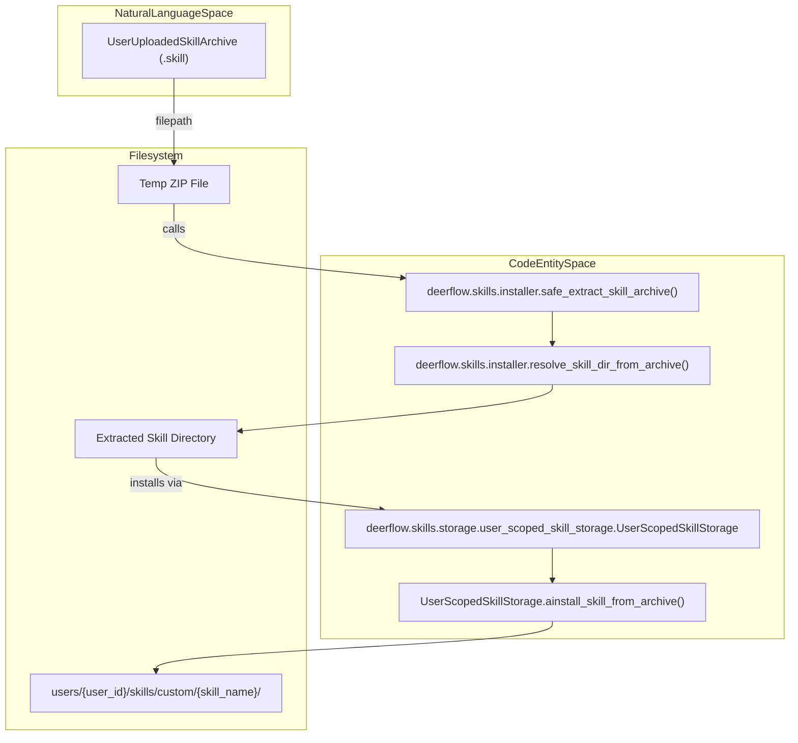
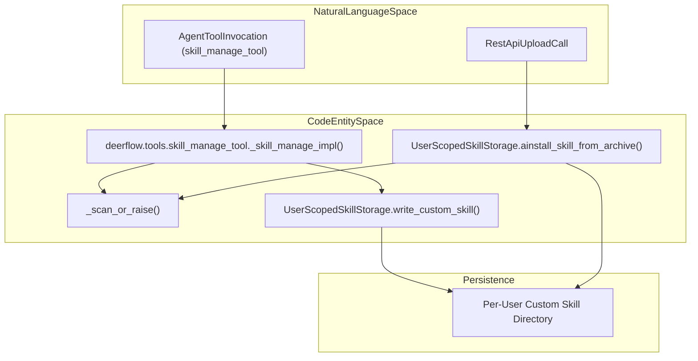
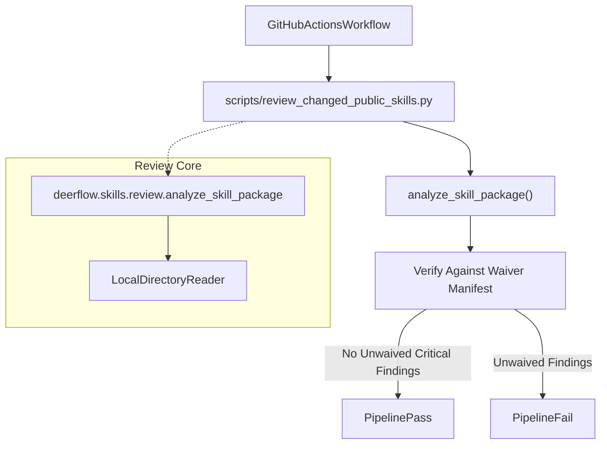

<!-- source: DeepWiki mcp.deepwiki.com · repo bytedance/deer-flow · page 10.2 Creating Skills · fetched 2026-10-29 -->

# Creating Skills

<details>
<summary>Relevant source files</summary>

The following files were used as context for generating this wiki page:

- [backend/packages/harness/deerflow/agents/middlewares/skill_context.py](backend/packages/harness/deerflow/agents/middlewares/skill_context.py)
- [backend/packages/harness/deerflow/community/aio_sandbox/AGENTS.md](backend/packages/harness/deerflow/community/aio_sandbox/AGENTS.md)
- [backend/packages/harness/deerflow/extensions/cli.py](backend/packages/harness/deerflow/extensions/cli.py)
- [backend/packages/harness/deerflow/integrations/lark_broker.py](backend/packages/harness/deerflow/integrations/lark_broker.py)
- [backend/packages/harness/deerflow/skills/frontmatter.py](backend/packages/harness/deerflow/skills/frontmatter.py)
- [backend/packages/harness/deerflow/skills/parser.py](backend/packages/harness/deerflow/skills/parser.py)
- [backend/packages/harness/deerflow/skills/review/analyzer.py](backend/packages/harness/deerflow/skills/review/analyzer.py)
- [backend/packages/harness/deerflow/skills/review/readers.py](backend/packages/harness/deerflow/skills/review/readers.py)
- [backend/packages/harness/deerflow/skills/review/resource_graph.py](backend/packages/harness/deerflow/skills/review/resource_graph.py)
- [backend/packages/harness/deerflow/skills/types.py](backend/packages/harness/deerflow/skills/types.py)
- [backend/packages/harness/deerflow/skills/validation.py](backend/packages/harness/deerflow/skills/validation.py)
- [backend/tests/test_bench_sandbox_provider.py](backend/tests/test_bench_sandbox_provider.py)
- [backend/tests/test_extension_check_script.py](backend/tests/test_extension_check_script.py)
- [backend/tests/test_extension_dependency_sync.py](backend/tests/test_extension_dependency_sync.py)
- [backend/tests/test_extension_manager.py](backend/tests/test_extension_manager.py)
- [backend/tests/test_lark_broker.py](backend/tests/test_lark_broker.py)
- [backend/tests/test_lark_shim_atomic.py](backend/tests/test_lark_shim_atomic.py)
- [backend/tests/test_local_sandbox_command_timeout.py](backend/tests/test_local_sandbox_command_timeout.py)
- [backend/tests/test_read_file_line_range.py](backend/tests/test_read_file_line_range.py)
- [backend/tests/test_read_file_tool_binary.py](backend/tests/test_read_file_tool_binary.py)
- [backend/tests/test_read_file_truncation_continuation.py](backend/tests/test_read_file_truncation_continuation.py)
- [backend/tests/test_skill_context.py](backend/tests/test_skill_context.py)
- [backend/tests/test_skill_frontmatter_boundaries.py](backend/tests/test_skill_frontmatter_boundaries.py)
- [backend/tests/test_skill_review_core.py](backend/tests/test_skill_review_core.py)
- [backend/tests/test_skills_parser.py](backend/tests/test_skills_parser.py)
- [backend/tests/test_skills_validation.py](backend/tests/test_skills_validation.py)
- [backend/tests/test_tool_output_truncation.py](backend/tests/test_tool_output_truncation.py)
- [contracts/skill_review/package_snapshot.v1.schema.json](contracts/skill_review/package_snapshot.v1.schema.json)
- [docker/lark-cli-broker/README.md](docker/lark-cli-broker/README.md)
- [skills/public/github-deep-research/SKILL.md](skills/public/github-deep-research/SKILL.md)
- [skills/public/github-deep-research/assets/report_template.md](skills/public/github-deep-research/assets/report_template.md)
- [skills/public/github-deep-research/scripts/github_api.py](skills/public/github-deep-research/scripts/github_api.py)
- [skills/public/podcast-generation/SKILL.md](skills/public/podcast-generation/SKILL.md)
- [skills/public/podcast-generation/scripts/generate.py](skills/public/podcast-generation/scripts/generate.py)
- [skills/public/podcast-generation/templates/tech-explainer.md](skills/public/podcast-generation/templates/tech-explainer.md)
- [tests/skills/skill_loader.py](tests/skills/skill_loader.py)
- [tests/skills/test_github_deep_research.py](tests/skills/test_github_deep_research.py)
- [tests/skills/test_podcast_generation.py](tests/skills/test_podcast_generation.py)

</details>


This page provides a technical guide for developing, packaging, and managing custom skills in DeerFlow. Skills are modular, reusable agent capabilities that extend the base system with specialized knowledge, automated workflows, and tool integrations.

---

## 1. Overview

Skills in DeerFlow are self-contained packages that enhance the agent's capabilities dynamically. Each skill consists of a `SKILL.md` markdown file containing YAML frontmatter and optional supporting resources such as Python scripts, reference documents, and assets. Skills are organized into user-scoped `custom/` directories and global read-only `public/` directories [backend/packages/harness/deerflow/skills/types.py:1-33]().

**Key Concepts:**

- **Skill Archive**: A `.skill` file is a standard ZIP archive packaging a skill directory safely with validations [backend/packages/harness/deerflow/skills/installer.py:115-134]().
- **SKILL.md**: The primary skill definition file containing YAML frontmatter and operational instructions, parsed and validated during install [backend/packages/harness/deerflow/skills/parser.py:1-176]().
- **Skill Storage**: Abstractions like `UserScopedSkillStorage` manage persistence, multi-user boundaries, and skill lookups [backend/packages/harness/deerflow/skills/storage/user_scoped_skill_storage.py:1-70]().
- **Static and Runtime Security Scanning**: Skills are screened for unsafe content and structural compliance before installation, including checks for binary files, executable bits, and frontmatter validity [backend/packages/harness/deerflow/skills/installer.py:51-175]().

Sources:  
- `backend/packages/harness/deerflow/skills/types.py:1-33`  
- `backend/packages/harness/deerflow/skills/installer.py:51-175`  
- `backend/packages/harness/deerflow/skills/parser.py:1-176`  
- `backend/packages/harness/deerflow/skills/storage/user_scoped_skill_storage.py:1-70`

---

## 2. Skill Directory Structure and Packaging

A skill is packaged as a `.skill` ZIP archive containing a root directory with a required `SKILL.md` and optional resources such as scripts, references, templates, and assets. Skill content must only contain safe relative paths without absolute components or NTFS ADS streams. Extraction enforces these constraints strictly.

The installation flow extracts the archive into a temporary directory, validates the extracted files, and writes the skill into a user-scoped persistent directory under `users/{user_id}/skills/custom/{skill_name}/` [backend/packages/harness/deerflow/skills/installer.py:51-120]().

### Data Flow: Skill Archive Installation Pipeline



Sources:  
- `backend/packages/harness/deerflow/skills/installer.py:51-120`  
- `backend/packages/harness/deerflow/skills/storage/user_scoped_skill_storage.py:50-90`

---

## 3. SKILL.md Frontmatter Format

All skills must include a `SKILL.md` markdown file with a YAML frontmatter section that declares metadata controlling skill identity, allowed tools, and secrets.

### Example `SKILL.md` Frontmatter

```yaml
---
name: github-deep-research
description: Conduct multi-round deep research on any GitHub Repo.
allowed-tools: [bash, read_file, web_search]
required-secrets:
  - name: GITHUB_TOKEN
    optional: true
---
# Skill operational markdown and instructions follow here...
```

### Frontmatter Fields and Validation

| Field             | Type                              | Description                                                                                             | Validation / Notes                                                                                             |
|-------------------|----------------------------------|-----------------------------------------------------------------------------------------------------|--------------------------------------------------------------------------------------------------------------|
| `name`            | string                           | Unique skill identifier, lowercase with digits and hyphens only, no leading/trailing/double hyphens. | Extracted without quotes (YAML string). Max 64 chars. Validated for format [backend/packages/harness/deerflow/skills/parser.py:1-176]()|
| `description`     | string                           | Human-readable summary guiding the agent and UI display.                                            | Max 1024 chars. No angle brackets `<` or `>`.                                                                 |
| `allowed-tools`   | list of strings or space-separated string | Tools that the skill is permitted to invoke at runtime. Aliases like `Bash` normalize to `bash`.     | Absence means no restriction; empty means deny all. Parses string preserving parenthesized patterns.          |
| `required-secrets`| list of secret specs or strings  | Secret environment variable names the skill requires, with optional `optional` boolean flag.        | Secret names must match POSIX env var regex. Non-boolean optional flags are rejected [backend/packages/harness/deerflow/skills/parser.py:139-176]()|

The frontmatter is parsed and validated during skill load to ensure consistent interpretation and security [backend/packages/harness/deerflow/skills/validation.py:10-80](). Common parsing errors like unmatched quotes or invalid keys are rendered with developer-friendly diagnostics [backend/packages/harness/deerflow/skills/parser.py:82-105]().

Sources:  
- `backend/packages/harness/deerflow/skills/parser.py:1-176`  
- `backend/packages/harness/deerflow/skills/validation.py:10-80`  
- `backend/tests/test_skill_review_core.py:30-100`

---

## 4. Public Skills Library (skills/public)

DeerFlow comes bundled with a curated set of public skills located under the `skills/public/` directory. These serve both as useful built-in capabilities and reference examples for custom skill authors.

### Example Skills

| Skill Name            | Description                                                                                                         | Key Features / Notes                                                                                            |
|-----------------------|---------------------------------------------------------------------------------------------------------------------|----------------------------------------------------------------------------------------------------------------|
| **github-deep-research** | Conducts multi-round deep research on GitHub repositories, combining GitHub API, web search, and web fetch tools. | Produces rich markdown reports with executive summaries, timelines, and diagrams. Triggers on GitHub URLs.     |
| **podcast-generation** | Automates podcast script generation and speech synthesis using cloud TTS services.                                 | Implements retryable TTS calls with concurrency control. Includes voice customization and batch generation.    |

The `SKILL.md` documents in public skills often include executable scripts, templates, and detailed instructions for reproducibility and extension [skills/public/github-deep-research/SKILL.md:1-166]().

Sources:  
- `skills/public/github-deep-research/SKILL.md:1-167`  
- `skills/public/podcast-generation/SKILL.md:1-50`  

---

## 5. Data Flow: Installation, Scanning, and Projection

Skill installation is performed mainly by the Gateway API backend, which handles user activation, package extraction, static validation, and writes into user skill storage locations. The following diagram illustrates the typical call flow starting from a REST API upload or internal agent tool invocation:



The pipeline includes these steps:

- Skill archive is extracted and resolved to find `SKILL.md`.
- Frontmatter and entire package content is statically analyzed for errors/blockers.
- If valid, user-scope storage writes or updates the skill atomically.
- The skill becomes available for agent runtime loading and tool invocation.

Sources:  
- `backend/packages/harness/deerflow/tools/skill_manage_tool.py:115-165`  
- `backend/packages/harness/deerflow/skills/storage/local_skill_storage.py:118-148`

---

## 6. Security Protections and Scanning

DeerFlow implements comprehensive safety measures during skill package handling:

1. **Path Safety**:
   - Extraction forbids paths escaping the skill root directory (no `../` outside root).
   - Absolute paths or Windows NTFS alternate data streams (`filename:stream`) are rejected.
   - Path normalization canonicalizes and validates extracted file paths [backend/packages/harness/deerflow/skills/installer.py:51-83]().

2. **Binary and Executable File Checks**:
   - Rejects unknown binary files inside skills.
   - Blocks files with executable bits to prevent stealth payload execution [backend/packages/harness/deerflow/skills/installer.py:166-175]().

3. **Zip Bomb Prevention**:
   - Enforces maximum extracted size (e.g., 20 MiB) and maximum file counts to survive decompression attack vectors.
   - Limits ensure the system is resilient against malicious oversized archives [backend/packages/harness/deerflow/skills/installer.py:115-147]().

4. **Secret Injection Controls**:
   - Skills can declare required secrets in frontmatter.
   - Secrets are injected into the sandbox environment namespace dynamically per skill invocation.
   - Ensures secrets are used explicitly and disclosed upfront.

5. **Static Skill Review**:
   - Skills are continuously integrated via a dedicated skill-review CI pipeline that analyzes packages with `analyze_skill_package()`.
   - The review misses no tracked files (using git ls-files for source consistency).
   - Findings such as missing descriptions, unknown frontmatter fields, unreferenced resources, and invalid secret flags are reported and can block installation.
   - A waiver system permits certain non-blocking warnings to be approved on public skills.

Sources:  
- `backend/packages/harness/deerflow/skills/installer.py:51-175`  
- `backend/tests/test_skill_review_core.py:20-158`  
- `backend/tests/test_skills_installer.py:29-58`  

---

## 7. Skill Review CI and Waiver System

To maintain the quality and security of public skills, DeerFlow enforces an automated skill review process in CI:

**Review Workflow:**

- On push to `skills/public`, the GitHub Actions workflow invokes `scripts/review_changed_public_skills.py`.
- This script reads changed skills and calls `analyze_skill_package()` from the review core.
- The analysis gathers "facts" including frontmatter validation, resource graphs, and structural rules.
- Findings are matched against a waiver manifest `.github/skill-review-waivers.v1.json`.
- Critical severity findings (blockers/error level) cannot be waived and break the pipeline.
- Passing scans or waived warnings allow merge and publication.

**Mermaid Diagram: Skill Review Flow**



This system enforces long-term code health, allows auditability, and prevents newly introduced severe issues from reaching production skills.

Sources:  
- `backend/tests/test_skill_review_core.py:1-60`  

---

# References

- Skill parsing and frontmatter validation:  
  `[backend/packages/harness/deerflow/skills/parser.py:1-176]()`  
  `[backend/packages/harness/deerflow/skills/validation.py:10-80]()`  
  `[backend/tests/test_skill_review_core.py:30-100]()`

- Skill installation and extraction:  
  `[backend/packages/harness/deerflow/skills/installer.py:51-175]()`  
  `[backend/packages/harness/deerflow/skills/storage/user_scoped_skill_storage.py:1-70]()`  
  `[backend/packages/harness/deerflow/skills/storage/local_skill_storage.py:118-148]()`  
  `[backend/packages/harness/deerflow/tools/skill_manage_tool.py:115-165]()`

- Skill management tools:  
  `[backend/packages/harness/deerflow/tools/skill_manage_tool.py:115-165]()`

- Public skill examples:  
  `skills/public/github-deep-research/SKILL.md:1-167`  
  `skills/public/podcast-generation/SKILL.md:1-50`

- Skill review CI and waiver system:  
  `[backend/tests/test_skill_review_core.py:1-60]()`

Sources:  
- `backend/packages/harness/deerflow/skills/parser.py:1-176`  
- `backend/packages/harness/deerflow/skills/installer.py:51-175`  
- `backend/packages/harness/deerflow/skills/storage/user_scoped_skill_storage.py:1-70`  
- `backend/packages/harness/deerflow/tools/skill_manage_tool.py:115-165`  
- `backend/tests/test_skill_review_core.py:1-60`  
- `skills/public/github-deep-research/SKILL.md:1-167`

---

