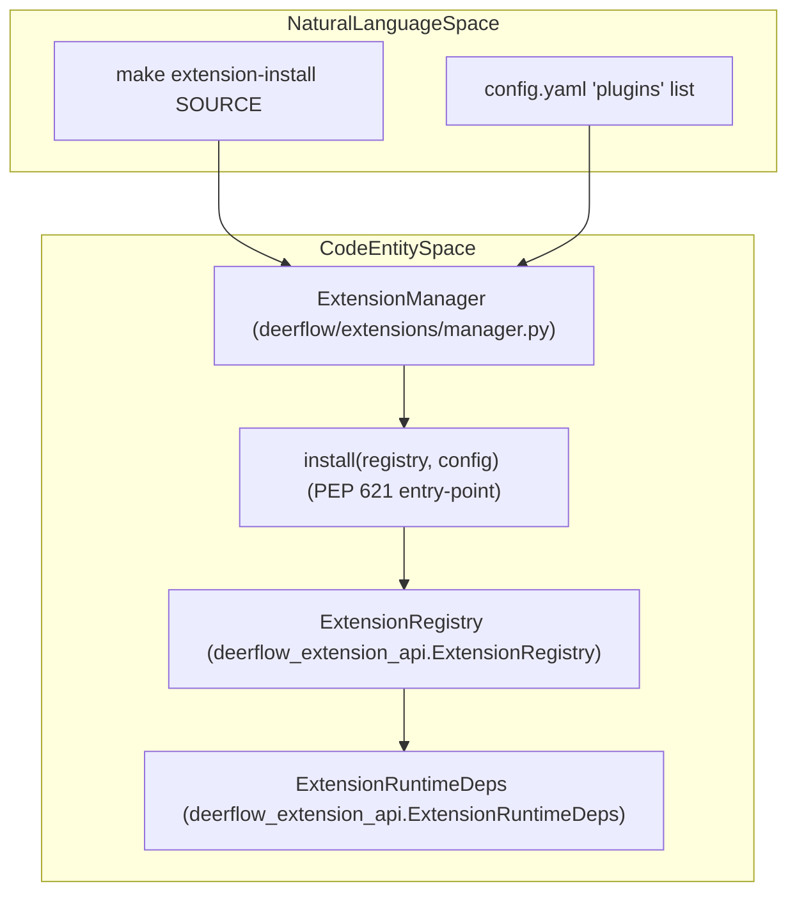
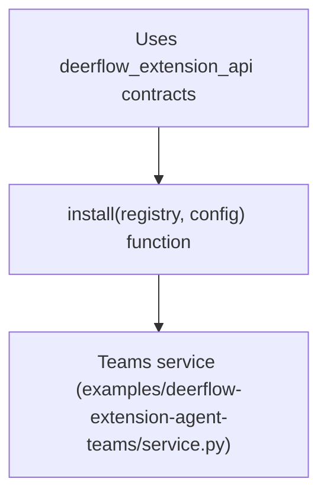
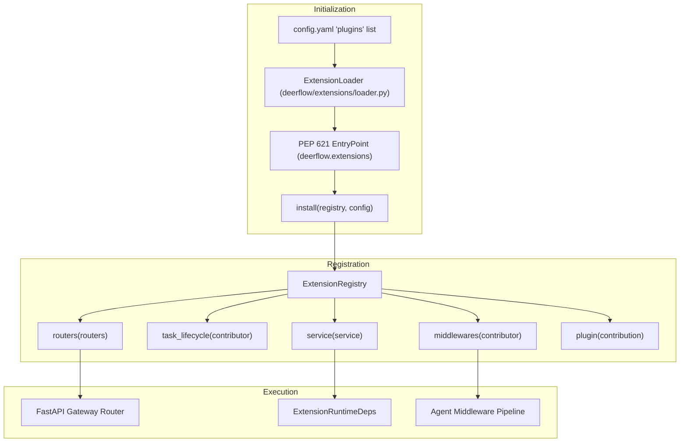

<!-- source: DeepWiki mcp.deepwiki.com · repo bytedance/deer-flow · page 10.3 Extension Plugin System · fetched 2026-10-29 -->

# Extension Plugin System

<details>
<summary>Relevant source files</summary>

The following files were used as context for generating this wiki page:

- [.gitignore](.gitignore)
- [backend/Makefile](backend/Makefile)
- [backend/extension_test_fixtures/agent_teams_gateway.py](backend/extension_test_fixtures/agent_teams_gateway.py)
- [backend/packages/extension-api/deerflow_extension_api/__init__.py](backend/packages/extension-api/deerflow_extension_api/__init__.py)
- [backend/packages/extension-api/deerflow_extension_api/contracts.py](backend/packages/extension-api/deerflow_extension_api/contracts.py)
- [backend/packages/extension-api/pyproject.toml](backend/packages/extension-api/pyproject.toml)
- [backend/packages/harness/deerflow/extensions/AGENTS.md](backend/packages/harness/deerflow/extensions/AGENTS.md)
- [backend/packages/harness/deerflow/extensions/registry.py](backend/packages/harness/deerflow/extensions/registry.py)
- [backend/packages/harness/pyproject.toml](backend/packages/harness/pyproject.toml)
- [backend/pyproject.toml](backend/pyproject.toml)
- [backend/tests/test_agent_teams_plugin.py](backend/tests/test_agent_teams_plugin.py)
- [backend/tests/test_extension_api_contracts.py](backend/tests/test_extension_api_contracts.py)
- [backend/uv.lock](backend/uv.lock)
- [examples/deerflow-extension-agent-teams/AGENTS.md](examples/deerflow-extension-agent-teams/AGENTS.md)
- [examples/deerflow-extension-agent-teams/README.md](examples/deerflow-extension-agent-teams/README.md)
- [examples/deerflow-extension-agent-teams/deerflow_extension_agent_teams/__init__.py](examples/deerflow-extension-agent-teams/deerflow_extension_agent_teams/__init__.py)
- [examples/deerflow-extension-agent-teams/deerflow_extension_agent_teams/history.py](examples/deerflow-extension-agent-teams/deerflow_extension_agent_teams/history.py)
- [examples/deerflow-extension-agent-teams/deerflow_extension_agent_teams/service.py](examples/deerflow-extension-agent-teams/deerflow_extension_agent_teams/service.py)
- [examples/deerflow-extension-agent-teams/deerflow_extension_agent_teams/static/index.mjs](examples/deerflow-extension-agent-teams/deerflow_extension_agent_teams/static/index.mjs)
- [examples/deerflow-extension-agent-teams/deerflow_extension_agent_teams/static/style.css](examples/deerflow-extension-agent-teams/deerflow_extension_agent_teams/static/style.css)
- [examples/deerflow-extension-agent-teams/deerflow_extension_agent_teams/store.py](examples/deerflow-extension-agent-teams/deerflow_extension_agent_teams/store.py)
- [frontend/src/core/extensions/catalog.ts](frontend/src/core/extensions/catalog.ts)
- [frontend/tests/e2e/bookmark-plugin.spec.ts](frontend/tests/e2e/bookmark-plugin.spec.ts)

</details>


The DeerFlow Extension System is designed to enable powerful modular extensions of the core DeerFlow harness functionality. It leverages a stable public contract package, `deerflow-extension-api`, which defines all extension interfaces and data structures independently of the host application internals. This ensures extensions can evolve and be released separately from the main host codebase while integrating cleanly at runtime.

## Overview & Scope

At its core, the extension system revolves around the **`deerflow-extension-api`** contract package (currently at version `0.2.7`), which defines protocols, data classes, and registries that extension authors depend on to contribute new capabilities to DeerFlow. This package purposefully avoids importing the host `deerflow.*` internals, keeping it a clean public surface for extensions [backend/packages/extension-api/deerflow_extension_api/__init__.py:1-103](). 

The lifecycle of an extension within DeerFlow involves:

- Installation via a controlled package and configuration management process.
- Dynamic loading and contribution registration at host startup through a stable entry-point interface.
- Access to scoped runtime dependencies and persistent storage.
- Activation of implemented contributions such as middleware, API routers, background services, and full-stack plugin features.

The host manages the set of active extensions through the `ExtensionManager`, which maintains the installed extension snapshot (filesystem and package metadata), the configuration registry, and runtime state [backend/packages/harness/deerflow/extensions/AGENTS.md:1-93]().

---

## Contribution Kinds

Extensions can contribute to DeerFlow's behavior via the following standard contribution kinds registered on an `ExtensionRegistry`:

| Contribution Kind      | Description                                                                                  | Code Interface/Reference                                     |
|-----------------------|----------------------------------------------------------------------------------------------|-------------------------------------------------------------|
| **Middleware**          | Custom interceptors inserted into the agent middleware pipeline (e.g., telemetry, guardrails). | `MiddlewareContributor` [contracts.py:37]()<br>`MiddlewarePlacement` [placement.py:59-64]() |
| **Task Lifecycle Hooks**| Hooks for task start/stop events to perform run-scoped tracking or side effects.             | `TaskLifecycleContributor` [contracts.py:43-44]()            |
| **System Model Observer** | Observes system-owned model calls such as title generation and summarization for auditing. | `SystemModelCallObserver` [contracts.py:38-41]()             |
| **Background Service**   | Async services activated on gateway start/stop lifecycle for continuous or scheduled work.  | `ExtensionService` [contracts.py:35]()                        |
| **API Routers**          | FastAPI routers mounted under host authentication and prefix paths for extension APIs.      | FastAPI `APIRouter` (example usage in `examples/deerflow-extension-example`) |
| **Full-Stack Plugin**    | Bundled browser modules, static assets, backend actions, model tools, and settings in one contribution. | `PluginContribution`, `BrowserModule`, `BackendAction`, `ModelTool` [plugins.py] |

These contributions allow extensions to overlay seamlessly on the host agent workflows and runtime [backend/packages/extension-api/deerflow_extension_api/__init__.py:31-65]().

---

## Technical Architecture

This diagram illustrates how core extension system concepts (configuration, CLI, registry) map to code entities:



This flow highlights the operator CLI command or config file driving the `ExtensionManager` package and config mutation. At runtime, the manager loads each extension’s `install()` function via PEP 621 entry-points and provides an `ExtensionRegistry` capturing contributions for activation.

Sources:
- [backend/packages/harness/deerflow/extensions/AGENTS.md:1-93]()
- [backend/packages/extension-api/deerflow_extension_api/__init__.py:1-103]()

---

## Extension Install, Registry & RuntimeDeps

### `ExtensionInstall`

Extensions must export an `install(registry: ExtensionRegistry, config: dict) -> None` function, called once at host startup by the extension loading logic. This function registers middleware, services, and other contributions by mutating the provided `ExtensionRegistry` instance.

The passed `config` contains runtime-specific configuration settings scoped to that plugin instance. The contract mandates no import of host internals to avoid coupling [backend/packages/harness/deerflow/extensions/AGENTS.md:1-9]().

### `ExtensionRegistry`

This is the central mutable registry interface used by extensions during installation. It aggregates all contributions:

- Middleware contributors installed into the LLM agent middleware pipeline.
- Task lifecycle hooks to monitor start/stop events.
- System model call observers for diagnostic capturing.
- Background asynchronous services managed by the gateway lifecycle.
- FastAPI routers for HTTP API extension endpoints.
- Full-stack plugin contributions bundling client and server features.

The registry enforces contribution uniqueness (e.g. tool names) and maintains typed collections for startup activation [examples/deerflow-extension-example/tests/test_plugin.py:28-60]().

### `ExtensionRuntimeDeps`

Background services and other runtime consumers receive `ExtensionRuntimeDeps`, an immutable container of host-provided service handles:

- `app_store` — global extension persistent key-value storage (`ExtensionData`).
- `policy_snapshot` — snapshot of the host policy configuration.
- `new_session` — factory to create new asynchronous HTTP client sessions.

This allows services to interact with stable host APIs without directly importing the host codebase [examples/deerflow-extension-example/tests/test_plugin.py:150-160]().

---

## Make `extension-*` CLI Commands

DeerFlow provides several Makefile wrappers for managing extensions via CLI commands which invoke the underlying `uv` tool's extension management features. All commands acquire a cross-process lock (`.deer-flow/extension-manager.lock`) to avoid concurrent conflicts [backend/packages/harness/deerflow/extensions/AGENTS.md:60-70]().

| Command                  | Description                                                       | Implementation Notes                                                                     |
|--------------------------|-------------------------------------------------------------------|------------------------------------------------------------------------------------------|
| `make extension-install`  | Installs an extension from a local snapshot or trusted remote URI | Runs `uv add` targeting the `extensions` dependency group, snapshots source code locally, updates config and lockfiles [AGENTS.md:15-36]() |
| `make extension-upgrade`  | Upgrades an existing installed extension package                  | Pins newer requirements or updates snapshot while preserving config flags [AGENTS.md:60-68]() |
| `make extension-list`     | Lists all installed extensions with load and enabled status      | Reads current configuration and entry-point metadata [AGENTS.md:12-16]()                 |
| `make extension-enable`   | Enables an extension in the config file                           | Changes the host config `enabled` flag without environment mutation [AGENTS.md:24-26]()  |
| `make extension-disable`  | Disables without removing code                                    | Toggles enabled false to preserve installed source for quick reactivation [AGENTS.md:24-26]() |
| `make extension-remove`   | Uninstalls extension package and removes its managed files       | Runs `uv remove`, deletes config record and files [AGENTS.md:26-28]()                    |

All mutation commands ensure atomic, safe state changes, including config rollback and failure recovery, preserving consistent runtime extension state.

Sources:
- [backend/packages/harness/deerflow/extensions/AGENTS.md:10-70]()

---

## Entry-Point Group for Extensions

Extension packages declare their installation entry point under the PEP 621-compliant `deerflow.extensions` group in `pyproject.toml`:

```toml
[project.entry-points."deerflow.extensions"]
example = "deerflow_extension_example:install"
```

The host extension loader uses these entry points to discover and load extensions in a deterministic order at startup, matching the declared plugins list in `config.yaml` [backend/packages/harness/deerflow/extensions/AGENTS.md:1-18]().

This approach isolates arbitrary code execution to trusted operator-managed packages, mitigating runtime risks.

Sources:
- [backend/packages/harness/deerflow/extensions/AGENTS.md:1-18]()

---

## Reference Examples Under `examples/`

The DeerFlow repository contains multiple example standalone extension packages in the `examples/` directory, designed to validate and illustrate extension patterns without importing host internals:

- **`deerflow-extension-example`**  
  Demonstrates instrumentation middleware, task lifecycle aggregation, system-model call observation, background async services, and a FastAPI router providing a usage stats endpoint `/api/extension-example/stats` [examples/deerflow-extension-example/README.md:1-92]().

- **`deerflow-extension-bookmarks`**  
  Implements a full-stack plugin with browser workspace page, conversation sidebar panel, API backend actions, and model tools, showing integration of frontend, backend, and agent tooling [docs/full-stack-plugins.md:17-23]().

- **`deerflow-extension-jev-classify` / `jev-context`**  
  Contribute model tools and context pruning middleware using the public extension framework APIs [docs/full-stack-plugins.md:24-65]().

- **`deerflow-extension-agent-teams`**  
  A fully-fledged independent extension that enables multiple Custom Agents to collaborate through directed requests and shared records, implemented purely as an independent plugin using the extension contract and runtime APIs [examples/deerflow-extension-agent-teams/README.md:1-121]().

Example architecture snippet for this extension:



Sources:
- [examples/deerflow-extension-example/README.md:1-92]()
- [docs/full-stack-plugins.md:1-65]()
- [examples/deerflow-extension-agent-teams/README.md:1-121]()
- [examples/deerflow-extension-agent-teams/deerflow_extension_agent_teams/service.py:1-172]()

---

## Summary Diagram: Extension Runtime Flow

This detailed flow diagram visualizes the full extension lifecycle from configuration through host loading, registration, and execution:



This illustrates the bootstrapping process: The host reads configuration and loads extensions via `install()`, which register middleware, lifecycle hooks, background services, and API routes that integrate with DeerFlow components.

Sources:
- [backend/packages/extension-api/deerflow_extension_api/__init__.py:31-46]()
- [examples/deerflow-extension-example/README.md:18-28]()
- [backend/packages/harness/deerflow/extensions/AGENTS.md:1-15]()

---

# Appendix: Key Classes and Concepts in `deerflow-extension-api`

| Symbol                      | Description                                                                                   |
|-----------------------------|-----------------------------------------------------------------------------------------------|
| `ExtensionInstall`          | The install entry function signature: `install(registry, config)` registering contributions.  |
| `ExtensionRegistry`         | Core mutable registry collecting all extension contributions at startup.                       |
| `ExtensionRuntimeDeps`      | Immutable container of runtime service handles delivered to extension services.                |
| `MiddlewareContributor`     | Interface for custom middleware integrated into the agent pipeline.                           |
| `TaskLifecycleContributor` | Interface for hooking into task start/stop events during agent runs.                         |
| `ExtensionService`          | Async background service integrated into the Gateway lifecycle start/stop.                    |
| `PluginContribution`        | Full-stack plugin descriptor bundling browser modules and backend actions.                    |
| `ExtensionData`             | Typed persistent key-value store scoped globally or per task run.                            |
| `ExtensionPrincipal`        | Principal identity abstraction used in extension contexts and authorization resolutions.     |


These class and protocol definitions form the stable extension contract surface that all contributed extensions use for safe integration [backend/packages/extension-api/deerflow_extension_api/__init__.py:10-160]().

---

# References

- `deerflow-extension-api` package source: `backend/packages/extension-api/deerflow_extension_api/__init__.py`
- Extension system host-side management and API: `backend/packages/harness/deerflow/extensions/AGENTS.md`
- CLI command wrappers: `backend/Makefile`, `backend/packages/harness/deerflow/extensions/AGENTS.md`
- Example extension: `examples/deerflow-extension-example/README.md`
- Agent teams example extension: `examples/deerflow-extension-agent-teams/`
- Core extension runtime code and tests: `examples/deerflow-extension-example/tests/test_plugin.py`

---

This page provides a comprehensive technical reference to the DeerFlow Extension Plugin System, enabling developers to create, install, and manage DeerFlow extensions safely and robustly using the stable extension contract APIs and runtime environment.

---

