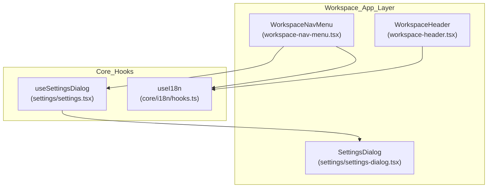
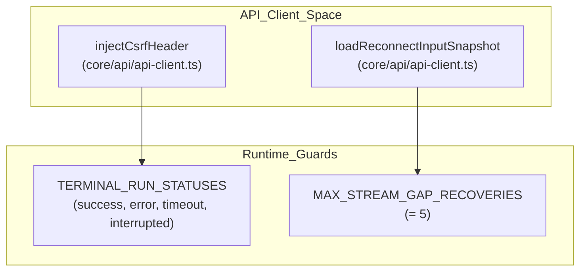

<!-- source: DeepWiki mcp.deepwiki.com · repo bytedance/deer-flow · page 10.4 Frontend Development · fetched 2026-10-29 -->

# Frontend Development

<details>
<summary>Relevant source files</summary>

The following files were used as context for generating this wiki page:

- [frontend/.env.example](frontend/.env.example)
- [frontend/README.md](frontend/README.md)
- [frontend/components.json](frontend/components.json)
- [frontend/src/AGENTS.md](frontend/src/AGENTS.md)
- [frontend/src/app/page.tsx](frontend/src/app/page.tsx)
- [frontend/src/components/theme-provider.tsx](frontend/src/components/theme-provider.tsx)
- [frontend/src/components/ui/aurora-text.tsx](frontend/src/components/ui/aurora-text.tsx)
- [frontend/src/components/ui/number-ticker.tsx](frontend/src/components/ui/number-ticker.tsx)
- [frontend/src/components/workspace/agents/agent-card.tsx](frontend/src/components/workspace/agents/agent-card.tsx)
- [frontend/src/components/workspace/artifacts/artifact-file-preview.tsx](frontend/src/components/workspace/artifacts/artifact-file-preview.tsx)
- [frontend/src/components/workspace/chats/chat-page.tsx](frontend/src/components/workspace/chats/chat-page.tsx)
- [frontend/src/core/agents/types.ts](frontend/src/core/agents/types.ts)
- [frontend/src/core/api/api-client.ts](frontend/src/core/api/api-client.ts)
- [frontend/src/core/api/stream-mode.ts](frontend/src/core/api/stream-mode.ts)
- [frontend/src/core/artifacts/html-assets.ts](frontend/src/core/artifacts/html-assets.ts)
- [frontend/src/core/auth/gateway-config.ts](frontend/src/core/auth/gateway-config.ts)
- [frontend/src/core/auth/permissions.ts](frontend/src/core/auth/permissions.ts)
- [frontend/src/core/config/index.ts](frontend/src/core/config/index.ts)
- [frontend/src/core/threads/stream-state.ts](frontend/src/core/threads/stream-state.ts)
- [frontend/src/env.js](frontend/src/env.js)
- [frontend/tests/e2e/agent-chat.spec.ts](frontend/tests/e2e/agent-chat.spec.ts)
- [frontend/tests/e2e/artifact-preview.spec.ts](frontend/tests/e2e/artifact-preview.spec.ts)
- [frontend/tests/e2e/sidebar.spec.ts](frontend/tests/e2e/sidebar.spec.ts)
- [frontend/tests/e2e/utils/mock-api.ts](frontend/tests/e2e/utils/mock-api.ts)
- [frontend/tests/unit/components/workspace/artifacts/artifact-file-preview.dom.test.tsx](frontend/tests/unit/components/workspace/artifacts/artifact-file-preview.dom.test.tsx)
- [frontend/tests/unit/components/workspace/input-box-send-gating.dom.test.tsx](frontend/tests/unit/components/workspace/input-box-send-gating.dom.test.tsx)
- [frontend/tests/unit/core/agents/api.test.ts](frontend/tests/unit/core/agents/api.test.ts)
- [frontend/tests/unit/core/api/api-client.test.ts](frontend/tests/unit/core/api/api-client.test.ts)
- [frontend/tests/unit/core/api/stream-mode.test.ts](frontend/tests/unit/core/api/stream-mode.test.ts)
- [frontend/tests/unit/core/artifacts/html-assets-auth.dom.test.ts](frontend/tests/unit/core/artifacts/html-assets-auth.dom.test.ts)
- [frontend/tests/unit/core/auth/gateway-config.test.ts](frontend/tests/unit/core/auth/gateway-config.test.ts)
- [frontend/tests/unit/core/auth/permissions.test.ts](frontend/tests/unit/core/auth/permissions.test.ts)
- [frontend/tests/unit/core/threads/incremental-stream-state.dom.test.tsx](frontend/tests/unit/core/threads/incremental-stream-state.dom.test.tsx)

</details>


This page provides a comprehensive technical guide for developing, configuring, and testing frontend components within the DeerFlow application. It covers the core technology stack, Next.js App Router structure, component hierarchies, state management using LangGraph SDK, API client plumbing, mock APIs, and styling approaches.

---

## Technology Stack and Prerequisites

DeerFlow's frontend is built using a modern and scalable web technology stack optimized for high-performance streaming AI interactions, responsive layouts, and rich client-side state handling.

| Technology          | Purpose                                   | Version / Comments                                      |
|---------------------|-------------------------------------------|--------------------------------------------------------|
| **Next.js**          | React framework with App Router            | Version 16+ [frontend/README.md:7]()                    |
| **React**            | UI component library                       | Version 19 [frontend/README.md:8]()                      |
| **TypeScript**       | Static typing and type safety              | Used throughout the codebase [frontend/package.json:1-135]() |
| **Tailwind CSS**     | Utility-first styling system                | Version 4, includes custom animations and themes [frontend/README.md:8]() |
| **LangGraph SDK**    | AI agent orchestration and event streaming | `@langchain/langgraph-sdk` [frontend/README.md:9]()     |
| **TanStack Query**   | Server-state caching and synchronization    | React Query for data fetching and caching [frontend/package.json:104-106]() |

The development environment requires Node.js 22+, pnpm, and modern browsers for testing.

Sources: [frontend/README.md:7-9](), [frontend/package.json:1-135]()

---

## Project Structure Overview

The project follows Next.js App Router conventions combined with a domain-driven `core/` logic folder and well-organized component subdirectories:

```
frontend/
├── src/
│   ├── app/                          # Next.js page routes: /workspace, /showcase, /mock
│   ├── components/                   # Reusable React components
│   │   ├── ui/                      # Atomic UI elements
│   │   ├── workspace/               # Workspace-specific UI components (chat, artifacts, settings)
│   │   ├── landing/                 # Landing page components
│   │   └── ai-elements/             # AI integration UI widgets
│   ├── core/                        # Application core logic and business rules
│   │   ├── api/                     # API clients and request management
│   │   ├── config/                  # Configuration utilities and environment access
│   │   ├── threads/                 # Chat thread state and hooks
│   │   ├── artifacts/               # Artifact file and content handling
│   │   ├── i18n/                   # Internationalization support
│   │   ├── settings/                # User settings state
│   │   └── utils/                   # Utility helpers
│   ├── hooks/                       # Custom React hooks 
│   ├── lib/                         # Shared libraries and helper functions
│   ├── server/                      # Server-side code and authentication helpers
│   └── styles/                      # Tailwind CSS and global styles
├── tests/
│   ├── e2e/                        # Playwright E2E test suites, many with mocked backend APIs
│   └── unit/                       # Rstest unit test suites mirroring src/ directory
```

Sources: [frontend/README.md:91-126]()

---

## Component Architecture and Workspace Layout

The core interactive workspace, especially the chat interface, is composed of layered React components coordinated to enable dynamic layouts and real-time streaming data. Navigation components like `WorkspaceNavMenu` and `WorkspaceHeader` manage system settings triggers, site navigation, and sidebar states.

### Data Flow Diagram: Workspace Component Interaction



Sources: [frontend/src/components/workspace/workspace-nav-menu.tsx:53-150](), [frontend/src/components/workspace/workspace-header.tsx:18-67](), [frontend/src/components/workspace/settings/settings-dialog.tsx:101-214]()

---

## API Client, Streaming, and Replay Management

The frontend-backend communication uses the LangGraph SDK client enhanced by local plumbing and API client adapters defined in `core/api/api-client.ts`. This module manages CSRF injection, streaming lifecycle, reconnect logic, and terminal state awareness.

### Key Features and Implementation Details

- **CSRF Token Injection:** The `injectCsrfHeader` function intercepts outgoing requests with state-changing HTTP methods (POST, PUT, DELETE) and injects a fresh `X-CSRF-Token` header parsed from the live `csrf_token` cookie before each fetch call for security compliance [frontend/src/core/api/api-client.ts:31-42]().
  
- **Terminal Run Statuses:** The `TERMINAL_RUN_STATUSES` set enumerates run states that terminate streaming (`success`, `error`, `timeout`, `interrupted`). These statuses prevent the client from attempting to stream from completed or halted runs [frontend/src/core/api/api-client.ts:66-71]().
  
- **Stream Replay and Gap Recovery:** Streaming runs can experience replay gaps. The client caps reconnect attempts to 5 via `MAX_STREAM_GAP_RECOVERIES` to prevent indefinite retry loops [frontend/src/core/api/api-client.ts:73-75]().
  
- **Input Snapshot Recovery:** The asynchronous `loadReconnectInputSnapshot` function fetches the durable input state of a run and merges it with existing messages to produce a consistent reconnection snapshot. It deduplicates messages by ID to avoid duplicate rendering on reconnect [frontend/src/core/api/api-client.ts:119-180]().

### API Stream and Replay Management Diagram



Sources: [frontend/src/core/api/api-client.ts:20-180]()

---

## Mock APIs and Static Demo Support

To enable development and testing without a live backend, DeerFlow implements mock APIs and static demos:

- The mock backends intercept LangGraph and Gateway API calls, providing deterministic fake data useful for integration testing and E2E Playwright tests.
- Mock API routes are configured in the Next.js server and rewrites to serve from `/mock/api` when no backend URLs are configured [frontend/next.config.js:35-86]() (not shown in excerpts but referenced).
- The dynamic URL resolver `getLangGraphBaseURL(isMock?: boolean)` returns either the production LangGraph API base or mock API base depending on environment variables and runtime [frontend/src/core/config/index.ts:21-40]().

This architecture supports UI development with full frontend interactivity and streaming simulation without requiring backend deployment.

Sources: [frontend/tests/e2e/utils/mock-api.ts:1-183](), [frontend/src/core/config/index.ts:21-40]()

---

## Artifact Content Loading and Range Handling

Artifacts (files generated by agents or uploaded) are loaded and rendered efficiently with support for partial content and stream integration:

- The `loadArtifactContent` method manages HTTP range requests to fetch large files incrementally, handling edge cases such as empty files, rolling hashes (FNV-1a or SHA-256), and UTF-8 decoding [frontend/src/core/artifacts/loader.ts:10-116]().
- The React hook `useArtifactContent` uses TanStack Query for data fetching, caching, and automatic refetching. It provides querying capabilities for partial or full content reads and subscribes to run settlement events to trigger refresh when necessary [frontend/src/core/artifacts/hooks.ts:8-77]().
  
These utilities allow lightweight previewing and editing of large artifact files in the UI, keeping networking minimal and user experience responsive.

Sources: [frontend/src/core/artifacts/loader.ts:1-147](), [frontend/src/core/artifacts/hooks.ts:1-132]()

---

## Settings and Configuration User Interface

The settings dialog centralizes user and app configurations:

- `SettingsDialog` coordinates multiple sub-pages asynchronously, including `MemorySettingsPage` for long-term memory preferences, appearance, account, and model options [frontend/src/components/workspace/settings/settings-dialog.tsx:101-214]().
- These components leverage React state hooks, React context, and TanStack Query for data loading and saving.
  
The modular design accommodates future expansion of user-facing settings without disrupting the core application flow.

Sources: [frontend/src/components/workspace/settings/settings-dialog.tsx:101-214](), [frontend/src/components/workspace/settings/memory-settings-page.tsx:1-232]()

---

# Summary

This page covered essential frontend development topics in DeerFlow, including:

- Modern Next.js App Router architecture combined with React 19 and Tailwind CSS 4, enabling responsive AI interaction UIs.
- Robust API client with CSRF header injection, terminal run status awareness, streaming reconnection with replay gaps capped, and input snapshot recovery.
- Clear project structure combining Next.js pages, reusable UI components, core domain logic, and custom hooks.
- Mock backend APIs and static demo support for development and testing without real backend dependencies.
- Artifact content streaming and partial retrieval strategies for efficient large file handling.
- Comprehensive settings UI infrastructure supporting modular configuration pages.

These foundations enable building and extending DeerFlow's rich frontend system confidently and efficiently.

Sources:  
[frontend/README.md:1-153](),  
[frontend/package.json:1-135](),  
[frontend/src/core/api/api-client.ts:1-180](),  
[frontend/src/core/config/index.ts:21-40](),  
[frontend/tests/e2e/utils/mock-api.ts:1-183](),  
[frontend/src/core/artifacts/loader.ts:1-147](),  
[frontend/src/core/artifacts/hooks.ts:1-132](),  
[frontend/src/components/workspace/settings/settings-dialog.tsx:101-214](),  
[frontend/src/components/workspace/settings/memory-settings-page.tsx:1-232]()

# End of "Frontend Development" (10.4)

---

