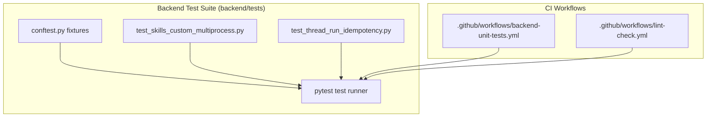
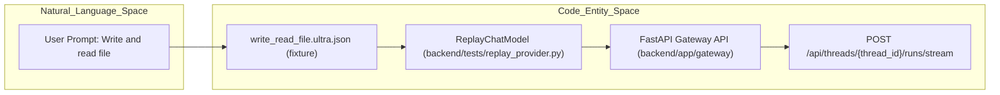
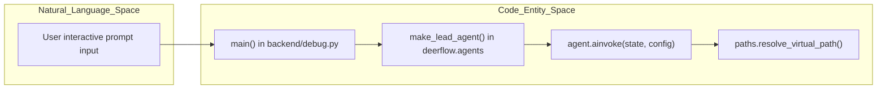

<!-- source: DeepWiki mcp.deepwiki.com · repo bytedance/deer-flow · page 10.5 Testing and Debugging · fetched 2026-10-29 -->

# Testing and Debugging

Relevant source files

The following files were used as context for generating this wiki page:

- [.github/workflows/backend-blocking-io-tests.yml](.github/workflows/backend-blocking-io-tests.yml)
- [.github/workflows/backend-unit-tests.yml](.github/workflows/backend-unit-tests.yml)
- [.github/workflows/e2e-tests.yml](.github/workflows/e2e-tests.yml)
- [.github/workflows/frontend-unit-tests.yml](.github/workflows/frontend-unit-tests.yml)
- [.github/workflows/lint-check.yml](.github/workflows/lint-check.yml)
- [.github/workflows/replay-e2e.yml](.github/workflows/replay-e2e.yml)
- [.github/workflows/skill-review-ci.yml](.github/workflows/skill-review-ci.yml)
- [.pre-commit-config.yaml](.pre-commit-config.yaml)
- [backend/debug.py](backend/debug.py)
- [frontend/eslint.config.js](frontend/eslint.config.js)
- [frontend/src/app/showcase/[thread_id]/page.tsx](frontend/src/app/showcase/[thread_id]/page.tsx)
- [frontend/src/components/workspace/chats/use-thread-chat.ts](frontend/src/components/workspace/chats/use-thread-chat.ts)
- [frontend/src/components/workspace/code-editor.tsx](frontend/src/components/workspace/code-editor.tsx)
- [frontend/src/components/workspace/command-palette.tsx](frontend/src/components/workspace/command-palette.tsx)
- [frontend/src/core/threads/static-demo.ts](frontend/src/core/threads/static-demo.ts)
- [frontend/src/core/uploads/api.ts](frontend/src/core/uploads/api.ts)
- [frontend/src/core/uploads/hooks.ts](frontend/src/core/uploads/hooks.ts)
- [frontend/tests/e2e/chat.spec.ts](frontend/tests/e2e/chat.spec.ts)
- [frontend/tests/e2e/thread-history.spec.ts](frontend/tests/e2e/thread-history.spec.ts)
- [frontend/tests/unit/core/uploads/api.test.ts](frontend/tests/unit/core/uploads/api.test.ts)

This document provides comprehensive technical guidance for testing and debugging DeerFlow's backend, frontend, and integrated runtime systems. It covers test strategies including backend unit tests, blocking-IO detection, record/replay E2E testing, Playwright UI validation, debugging helpers (`backend/debug.py`), and best practices for maintaining system correctness.

---

## Backend Testing Infrastructure

DeerFlow enforces automated testing on all backend code using `pytest` running under the `uv` runtime environment. Tests and linting are run via GitHub Actions workflows, specifically `.github/workflows/backend-unit-tests.yml` and `.github/workflows/lint-check.yml`.

### Continuous Integration Workflows and Environment

- **Linting and Type-Checking:**  
  Backend code quality is continuously checked using Python linting (`make lint`) and verifying dependency lockfile synchronization with `uv lock --check`.
  
- **Backend Unit Tests:**  
  Unit tests are sharded into 4 parallel jobs to distribute the workload effectively across runners. Postgres 17 and Redis 7 containers are provisioned during CI to enable full-stack integration tests covering persistence and caching layers. Historical runtime data guides shard balancing to minimize total CI time.

- **Dependency Isolation:**  
  The documented developer dependency install path (`uv sync --group dev`) is validated to ensure lazy loading of optional dependencies, preserving flexible development experience.
  

Sources:  
[.github/workflows/backend-unit-tests.yml:1-116](),  
[.github/workflows/lint-check.yml:41-69]()

### Test Suite Structure and Invariants

The backend test suite located under `backend/tests/` rigorously maintains core runtime correctness:

- **Multiprocess Custom Skills Testing:**  
  `test_skills_custom_multiprocess.py` verifies safe concurrent execution of custom skills using independent spawn workers sharing a temporary skill root, focusing on resource locking and predecessor/run chaining correctness.

- **Thread Run Idempotency and Mixed-Version Resume:**  
  `test_thread_run_idempotency.py` exercises a real shared SQL repository with legacy projections to assert correctness of upgrade locking behavior and proper handling of persistence conflicts.

- **PostgreSQL Batch Fixtures:**  
  Utility helpers handle asyncpg database URL transformations and settings (e.g., stripping incompatible `sslmode` options) to harmonize SQL test fixtures.

Sources:  
[backend/tests/AGENTS.md:1-130]()

---

## Blocking IO and Concurrency Detection

Because DeerFlow is an `asyncio`-based system, blocking IO operations inside async functions degrade performance and responsiveness significantly.

- **Static Analysis Tools:**  
  The codebase is scanned for forbidden blocking calls inside `async def` functions, particularly synchronous file/network ops lacking appropriate async wrappers.

- **Thread Boundaries:**  
  The system explicitly separates event loop management from blocking executors and synchronous worker pools, maintaining clear execution context boundaries.

- **Test Fixtures for Blocking IO:**  
  Blocking IO compliance is verified through dedicated fixture tests which ensure execution of filesystem and subprocess actions happens within appropriate threads (`asyncio.to_thread`) or executors, validated by tests such as `blocking_io/test_integrations_router.py`.

Sources:  
[backend/tests/AGENTS.md:113-116](),  
[.github/workflows/backend-blocking-io-tests.yml]()

---

## Record/Replay End-to-End (E2E) Testing

DeerFlow employs a layered record/replay E2E testing strategy to guarantee stability of frontend-backend contracts and UI consistency:

### Layer 1 — Backend Golden Replay

- Recorded Server-Sent Events (SSE) streams simulate chat conversations. These extend from golden fixtures stored under `backend/tests/fixtures/replay`.
- `ReplayChatModel` provides a LangChain-compatible mock model implementation that maps hashed prompts (after scrubbing volatile UUIDs) to recorded responses, stabilizing test inputs.
- Backend API endpoints replay these streams to verify SSE event sequences and payloads against the committed golden state with exactness.

### Layer 2 — Full-Stack Replay Render with Playwright

- Next.js frontend is configured in replay mode with the same fixtures, connected to the replay gateway backend.
- Playwright launches Chromium to load replayed conversations, performing DOM assertions to confirm UI state matches replay expectations.
- This integration ensures front-back protocol compatibility and guards against regressions in rendering logic.

### Record/Replay Data Flow: From Natural Language to Code Entities

Sources:  
[.github/workflows/replay-e2e.yml:1-114](),  
[backend/tests/AGENTS.md:124-130]()

---

## Frontend Testing

The frontend benefits from extensive unit tests and end-to-end testing with Playwright.

### Mock API Layer and Streaming Utilities

- `mockLangGraphAPI` intercepts frontend requests to simulate LangGraph and Gateway API responses, including providing stable thread lists, messages, and streaming SSE data.
- `handleRunStream` utility simulates SSE streams incrementally emitting run events/messages to mimic live agent output streaming realistically.
- These mocks enable tests verifying critical UI behaviors such as conversation switching, message streaming continuation, submission race conditions, and stale request cancellations.

Example tested scenarios include:
- Dropping of stale continuations when switching conversations mid-submission.
- Resetting thread identity when dropping project scope during chat submission.
- Ensuring streaming messages remain copyable while next agent response starts.

Sources:  
[frontend/tests/e2e/chat.spec.ts:1-193](),  
[frontend/tests/unit/core/uploads/api.test.ts:1-155]()

---

## Debugging Helpers and Best Practices

### Backend Debug Script (`backend/debug.py`)

An interactive debugging script is provided for development and troubleshooting of lead agent logic in isolation.

- **Execution Instructions:**  
  Run the script from the `backend/` directory with uv and PYTHONPATH set correctly:  
  `cd backend && PYTHONPATH=. uv run python debug.py`
  
- **Logging Configuration:**  
  Logs are routed exclusively to `debug.log` at startup to avoid polluting the interactive terminal session output. The root logger removes any pre-existing handlers to ensure clean log output.

- **Interactive Loop:**  
  The script initializes core DeerFlow app configuration and MCP tool sets, then creates an instance of the lead agent configured for plan mode (`"is_plan_mode": True`). It provides a terminal prompt (using `prompt_toolkit` if installed) to interactively send user messages.  
  Responses and any presented artifacts (files) are displayed with their resolved paths in the console.

### Debug Mode Invocation Flow: From Natural Language to Code Entities

Sources:  
[backend/debug.py:1-171]()

### Frontend Debugging Tools

- **Static Showcase Mode:**  
  The frontend supports development mode with static demo threads that do not require running a backend service (`frontend/src/core/threads/static-demo.ts`). This speeds up UI component debugging.

- **Command Palette:**  
  The frontend includes a comprehensive command palette supporting keyboard shortcuts such as `Cmd+K` (open palette), `Cmd+Shift+N` (new chat), `Cmd+,` (settings), and `Cmd+/` (show shortcuts). This facilitates quick navigation and debugging workflows within the UI.

Sources:  
[backend/debug.py:1-171](),  
[frontend/src/components/workspace/command-palette.tsx:32-133]()

---

# References

- Backend tests documentation: `backend/tests/AGENTS.md`
- Backend debug script: `backend/debug.py`
- GitHub CI Workflows: `.github/workflows/backend-unit-tests.yml`, `.github/workflows/lint-check.yml`, `.github/workflows/replay-e2e.yml`
- Frontend E2E tests: `frontend/tests/e2e/chat.spec.ts`
- Frontend Command Palette: `frontend/src/components/workspace/command-palette.tsx`

Sources:  
[backend/tests/AGENTS.md:1-130](),  
[backend/debug.py:1-171](),  
[.github/workflows/backend-unit-tests.yml:1-116](),  
[.github/workflows/lint-check.yml:41-69](),  
[.github/workflows/replay-e2e.yml:1-114](),  
[frontend/tests/e2e/chat.spec.ts:1-193](),  
[frontend/src/components/workspace/command-palette.tsx:32-133]()

---

