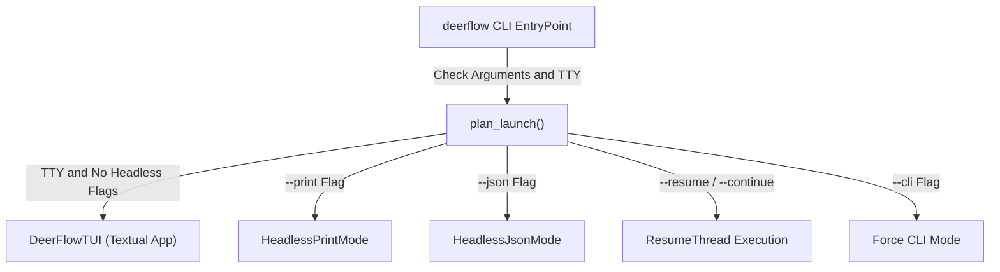
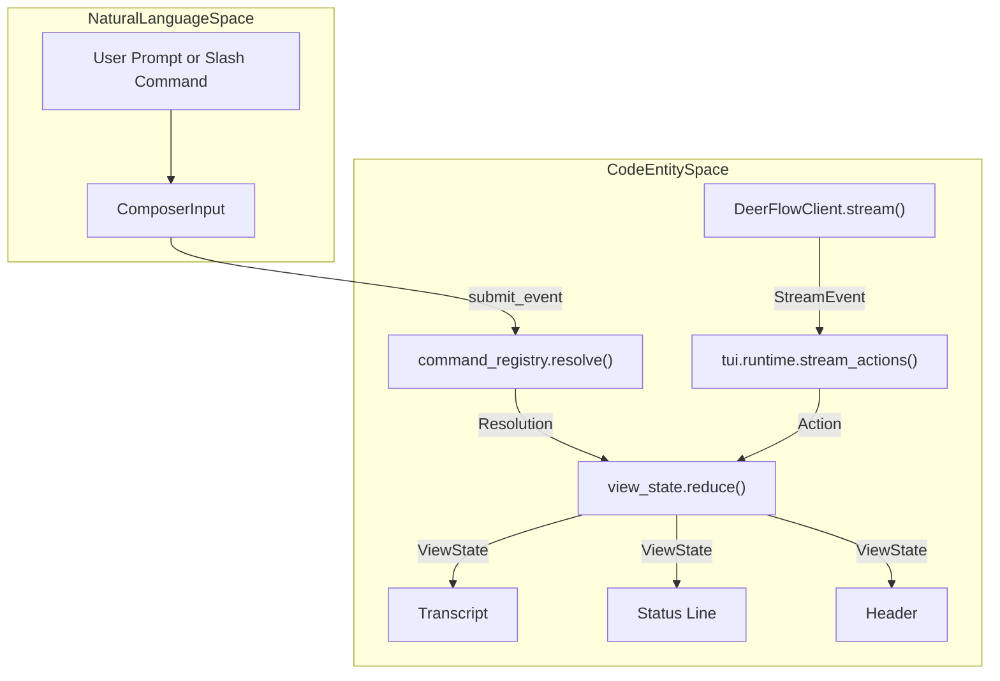
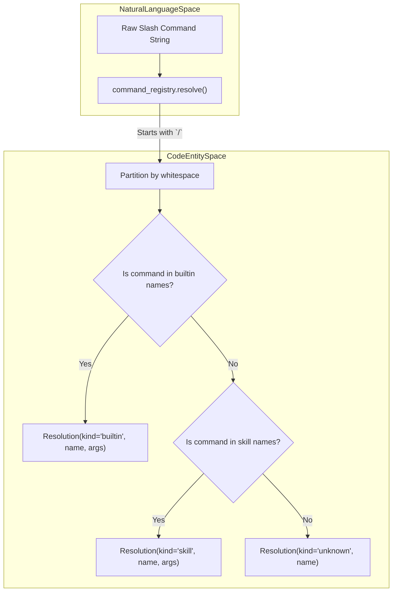

<!-- source: DeepWiki mcp.deepwiki.com · repo bytedance/deer-flow · page 10.6 Terminal Workbench (TUI) · fetched 2026-10-29 -->

# Terminal Workbench (TUI)

Relevant source files

The following files were used as context for generating this wiki page:

- [backend/app/gateway/routers/uploads.py](backend/app/gateway/routers/uploads.py)
- [backend/app/gateway/upload_ingestion.py](backend/app/gateway/upload_ingestion.py)
- [backend/docs/FILE_UPLOAD.md](backend/docs/FILE_UPLOAD.md)
- [backend/docs/TUI.md](backend/docs/TUI.md)
- [backend/packages/harness/deerflow/AGENTS.md](backend/packages/harness/deerflow/AGENTS.md)
- [backend/packages/harness/deerflow/client.py](backend/packages/harness/deerflow/client.py)
- [backend/packages/harness/deerflow/tui/AGENTS.md](backend/packages/harness/deerflow/tui/AGENTS.md)
- [backend/packages/harness/deerflow/tui/__init__.py](backend/packages/harness/deerflow/tui/__init__.py)
- [backend/packages/harness/deerflow/tui/__main__.py](backend/packages/harness/deerflow/tui/__main__.py)
- [backend/packages/harness/deerflow/tui/app.py](backend/packages/harness/deerflow/tui/app.py)
- [backend/packages/harness/deerflow/tui/cli.py](backend/packages/harness/deerflow/tui/cli.py)
- [backend/packages/harness/deerflow/tui/command_registry.py](backend/packages/harness/deerflow/tui/command_registry.py)
- [backend/packages/harness/deerflow/tui/input_history.py](backend/packages/harness/deerflow/tui/input_history.py)
- [backend/packages/harness/deerflow/tui/message_format.py](backend/packages/harness/deerflow/tui/message_format.py)
- [backend/packages/harness/deerflow/uploads/AGENTS.md](backend/packages/harness/deerflow/uploads/AGENTS.md)
- [backend/packages/harness/deerflow/uploads/manager.py](backend/packages/harness/deerflow/uploads/manager.py)
- [backend/tests/AGENTS.md](backend/tests/AGENTS.md)
- [backend/tests/test_channel_file_attachments.py](backend/tests/test_channel_file_attachments.py)
- [backend/tests/test_client.py](backend/tests/test_client.py)
- [backend/tests/test_lark_skill_manifest_atomic.py](backend/tests/test_lark_skill_manifest_atomic.py)
- [backend/tests/test_tui_app.py](backend/tests/test_tui_app.py)
- [backend/tests/test_tui_cli.py](backend/tests/test_tui_cli.py)
- [backend/tests/test_tui_cli_main.py](backend/tests/test_tui_cli_main.py)
- [backend/tests/test_tui_command_registry.py](backend/tests/test_tui_command_registry.py)
- [backend/tests/test_tui_input_history.py](backend/tests/test_tui_input_history.py)
- [backend/tests/test_tui_interrupted_run_drain.py](backend/tests/test_tui_interrupted_run_drain.py)
- [backend/tests/test_tui_run_isolation.py](backend/tests/test_tui_run_isolation.py)
- [backend/tests/test_tui_transparent.py](backend/tests/test_tui_transparent.py)
- [backend/tests/test_upload_copy_publication.py](backend/tests/test_upload_copy_publication.py)
- [backend/tests/test_uploads_manager.py](backend/tests/test_uploads_manager.py)
- [backend/tests/test_uploads_router.py](backend/tests/test_uploads_router.py)

The Terminal Workbench is a Textual-based terminal user interface (TUI) and command-line interface (CLI) for DeerFlow [backend/packages/harness/deerflow/tui/app.py:1-7](). It offers developers and operators an interactive environment within the terminal for orchestrating agents, managing skills, handling long-term memory, and inspecting conversational threads. This workbench mirrors the capabilities of the Web UI while allowing headless execution modes suited for automation, scripting, or usage in environments without graphical interfaces [backend/docs/TUI.md:3-6]().

Sources:
- [backend/packages/harness/deerflow/tui/app.py:1-7]()
- [backend/docs/TUI.md:3-6]()

---

## Overview and Launch Modes

The `deerflow` console script is the main entry point for the Terminal Workbench [backend/packages/harness/deerflow/tui/AGENTS.md:3](). It runs an **embedded** client over `DeerFlowClient`, meaning it communicates directly with the DeerFlow agent framework without requiring supporting services such as the Gateway API, frontend UI, Nginx, or Docker containers. This embedded runtime respects the global `config.yaml`, persistence via checkpointers, and environment settings, allowing seamless integration with existing DeerFlow backend infrastructure.

### Launch Modes

The workbench supports several launch modes, which control whether it runs interactively or outputs headless results:

| Mode                    | Flag / Command               | Description                                                                                                 | Reference                                            |
|-------------------------|-----------------------------|-------------------------------------------------------------------------------------------------------------|-----------------------------------------------------|
| Interactive TUI         | Default, or `deerflow --tui` | Launches `DeerFlowTUI` Textual app if stdin and stdout are TTYs                                             | [backend/docs/TUI.md:22](), [backend/packages/harness/deerflow/tui/app.py:83-213]()           |
| Transparent TUI          | `--tui-transparent`          | Same as TUI but uses the terminal’s default background color instead of a solid palette                      | [backend/docs/TUI.md:24](), [backend/packages/harness/deerflow/tui/app.py:198-203]()          |
| Headless Print Mode      | `--print`                   | One-shot synchronous execution streaming AI response chunks directly to stdout                               | [backend/docs/TUI.md:29](), [backend/packages/harness/deerflow/tui/cli.py:22-35]()            |
| Headless JSON Mode       | `--json`                    | Headless mode emitting newline-delimited JSON-serialized streaming `StreamEvent` objects                     | [backend/docs/TUI.md:30](), [backend/packages/harness/deerflow/client.py:133-149]()           |
| Continue                 | `--continue`                | Resume the most recent conversation thread                                                                 | [backend/docs/TUI.md:27](), [backend/packages/harness/deerflow/tui/cli.py:22-35]()            |
| Resume                   | `--resume <thread_id>`      | Resume a conversation by thread ID or title                                                                 | [backend/docs/TUI.md:28](), [backend/packages/harness/deerflow/tui/cli.py:22-35]()            |
| Force CLI mode           | `--cli`                     | Force the CLI/Headless mode for a single invocation regardless of tty presence                               | [backend/docs/TUI.md:25](), [backend/packages/harness/deerflow/tui/cli.py:22-35]()            |

The mode selection logic resides in the `plan_launch()` function inside `cli.py`. It inspects terminal capabilities and CLI flags, then determines whether to run the Textual event loop UI or execute headless streaming calls synchronously. Headless executions default to a recursion limit of 100 super-steps (model + tool calls) unless overridden by CLI options [backend/packages/harness/deerflow/tui/AGENTS.md:3-6]() [backend/docs/TUI.md:46-51]().

### Mode Launch Flow Overview

Sources:
- [backend/packages/harness/deerflow/tui/app.py:198-213]()
- [backend/docs/TUI.md:20-51]()
- [backend/packages/harness/deerflow/client.py:133-149]()
- [backend/packages/harness/deerflow/tui/AGENTS.md:3-6]()

---

## Architecture: DeerFlowTUI

The interactive TUI is implemented by the `DeerFlowTUI` class ([`deerflow.tui.app.DeerFlowTUI`]) which subclasses Textual's `App` base class [backend/packages/harness/deerflow/tui/app.py:102-213](). It maintains a single immutable `ViewState` instance containing all the visible session state. State updates are computed via pure reducer functions and rendered fully on each change for robust terminal UI refresh [backend/packages/harness/deerflow/tui/app.py:3-39]().

### Data Flow and Component Interaction

User inputs and slash command submissions enter via the `ComposerInput` widget, generating events forwarded to the command registry and the reducer that applies state transitions [backend/packages/harness/deerflow/tui/app.py:40](), [backend/packages/harness/deerflow/tui/command_registry.py:1-132]().

Agent computations use `DeerFlowClient.stream()`, which is a synchronous generator returning streaming `StreamEvent` updates [backend/packages/harness/deerflow/client.py:175-182](). Because it blocks, the run executes on a separate worker thread. Each yielded event is marshalled back to the UI main thread with Textual's `call_from_thread` function, then folded into the UI `ViewState`.

The UI components then render the transcript, status bar, header, and composer using this immutable state.

Sources:
- [backend/packages/harness/deerflow/tui/app.py:1-213]()
- [backend/packages/harness/deerflow/client.py:175-182]()
- [backend/packages/harness/deerflow/tui/command_registry.py:1-132]()

---

## Slash Commands

Slash commands input by the user via `/` are parsed and resolved through a centralized command registry in `command_registry.py` [backend/packages/harness/deerflow/tui/command_registry.py:1-12](). This system supports built-in command names as well as dynamically discovered skill commands, allowing flexible extension of TUI interactivity aligned with DeerFlow's skill system [backend/packages/harness/deerflow/skills/slash.py:9-17]().

Commands are parsed by splitting the input on whitespace and checking command names against sets of built-in commands and skill names in order [backend/packages/harness/deerflow/tui/command_registry.py:30-70]():

### Built-in Slash Commands

Below are the primary slash commands provided out of the box in the TUI [backend/packages/harness/deerflow/tui/command_registry.py:30-70]():

| Command       | Description                                     |
|---------------|------------------------------------------------|
| `/help`       | Show available commands and keybindings        |
| `/new`        | Start a new conversation thread                 |
| `/clear`      | Clear the transcript output (does not forget data) |
| `/threads` or `/switch` | Show a thread picker modal to switch conversations |
| `/resume <id>`| Resume a conversation by thread id or title     |
| `/goal`       | Set, show, or clear the active goal             |
| `/model`      | Select or view the LLM model                      |
| `/skills`     | Browse enabled skills and list available skills  |
| `/tools`      | List built-in tools, sandbox tools, and MCP tools |
| `/mcp`        | Show MCP server status and controls               |
| `/memory`     | Show memory status and injected facts             |
| `/uploads`    | View uploaded files associated with the current thread |
| `/artifacts`  | List generated artifacts across threads           |
| `/details`   | Toggle detailed activity rendering                |
| `/usage`      | Show token usage and context metadata              |
| `/config`     | Show resolved config paths and overrides           |
| `/quit`      | Quit the TUI application                            |

Skill commands can be invoked by `/skillname task ...` invoking any enabled skill with semantic parity to other DeerFlow clients.

Sources:
- [backend/packages/harness/deerflow/tui/command_registry.py:1-132]()
- [backend/packages/harness/deerflow/skills/slash.py:9-17]()

---

## Session Persistence and Synchronization with Web UI

The TUI shares the DeerFlow persistent storage backend with the Web UI, enabling seamless session continuity across environments. Persisted data includes conversation metadata rows and thread state stored in the `threads_meta` table, scoped to the default user ID `"default"` by the TUI [backend/packages/harness/deerflow/tui/AGENTS.md:13]().

This design allows conversations, activity goals, and state visible in the Web UI sidebar to be accessed, resumed, or modified from within the TUI without reliance on Gateway services. The persistence layer synchronizes thread metadata and run journal entries using the shared checkpointer and data migration systems built into DeerFlow [backend/packages/harness/deerflow/tui/AGENTS.md:3-15]().

Sources:
- [backend/packages/harness/deerflow/tui/AGENTS.md:3-15]()
- [backend/docs/TUI.md:97-129]()

---

## Embedded Runtime Client: `DeerFlowClient`

Underlying both the interactive TUI and headless modes is the `DeerFlowClient` class from the `deerflow.client` module [backend/packages/harness/deerflow/client.py:1-182](). This embedded client implements programmatic access to the DeerFlow agent system, bypassing the need for a remote LangGraph Server or Gateway API.

### Key Features

- **Synchronous and Streaming API:** Supports `.chat()` for one-off text queries and `.stream()` for incremental streaming of agent responses as `StreamEvent`s [backend/packages/harness/deerflow/client.py:175-182]().
- **Streaming Event Model:** Yields `StreamEvent` dataclasses of types `"values"`, `"messages-tuple"`, `"custom"`, and `"end"` reflecting incremental chat state snapshots, message updates, custom events, and stream termination respectively [backend/packages/harness/deerflow/client.py:133-149]().
- **Agent Configuration:** Supports runtime injection of model selection, subagent toggle, plan mode, available skill sets, and a checkpointer interface [backend/packages/harness/deerflow/client.py:95-120]().
- **Session and Persistence:** Manages thread state with integration into thread lockers, user context, run journals, and checkpoint state accessors [backend/packages/harness/deerflow/client.py:60-130]().
- **Sandbox Lease Management:** Automatically acquires and releases sandbox execution leases for code isolation during streaming runs [backend/packages/harness/deerflow/client.py:106-117]().
- **Trace Context Propagation:** Ensures request-level trace context correlation across threads and asynchronous boundaries [backend/packages/harness/deerflow/client.py:73-87]().

This client forms the backbone of the Terminal Workbench, executing agent logic embedded in-process while reusing the full DeerFlow runtime environment and config [backend/packages/harness/deerflow/client.py:1-182]().

Sources:
- [backend/packages/harness/deerflow/client.py:1-182]()

---

## Headless and One-Shot Execution

The TUI suite supports headless CLI modes designed for quick, single-message agents or integration scripting.

- **Print Mode (`--print`):** Runs a one-shot synchronous agent interaction streaming response text chunks to `stdout`, suitable for shell scripting or simple command-line use [backend/docs/TUI.md:29]().

- **JSON Mode (`--json`):** Emits newline-delimited JSON records of `StreamEvent` objects representing all streaming outputs, enabling fine-grained programmatic consumption and integration in JSON parsers [backend/docs/TUI.md:30]().

These modes bypass the Textual UI application entirely, running the embedded `DeerFlowClient` synchronously in the CLI process space.

Sources:
- [backend/docs/TUI.md:20-35]()
- [backend/packages/harness/deerflow/client.py:133-149]()

---

# Summary

The Terminal Workbench (TUI) for DeerFlow provides a feature-rich yet terminal-native interface for agent orchestration, skill management, session persistence, and embedded runtime execution. It uses the Textual framework to create an interactive experience and supports powerful slash commands and session syncing with the Web UI. The embedded `DeerFlowClient` runtime enables both interactive and headless workflows without external services, making the TUI an ideal tool for developers and operations in diverse environments.

# Sources

- [backend/packages/harness/deerflow/tui/app.py:1-213]()
- [backend/packages/harness/deerflow/client.py:1-182]()
- [backend/packages/harness/deerflow/tui/command_registry.py:1-132]()
- [backend/packages/harness/deerflow/skills/slash.py:9-17]()
- [backend/packages/harness/deerflow/tui/AGENTS.md:3-15]()
- [backend/docs/TUI.md:3-129]()
- [backend/packages/harness/deerflow/tui/cli.py:22-35]()

---

