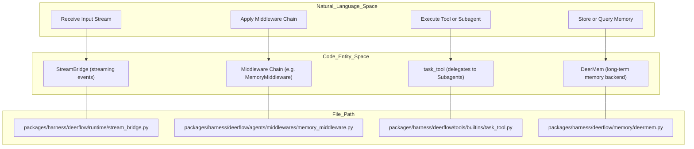
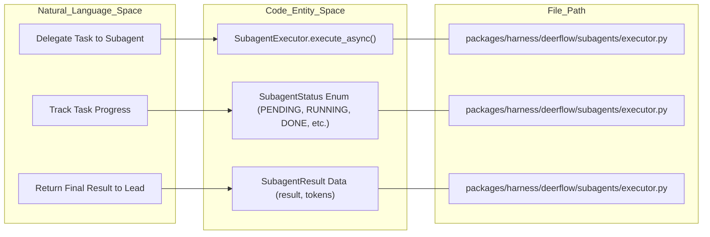

<!-- source: DeepWiki mcp.deepwiki.com · repo bytedance/deer-flow · page 11 Glossary · fetched 2026-10-29 -->

# Glossary

Relevant source files

The following files were used as context for generating this wiki page:

- [.env.example](.env.example)
- [CHANGELOG.md](CHANGELOG.md)
- [CHANGELOG_zh.md](CHANGELOG_zh.md)
- [README.md](README.md)
- [backend/AGENTS.md](backend/AGENTS.md)
- [backend/CLAUDE.md](backend/CLAUDE.md)
- [backend/README.md](backend/README.md)
- [backend/app/gateway/routers/input_polish.py](backend/app/gateway/routers/input_polish.py)
- [backend/docs/API.md](backend/docs/API.md)
- [backend/docs/ARCHITECTURE.md](backend/docs/ARCHITECTURE.md)
- [backend/docs/CONFIGURATION.md](backend/docs/CONFIGURATION.md)
- [backend/docs/README.md](backend/docs/README.md)
- [backend/docs/SANDBOX_MEMORY_PROFILING.md](backend/docs/SANDBOX_MEMORY_PROFILING.md)
- [backend/docs/TODO.md](backend/docs/TODO.md)
- [backend/packages/harness/deerflow/agents/middlewares/AGENTS.md](backend/packages/harness/deerflow/agents/middlewares/AGENTS.md)
- [backend/packages/harness/deerflow/agents/middlewares/llm_error_handling_middleware.py](backend/packages/harness/deerflow/agents/middlewares/llm_error_handling_middleware.py)
- [backend/packages/harness/deerflow/config/input_polish_config.py](backend/packages/harness/deerflow/config/input_polish_config.py)
- [backend/packages/harness/deerflow/extensions/manager.py](backend/packages/harness/deerflow/extensions/manager.py)
- [backend/packages/harness/deerflow/integrations/lark_cli.py](backend/packages/harness/deerflow/integrations/lark_cli.py)
- [backend/packages/harness/deerflow/skills/projection.py](backend/packages/harness/deerflow/skills/projection.py)
- [backend/packages/harness/deerflow/utils/AGENTS.md](backend/packages/harness/deerflow/utils/AGENTS.md)
- [backend/packages/harness/deerflow/utils/file_lock.py](backend/packages/harness/deerflow/utils/file_lock.py)
- [backend/packages/harness/deerflow/utils/file_outline.py](backend/packages/harness/deerflow/utils/file_outline.py)
- [backend/packages/harness/deerflow/utils/llm_text.py](backend/packages/harness/deerflow/utils/llm_text.py)
- [backend/tests/_windows_acl_helpers.py](backend/tests/_windows_acl_helpers.py)
- [backend/tests/test_extensions_config_raw_writes.py](backend/tests/test_extensions_config_raw_writes.py)
- [backend/tests/test_file_lock_retry.py](backend/tests/test_file_lock_retry.py)
- [backend/tests/test_file_outline.py](backend/tests/test_file_outline.py)
- [backend/tests/test_file_outline_atx.py](backend/tests/test_file_outline_atx.py)
- [backend/tests/test_file_outline_encoding.py](backend/tests/test_file_outline_encoding.py)
- [backend/tests/test_file_outline_html_comments.py](backend/tests/test_file_outline_html_comments.py)
- [backend/tests/test_file_outline_indented_bold.py](backend/tests/test_file_outline_indented_bold.py)
- [backend/tests/test_file_outline_split_bold.py](backend/tests/test_file_outline_split_bold.py)
- [backend/tests/test_file_outline_text_budget.py](backend/tests/test_file_outline_text_budget.py)
- [backend/tests/test_input_polish_router.py](backend/tests/test_input_polish_router.py)
- [backend/tests/test_lark_cli_install_lock.py](backend/tests/test_lark_cli_install_lock.py)
- [backend/tests/test_lark_cli_integration.py](backend/tests/test_lark_cli_integration.py)
- [backend/tests/test_llm_error_handling_middleware.py](backend/tests/test_llm_error_handling_middleware.py)
- [backend/tests/test_mcp_artifact_capture.py](backend/tests/test_mcp_artifact_capture.py)
- [backend/tests/test_run_journal_visible_summary.py](backend/tests/test_run_journal_visible_summary.py)
- [backend/tests/test_sandbox_memory_profile_script.py](backend/tests/test_sandbox_memory_profile_script.py)
- [backend/tests/test_skill_projection.py](backend/tests/test_skill_projection.py)
- [backend/tests/test_support_bundle.py](backend/tests/test_support_bundle.py)
- [backend/tests/test_think_tag_boundaries.py](backend/tests/test_think_tag_boundaries.py)
- [backend/tests/test_utils_llm_text.py](backend/tests/test_utils_llm_text.py)
- [config.example.yaml](config.example.yaml)
- [scripts/AGENTS.md](scripts/AGENTS.md)
- [scripts/sandbox_memory_profile.py](scripts/sandbox_memory_profile.py)
- [scripts/support_bundle.py](scripts/support_bundle.py)

## Purpose and Scope

The purpose of this page is to provide onboarding engineers and contributors with a precise technical vocabulary for the DeerFlow 2.0 ecosystem. DeerFlow (**D**eep **E**xploration and **E**fficient **R**esearch **Flow**) is an open-source **super agent harness** that orchestrates sub-agents, memory, and sandboxes to perform complex tasks via extensible skills [README.md:12-13](). This document bridges the gap between high-level architectural concepts and specific code entities such as classes, functions, and file paths.

Sources: [README.md:12-13](), [backend/AGENTS.md:5-30]()

---

## System Components

### Super Agent Harness
The core architecture of DeerFlow 2.0 is a super agent harness. Unlike a simple chatbot, this harness provides comprehensive infrastructure including middleware, sandbox isolation, memory systems, and tool integrations to run autonomous agents capable of delegating tasks and manipulating files independently [README.md:12-13]().

- **Implementation**: The harness core resides in the `deerflow-harness` package, specifically under `backend/packages/harness/deerflow/runtime/` and related submodules [backend/AGENTS.md:7-9]().
- **Role**: It manages agent execution lifecycles, event streaming, checkpointing, and hierarchical subagent orchestration.

Sources: [README.md:12-13](), [backend/AGENTS.md:7-9]()

### Lead Agent
The lead agent is the primary, single LangGraph-based agent entry point for user interactions. It integrates dynamic model selection, a robust middleware chain, built-in and MCP tools, and manages subagent delegation [backend/README.md:43-52]().

- **Factory Function**: Created via `make_lead_agent(config)` [backend/packages/harness/deerflow/agents/lead_agent/agent.py:1-23]().
- **Middleware Chain**: Consists of rigorously ordered middlewares (e.g., `SandboxMiddleware`, `MemoryMiddleware`, `GuardrailMiddleware`) that collectively shape the agent prompt, enforce safety, and manage file systems [backend/README.md:53-68]().

Sources: [backend/README.md:43-68](), [backend/packages/harness/deerflow/agents/lead_agent/agent.py:1-23]()

### Gateway API
A FastAPI-based backend service (port 8001) that exposes REST endpoints and the LangGraph-compatible streaming API, serving as the core interface between the frontend application and the agent runtime [backend/AGENTS.md:10-10]().

- **Responsibilities**: Handles thread management, run execution, model catalogs, memory systems, skills, artifacts, and SSE streaming responses [backend/README.md:34-38]() [backend/app/gateway/services.py:1-172]().
- **Run Management**: Uses `RunManager` for lifecycle control, streams events via `StreamBridge`, and orchestrates checkpoint storage.

Sources: [backend/AGENTS.md:10-10](), [backend/README.md:34-38](), [backend/app/gateway/services.py:1-172]()

### LangGraph Server & Runtime
The execution engine underlying the agent architecture is based on LangGraph, providing a stateful actor graph model for asynchronous multi-agent coordination.

- **Interaction**: The LangGraph runtime is embedded inside the FastAPI Gateway and orchestrates runs via `RunManager` and event publishing to `StreamBridge` [backend/AGENTS.md:16-16]() [backend/packages/harness/deerflow/runtime/runs/worker.py:1-150]().

Sources: [backend/AGENTS.md:16-16](), [backend/packages/harness/deerflow/runtime/runs/worker.py:1-150]()

### Sandbox
An isolated execution environment designed to securely execute code, manage file I/O, and perform shell operations without compromising host security [backend/README.md:75-87]().

- **SandboxProvider Interface**: Abstracts backend implementations offering path virtualization, container isolation, and lifecycle management [backend/README.md:75-87]() [backend/docs/CONFIGURATION.md:1-50]().
- **Backends**: Include `LocalSandboxProvider` (filesystem-based) and async Docker container providers (`AioSandboxProvider`) [backend/README.md:79-82]().

Sources: [backend/README.md:75-87](), [backend/docs/CONFIGURATION.md:1-50]()

---

## Natural Language to Code Entity Space

### 1. Agent Runtime Pipeline

This diagram bridges high-level agent execution (Natural Language Space) with the core runtime classes and functions (Code Entity Space).

Sources: [backend/AGENTS.md:16-19](), [backend/README.md:43-52](), [backend/packages/harness/deerflow/runtime/stream_bridge.py:1-100](), [backend/packages/harness/deerflow/agents/middlewares/memory_middleware.py:1-80](), [backend/packages/harness/deerflow/tools/builtins/task_tool.py:1-40](), [backend/packages/harness/deerflow/memory/deermem.py:1-50]()

### 2. Subagent Delegation Flow

This diagram illustrates the flow from natural language subtask delegation to subagent execution lifecycle in code entities.

Sources: [backend/AGENTS.md:17-19](), [backend/packages/harness/deerflow/subagents/executor.py:1-130]()

---

## Core Technical Terms

### Super Agent Harness
**Definition:** The underlying framework of DeerFlow that manages agent execution, subagents, memory, sandboxing, and tool invocation [README.md:12-13]().

Sources: [README.md:12-13]()

### Lead Agent
**Definition:** The primary LangGraph agent instance that receives user inputs, applies middleware, delegates tasks, and surfaces results [backend/README.md:43-52]().

- **Key Code:** `make_lead_agent(config)` [backend/packages/harness/deerflow/agents/lead_agent/agent.py:1-23]()

Sources: [backend/README.md:43-52](), [backend/packages/harness/deerflow/agents/lead_agent/agent.py:1-23]()

### Subagent and SubagentExecutor
| Term             | Definition                                                                                      | Code Reference                                            |
|------------------|------------------------------------------------------------------------------------------------|-----------------------------------------------------------|
| **Subagent**     | A specialized worker agent spawned to perform delegated subtasks concurrently.                  | `SubagentExecutor` and related classes in `subagents/`    |
| **SubagentExecutor** | Manages asynchronous execution of subagents with lifecycle, cancellation, and timeout handling.| `packages/harness/deerflow/subagents/executor.py` [backend/packages/harness/deerflow/subagents/executor.py:1-2278]()          |
| **SubagentResult**  | Data container capturing the outcome, token usage, and metadata of a subagent run.             | `SubagentResult` class in `executor.py` [backend/packages/harness/deerflow/subagents/executor.py:117-154]()                    |
| **SubagentStatus**  | Enum defining possible states of a subagent task (e.g., PENDING, RUNNING, COMPLETED, FAILED).  | `SubagentStatus` enum in `executor.py` [backend/packages/harness/deerflow/subagents/executor.py:97-114]()                     |

Sources: [backend/AGENTS.md:17-19](), [backend/packages/harness/deerflow/subagents/executor.py:1-130]()

### RunJournal and RunManager
- **RunJournal:** Persistent structured record of an agent run including checkpoints, state snapshots, and event logs.
- **RunManager:** Service managing runs, transitions, state storage, and event streaming [backend/app/gateway/services.py:1-172]().

Sources: [backend/packages/harness/deerflow/runtime/journal.py:1-100](), [backend/app/gateway/services.py:1-172]()

### StreamBridge
- **Function:** Bridges internal runtime agent events to SSE frames formatted for HTTP streaming clients.
- **Details:** Supports event batching, gap recovery, and multiple streaming modes [backend/app/gateway/services.py:165-172]().

Sources: [backend/packages/harness/deerflow/runtime/stream_bridge.py:1-100]()

### GuardrailProvider and GuardrailMiddleware
| Term                | Definition                                                  | Code Reference                                        |
|---------------------|--------------------------------------------------------------|-------------------------------------------------------|
| **GuardrailProvider** | Contract interface to implement pre-tool-call authorization policies.| Referenced in agent middleware setup in `factory.py`  |
| **GuardrailMiddleware** | Middleware enforcing guardrails, configurable fail-closed policies.| Agent middleware class in harness codebase             |

Sources: [backend/packages/harness/deerflow/agents/factory.py:1-40]()

### Skill and SkillScan
- **Skill:** Packaged agent capability archives (`.skill`) that include tools, prompts, and handlers [backend/README.md:81-85]().
- **SkillScan:** Security and consistency scanning process performed on skill archives prior to installation; critical issues block installation, warnings surface as LLM context [backend/README.md:81-85]().

Sources: [backend/README.md:81-85]()

### SandboxProvider and VirtualPath
| Term              | Definition                                                     | Code Reference                             |
|-------------------|-----------------------------------------------------------------|--------------------------------------------|
| **SandboxProvider** | Abstract interface managing sandbox lifecycle, acquisition, release, lease management and path virtualization.| Described in `sandbox/` modules, e.g. LocalSandboxProvider and AioSandboxProvider [backend/README.md:75-87]() |
| **VirtualPath**   | Abstract paths such as `/mnt/user-data`, mapped to physical workspace directories per thread for secure isolation.| Implementation detail in sandbox path mapping and virtual FS layers |

Sources: [backend/README.md:75-87]()

### ThreadState and Checkpointer
- **ThreadState:** Persistent data structure representing dialogue state, filesystem state, and execution context for an agent thread [backend/packages/harness/deerflow/agents/thread_state.py:1-100]().
- **Checkpointer:** Mechanism allowing agent graph checkpoint saving and loading, typically LangGraph’s checkpoint abstractions [backend/packages/harness/deerflow/agents/factory.py:26-35]().

Sources: [backend/packages/harness/deerflow/agents/thread_state.py:1-100](), [backend/packages/harness/deerflow/agents/factory.py:26-35]()

### DeerMem
Long-term LLM-powered memory backend that extracts, stores, and retrieves user context and facts. Supports debounced batch writes and fact confidence scoring [backend/README.md:97-106]().

Sources: [backend/README.md:97-106]()

### Artifact
Entities representing files or structured data produced by agents. Used in messaging, UI display, and skill file management [README.md:114-125]().

Sources: [README.md:114-125]()

### MCP and tool_search
- **MCP (Model Context Protocol):** Protocol and toolkit for tool discovery, invocation, and integration in agent contexts [backend/AGENTS.md:20-22]().
- **tool_search:** Utility tool that agents invoke to discover other available tools dynamically in a running registry [backend/AGENTS.md:20-22]() [backend/packages/harness/deerflow/tools/builtins/tool_search.py:1-100]().

Sources: [backend/AGENTS.md:20-22](), [backend/packages/harness/deerflow/tools/builtins/tool_search.py:1-100]()

### ScheduledTask
- **Definition:** Tasks configured to run once or on a cron schedule within DeerFlow, managed with leases to coordinate execution across instances [backend/AGENTS.md:18-20]().
- **context_mode:** Defines whether runs re-use existing threads or start fresh threads for each scheduled execution [backend/AGENTS.md:18-20]().

Sources: [backend/AGENTS.md:18-20]()

### Extension API Terms
- **ExtensionInstall:** Entry point abstraction for an extension to register and configure capabilities in the harness [backend/pyproject.toml:12-15]().
- **ExtensionRegistry:** Maintains information on installed extensions and their runtime dependencies [backend/pyproject.toml:12-15]().
- **deerflow-extension-api:** The contract package defining extension APIs and shared types [backend/pyproject.toml:12-15]().

Sources: [backend/pyproject.toml:12-15]()

---

## Infrastructure & Tooling Terms

| Term    | Definition                                       | Code Reference               |
|---------|-------------------------------------------------|------------------------------|
| **uv**  | Python-based project workspace manager used for the backend packages. | `uv.lock` file [backend/uv.lock:1-11]() |
| **pnpm**| JavaScript package manager used for frontend dependencies. | `Makefile` |
| **LangGraph** | Orchestration framework enabling stateful multi-actor graphs for LLM apps. | `langgraph` dependency and runtime |

Sources: [backend/uv.lock:1-11]()

---

## Summary Table of Core Terms

| Term              | Description                                    | Key Code Location / Class                                  |
|-------------------|------------------------------------------------|------------------------------------------------------------|
| Super Agent Harness| Agent orchestration infrastructure with tool, subagent, sandbox, memory management. | `deerflow-harness/` package                                |
| Lead Agent        | Top-level LangGraph agent runtime entry point. | `make_lead_agent(config)` [backend/packages/harness/deerflow/agents/lead_agent/agent.py:1-23]() |
| Subagent          | Secondary agent task executor for parallelism.| `SubagentExecutor` [backend/packages/harness/deerflow/subagents/executor.py:1-130]() |
| RunJournal        | Structured run event log and state record.    | `RunManager` and run event storage [backend/app/gateway/services.py:1-172]() |
| StreamBridge      | Event streaming abstraction bridging runtime and SSE clients. | `StreamBridge` [backend/packages/harness/deerflow/runtime/stream_bridge.py:1-100]() |
| GuardrailProvider | Security policy provider interface.            | Agent middleware setup [backend/packages/harness/deerflow/agents/factory.py:1-40]() |
| SkillScan         | Security scan on skill archives.                | Skill management modules                                    |
| SandboxProvider   | Interface for isolated execution environments. | `LocalSandboxProvider`, `AioSandboxProvider`                |
| VirtualPath       | Abstract path system for sandboxed file access.| Sandbox path translation                                    |
| ThreadState       | Persistent conversation and sandbox state.    | [backend/packages/harness/deerflow/agents/thread_state.py:1-100]() |
| DeerMem           | Long-term LLM-driven memory system.            | Persistent memory [backend/packages/harness/deerflow/memory/deermem.py:1-50]() |
| Artifact          | Files or structured data produced by the agent.| Artifacts management API                                    |
| MCP               | Model Context Protocol for tool discovery.    | MCP task system modules                                     |
| tool_search       | Deferred tool invocation mechanism.            | Tool registry utilities [backend/packages/harness/deerflow/tools/builtins/tool_search.py:1-100]() |
| ScheduledTask     | Cron/once task scheduling abstraction.        | Scheduling backend and run management                       |
| Extension API     | Plugin contract package for adding capabilities.| `deerflow-extension-api` package [backend/pyproject.toml:12-15]() |

Sources: [README.md](), [backend/AGENTS.md](), [backend/README.md](), [backend/app/gateway/services.py](), [backend/packages/harness/deerflow/runtime/runs/worker.py](), [backend/packages/harness/deerflow/subagents/executor.py]()

# End of Glossary Page