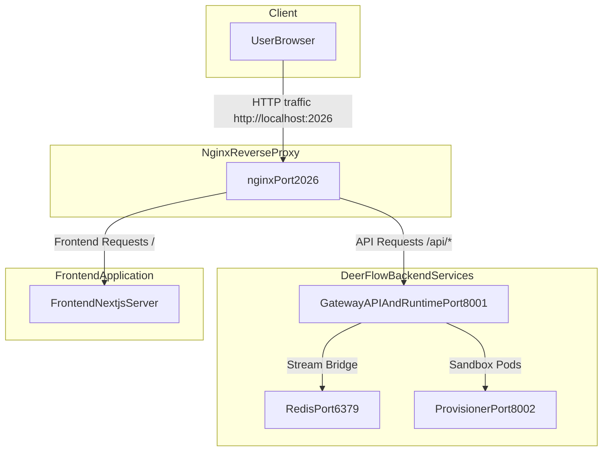
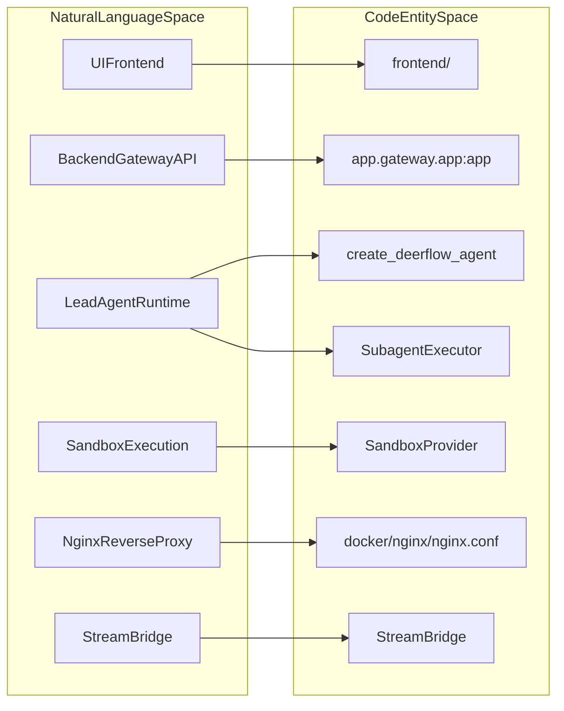

<!-- source: DeepWiki mcp.deepwiki.com · repo bytedance/deer-flow · page 2 Getting Started · fetched 2026-10-29 -->

# Getting Started

<details>
<summary>Relevant source files</summary>

The following files were used as context for generating this wiki page:

- [CONTRIBUTING.md](CONTRIBUTING.md)
- [Makefile](Makefile)
- [backend/Dockerfile](backend/Dockerfile)
- [backend/tests/test_check_script.py](backend/tests/test_check_script.py)
- [backend/tests/test_docker_sandbox_mode_detection.py](backend/tests/test_docker_sandbox_mode_detection.py)
- [backend/tests/test_gateway_sigterm_delivery.py](backend/tests/test_gateway_sigterm_delivery.py)
- [backend/tests/test_gateway_startup.py](backend/tests/test_gateway_startup.py)
- [backend/tests/test_make_install.py](backend/tests/test_make_install.py)
- [backend/tests/test_pnpm_script.py](backend/tests/test_pnpm_script.py)
- [docker/docker-compose-dev.yaml](docker/docker-compose-dev.yaml)
- [docker/docker-compose.yaml](docker/docker-compose.yaml)
- [frontend/Dockerfile](frontend/Dockerfile)
- [scripts/check.py](scripts/check.py)
- [scripts/deploy.sh](scripts/deploy.sh)
- [scripts/docker.sh](scripts/docker.sh)
- [scripts/pnpm.py](scripts/pnpm.py)
- [scripts/sandbox-mode.sh](scripts/sandbox-mode.sh)

</details>


## Purpose and Scope

This page provides a high-level guide to install, configure, and run DeerFlow for the first time, serving as an introduction to the key steps involved in getting the system operational. DeerFlow is a LangGraph-based AI super agent harness that orchestrates subagents, sandbox execution, extensible skills, and persistent memory to enable versatile AI agents [README.md:12-17](), [docker/docker-compose.yaml:119-120]().

As a parent page, it summarizes the installation and configuration workflow and points to child pages for detailed instructions:
- **Prerequisites and Installation**: Detail system requirements (Node.js, Python, `uv`, `pnpm`, `nginx`), dependency installation via `make install`, and initial `config.yaml` setup. For details, see [Prerequisites and Installation](#2.1) [Makefile:37-37](), [CONTRIBUTING.md:178-191]().
- **Configuration Quickstart**: Walk through the minimum `config.yaml` and `.env` settings needed to get DeerFlow running, linking to the full Configuration System section. For details, see [Configuration Quickstart](#2.2) [CONTRIBUTING.md:26-34](), [docker/docker-compose.yaml:1-25]().

Sources: [README.md:12-17](), [docker/docker-compose.yaml:119-120](), [Makefile:37-37](), [CONTRIBUTING.md:26-191]()

---

## Prerequisites and Installation Overview

DeerFlow requires a modern development and runtime toolchain spanning backend, frontend, and sandbox execution environments [CONTRIBUTING.md:186-191]().

| Tool       | Minimum Version | Role                                   | Reference                     |
|------------|-----------------|--------------------------------------|-------------------------------|
| Python     | 3.12+           | Backend runtime environment           | [Makefile:15-15](), [backend/Dockerfile:11-11]()  |
| Node.js    | 22+             | Frontend runtime environment          | [CONTRIBUTING.md:187-187](), [backend/Dockerfile:13-13]()|
| `uv`       | Latest          | Python dependency manager and builder | [Makefile:99-99](), [CONTRIBUTING.md:189-189]() |
| `pnpm`     | Latest          | Frontend package manager               | [Makefile:22-22](), [CONTRIBUTING.md:188-188]() |
| `nginx`    | Latest          | Unified reverse proxy endpoint         | [docker/docker-compose.yaml:51-60](), [Makefile:49-49]() |
| Docker     | Latest          | Container runtime for sandbox providers| [CONTRIBUTING.md:14-16](), [docker/docker-compose.yaml:1-25]() |

To verify your environment and diagnose configuration issues, you can run the built-in diagnostic script via `make doctor` [Makefile:74-75](). This utility inspects installed binaries, environment variables, config files, and provider setups and returns actionable recommendations for missing or misconfigured components [Makefile:74-75](), [scripts/check.py:90-185]().

For detailed system requirements, installation steps, and troubleshooting, see [Prerequisites and Installation](#2.1).

Sources: [Makefile:15-99](), [CONTRIBUTING.md:14-191](), [backend/Dockerfile:11-13](), [docker/docker-compose.yaml:1-60](), [scripts/check.py:90-185]()

---

## Configuration Quickstart

After cloning the DeerFlow repository, the system requires a minimum viable configuration to enable core agent functions such as model usage and optional tool integrations [CONTRIBUTING.md:26-34]().

- You can run the interactive setup wizard with `make setup`, which invokes `scripts/setup_wizard.py` [Makefile:71-72](). This wizard walks through selecting LLM providers, optional web search integrations, and sandbox mode preferences, generating a minimal `config.yaml` and environment settings [Makefile:71-72]().
- Configuration versioning and schema upgrades are managed via `make config-upgrade`, which safely merges new fields from `config.example.yaml` into existing configurations [Makefile:32-32]().

For a full walkthrough of configuration options, environment variables, and providers, see [Configuration Quickstart](#2.2).

Sources: [Makefile:32-72](), [CONTRIBUTING.md:26-34]()

---

## Running DeerFlow for the First Time

Once configured, DeerFlow offers multiple runtime modes for development and production use [README.md:63-65]().

### Local Development Mode

Run the backend Gateway API, Next.js frontend, and Nginx proxy directly on your host machine with hot reload support via `make dev` [Makefile:45-45](). This command orchestrates the startup of each component, enabling immediate code changes and inspection during development [Makefile:45-45]().

### Docker Development Mode

For an isolated environment closely matching production with containerized backend, frontend, and sandbox services [CONTRIBUTING.md:9-12]():

```bash
make docker-init    # Pulls necessary sandbox container images [Makefile:62-62]
make docker-start   # Starts the full Docker development stack [Makefile:63-63]
```

You can then access DeerFlow’s web UI at `http://localhost:2026` [CONTRIBUTING.md:80-80]().

Sources: [Makefile:45-63](), [CONTRIBUTING.md:9-80](), [README.md:63-65]()

---

## DeerFlow Service Architecture and Ports

The core DeerFlow system consists of multiple services coordinated behind an Nginx reverse proxy [docker/docker-compose.yaml:51-60](). The main components and their standard ports are:

- **Nginx Proxy** (port 2026): Unified HTTP entrypoint handling routing between frontend and backend services [docker/docker-compose.yaml:59-60]().
- **Gateway API Server** (port 8001): FastAPI-based REST API and embedded LangGraph agent runtime [docker/docker-compose.yaml:107-134]().
- **Frontend** (port 3000): Next.js React frontend application [docker/docker-compose-dev.yaml:28-28]().
- **Sandbox Provisioner** (port 8002, optional): Manages sandbox container lifecycle when sandboxing uses Kubernetes or provisioner mode [docker/docker-compose-dev.yaml:55-58]().
- **Redis** (port 6379): Optional backend service for caching and stream bridging [docker/docker-compose.yaml:34-48]().

Title: Service Topology


Sources: [docker/docker-compose.yaml:34-134](), [docker/docker-compose-dev.yaml:28-58]()

---

## Mapping System Components to Code Entities

DeerFlow’s architecture maps logical system components to specific code modules and classes. Key associations include:

| System Component        | Code Entity / Symbol        | Location / Reference                                      |
|------------------------|-----------------------------|-----------------------------------------------------------|
| Gateway API App        | `app.gateway.app:app`        | `backend/app/gateway/app.py`                              |
| Lead Agent Factory      | `create_deerflow_agent`      | `backend/packages/harness/deerflow/agents/lead_agent/factory.py` |
| Subagent Executor       | `SubagentExecutor`           | `backend/packages/harness/deerflow/subagents/executor.py` |
| Sandbox Provider        | `SandboxProvider`            | `backend/packages/harness/deerflow/sandbox/sandbox.py`   |
| Stream Bridge           | `StreamBridge`               | `backend/packages/harness/deerflow/runtime/`              |
| Reverse Proxy           | `nginx`                     | `docker/nginx/nginx.conf`                                 |

Title: Natural Language Space to Code Entity Space Mapping


Sources: [docker/docker-compose.yaml:134-134](), [frontend/src/content/en/harness/tools.mdx:29-37]()

---

## Next Steps

- For detailed environment setup, dependency installation, and troubleshooting, proceed to [Prerequisites and Installation](#2.1).
- To understand configuration file formats and minimum required settings, see [Configuration Quickstart](#2.2).
- Explore the architectural design and service interactions in the [Architecture](#3) section.

Sources: [README.md:60-134]()

---

