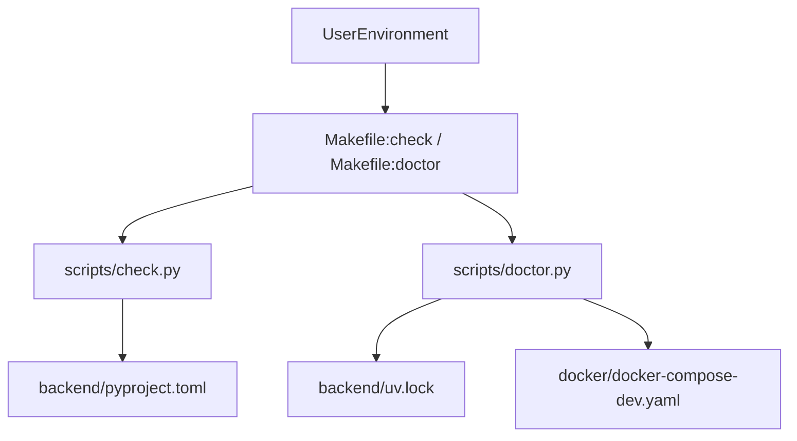
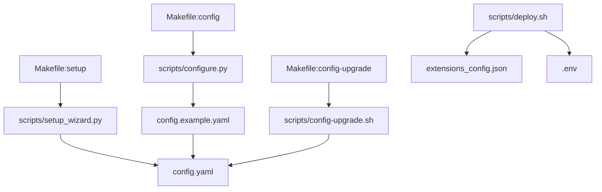

<!-- source: DeepWiki mcp.deepwiki.com · repo bytedance/deer-flow · page 2.1 Prerequisites and Installation · fetched 2026-10-29 -->

# Prerequisites and Installation

<details>
<summary>Relevant source files</summary>

The following files were used as context for generating this wiki page:

- [.gitignore](.gitignore)
- [CONTRIBUTING.md](CONTRIBUTING.md)
- [Makefile](Makefile)
- [backend/Dockerfile](backend/Dockerfile)
- [backend/Makefile](backend/Makefile)
- [backend/packages/extension-api/deerflow_extension_api/__init__.py](backend/packages/extension-api/deerflow_extension_api/__init__.py)
- [backend/packages/extension-api/deerflow_extension_api/contracts.py](backend/packages/extension-api/deerflow_extension_api/contracts.py)
- [backend/packages/extension-api/pyproject.toml](backend/packages/extension-api/pyproject.toml)
- [backend/packages/harness/deerflow/extensions/AGENTS.md](backend/packages/harness/deerflow/extensions/AGENTS.md)
- [backend/packages/harness/deerflow/extensions/registry.py](backend/packages/harness/deerflow/extensions/registry.py)
- [backend/packages/harness/pyproject.toml](backend/packages/harness/pyproject.toml)
- [backend/pyproject.toml](backend/pyproject.toml)
- [backend/tests/test_check_script.py](backend/tests/test_check_script.py)
- [backend/tests/test_docker_sandbox_mode_detection.py](backend/tests/test_docker_sandbox_mode_detection.py)
- [backend/tests/test_extension_api_contracts.py](backend/tests/test_extension_api_contracts.py)
- [backend/tests/test_gateway_sigterm_delivery.py](backend/tests/test_gateway_sigterm_delivery.py)
- [backend/tests/test_gateway_startup.py](backend/tests/test_gateway_startup.py)
- [backend/tests/test_make_install.py](backend/tests/test_make_install.py)
- [backend/tests/test_pnpm_script.py](backend/tests/test_pnpm_script.py)
- [backend/uv.lock](backend/uv.lock)
- [docker/docker-compose-dev.yaml](docker/docker-compose-dev.yaml)
- [docker/docker-compose.yaml](docker/docker-compose.yaml)
- [frontend/Dockerfile](frontend/Dockerfile)
- [frontend/src/core/extensions/catalog.ts](frontend/src/core/extensions/catalog.ts)
- [frontend/tests/e2e/bookmark-plugin.spec.ts](frontend/tests/e2e/bookmark-plugin.spec.ts)
- [scripts/check.py](scripts/check.py)
- [scripts/deploy.sh](scripts/deploy.sh)
- [scripts/docker.sh](scripts/docker.sh)
- [scripts/pnpm.py](scripts/pnpm.py)
- [scripts/sandbox-mode.sh](scripts/sandbox-mode.sh)

</details>


This page details the system requirements, dependency installation mechanisms, and initial configuration steps required to set up DeerFlow. DeerFlow supports two primary execution workflows: **Local Development** (running services directly on the host) and **Docker Development** (orchestrating containerized services). The framework relies on explicit binary version checking (`scripts/doctor.py`), locked package management (`uv` for Python dependencies and `pnpm` for frontend), and automated environment configuration (`Makefile`).

Sources: [Makefile:24-30](), [CONTRIBUTING.md:13-23](), [scripts/doctor.py:1-217]()

---

## System Requirements

The DeerFlow environment requires specific core tools and minimum version constraints to orchestrate the Next.js frontend, FastAPI Gateway API, LangGraph agent runtime, and reverse proxy routing. Automated health check scripts validate environment readiness.

### Required Tooling

| Tool            | Minimum Version | Purpose                                                  | Code Reference                    |
|-----------------|-----------------|----------------------------------------------------------|----------------------------------|
| **Node.js**     | 22+             | Runtime for Next.js frontend application                 | `scripts/doctor.py:193-211`       |
| **pnpm**        | Latest          | Package manager for JavaScript frontend dependencies     | `scripts/doctor.py:213-217`       |
| **Python**      | 3.12+           | Backend runtime for FastAPI Gateway API and LangGraph    | `backend/pyproject.toml:6`        |
| **uv**          | 0.11.1+         | Python virtual environment and dependency manager        | `backend/Dockerfile:7-8`          |
| **nginx**       | Latest          | Reverse proxy that consolidates requests on port 2026    | `docker/docker-compose-dev.yaml:121-128` |

- **Node.js** and **pnpm** power and manage the Next.js SPA frontend. The `pnpm` invocation is wrapped in a cross-platform Python runner at `scripts/pnpm.py` to ensure environment consistency [Makefile:22]().
- **Python 3.12+** is the backend execution environment, enabling fully asynchronous FastAPI services with modern typing support [backend/pyproject.toml:6]().
- **uv** manages backend Python dependencies deterministically using `uv.lock` and orchestrates execution with virtual environment isolation [Makefile:97](), [backend/Makefile:5-6]().
- **nginx** serves as specialized reverse proxy routing frontend and API traffic on the single user port `2026`, configurable via environment variables [docker/docker-compose-dev.yaml:121-128]().

### Diagram: Toolchain and System Validation Architecture



Sources: [Makefile:24-112](), [scripts/doctor.py:1-217](), [backend/pyproject.toml:1-43]()

---

## Environment Validation

Run the following commands to verify host dependencies and configuration integrity:

- **Basic dependency version check:**

```bash
make check
```

This invokes `scripts/check.py` which validates presence and versions of Node.js, pnpm, uv, Python, and nginx, printing status messages with instructions for missing tools [Makefile:89-91]().

- **Comprehensive health check:**

```bash
make doctor
```

This runs `scripts/doctor.py` which performs deeper verification of configuration files, LLM providers importability, environment variables, token validity, and more, producing an actionable diagnostic report [Makefile:71-72](), [scripts/doctor.py:1-217]().

Sources: [Makefile:71-95](), [scripts/doctor.py:1-217]()

---

## Installation Procedures

Dependency installation synchronizes all Python and JavaScript package requirements, ensuring matching locked versions for consistent runtime behavior.

### Installing Dependencies via Make

From the repository root (`deer-flow/`), run:

```bash
make install
```

This triggers the following sequence [Makefile:96-105]():

1. **Backend Dependency Installation:** Executes `uv sync --locked` within the `backend/` directory to install all Python packages declared in `uv.lock`, matching exact versions for reproducibility [Makefile:98-99](), [backend/Makefile:5-6]().

2. **Frontend Dependency Installation:** Runs `pnpm install` inside the `frontend/` directory via the helper Python script `scripts/pnpm.py` that reliably invokes the pnpm binary across platforms [Makefile:22](), [Makefile:100-101]().

3. **Pre-commit Hook Setup:** Installs and configures `pre-commit` hooks via `uv tool install pre-commit` and activates them to enforce code style, linting, and commit safety checks [Makefile:102-104]().

### Optional: Pre-pull Sandbox Container Image

DeerFlow supports safe sandboxed code execution using container images. To pre-pull the sandbox container image (optional but recommended to minimize startup latency of sandboxed code runs):

```bash
make setup-sandbox
```

This command pulls the configured sandbox image as specified in runtime settings to your local Docker daemon, preparing the environment in advance [Makefile:44](), [docker/docker-compose-dev.yaml:60-70]().

Sources: [Makefile:44-112](), [backend/Makefile:5-6](), [CONTRIBUTING.md:13-23]()

---

## Initial Configuration Setup

DeerFlow requires a configuration file that specifies LLM providers, API keys, model options, skills, memory backends, sandbox and tool settings, among others.

### Config File Creation Methods

- **Interactive Setup Wizard:**

Use a guided CLI wizard to generate a personalized `config.yaml`:

```bash
make setup
```

This runs the Python script `scripts/setup_wizard.py` which interactively prompts for API keys, LLM provider selection, and common configuration parameters, then writes a tailored `config.yaml` [Makefile:68-69]().

- **Template Copy:**

Manually copy the example configuration file to start with defaults:

```bash
make config
```

This runs `scripts/configure.py` which copies `config.example.yaml` to `config.yaml` if not already present [Makefile:83-84]().

- **Configuration Upgrade:**

When upgrading DeerFlow versions, to migrate old configs to new schemas, run:

```bash
make config-upgrade
```

This executes `scripts/config-upgrade.sh` which merges new configuration fields into your existing `config.yaml` while preserving customizations [Makefile:86-87]().

### Key Configuration Files Explained

| File                  | Description                                                                                                             | Notes                                                        |
|-----------------------|-------------------------------------------------------------------------------------------------------------------------|--------------------------------------------------------------|
| `config.yaml`          | Primary runtime configuration specifying models, tools, memory, sandbox, and service parameters                         | Mounted read-only in Docker, editable locally                |
| `extensions_config.json`| JSON file managing MCP servers and enabled extensions                                                                  | Mounted read-write; live updates handled by Gateway API       |
| `.env`                 | Environment variable file storing API keys, internal tokens, and runtime flags                                          | Optional, but recommended for secrets and overrides           |

#### Configuration File Locations in Docker

Docker Compose mounts these files inside containers per `docker/docker-compose.yaml`:

- `config.yaml` is mounted to `/app/backend/config.yaml` (read-only) [docker/docker-compose.yaml:139]().
- `extensions_config.json` is mounted to `/app/backend/extensions_config.json` (read-write) [docker/docker-compose.yaml:143]().
- `.env` files are referenced via `env_file` directives in compose configurations [docker/docker-compose-dev.yaml:104-106]().

### Diagram: Configuration and Script Entity Mapping



Sources: [Makefile:68-91](), [scripts/deploy.sh:146-186](), [docker/docker-compose.yaml:138-145]()

---

## References and Next Steps

- After installing dependencies and configuring `config.yaml`, users can proceed to run local or Docker services.
- See the next page "2.2 Configuration Quickstart" for minimal configuration samples and environment variables.
- Validate your environment often with `make doctor` to catch misconfigurations early.

Sources: [Makefile:71-76](), [CONTRIBUTING.md:1-424]()

---

# End of Section 2.1 Prerequisites and Installation

---

