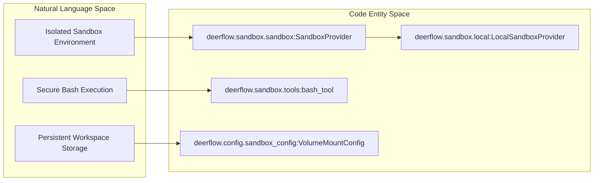

<!-- source: DeepWiki mcp.deepwiki.com · repo bytedance/deer-flow · page 2.2 Configuration Quickstart · fetched 2026-10-29 -->

# Configuration Quickstart

<details>
<summary>Relevant source files</summary>

The following files were used as context for generating this wiki page:

- [.env.example](.env.example)
- [CHANGELOG.md](CHANGELOG.md)
- [CHANGELOG_zh.md](CHANGELOG_zh.md)
- [README.md](README.md)
- [backend/AGENTS.md](backend/AGENTS.md)
- [backend/docs/CONFIGURATION.md](backend/docs/CONFIGURATION.md)
- [backend/packages/harness/deerflow/agents/middlewares/AGENTS.md](backend/packages/harness/deerflow/agents/middlewares/AGENTS.md)
- [backend/packages/harness/deerflow/agents/middlewares/llm_error_handling_middleware.py](backend/packages/harness/deerflow/agents/middlewares/llm_error_handling_middleware.py)
- [backend/tests/test_extensions_config_raw_writes.py](backend/tests/test_extensions_config_raw_writes.py)
- [backend/tests/test_llm_error_handling_middleware.py](backend/tests/test_llm_error_handling_middleware.py)
- [backend/tests/test_support_bundle.py](backend/tests/test_support_bundle.py)
- [config.example.yaml](config.example.yaml)
- [frontend/src/content/en/application/agents-and-threads.mdx](frontend/src/content/en/application/agents-and-threads.mdx)
- [frontend/src/content/en/application/configuration.mdx](frontend/src/content/en/application/configuration.mdx)
- [frontend/src/content/en/application/index.mdx](frontend/src/content/en/application/index.mdx)
- [frontend/src/content/en/application/operations-and-troubleshooting.mdx](frontend/src/content/en/application/operations-and-troubleshooting.mdx)
- [frontend/src/content/en/application/quick-start.mdx](frontend/src/content/en/application/quick-start.mdx)
- [frontend/src/content/en/application/workspace-usage.mdx](frontend/src/content/en/application/workspace-usage.mdx)
- [frontend/src/content/en/harness/configuration.mdx](frontend/src/content/en/harness/configuration.mdx)
- [frontend/src/content/en/harness/design-principles.mdx](frontend/src/content/en/harness/design-principles.mdx)
- [frontend/src/content/en/harness/lead-agent.mdx](frontend/src/content/en/harness/lead-agent.mdx)
- [frontend/src/content/en/harness/quick-start.mdx](frontend/src/content/en/harness/quick-start.mdx)
- [frontend/src/content/en/harness/sandbox.mdx](frontend/src/content/en/harness/sandbox.mdx)
- [frontend/src/content/en/harness/skills.mdx](frontend/src/content/en/harness/skills.mdx)
- [frontend/src/content/zh/application/agents-and-threads.mdx](frontend/src/content/zh/application/agents-and-threads.mdx)
- [frontend/src/content/zh/application/configuration.mdx](frontend/src/content/zh/application/configuration.mdx)
- [frontend/src/content/zh/application/index.mdx](frontend/src/content/zh/application/index.mdx)
- [frontend/src/content/zh/application/operations-and-troubleshooting.mdx](frontend/src/content/zh/application/operations-and-troubleshooting.mdx)
- [frontend/src/content/zh/application/quick-start.mdx](frontend/src/content/zh/application/quick-start.mdx)
- [frontend/src/content/zh/application/workspace-usage.mdx](frontend/src/content/zh/application/workspace-usage.mdx)
- [frontend/src/content/zh/harness/configuration.mdx](frontend/src/content/zh/harness/configuration.mdx)
- [frontend/src/content/zh/harness/lead-agent.mdx](frontend/src/content/zh/harness/lead-agent.mdx)
- [frontend/src/content/zh/harness/sandbox.mdx](frontend/src/content/zh/harness/sandbox.mdx)
- [frontend/src/content/zh/harness/skills.mdx](frontend/src/content/zh/harness/skills.mdx)
- [frontend/tests/unit/content/docs-links.test.ts](frontend/tests/unit/content/docs-links.test.ts)
- [scripts/AGENTS.md](scripts/AGENTS.md)
- [scripts/support_bundle.py](scripts/support_bundle.py)

</details>


This page provides a technical walkthrough of the minimum `config.yaml` and `.env` settings required to get DeerFlow operational. It covers essential configuration for LLM providers, environment variables, sandbox environments, and token/memory controls. For a comprehensive reference of all available options, see the [7. Configuration System]() section.

---

## 1. Overview and Scope

DeerFlow uses a structured configuration architecture that separates core runtime settings from environment-specific secrets:

- **`config.yaml`**: The primary YAML file defining agent models, sandbox execution providers, tools, logging levels, and safety controls. It resolves environment variable references dynamically `[config.example.yaml:1-16]`, `[backend/docs/CONFIGURATION.md:3-33]`.
- **`.env`**: A local environment file storing sensitive credentials (such as API keys) referenced via `$VAR` syntax in `config.yaml`. Loaded via `dotenv.load_dotenv()` at startup `[README.md:120-136]`, `[config.example.yaml:6-15]`.

### Configuration Loading and Injection Flow

```mermaid
flowchart TD
    subgraph NaturalLanguageSpace["Natural Language Space"]
        ConfigEnv["Environment Secrets"]
        ConfigYaml["YAML Configuration"]
    end

    subgraph CodeEntitySpace["Code Entity Space"]
        LoadDotenv["dotenv.load_dotenv()"]
        AppConfigLoad["deerflow.config.app_config:AppConfig.from_file()"]
        AppConfig["deerflow.config.app_config:AppConfig"]
        ModelFactory["deerflow.models.factory:create_chat_model()"]
    end

    ConfigEnv -->| "Populate process env" | LoadDotenv
    ConfigYaml -->| "Parse & substitute vars" | AppConfigLoad
    LoadDotenv --> AppConfig
    AppConfigLoad --> AppConfig
    AppConfig -->| "Inject configuration" | ModelFactory
```

The `.env` file is loaded first to populate process environment variables. Subsequently, `config.yaml` is parsed by `AppConfig.from_file()`, substituting expressions like `$VOLCENGINE_API_KEY` with runtime values to instantiate the `AppConfig` schema `[config.example.yaml:1-16]`, `[backend/docs/CONFIGURATION.md:3-33]`.

Sources: `[backend/docs/CONFIGURATION.md:3-33]`, `[config.example.yaml:1-16]`, `[README.md:120-136]`

---

## 2. Initial Setup and Versioning

### Setup Wizard

The recommended method for bootstrapping a runnable environment is the interactive setup wizard `[README.md:120-136]`:

```bash
make setup
```

The wizard invokes setup routines that prompt for LLM providers, search tool selection, and sandbox execution permissions, generating both a baseline `config.yaml` and a populated `.env` file `[scripts/wizard/providers.py:1-116]`.

### Configuration Versioning

DeerFlow tracks schema changes through the `config_version` integer property at the root of `config.yaml` `[config.example.yaml:18-23]`, `[backend/docs/CONFIGURATION.md:105-117]`:

```yaml
config_version: 60
```

If the local configuration version lags behind the codebase schema version, DeerFlow emits a startup warning `[backend/docs/CONFIGURATION.md:105-117]`. You can safely merge new fields while preserving existing values by running `[backend/docs/CONFIGURATION.md:105-117]`:

```bash
make config-upgrade
```

Sources: `[README.md:120-136]`, `[config.example.yaml:18-23]`, `[backend/docs/CONFIGURATION.md:105-117]`, `[scripts/wizard/providers.py:1-116]`

---

## 3. Model Configuration

At least one model profile must be declared under the `models:` block in `config.yaml` `[backend/docs/CONFIGURATION.md:53-84]`.

### Essential Model Fields

| Field | Purpose |
| :--- | :--- |
| `name` | Internal unique model identifier used in routing and task assignment |
| `display_name` | Human-readable label rendered in the user interface |
| `use` | Python import path to the chat model adapter class (e.g., `deerflow.models.patched_deepseek:PatchedChatDeepSeek`) |
| `model` | Provider-specific model deployment or version string |
| `api_key` | Environment variable reference pointing to the required credential |
| `supports_thinking` | Boolean flag enabling reasoning/chain-of-thought parsing in supported model wrappers |

Example minimal model declaration:

```yaml
models:
  - name: doubao-pro
    display_name: "Doubao Pro"
    use: deerflow.models.patched_deepseek:PatchedChatDeepSeek
    model: doubao-seed-1-8-251228
    api_key: $VOLCENGINE_API_KEY
    supports_thinking: true
```

Sources: `[backend/docs/CONFIGURATION.md:53-84]`, `[config.example.yaml:128-135]`, `[scripts/wizard/providers.py:116-134]`

---

## 4. Minimal Essential `.env` Variables

Environment secrets referenced in `config.yaml` must be declared in `.env`. At minimum, provide credentials for your primary inference and optional search providers:

| Variable | Description |
| :--- | :--- |
| `VOLCENGINE_API_KEY` | Authentication token for Volcengine / Doubao models |
| `OPENAI_API_KEY` | Authentication token for OpenAI API or compatible gateways |
| `TAVILY_API_KEY` | Authentication token for Tavily structured web search |

Example `.env` configuration:

```env
OPENAI_API_KEY=your-openai-api-key
VOLCENGINE_API_KEY=your-volcengine-api-key
TAVILY_API_KEY=your-tavily-api-key
```

Sources: `[README.md:120-136]`, `[config.example.yaml:1-16]`

---

## 5. Sandbox Configuration

DeerFlow executes untrusted shell commands and file manipulation tasks inside isolated environments `[backend/packages/harness/deerflow/agents/middlewares/AGENTS.md:73-78]`.

### Minimal Sandbox Config Example

```yaml
sandbox:
  use: deerflow.sandbox.local:LocalSandboxProvider
  allow_host_bash: false
```

- `use`: Specifies the Python path to the sandbox provider implementation `[backend/packages/harness/deerflow/config/app_config.py:42]`.
- `allow_host_bash`: Set to `false` to prevent direct host shell execution, forcing containerized or isolated execution.

### Sandbox Conceptual Mapping



Sources: `[backend/packages/harness/deerflow/config/app_config.py:42]`, `[backend/packages/harness/deerflow/agents/middlewares/AGENTS.md:73-78]`

---

## 6. Token Budget and Memory Controls

### Token Budget Configuration

To prevent runaway token consumption during recursive agent loops, configure a process token budget:

```yaml
token_budget:
  enabled: true
  max_tokens: 200000
  warn_threshold: 0.8
  hard_stop_threshold: 1.0
```

- `max_tokens`: Hard upper limit of combined input and output tokens per run `[config.example.yaml:99-112]`.
- `warn_threshold` / `hard_stop_threshold`: Triggers in-context warning notifications at 80% and strips tool calls to force a final answer at 100% capacity `[config.example.yaml:99-112]`.

### Memory Configuration

Enable long-term fact extraction and prompt context injection `[backend/packages/harness/deerflow/agents/middlewares/AGENTS.md:31-38]`:

```yaml
memory:
  enabled: true
  injection_enabled: true
```

Sources: `[config.example.yaml:99-112]`, `[backend/packages/harness/deerflow/agents/middlewares/AGENTS.md:31-38]`

---

## 7. Summary: Minimal `config.yaml` Example

```yaml
config_version: 60
log_level: info

models:
  - name: doubao-pro
    display_name: "Doubao Pro"
    use: deerflow.models.patched_deepseek:PatchedChatDeepSeek
    model: doubao-seed-1-8-251228
    api_key: $VOLCENGINE_API_KEY
    supports_thinking: true

sandbox:
  use: deerflow.sandbox.local:LocalSandboxProvider
  allow_host_bash: false

token_usage:
  enabled: true

memory:
  enabled: true
  injection_enabled: true
```

This minimal file sets up a single thinking-capable LLM model, enforces a secure sandbox provider without direct host access, enables token metric tracking, and activates persistent memory injection. Ensure corresponding API secrets are populated in `.env`.

Sources: `[config.example.yaml:23-46,95-96]`, `[backend/docs/CONFIGURATION.md:1-141]`, `[README.md:120-136]`

---

For complete configuration schemas, including IM channels, MCP server topologies, and scheduled task properties, refer to the [7. Configuration System]() section.

---

