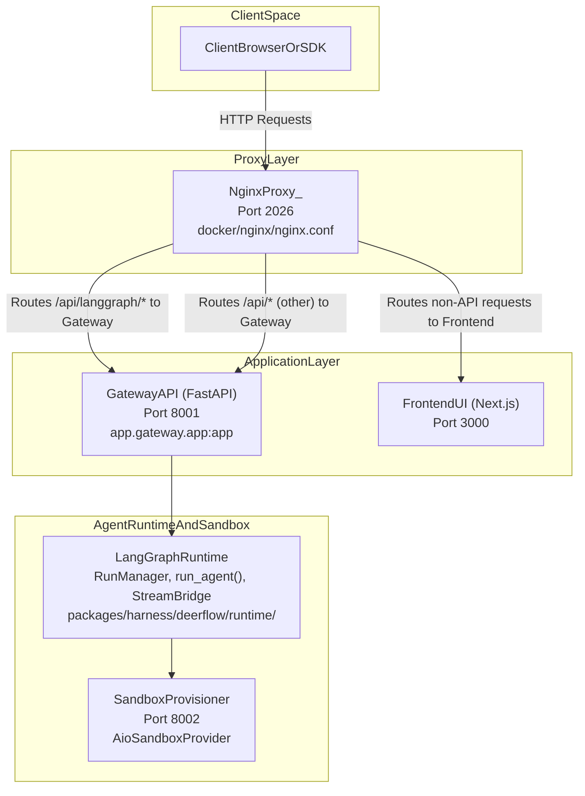
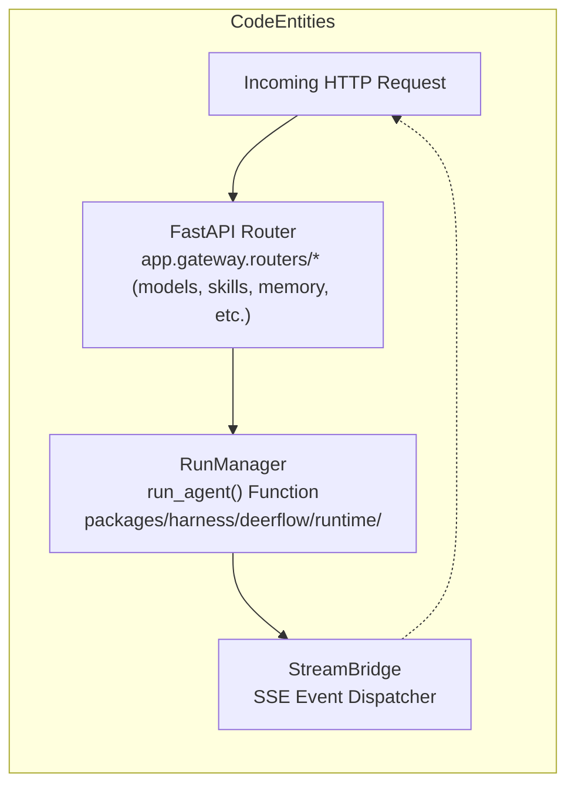

<!-- source: DeepWiki mcp.deepwiki.com · repo bytedance/deer-flow · page 3 Architecture · fetched 2026-10-29 -->

# Architecture

Relevant source files

The following files were used as context for generating this wiki page:

- [backend/.gitignore](backend/.gitignore)
- [backend/CLAUDE.md](backend/CLAUDE.md)
- [backend/README.md](backend/README.md)
- [backend/docs/API.md](backend/docs/API.md)
- [backend/docs/ARCHITECTURE.md](backend/docs/ARCHITECTURE.md)
- [backend/docs/README.md](backend/docs/README.md)
- [backend/docs/SANDBOX_MEMORY_PROFILING.md](backend/docs/SANDBOX_MEMORY_PROFILING.md)
- [backend/docs/TODO.md](backend/docs/TODO.md)
- [backend/tests/support/nginx_conf.py](backend/tests/support/nginx_conf.py)
- [backend/tests/support/shell.py](backend/tests/support/shell.py)
- [backend/tests/test_deploy_uv_extras.py](backend/tests/test_deploy_uv_extras.py)
- [backend/tests/test_detect_uv_extras.py](backend/tests/test_detect_uv_extras.py)
- [backend/tests/test_dev_entrypoint.py](backend/tests/test_dev_entrypoint.py)
- [backend/tests/test_gateway_runtime_cleanup.py](backend/tests/test_gateway_runtime_cleanup.py)
- [backend/tests/test_local_dev_loopback_bind.py](backend/tests/test_local_dev_loopback_bind.py)
- [backend/tests/test_nginx_langgraph_body_size.py](backend/tests/test_nginx_langgraph_body_size.py)
- [backend/tests/test_nginx_loopback_canonical.py](backend/tests/test_nginx_loopback_canonical.py)
- [backend/tests/test_nginx_project_documents_body_size.py](backend/tests/test_nginx_project_documents_body_size.py)
- [backend/tests/test_sandbox_memory_profile_script.py](backend/tests/test_sandbox_memory_profile_script.py)
- [backend/tests/test_serve_pick_python.py](backend/tests/test_serve_pick_python.py)
- [backend/tests/test_support_shell.py](backend/tests/test_support_shell.py)
- [backend/tests/test_uvicorn_reload_exclude.py](backend/tests/test_uvicorn_reload_exclude.py)
- [deploy/helm/deer-flow/templates/configmap-nginx.yaml](deploy/helm/deer-flow/templates/configmap-nginx.yaml)
- [docker/dev-entrypoint.sh](docker/dev-entrypoint.sh)
- [docker/nginx/nginx.conf](docker/nginx/nginx.conf)
- [docker/nginx/nginx.local.conf](docker/nginx/nginx.local.conf)
- [scripts/detect_uv_extras.py](scripts/detect_uv_extras.py)
- [scripts/nginx-local-conf.sh](scripts/nginx-local-conf.sh)
- [scripts/sandbox_memory_profile.py](scripts/sandbox_memory_profile.py)
- [scripts/serve.sh](scripts/serve.sh)

## Purpose and Scope

This page offers a high-level overview of DeerFlow’s system architecture, focusing on core system components and their interactions [backend/docs/ARCHITECTURE.md:5-49](). DeerFlow is an open-source **super agent harness** that orchestrates multi-agent workflows, manages persistent memory, and provides isolated sandbox execution environments [backend/README.md:1-6](). The architecture centers around a **unified Nginx reverse proxy** that routes incoming requests to the **FastAPI-based Gateway API**, which embeds the core **LangGraph agent runtime** directly within its process [backend/docs/ARCHITECTURE.md:53-56]().

The key architectural components include:
- **Nginx Proxy:** Acts as the unified entry point (`docker/nginx/nginx.conf`), routing requests based on path prefixes to backend services [backend/README.md:11-38]().
- **Gateway API:** A FastAPI application (`app/gateway/app.py`) providing REST endpoints and embedding the LangGraph agent runtime [backend/docs/ARCHITECTURE.md:78-83]().
- **Embedded Agent Runtime:** Orchestrates run lifecycles, streaming events via `StreamBridge`, middleware chains, and subagent task delegation [backend/README.md:43-68]().
- **Frontend Application:** A Next.js web application (`frontend/`) serving the user interface and communicating with backend endpoints [backend/docs/ARCHITECTURE.md:27-36]().
- **Sandbox Environment:** Provides isolated runtime environments for code execution and virtualized workspace management [backend/README.md:5-87]().

This page functions as a PARENT page. Detailed technical and operational specifics are covered in its child pages:
- For service ports, container layouts, and Nginx routing rules, see [Service Topology](#3.1).
- For package boundaries, dependency rules, and the modular backend split, see [Harness vs App Layer](#3.2).

Sources: `backend/README.md:1-6`(), `backend/docs/ARCHITECTURE.md:5-56`(), `docker/nginx/nginx.conf:80-140`()

---

## Service Components and Topology

DeerFlow operates across four main services, typically deployed via Docker Compose or run locally [docker/nginx/nginx.conf:80-140](). All external traffic enters through an Nginx reverse proxy on port `2026`, which dispatches requests using URL path prefixes [backend/README.md:11-38]().

### System Topology and Code Entity Mapping

Title: DeerFlow System Topology and Component Flow

Nginx configuration defines path routing and proxy parameters for seamless streaming and long-running execution [docker/nginx/nginx.conf:107-140](). The Gateway runs FastAPI and hosts the agent runtime embedded within the same process [backend/docs/ARCHITECTURE.md:53-56]().

For detailed service ports and container routing configurations, see [Service Topology](#3.1).

Sources: `backend/README.md:11-38`(), `docker/nginx/nginx.conf:80-140`(), `backend/docs/ARCHITECTURE.md:53-56`()

---

## Harness vs App Layer

DeerFlow’s backend codebase is structured into a clean two-layer architecture:

1. **Harness Layer (`deerflow-harness`):**  
   Located under `backend/packages/harness/`, this package implements the foundational agent framework code, including the LangGraph lead agent factory (`make_lead_agent`), middleware chains, sandbox abstractions, tool integrations, and subagent management [backend/README.md:43-52](). It defines a reusable public API surface for agent logic.

2. **Application Layer (`backend/app/`):**  
   This layer comprises the FastAPI-based Gateway API service (`app.gateway.app:app`), channel integrations, authentication/authorization providers, and scheduled task handlers [backend/docs/ARCHITECTURE.md:78-98](). It depends on `deerflow-harness` to host the agent runtime and serve application endpoints.

This separation isolates core orchestration logic from web hosting and integration concerns.

For package boundaries and dependency guidelines, see [Harness vs App Layer](#3.2).

Sources: `backend/README.md:43-52`(), `backend/docs/ARCHITECTURE.md:78-98`()

---

## Request Routing and Gateway Interactions

Nginx routes requests based on URL path prefixes to optimize delivery:
- Requests starting with `/api/langgraph/*` are rewritten and directed to the Gateway's LangGraph-compatible agent runtime routes [backend/docs/ARCHITECTURE.md:17-17]().
- General REST routes under `/api/*` (e.g., `/api/models`, `/api/skills`, `/api/memory`) map to Gateway controllers [backend/docs/ARCHITECTURE.md:85-98]().
- Non-API paths are proxied to the Next.js frontend server [backend/README.md:37-37]().

### Gateway Request Flow and Code Entities

Title: Gateway Request Flow and Agent Runtime Components

The Gateway acts as both the REST interface handler and the agent runtime host [backend/docs/ARCHITECTURE.md:53-80](). `RunManager` handles execution lifecycles, and `StreamBridge` dispatches Server-Sent Events (SSE) back to clients [backend/docs/ARCHITECTURE.md:60-64]().

For deeper API specifications, refer to [API Gateway](#5.1) and [LangGraph Agent Server](#5.2).

Sources: `backend/README.md:34-38`(), `backend/docs/ARCHITECTURE.md:53-80`(), `backend/app/gateway/app.py:1-180`()

---

## Further Reading

- [Service Topology](#3.1)
- [Harness vs App Layer](#3.2)

Sources: `backend/README.md:5-110`()

---

