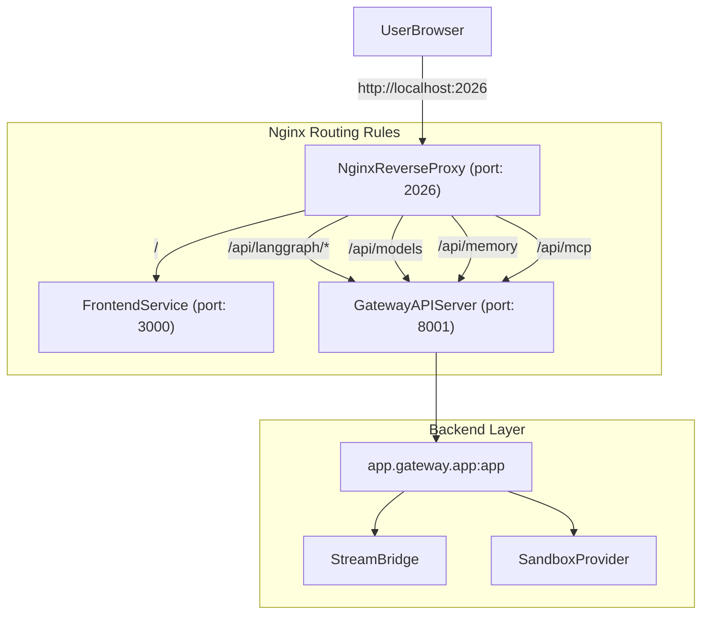
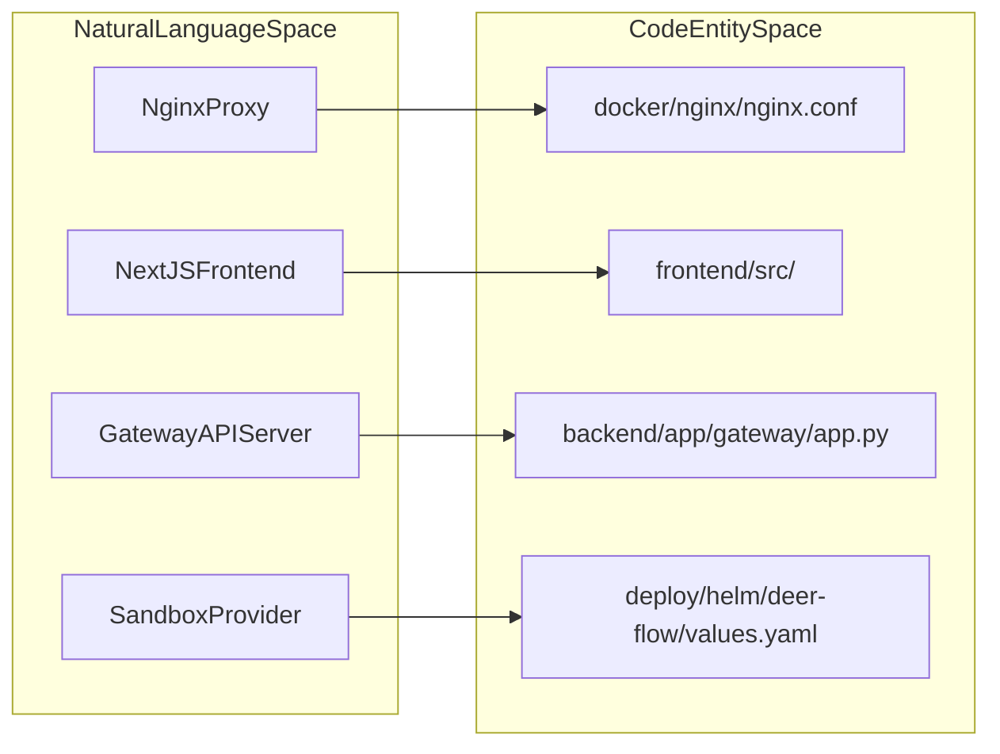

<!-- source: DeepWiki mcp.deepwiki.com · repo bytedance/deer-flow · page 3.1 Service Topology · fetched 2026-10-29 -->

# Service Topology

<details>
<summary>Relevant source files</summary>

The following files were used as context for generating this wiki page:

- [backend/.gitignore](backend/.gitignore)
- [backend/app/gateway/app.py](backend/app/gateway/app.py)
- [backend/app/gateway/deps.py](backend/app/gateway/deps.py)
- [backend/packages/harness/deerflow/config/reload_boundary.py](backend/packages/harness/deerflow/config/reload_boundary.py)
- [backend/tests/support/nginx_conf.py](backend/tests/support/nginx_conf.py)
- [backend/tests/support/shell.py](backend/tests/support/shell.py)
- [backend/tests/test_deploy_uv_extras.py](backend/tests/test_deploy_uv_extras.py)
- [backend/tests/test_detect_uv_extras.py](backend/tests/test_detect_uv_extras.py)
- [backend/tests/test_dev_entrypoint.py](backend/tests/test_dev_entrypoint.py)
- [backend/tests/test_gateway_lifespan_shutdown.py](backend/tests/test_gateway_lifespan_shutdown.py)
- [backend/tests/test_gateway_run_drain_shutdown.py](backend/tests/test_gateway_run_drain_shutdown.py)
- [backend/tests/test_gateway_run_recovery.py](backend/tests/test_gateway_run_recovery.py)
- [backend/tests/test_gateway_runtime_cleanup.py](backend/tests/test_gateway_runtime_cleanup.py)
- [backend/tests/test_local_dev_loopback_bind.py](backend/tests/test_local_dev_loopback_bind.py)
- [backend/tests/test_multi_worker_postgres_gate.py](backend/tests/test_multi_worker_postgres_gate.py)
- [backend/tests/test_nginx_langgraph_body_size.py](backend/tests/test_nginx_langgraph_body_size.py)
- [backend/tests/test_nginx_loopback_canonical.py](backend/tests/test_nginx_loopback_canonical.py)
- [backend/tests/test_nginx_project_documents_body_size.py](backend/tests/test_nginx_project_documents_body_size.py)
- [backend/tests/test_serve_pick_python.py](backend/tests/test_serve_pick_python.py)
- [backend/tests/test_support_shell.py](backend/tests/test_support_shell.py)
- [backend/tests/test_uvicorn_reload_exclude.py](backend/tests/test_uvicorn_reload_exclude.py)
- [deploy/helm/deer-flow/README.md](deploy/helm/deer-flow/README.md)
- [deploy/helm/deer-flow/templates/configmap-nginx.yaml](deploy/helm/deer-flow/templates/configmap-nginx.yaml)
- [deploy/helm/deer-flow/templates/gateway-deployment.yaml](deploy/helm/deer-flow/templates/gateway-deployment.yaml)
- [deploy/helm/deer-flow/values.yaml](deploy/helm/deer-flow/values.yaml)
- [docker/dev-entrypoint.sh](docker/dev-entrypoint.sh)
- [docker/nginx/nginx.conf](docker/nginx/nginx.conf)
- [docker/nginx/nginx.local.conf](docker/nginx/nginx.local.conf)
- [scripts/detect_uv_extras.py](scripts/detect_uv_extras.py)
- [scripts/nginx-local-conf.sh](scripts/nginx-local-conf.sh)
- [scripts/serve.sh](scripts/serve.sh)

</details>


## Purpose and Scope

This page details the four principal runtime services within the DeerFlow system: the **Frontend**, **Gateway API**, **LangGraph Server**, and **Sandbox**. It also describes supporting infrastructure components like **Nginx**, **Redis**, and the **Sandbox Provisioner** [docker/docker-compose-dev.yaml:27-32](). The focus is on their assigned internal TCP ports, how Nginx serves as a unified reverse proxy routing requests between these services, and a precise mapping linking natural language system components to specific codebase entities.

Sources:  
[docker/docker-compose-dev.yaml:27-32]()

---

## High-Level Component Overview

DeerFlow adopts a multi-container distributed architecture that can operate in both development and production environments, typically managed via Docker Compose or local execution scripts [scripts/serve.sh:3-26](). The main services and their port allocations are tabulated below:

| Service                | Internal Port | Public Access Port | Role                                                                                     |
|------------------------|---------------|--------------------|------------------------------------------------------------------------------------------|
| **Nginx (Reverse Proxy)** | `2026`        | `localhost:2026`    | Central HTTP ingress point that routes based on path prefixes and proxy rules [docker/nginx/nginx.conf:80-83]() |
| **Frontend**           | `3000`        | Via Nginx root `/`  | Next.js frontend server delivering UI and static assets [docker/docker-compose-dev.yaml:28]() |
| **Gateway API**        | `8001`        | Via Nginx `/api/*` | FastAPI backend exposing agent runtime, REST APIs, and LangGraph-compatible endpoints [backend/app/gateway/app.py:14-62]() |
| **Sandbox**            | Internal      | N/A                | Secure isolated environment for agent code execution [deploy/helm/deer-flow/README.md:3-6]() |
| **Provisioner** (optional) | `8002`       | Internal           | Kubernetes Pod lifecycle manager used in provisioner sandbox mode [deploy/helm/deer-flow/values.yaml:143-148]() |
| **Redis**              | `6379`        | Internal           | Redis Streams backend for cross-worker SSE stream bridging [deploy/helm/deer-flow/README.md:157-158]() |

The **LangGraph Server** is embedded within the Gateway API process and handles LangGraph-compatible API requests under the `/api/langgraph/*` URL namespace [docker/nginx/nginx.conf:107-110](). The Sandbox operates internally via pluggable `SandboxProvider` implementations invoked by the Gateway's runtime [deploy/helm/deer-flow/values.yaml:145-147]().

Sources:  
[docker/docker-compose-dev.yaml:27-32](), [docker/nginx/nginx.conf:80-110](), [scripts/serve.sh:3-26](), [backend/app/gateway/app.py:14-62](), [deploy/helm/deer-flow/README.md:3-6](), [deploy/helm/deer-flow/values.yaml:143-148]()

---

## Ports and Services in Detail

### Frontend

- **Port:** `3000` internal TCP port for HTTP [docker/docker-compose-dev.yaml:28]()
- **Purpose:** Hosts the Next.js frontend server, which serves the web UI including pages, client routing, and static assets.
- **Implementation:** Next.js application running in a Node.js environment.
- **Configuration:** Forwarding of API requests from SSR layers configured via internal service discovery to communicate directly with the backend Gateway container [deploy/helm/deer-flow/templates/gateway-deployment.yaml:129-132]().

Sources:  
[docker/docker-compose-dev.yaml:28](), [deploy/helm/deer-flow/templates/gateway-deployment.yaml:129-132]()

---

### Gateway API

- **Port:** `8001` internal TCP port for API requests [deploy/helm/deer-flow/templates/gateway-deployment.yaml:137-138]()
- **Purpose:** Serves the REST API endpoints for models, skills, memory, MCP configuration, agent runtime, and user session management [backend/app/gateway/app.py:24-62]().
- **Implementation:** FastAPI app defined at `app.gateway.app:app` served by `uvicorn` inside a Python environment [backend/app/gateway/app.py:14]() [deploy/helm/deer-flow/templates/gateway-deployment.yaml:109]().
- **Scalability:** Can run with multiple worker instances, controlled via worker configurations, with Redis Streams managing state synchronization [deploy/helm/deer-flow/values.yaml:28-47]().
- **Security:** Exposed only internally; public access happens via Nginx proxy [deploy/helm/deer-flow/README.md:3-6]().

Sources:  
[backend/app/gateway/app.py:14-62](), [deploy/helm/deer-flow/README.md:3-6](), [deploy/helm/deer-flow/values.yaml:28-47](), [deploy/helm/deer-flow/templates/gateway-deployment.yaml:109-138]()

---

### LangGraph Server

- **Deployment:** Incorporated inside the Gateway API server process, thus sharing server resources and persistence layers.
- **Routing:** Nginx rewrites `/api/langgraph/*` requests to `/api/*` and proxies to the Gateway API [docker/nginx/nginx.conf:107-110]().
- **Functionality:** Provides LangGraph-compatible API endpoints using the same run manager and store mechanisms inside the Gateway.

Sources:  
[docker/nginx/nginx.conf:107-110]()

---

### Sandbox and Provisioner

- **Sandbox:** Provides a constrained, isolated environment for executing arbitrary code and tools invoked by agents. Implemented via the `SandboxProvider` interface [deploy/helm/deer-flow/values.yaml:145-147]().
- **Provisioner:** An optional service that manages the lifecycle of sandbox environments dynamically, listening on port `8002` [deploy/helm/deer-flow/values.yaml:143-148]().

Sources:  
[deploy/helm/deer-flow/values.yaml:143-148]()

---

## Nginx Proxy Configuration and Routing

Nginx acts as the unified HTTP ingress point, listening on **port 2026**, consolidating access to both the frontend and backend services [docker/nginx/nginx.conf:80-83](). It handles common web requirements such as connection upgrade headers for WebSocket/SSE, payload limits, and long-timeout handling [docker/nginx/nginx.conf:52-140]().

### Routing Rules Summary

| URL Path Pattern          | Action                                   | Destination Service           |
|---------------------------|------------------------------------------|------------------------------|
| `/api/langgraph/*`         | Rewrite prefix `/api/langgraph/` → `/api/`; proxy to Gateway | Gateway API (`8001`) [docker/nginx/nginx.conf:107-110]() |
| `/api/models`              | Proxy directly                          | Gateway API (`8001`) [docker/nginx/nginx.conf:143-151]() |
| `/api/memory`              | Proxy directly                          | Gateway API (`8001`) [docker/nginx/nginx.conf:153-161]() |
| `/api/mcp`                 | Proxy directly                          | Gateway API (`8001`) [docker/nginx/nginx.conf:163-169]() |
| All other requests         | Proxy catch-all                         | Frontend service (`3000`) [docker/nginx/nginx.conf:93]() |

Sources:  
[docker/nginx/nginx.conf:80-169]()

---

### Sample Nginx Location Block for LangGraph API

```nginx
location /api/langgraph/ {
    rewrite ^/api/langgraph/(.*) /api/$1 break;
    proxy_pass http://$gateway_upstream;
    proxy_http_version 1.1;

    proxy_set_header Host $http_host;
    proxy_set_header X-Real-IP $remote_addr;
    proxy_set_header X-Forwarded-For $proxy_add_x_forwarded_for;
    proxy_set_header X-Forwarded-Proto $forwarded_proto;
    proxy_set_header Connection '';

    proxy_set_header X-Accel-Buffering no;
    client_max_body_size 20M;
    proxy_request_buffering off;

    proxy_connect_timeout 600s;
    proxy_send_timeout 600s;
    proxy_read_timeout 600s;
    chunked_transfer_encoding on;
}
```

Sources:  
[docker/nginx/nginx.conf:107-140]()

---

## Diagram: Nginx Proxy Routing Topology

Title: "Nginx Routing Topology"


Sources:  
[docker/nginx/nginx.conf:80-169](), [backend/app/gateway/app.py:14-62]()

---

## Implementation Mapping: Natural Language Components to Code Entities

Title: "Natural Language to Code Entity Mapping"


Sources:  
[docker/nginx/nginx.conf:80-169](), [backend/app/gateway/app.py:14-62](), [deploy/helm/deer-flow/values.yaml:143-148]()

---

# Summary

- DeerFlow comprises four main services: Frontend (`3000`), Gateway API + LangGraph Server (`8001`), Sandbox (internal), and Nginx (`2026`) [docker/docker-compose-dev.yaml:27-32]().
- Nginx serves as a centralized HTTP proxy, routing requests based on URL prefixes to the appropriate upstream service [docker/nginx/nginx.conf:80-110]().
- The Gateway API is the core backend with an embedded LangGraph Server, integrating REST APIs, agent runtime, and sandbox execution calls [backend/app/gateway/app.py:14-62]().
- Environment variables and internal service references ensure coherent inter-service communication [deploy/helm/deer-flow/templates/gateway-deployment.yaml:129-132]().

Sources:  
[docker/docker-compose-dev.yaml:27-32](), [docker/nginx/nginx.conf:80-110](), [backend/app/gateway/app.py:14-62](), [deploy/helm/deer-flow/templates/gateway-deployment.yaml:129-132]()

---

