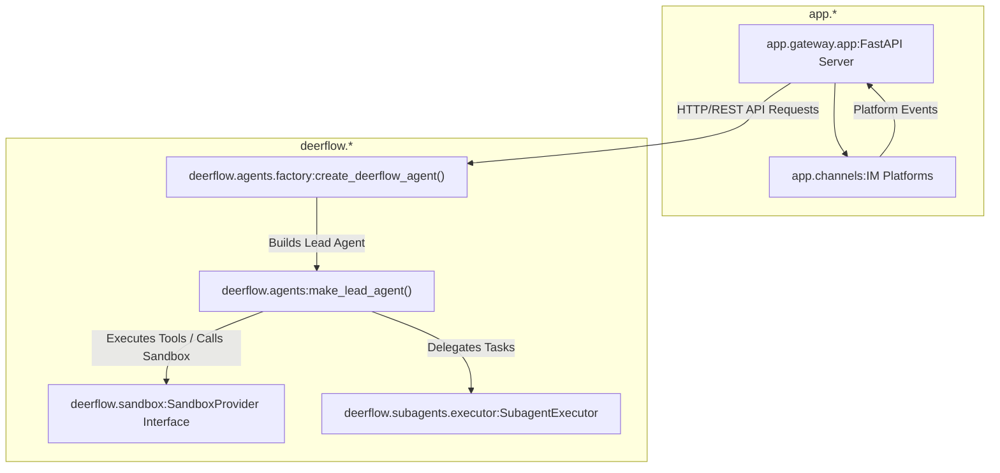
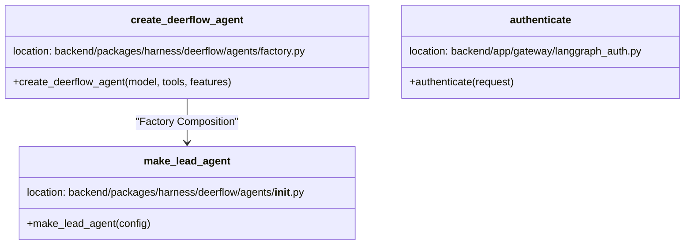
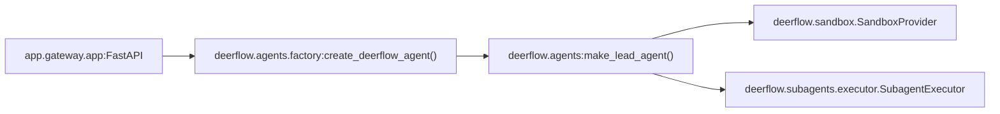

<!-- source: DeepWiki mcp.deepwiki.com · repo bytedance/deer-flow · page 3.2 Harness vs App Layer · fetched 2026-10-29 -->

# Harness vs App Layer

Relevant source files

The following files were used as context for generating this wiki page:

- [.gitignore](.gitignore)
- [backend/CLAUDE.md](backend/CLAUDE.md)
- [backend/Makefile](backend/Makefile)
- [backend/README.md](backend/README.md)
- [backend/docs/API.md](backend/docs/API.md)
- [backend/docs/ARCHITECTURE.md](backend/docs/ARCHITECTURE.md)
- [backend/docs/README.md](backend/docs/README.md)
- [backend/docs/SANDBOX_MEMORY_PROFILING.md](backend/docs/SANDBOX_MEMORY_PROFILING.md)
- [backend/docs/TODO.md](backend/docs/TODO.md)
- [backend/packages/extension-api/deerflow_extension_api/__init__.py](backend/packages/extension-api/deerflow_extension_api/__init__.py)
- [backend/packages/extension-api/deerflow_extension_api/contracts.py](backend/packages/extension-api/deerflow_extension_api/contracts.py)
- [backend/packages/extension-api/pyproject.toml](backend/packages/extension-api/pyproject.toml)
- [backend/packages/harness/deerflow/extensions/AGENTS.md](backend/packages/harness/deerflow/extensions/AGENTS.md)
- [backend/packages/harness/deerflow/extensions/registry.py](backend/packages/harness/deerflow/extensions/registry.py)
- [backend/packages/harness/pyproject.toml](backend/packages/harness/pyproject.toml)
- [backend/pyproject.toml](backend/pyproject.toml)
- [backend/tests/test_extension_api_contracts.py](backend/tests/test_extension_api_contracts.py)
- [backend/tests/test_sandbox_memory_profile_script.py](backend/tests/test_sandbox_memory_profile_script.py)
- [backend/uv.lock](backend/uv.lock)
- [frontend/src/core/extensions/catalog.ts](frontend/src/core/extensions/catalog.ts)
- [frontend/tests/e2e/bookmark-plugin.spec.ts](frontend/tests/e2e/bookmark-plugin.spec.ts)
- [scripts/sandbox_memory_profile.py](scripts/sandbox_memory_profile.py)

This page explains the two-layer backend architecture of DeerFlow, detailing the boundary between the publishable `deerflow-harness` package and the application layer (`app/`), their responsibilities, dependency rules, and how they interact.

---

## Architectural Overview

DeerFlow employs a clean two-layer backend architecture designed to decouple the core agent runtime, orchestration engine, and memory systems from the application-specific delivery, REST API exposure, authentication, and integration layers. This separation guarantees that the core capabilities remain publishable, reusable, and testable as a standalone Python package `deerflow-harness` [backend/packages/harness/pyproject.toml:1-67](). Meanwhile, the application layer under `backend/app/` provides deployment orchestration, FastAPI Gateway endpoints, authentication, and platform integrations [backend/pyproject.toml:1-43]().

The backend is logically divided into two primary layers:

- **Harness Layer**: Implemented as the `deerflow-harness` standalone Python package located at `backend/packages/harness/` [backend/packages/harness/pyproject.toml:1-67](). It contains the core AI super agent runtime: the LangGraph-based lead agent factory (`create_deerflow_agent`, `make_lead_agent`), middleware pipeline, subagent executor, sandbox abstractions, tool system, memory engine, and configuration [backend/packages/harness/pyproject.toml:1-67](), [backend/docs/ARCHITECTURE.md:53-76](). This layer is environment-agnostic and free from deployment-specific dependencies.

- **App Layer**: Implemented under `backend/app/` in the main workspace [backend/pyproject.toml:1-43](). This layer hosts the FastAPI Gateway server exposing REST APIs, manages authentication and authorization, orchestrates agent runtime execution, and integrates with external platforms via IM channels [backend/pyproject.toml:1-43](), [backend/docs/ARCHITECTURE.md:78-105]().

This strict layering is enforced via a hard architectural import boundary rule:

> The **App Layer is allowed to import the Harness package**, but the **Harness package must never import or depend on App**.

Sources: [backend/uv.lock:13-18](), [backend/pyproject.toml:1-43](), [backend/packages/harness/pyproject.toml:1-67]()

---

## Layer Summary Table

| Layer               | Package / Directory                      | Import Prefix    | Role                                                                                       |
|---------------------|----------------------------------------|-----------------|--------------------------------------------------------------------------------------------|
| Harness             | `backend/packages/harness/deerflow/`  | `deerflow.*`    | Core AI super agent runtime: lead agent factory, middleware chain, sandbox, subagents, tools, memory engine |
| App Layer           | `backend/app/`                         | `app.*`         | FastAPI Gateway API (`app.gateway`), authentication, authorization, IM platform integrations, routing |

Sources: [backend/pyproject.toml:1-43](), [backend/packages/harness/pyproject.toml:1-67](), [backend/docs/ARCHITECTURE.md:53-105]()

---

## Harness: The `deerflow-harness` Package

The **Harness** layer is developed as a self-contained, publishable Python package located at `backend/packages/harness/` [backend/packages/harness/pyproject.toml:1-67](). It is an independent workspace member, enabling separate versioning and managed dependencies.

### Core Responsibilities

- **Lead Agent Factory**: Provides `make_lead_agent()` and `create_deerflow_agent()` which build the LangGraph-based lead agent, wiring in system prompts, middleware, subagent limits, and tools within a strong runtime boundary [backend/docs/ARCHITECTURE.md:53-76]().

- **Middleware Chain**: Implements a modular chain of middlewares handling critical runtime concerns such as per-thread isolation, uploads injection, sandbox environment acquisition, and memory extraction [backend/README.md:53-68]().

- **Subagent System**: Provides asynchronous task delegation with `SubagentExecutor` which runs delegated agent graphs concurrently, tracked with task statuses and managed timeouts [backend/README.md:88-96]().

- **Sandbox Execution**: Abstracts sandboxed execution environments via the `SandboxProvider` interface, supporting local file systems, Docker containers, and Kubernetes pods for safe code and tool execution [backend/packages/harness/pyproject.toml:7-10,54]().

Sources: [backend/packages/harness/pyproject.toml:1-67](), [backend/docs/ARCHITECTURE.md:53-76](), [backend/README.md:41-111]()

---

## App Layer: Gateway API and IM Channels

The **App** layer serves as the deployment container and external interface boundary for DeerFlow. It composes the harness into a full backend service with:

- A FastAPI Gateway server exposing REST APIs for models, skills, memory, artifacts, agents, threads, runs, uploads, and scheduled tasks [backend/docs/ARCHITECTURE.md:78-105]().
- Authentication and authorization subsystems, handling JWT session validation, CSRF Double Submit Cookie enforcement, token versioning, and user-id metadata filtering for LangGraph Server [backend/docs/API.md:19-161]().
- Integrations with multiple IM platforms (Slack, Telegram, Feishu/Lark, WeCom, DingTalk, Discord, Buzz), translating platform events into conversation threads routed through the harness runtime [backend/pyproject.toml:31-38]().

Sources: [backend/pyproject.toml:7-43](), [backend/docs/ARCHITECTURE.md:78-105](), [backend/docs/API.md:19-161]()

---

## Data Flow and Interaction Diagram

Title for the diagram: "Harness vs App Layer Request Flow"

Sources: [backend/pyproject.toml:7-43](), [backend/docs/ARCHITECTURE.md:53-76]()

---

## Code Entity Space Bridge Diagrams

Title for diagram: "Harness to App Layer Bridge Entities"

Title for diagram: "App API and Harness Runtime Access"

Sources: [backend/pyproject.toml:7-43](), [backend/docs/ARCHITECTURE.md:53-76]()

---

# Summary

DeerFlow's two-layer backend architecture enforces a clear separation between:

- **Harness Layer:** The publishable `deerflow-harness` package containing the core AI super agent runtime, LangGraph graphs, middleware, sandbox execution, subagents, and configuration [backend/packages/harness/pyproject.toml:1-67]().
- **App Layer:** The application wrapper (`backend/app/`) providing REST APIs, authentication, authorization middleware, IM channels, and server orchestration [backend/pyproject.toml:1-43](), [backend/docs/ARCHITECTURE.md:78-105]().

This separation ensures modularity, reusability, and clean distribution boundaries, critical for evolving DeerFlow as a platform super agent infrastructure.

Sources:
- [backend/pyproject.toml:1-43]()
- [backend/packages/harness/pyproject.toml:1-67]()
- [backend/docs/ARCHITECTURE.md:53-105]()
- [backend/uv.lock:13-18]()

---

