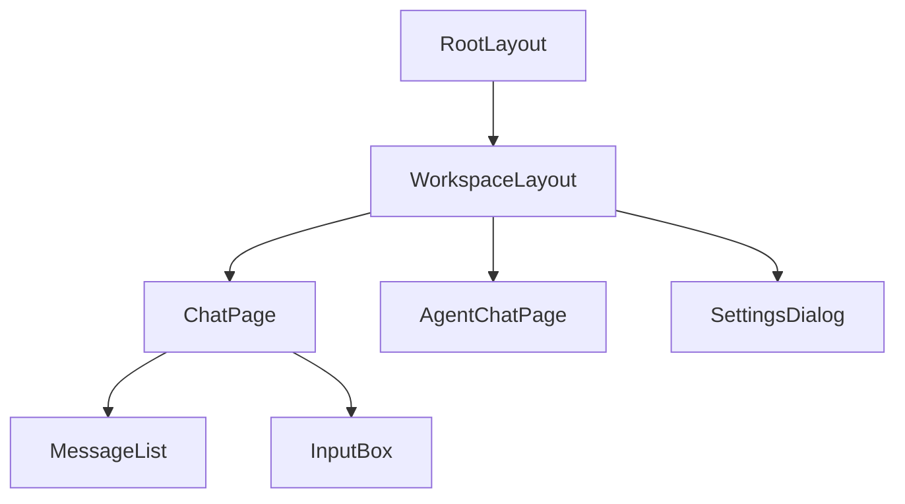
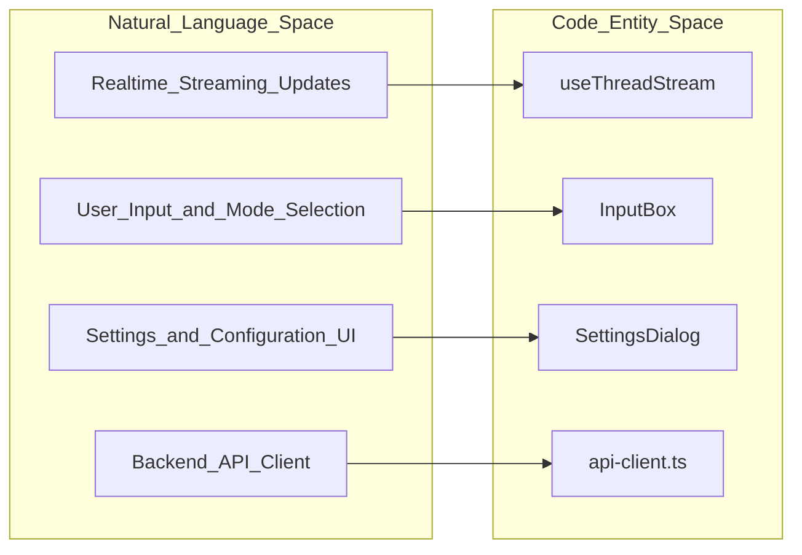
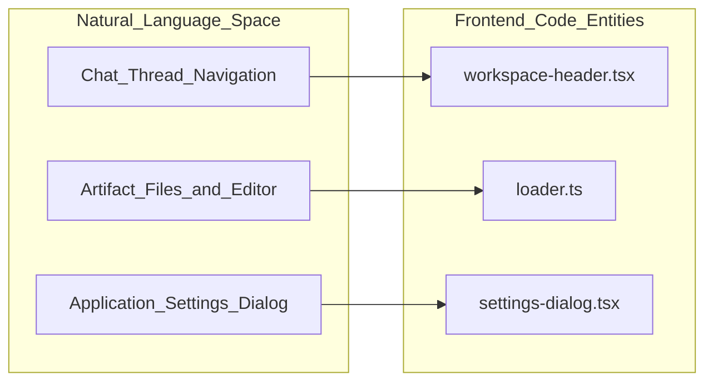

<!-- source: DeepWiki mcp.deepwiki.com · repo bytedance/deer-flow · page 4 Frontend Application · fetched 2026-10-29 -->

# Frontend Application

Relevant source files

The following files were used as context for generating this wiki page:

- [frontend/.env.example](frontend/.env.example)
- [frontend/README.md](frontend/README.md)
- [frontend/components.json](frontend/components.json)
- [frontend/next.config.js](frontend/next.config.js)
- [frontend/package.json](frontend/package.json)
- [frontend/pnpm-lock.yaml](frontend/pnpm-lock.yaml)
- [frontend/src/AGENTS.md](frontend/src/AGENTS.md)
- [frontend/src/app/page.tsx](frontend/src/app/page.tsx)
- [frontend/src/components/theme-provider.tsx](frontend/src/components/theme-provider.tsx)
- [frontend/src/components/ui/aurora-text.tsx](frontend/src/components/ui/aurora-text.tsx)
- [frontend/src/components/ui/number-ticker.tsx](frontend/src/components/ui/number-ticker.tsx)
- [frontend/src/components/workspace/artifacts/artifact-file-preview.tsx](frontend/src/components/workspace/artifacts/artifact-file-preview.tsx)
- [frontend/src/components/workspace/settings/about-content.ts](frontend/src/components/workspace/settings/about-content.ts)
- [frontend/src/components/workspace/settings/about-settings-page.tsx](frontend/src/components/workspace/settings/about-settings-page.tsx)
- [frontend/src/components/workspace/settings/about.md](frontend/src/components/workspace/settings/about.md)
- [frontend/src/components/workspace/settings/memory-settings-page.tsx](frontend/src/components/workspace/settings/memory-settings-page.tsx)
- [frontend/src/components/workspace/settings/settings-dialog.tsx](frontend/src/components/workspace/settings/settings-dialog.tsx)
- [frontend/src/components/workspace/workspace-header.tsx](frontend/src/components/workspace/workspace-header.tsx)
- [frontend/src/components/workspace/workspace-nav-menu.tsx](frontend/src/components/workspace/workspace-nav-menu.tsx)
- [frontend/src/core/api/api-client.ts](frontend/src/core/api/api-client.ts)
- [frontend/src/core/api/stream-mode.ts](frontend/src/core/api/stream-mode.ts)
- [frontend/src/core/artifacts/hooks.ts](frontend/src/core/artifacts/hooks.ts)
- [frontend/src/core/artifacts/html-assets.ts](frontend/src/core/artifacts/html-assets.ts)
- [frontend/src/core/artifacts/loader.ts](frontend/src/core/artifacts/loader.ts)
- [frontend/src/core/auth/gateway-config.ts](frontend/src/core/auth/gateway-config.ts)
- [frontend/src/core/config/index.ts](frontend/src/core/config/index.ts)
- [frontend/src/core/memory/api.ts](frontend/src/core/memory/api.ts)
- [frontend/src/core/memory/hooks.ts](frontend/src/core/memory/hooks.ts)
- [frontend/src/core/memory/types.ts](frontend/src/core/memory/types.ts)
- [frontend/src/core/threads/stream-state.ts](frontend/src/core/threads/stream-state.ts)
- [frontend/src/env.js](frontend/src/env.js)
- [frontend/tests/e2e/artifact-preview.spec.ts](frontend/tests/e2e/artifact-preview.spec.ts)
- [frontend/tests/unit/components/workspace/artifacts/artifact-file-preview.dom.test.tsx](frontend/tests/unit/components/workspace/artifacts/artifact-file-preview.dom.test.tsx)
- [frontend/tests/unit/core/api/api-client.test.ts](frontend/tests/unit/core/api/api-client.test.ts)
- [frontend/tests/unit/core/api/stream-mode.test.ts](frontend/tests/unit/core/api/stream-mode.test.ts)
- [frontend/tests/unit/core/artifacts/html-assets-auth.dom.test.ts](frontend/tests/unit/core/artifacts/html-assets-auth.dom.test.ts)
- [frontend/tests/unit/core/auth/gateway-config.test.ts](frontend/tests/unit/core/auth/gateway-config.test.ts)
- [frontend/tests/unit/core/threads/incremental-stream-state.dom.test.tsx](frontend/tests/unit/core/threads/incremental-stream-state.dom.test.tsx)

The Frontend Application is the Next.js-based user interface for DeerFlow, designed to provide an interactive and real-time experience for orchestrating complex agent workflows. It acts as the "super agent harness" frontend, visualizing conversation threads, managing subtasks, presenting artifacts, and providing an extensible settings UI. The frontend architecture emphasizes modularity, localization, and streaming interaction, supporting DeerFlow’s multi-agent orchestration backend.

## Technology Stack

DeerFlow’s frontend utilizes a modern React ecosystem and third-party libraries optimized for real-time interaction, rich UI, and maintainable design.

| Category             | Technology                                | Purpose                                                                              |
|----------------------|------------------------------------------|--------------------------------------------------------------------------------------|
| **Framework**        | Next.js 16 (App Router)                  | Server-side rendering, nested layouts, routing [frontend/next.config.js:20-32]()     |
| **UI**               | React 19                                 | Interactive component rendering with hooks and concurrent mode support [frontend/package.json:88-89]() |
| **Streaming SDK**    | `@langchain/langgraph-sdk`               | Real-time streaming from LangGraph with SSE support [frontend/pnpm-lock.yaml:38-40]()|
| **Styling**          | Tailwind CSS 4, Radix UI, Shadcn UI     | Utility-first CSS, components, animations, accessibility [frontend/package.json:33-50](), [frontend/package.json:126-126]() |
| **Markdown Rendering**| Streamdown + plugins                     | Streaming markdown rendering including code blocks, mermaid diagrams, LaTeX math [frontend/package.json:51-52](), [frontend/package.json:99-99]() |
| **Editor**           | CodeMirror 6 + `@uiw/react-codemirror` | Embedded code editor for artifact content with syntax highlighting [frontend/package.json:59-67]() |
| **Internationalization** | Custom i18n context + locale files    | Multi-language support with typed translation files and locale detection [frontend/next.config.js:26-29]() |

Sources: [frontend/next.config.js:20-32](), [frontend/package.json:33-126](), [frontend/pnpm-lock.yaml:38-40]()

---

## Application Architecture

The frontend follows Next.js’s App Router design, mixing server and client components alongside React Context providers and rich hooks to maintain domain state and interactions.

### Component Hierarchy Overview

Title: Component Hierarchy Overview

This structure ensures localization, authentication, and workspace context flow seamlessly to chat pages, dialogs, and navigation components.

Sources: [frontend/README.md:97-126](), [frontend/src/components/workspace/settings/settings-dialog.tsx:109-203]()

---

### Mapping Natural Language Concepts to Code Entities

Title: Natural Language to Code Entity Space

This diagram clarifies how real-time updates, user inputs, configuration panels, and network boundaries map to concrete code modules.

Sources: [frontend/src/core/api/api-client.ts:31-42](), [frontend/src/components/workspace/settings/settings-dialog.tsx:109-203](), [frontend/README.md:108-120]()

---

## Key Subsystems Overview

This overview introduces major frontend subsystems. Each subsection links to a dedicated child page for detailed documentation.

### 4.1 Application Layout and Routing

The frontend adopts Next.js App Router's nested layouts for a workspace-centric UI. The workspace root layout manages authentication and wraps the sidebar, header, and main content. Routing follows resource grouping: `/workspace/chats/[thread_id]` for conversation threads, `/workspace/chats/new` for creating chats, and `/workspace/agents/[agent_name]/chats/[thread_id]` for custom agent threads.

For details, see [Application Layout and Routing](#4.1).

Sources: [frontend/README.md:71-76]()

---

### 4.2 Chat Interface and Thread Management

The chat interface leverages the `useThreadStream` hook to subscribe to thread lifecycle events and stream messages live from LangGraph via SSE. The `ChatPage` component orchestrates the thread view, user inputs, and real-time message updates while safeguarding against stream replay gaps.

For details, see [Chat Interface and Thread Management](#4.2).

Sources: [frontend/src/core/api/api-client.ts:77-110]()

---

### 4.3 Input System and Mode Selection

User input is handled by the `InputBox` component, supporting text input, mode switching, file attachments, and model selection. Suggestion and follow-up features assist user workflows and draft management before submission.

For details, see [Input System and Mode Selection](#4.3).

Sources: [frontend/src/AGENTS.md:28-29]()

---

### 4.4 Message Rendering System

Messages are rendered as stable groups with support for rich content including Chain of Thought reasoning steps, tool call visualizations, and interactive annotations, through components like `MessageList`, `MessageListItem`, and `MessageGroup`.

For details, see [Message Rendering System](#4.4).

Sources: [frontend/README.md:103-114]()

---

### 4.5 Subtasks and Subagent Tracking

Delegated subtasks executed by subagents are tracked and visualized via specialized task card components and related hooks. This subsystem manages lifecycle events and real-time progress updates for subtasks.

For details, see [Subtasks and Subagent Tracking](#4.5).

Sources: [frontend/README.md:108-120]()

---

### 4.6 Artifacts and File Display

Agent-generated artifacts are presented within a file list and detailed viewer UI, supporting previews, downloads, and in-browser editing with CodeMirror and range loading (`[frontend/src/core/artifacts/loader.ts:50-116]()`). Skill installation UI is also integrated here.

For details, see [Artifacts and File Display](#4.6).

Sources: [frontend/src/core/artifacts/loader.ts:50-116]()

---

### 4.7 Settings and Configuration UI

Settings are managed via a dialog (`[frontend/src/components/workspace/settings/settings-dialog.tsx:109-203]()`) with dynamically loaded pages for account, appearance, skills, memory (`[frontend/src/components/workspace/settings/memory-settings-page.tsx:1-51]()`), notifications, subagents, and about sections, optimized for lazy loading and performance.

For details, see [Settings and Configuration UI](#4.7).

Sources: [frontend/src/components/workspace/settings/settings-dialog.tsx:36-93](), [frontend/src/components/workspace/settings/memory-settings-page.tsx:1-51]()

---

### 4.8 State Management and Hooks

State management combines React Context providers, custom hooks (`useThreadStream`, `useArtifacts`, `useSubtasks`), and API client abstractions to encapsulate frontend logic and backend communication.

For details, see [State Management and Hooks](#4.8).

Sources: [frontend/src/core/api/api-client.ts:31-42]()

---

### 4.9 Styling System and UI Components

The UI styling is based on Tailwind CSS with custom animations and Radix UI component library for accessibility and composability. CodeMirror integration supports in-browser editing features.

For details, see [Styling System and UI Components](#4.9).

Sources: [frontend/package.json:33-67]()

---

### 4.10 Internationalization

A custom internationalization system provides typed locales with support for English and Chinese, managing multi-language strings and locale detection under Next.js configuration rules.

For details, see [Internationalization](#4.10).

Sources: [frontend/next.config.js:26-29]()

---

### 4.11 Content Rendering and Link Handling

Message and content rendering employs Streamdown with plugins for markdown parsing, code highlighting, Mermaid diagrams, math formulas, and secure handling of special links like citations and artifacts.

For details, see [Content Rendering and Link Handling](#4.11).

Sources: [frontend/package.json:51-52](), [frontend/package.json:91-102]()

---

### 4.12 Custom Agent Studio

Custom agents can be created and managed with a dedicated UI studio, including an agent creation wizard, a gallery for browsing agents, and support for agent-specific chat threads.

For details, see [Custom Agent Studio](#4.12).

Sources: [frontend/README.md:98-102]()

---

### 4.13 Scheduled Tasks UI

The scheduled tasks workspace page lets users create one-time or cron-based tasks, manage run history, and utilize recipe shortcuts, integrating React Query hooks for data synchronization.

For details, see [Scheduled Tasks UI](#4.13).

Sources: [frontend/package.json:104-106]()

---

### 4.14 Documentation Site Content

In-app documentation is provided as MDX content under `frontend/src/content`, supporting multiple languages and organized as harness and application guides. Routing and link-checking are integrated into the build configuration via Nextra (`[frontend/next.config.js:16-18]()`).

For details, see [Documentation Site Content](#4.14).

Sources: [frontend/next.config.js:16-18]()

---

## Summary Diagram: Concept to Code Mapping

Title: Summary Concept to Code Mapping

This diagram captures primary conceptual frontend domains mapped to concrete code entities, illustrating the layered interface and internal logic.

Sources: [frontend/src/components/workspace/workspace-header.tsx:1-18](), [frontend/src/core/artifacts/loader.ts:50-65](), [frontend/src/components/workspace/settings/settings-dialog.tsx:109-125]()

---

