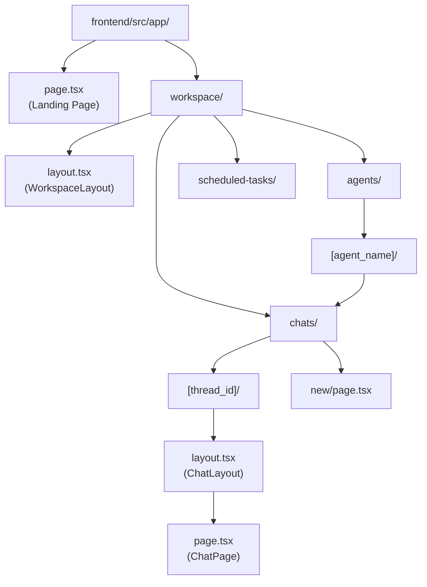
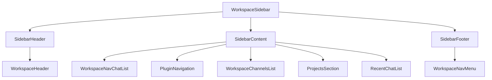
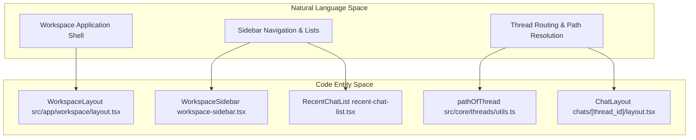
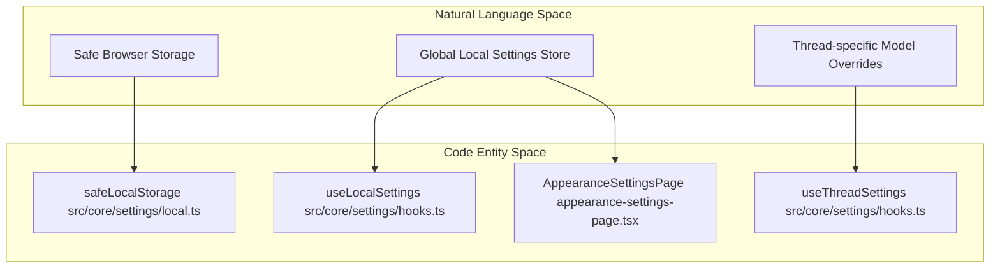

<!-- source: DeepWiki mcp.deepwiki.com · repo bytedance/deer-flow · page 4.1 Application Layout and Routing · fetched 2026-10-29 -->

# Application Layout and Routing

<details>
<summary>Relevant source files</summary>

The following files were used as context for generating this wiki page:

- [frontend/src/app/workspace/chats/[thread_id]/layout.tsx](frontend/src/app/workspace/chats/[thread_id]/layout.tsx)
- [frontend/src/app/workspace/layout.tsx](frontend/src/app/workspace/layout.tsx)
- [frontend/src/components/query-client-provider.tsx](frontend/src/components/query-client-provider.tsx)
- [frontend/src/components/ui/empty.tsx](frontend/src/components/ui/empty.tsx)
- [frontend/src/components/ui/item.tsx](frontend/src/components/ui/item.tsx)
- [frontend/src/components/ui/switch.tsx](frontend/src/components/ui/switch.tsx)
- [frontend/src/components/workspace/recent-chat-list.tsx](frontend/src/components/workspace/recent-chat-list.tsx)
- [frontend/src/components/workspace/settings/appearance-settings-page.tsx](frontend/src/components/workspace/settings/appearance-settings-page.tsx)
- [frontend/src/components/workspace/settings/index.ts](frontend/src/components/workspace/settings/index.ts)
- [frontend/src/components/workspace/workspace-sidebar.tsx](frontend/src/components/workspace/workspace-sidebar.tsx)
- [frontend/src/core/i18n/context.tsx](frontend/src/core/i18n/context.tsx)
- [frontend/src/core/i18n/cookies.ts](frontend/src/core/i18n/cookies.ts)
- [frontend/src/core/i18n/hooks.ts](frontend/src/core/i18n/hooks.ts)
- [frontend/src/core/i18n/index.ts](frontend/src/core/i18n/index.ts)
- [frontend/src/core/i18n/server.ts](frontend/src/core/i18n/server.ts)
- [frontend/src/core/settings/hooks.ts](frontend/src/core/settings/hooks.ts)
- [frontend/src/core/settings/index.ts](frontend/src/core/settings/index.ts)
- [frontend/src/core/settings/local.ts](frontend/src/core/settings/local.ts)
- [frontend/src/core/settings/store.ts](frontend/src/core/settings/store.ts)
- [frontend/src/core/threads/types.ts](frontend/src/core/threads/types.ts)
- [frontend/src/core/threads/utils.ts](frontend/src/core/threads/utils.ts)
- [frontend/tests/unit/core/threads/utils.test.ts](frontend/tests/unit/core/threads/utils.test.ts)

</details>


## Purpose and Scope

This document explains the Next.js application structure, workspace layout system, sidebar navigation, routing patterns, and related data flow in the DeerFlow frontend. It details how the application organizes files, manages authentication states via server-side checks, structures routed chat threads and agent workspaces, and handles local and thread-scoped UI settings using a safe `localStorage` abstraction layer.

---

## Next.js App Router Structure

DeerFlow utilizes Next.js with the App Router paradigm, organizing navigation via filesystem-based conventions under `frontend/src/app/`. The application uses hierarchical layouts that wrap nested child pages and dynamic routes.

### File System Routing Topology

Title: "File System Routing Topology"


- The root `/` path serves the landing page, providing entry points and information.
- The `/workspace/` subtree hosts the authenticated user interface, enclosed by `WorkspaceLayout`.
- Dynamic nested routes like `/workspace/chats/[thread_id]` house chat threads. `ChatLayout` wraps these views with shared context for thread-specific data streams, message streaming, and lifecycle hooks [frontend/src/app/workspace/chats/[thread_id]/layout.tsx:1-18](). This layout also implements `generateStaticParams()` to support static generation of demo chat threads during static export builds [frontend/src/app/workspace/chats/[thread_id]/layout.tsx:5-10]().
- Other workspace modules include custom agent execution spaces (`/workspace/agents/[agent_name]/chats/[thread_id]`) and scheduled tasks (`/workspace/scheduled-tasks/`), each maintaining dedicated routing contexts.

Sources: [frontend/src/app/workspace/chats/[thread_id]/layout.tsx:1-18](), [frontend/src/app/workspace/layout.tsx:1-64]().

---

## Workspace Layout Architecture

At the root of the authenticated user interface under `/workspace`, the `WorkspaceLayout` component located at `frontend/src/app/workspace/layout.tsx` serves as the primary application shell. It performs key responsibilities:

- **Authentication State Resolution:** Invokes `getServerSideUser()` to inspect the user's session status and system initialization flags from the server environment [frontend/src/app/workspace/layout.tsx:22]().
- **Locale Detection:** Calls `detectLocaleServer()` to determine the localized language profile before rendering [frontend/src/app/workspace/layout.tsx:21]().
- **Conditional Layout Flow:** Processes the union result returned by the authentication check:
  - `"authenticated"`: Wraps child nodes in an `AuthProvider` passing `initialUser`, and mounts `WorkspaceContent` [frontend/src/app/workspace/layout.tsx:27-32]().
  - `"needs_setup"` or `"system_setup_required"`: Triggers a server-side redirect to `/setup` [frontend/src/app/workspace/layout.tsx:34-37]().
  - `"unauthenticated"`: Renders `WorkspaceLoginRedirect` (delegating client-side login handling since layouts cannot directly inspect request URLs) [frontend/src/app/workspace/layout.tsx:38-42]().
  - `"account_disabled"`: Redirects to `ACCOUNT_DISABLED_LOGIN_URL` [frontend/src/app/workspace/layout.tsx:43-46]().
  - `"gateway_unavailable"`: Mounts `GatewayOfflineFallback` enclosing `WorkspaceContent` with the `gatewayUnavailable` flag enabled [frontend/src/app/workspace/layout.tsx:47-56]().
  - `"config_error"`: Throws a runtime initialization error with the message provided [frontend/src/app/workspace/layout.tsx:57-58]().

Sources: [frontend/src/app/workspace/layout.tsx:1-64]().

---

## Sidebar Architecture and Components

The sidebar provides persistent navigation across the workspace interface, granting access to active navigation links, IM channels, projects, and recent chats.

### Sidebar Component Tree

Title: "Sidebar Component Tree"


- **WorkspaceHeader**: Renders the brand header and primary controls [frontend/src/components/workspace/workspace-sidebar.tsx:34]().
- **WorkspaceNavChatList**: Displays primary workspace links (chats, agents, scheduled tasks) [frontend/src/components/workspace/workspace-sidebar.tsx:37]().
- **PluginNavigation**: Injects extension and plugin routes dynamically [frontend/src/components/workspace/workspace-sidebar.tsx:38]().
- **WorkspaceChannelsList**: Lists linked messaging channel connections [frontend/src/components/workspace/workspace-sidebar.tsx:39]().
- **ProjectsSection** & **RecentChatList**: Conditionally rendered when `isSidebarOpen` is true, displaying user projects and recent threads [frontend/src/components/workspace/workspace-sidebar.tsx:40-45](). Additionally, `WorkspaceSidebar` invokes `useThreadActivity()` to poll for background thread updates [frontend/src/components/workspace/workspace-sidebar.tsx:29]().
- **WorkspaceNavMenu**: Houses user account menus, theme settings, and navigation footers [frontend/src/components/workspace/workspace-sidebar.tsx:48]().

Sources: [frontend/src/components/workspace/workspace-sidebar.tsx:1-54]().

---

## Thread Routing and Context Resolution

Routing between standard chats and custom agent chats is centralized in utility functions like `pathOfThread` (`frontend/src/core/threads/utils.ts`). 

- If an agent name is detected in either the thread's `context.agent_name` or `metadata.agent_name`, `pathOfThread` constructs a custom agent route: `/workspace/agents/[agent_name]/chats/[thread_id]` [frontend/src/core/threads/utils.ts:41-67]().
- Otherwise, it falls back to the standard chat route: `/workspace/chats/[thread_id]` [frontend/src/core/threads/utils.ts:66]().

Sources: [frontend/src/core/threads/utils.ts:1-180](), [frontend/tests/unit/core/threads/utils.test.ts:1-231]().

---

## Application Settings and Local Storage

DeerFlow manages persistent UI configurations and thread overrides through a robust `localStorage` abstraction layer.

### Safe Local Storage Wrapper

Browser environments (such as Safari in private mode or tight security configurations) frequently throw `SecurityError` or `QuotaExceededError` on storage operations. The `safeLocalStorage` helper (`frontend/src/core/settings/local.ts`) traps these exceptions to prevent React render-phase crashes [frontend/src/core/settings/local.ts:39-66]().

```ts
export const safeLocalStorage = {
  getItem(key: string): string | null { ... },
  setItem(key: string, value: string): boolean { ... },
  removeItem(key: string): boolean { ... },
}
```

### Storage Key Conventions

| Key Pattern | Description |
| :--- | :--- |
| `deerflow.local-settings` | Global UI and feature toggle state [frontend/src/core/settings/local.ts:22]() |
| `deerflow.thread-model.<thread_id>` | Thread-specific model overrides [frontend/src/core/settings/local.ts:23]() |

### React Hooks for State Management

- `useLocalSettings()`: Subscribes to global settings changes using `useSyncExternalStore` [frontend/src/core/settings/hooks.ts:17-29]().
- `useThreadSettings(threadId)`: Combines base settings with thread-specific model overrides [frontend/src/core/settings/hooks.ts:31-59]().

Sources: [frontend/src/core/settings/local.ts:1-176](), [frontend/src/core/settings/hooks.ts:1-59]().

---

# Natural Language Space to Code Entity Mapping: Layout & Routing

Title: "Natural Language Space to Code Entity Mapping Layout and Routing"


Sources: [frontend/src/app/workspace/layout.tsx:1-64](), [frontend/src/components/workspace/workspace-sidebar.tsx:1-54](), [frontend/src/components/workspace/recent-chat-list.tsx:1-207](), [frontend/src/core/threads/utils.ts:1-180](), [frontend/src/app/workspace/chats/[thread_id]/layout.tsx:1-18]().

---

# Natural Language Space to Code Entity Mapping: Settings & Storage

Title: "Natural Language Space to Code Entity Mapping Settings and Storage"


Sources: [frontend/src/core/settings/local.ts:1-176](), [frontend/src/core/settings/hooks.ts:1-59](), [frontend/src/components/workspace/settings/appearance-settings-page.tsx:1-112]().

---

