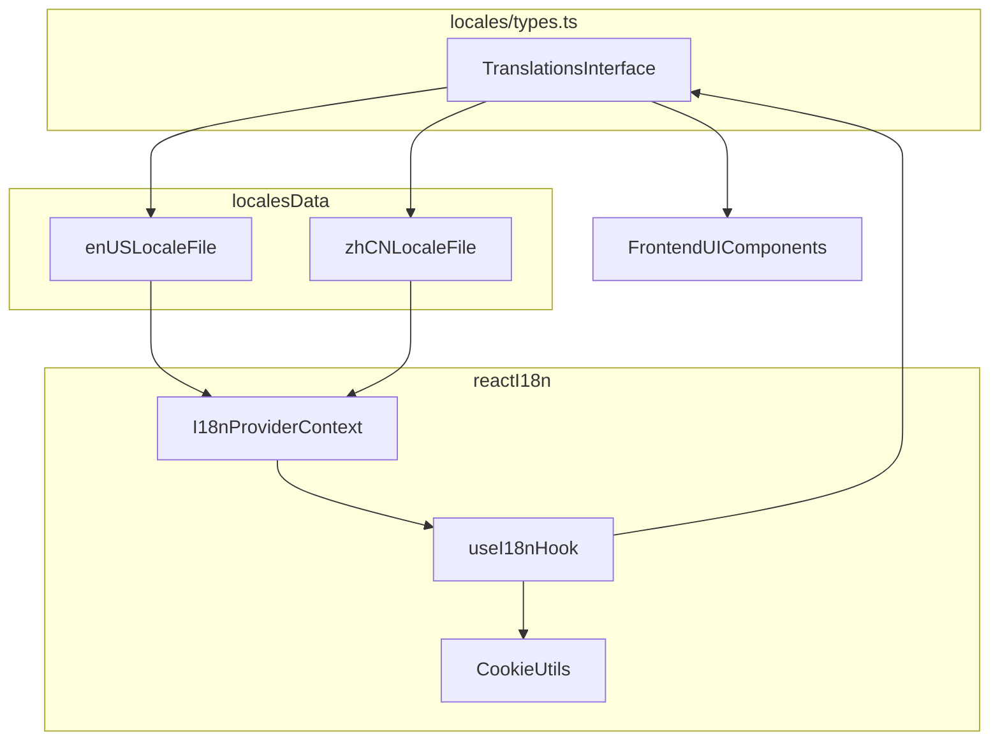
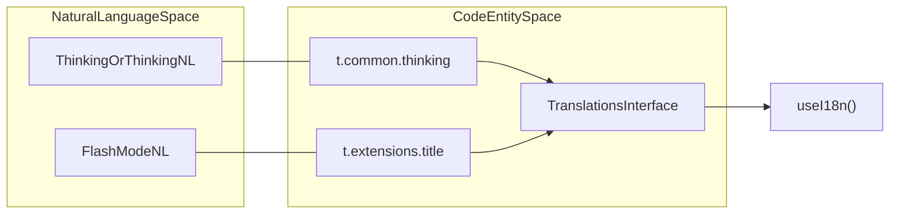
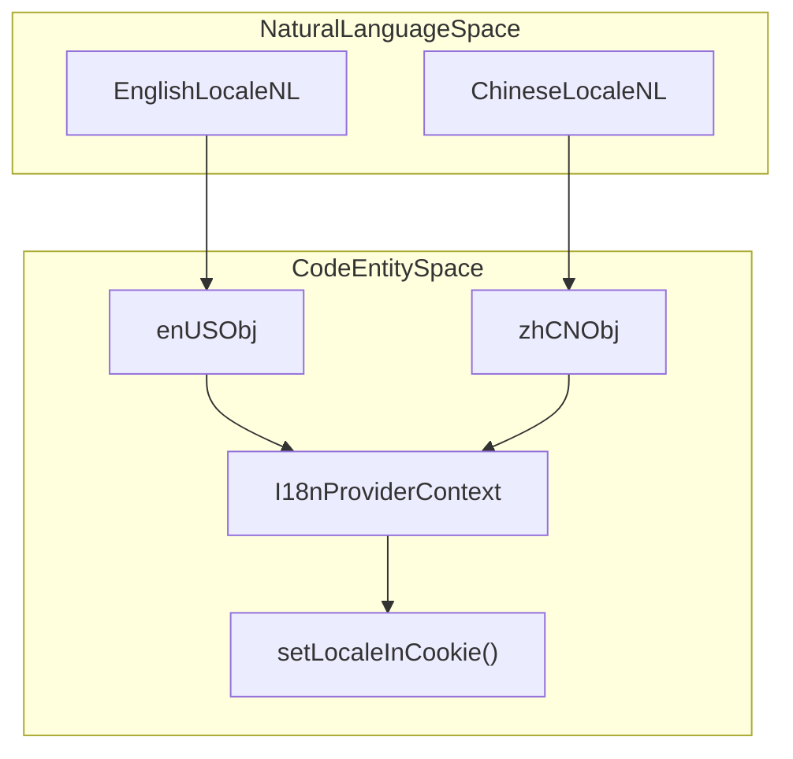
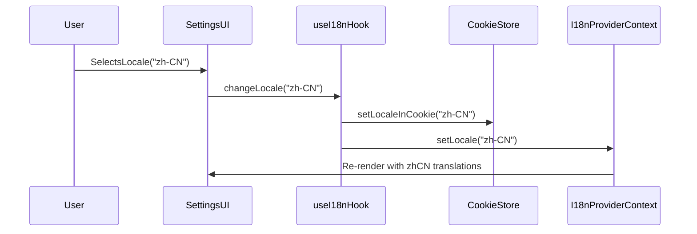

<!-- source: DeepWiki mcp.deepwiki.com · repo bytedance/deer-flow · page 4.10 Internationalization · fetched 2026-10-29 -->

# Internationalization

<details>
<summary>Relevant source files</summary>

The following files were used as context for generating this wiki page:

- [frontend/AGENTS.md](frontend/AGENTS.md)
- [frontend/src/app/workspace/agents/[agent_name]/chats/[thread_id]/page.tsx](frontend/src/app/workspace/agents/[agent_name]/chats/[thread_id]/page.tsx)
- [frontend/src/app/workspace/chats/[thread_id]/layout.tsx](frontend/src/app/workspace/chats/[thread_id]/layout.tsx)
- [frontend/src/app/workspace/chats/[thread_id]/page.tsx](frontend/src/app/workspace/chats/[thread_id]/page.tsx)
- [frontend/src/components/ui/empty.tsx](frontend/src/components/ui/empty.tsx)
- [frontend/src/components/ui/item.tsx](frontend/src/components/ui/item.tsx)
- [frontend/src/components/ui/switch.tsx](frontend/src/components/ui/switch.tsx)
- [frontend/src/components/workspace/artifacts/artifact-file-detail.tsx](frontend/src/components/workspace/artifacts/artifact-file-detail.tsx)
- [frontend/src/components/workspace/input-box.tsx](frontend/src/components/workspace/input-box.tsx)
- [frontend/src/components/workspace/messages/message-group.tsx](frontend/src/components/workspace/messages/message-group.tsx)
- [frontend/src/components/workspace/messages/message-list-item.tsx](frontend/src/components/workspace/messages/message-list-item.tsx)
- [frontend/src/components/workspace/messages/message-list.tsx](frontend/src/components/workspace/messages/message-list.tsx)
- [frontend/src/components/workspace/settings/appearance-settings-page.tsx](frontend/src/components/workspace/settings/appearance-settings-page.tsx)
- [frontend/src/components/workspace/settings/index.ts](frontend/src/components/workspace/settings/index.ts)
- [frontend/src/components/workspace/workspace-sidebar.tsx](frontend/src/components/workspace/workspace-sidebar.tsx)
- [frontend/src/core/i18n/context.tsx](frontend/src/core/i18n/context.tsx)
- [frontend/src/core/i18n/cookies.ts](frontend/src/core/i18n/cookies.ts)
- [frontend/src/core/i18n/hooks.ts](frontend/src/core/i18n/hooks.ts)
- [frontend/src/core/i18n/index.ts](frontend/src/core/i18n/index.ts)
- [frontend/src/core/i18n/locales/en-US.ts](frontend/src/core/i18n/locales/en-US.ts)
- [frontend/src/core/i18n/locales/types.ts](frontend/src/core/i18n/locales/types.ts)
- [frontend/src/core/i18n/locales/zh-CN.ts](frontend/src/core/i18n/locales/zh-CN.ts)
- [frontend/src/core/i18n/server.ts](frontend/src/core/i18n/server.ts)
- [frontend/src/core/messages/utils.ts](frontend/src/core/messages/utils.ts)
- [frontend/src/core/threads/hooks.ts](frontend/src/core/threads/hooks.ts)
- [frontend/tests/unit/components/workspace/messages/message-list-item.dom.test.tsx](frontend/tests/unit/components/workspace/messages/message-list-item.dom.test.tsx)
- [frontend/tests/unit/core/messages/utils.test.ts](frontend/tests/unit/core/messages/utils.test.ts)
- [frontend/tests/unit/core/threads/local-turn-order.dom.test.tsx](frontend/tests/unit/core/threads/local-turn-order.dom.test.tsx)
- [frontend/tests/unit/core/threads/message-merge.test.ts](frontend/tests/unit/core/threads/message-merge.test.ts)
- [frontend/tests/unit/core/threads/send-message.test.ts](frontend/tests/unit/core/threads/send-message.test.ts)

</details>


This page documents the internationalization (i18n) system in DeerFlow's Next.js frontend application. It details the `Translations` type contract, locale file structure, the `useI18n` hook implementation, locale switching, and multi-language support.

Sources: [frontend/src/core/i18n/locales/types.ts:3-10](), [frontend/src/core/i18n/locales/en-US.ts:14-18](), [frontend/src/core/i18n/locales/zh-CN.ts:14-18]()

---

## Overview

DeerFlow's frontend supports multiple locales—primarily American English (`en-US`) and Simplified Chinese (`zh-CN`)—using a lightweight, type-safe internationalization architecture integrated directly into TypeScript. This design provides static type checking for all string keys, full IDE autocompletion, and correctness validation without external runtime translation overhead.

The core modules of the i18n system include:

- **Contract Definition**: The `Translations` TypeScript interface defining the full translation key schema and nested namespaces for UI text and dynamic functional entries [frontend/src/core/i18n/locales/types.ts:3-250]().  
- **Locale Data Implementations**: Concrete objects (`enUS` and `zhCN`) implementing the `Translations` interface, providing localized string values [frontend/src/core/i18n/locales/en-US.ts:14-199](), [frontend/src/core/i18n/locales/zh-CN.ts:14-191]().  
- **React Context and Hooks**: `I18nProvider` context to supply active translations and the `useI18n` hook for consuming translations and triggering locale changes [frontend/src/core/i18n/hooks.ts:10-40](), [frontend/src/core/i18n/context.tsx:1-50]().  
- **Persistence & SSR**: Locale preferences stored in cookies enable server-side rendering (SSR) to render locale-appropriate HTML and client-side locale changes without page reload [frontend/src/core/i18n/server.ts:1-41](), [frontend/src/core/i18n/cookies.ts:1-30]().

This system is designed for simplicity, type safety, and robust multi-language support.

Sources: [frontend/src/core/i18n/locales/types.ts:3-250](), [frontend/src/core/i18n/locales/en-US.ts:14-199](), [frontend/src/core/i18n/locales/zh-CN.ts:14-191](), [frontend/src/core/i18n/hooks.ts:10-40](), [frontend/src/core/i18n/server.ts:1-41]()

---

## Architecture and File Layout

The i18n system resides primarily under `frontend/src/core/i18n/`. The following diagram illustrates the relationships among key modules, the data flow, and integration points with the frontend components.

### I18n Module Architecture and Data Flow


- The `Translations` interface defines all translation keys and structure [frontend/src/core/i18n/locales/types.ts:3-10]().
- Locale files `enUS` and `zhCN` implement the interface and provide localized text [frontend/src/core/i18n/locales/en-US.ts:14-18](), [frontend/src/core/i18n/locales/zh-CN.ts:14-18]().
- `I18nProvider` holds the current translations and locale state for the React tree [frontend/src/core/i18n/context.tsx:1-50]().
- The `useI18n` hook consumes translations and exposes locale switching [frontend/src/core/i18n/hooks.ts:10-40]().
- Cookie utilities handle persistence of the locale choice across sessions [frontend/src/core/i18n/cookies.ts:1-30]().
- Frontend UI components call `useI18n` to render translated strings [frontend/src/components/workspace/input-box.tsx:86-86]().

Sources: [frontend/src/core/i18n/locales/types.ts:3-10](), [frontend/src/core/i18n/locales/en-US.ts:14-18](), [frontend/src/core/i18n/locales/zh-CN.ts:14-18](), [frontend/src/core/i18n/context.tsx:1-50](), [frontend/src/core/i18n/hooks.ts:10-40](), [frontend/src/core/i18n/cookies.ts:1-30](), [frontend/src/components/workspace/input-box.tsx:86-86]()

---

## The `Translations` Interface

All translatable UI strings and functional text entries are statically organized inside the `Translations` interface, which serves as the contract for locale implementations.

### Key Features of the `Translations` Interface

- **Nested Namespaces:** Translation strings are grouped by UI domain or feature, e.g.:
  - `common`: General UI actions and labels such as "Save", "Delete" [frontend/src/core/i18n/locales/types.ts:132-176]()
  - `extensions`: Extension plugin UI strings [frontend/src/core/i18n/locales/types.ts:9-48]()
  - `capabilities`: Capability center UI texts [frontend/src/core/i18n/locales/types.ts:50-129]()
  - `skillUsage`: Skill-related labels and usage states [frontend/src/core/i18n/locales/types.ts:178-189]()
  - `runDuration`: Task timing and duration descriptions [frontend/src/core/i18n/locales/types.ts:191-201]()
  - Other domains like `welcome`, `clipboard`, `artifactEditing`, etc. [frontend/src/core/i18n/locales/types.ts:209-271]()

- **Static and Dynamic Keys:** Supports static strings as well as functions for dynamic formatting, e.g. a key like `showingOf(loaded: number, total: number): string` for displaying "Showing X of Y" [frontend/src/core/i18n/locales/types.ts:145-145]().

- **Strong Type Safety:** The TypeScript interface enforces key existence and correct typing for all locales, ensuring consistency and IDE support [frontend/src/core/i18n/locales/types.ts:3-10]().

### Important Namespaces Summary

| Namespace           | Purpose / Content                                           |
|---------------------|------------------------------------------------------------|
| `locale`            | Locale metadata such as the readable local name            |
| `common`            | General UI labels and actions                               |
| `extensions`        | Extension-related UI strings                                |
| `capabilities`      | Capability Center UI text                                   |
| `skillUsage`        | Skill state and label strings                               |
| `runDuration`       | Task run timing and formatter strings                       |
| `welcome`           | Welcome screen texts                                        |
| `clipboard`         | Clipboard-related messages                                  |
| `artifactEditing`   | Artifact file editing messages and states                   |
| `artifactPreview`   | Artifact preview UI messages                                |
| `artifactTable`     | Data table UI text for artifact content                     |
| `artifactArchive`   | Artifact archive UI interactions                            |

Sources: [frontend/src/core/i18n/locales/types.ts:3-271]()

---

## Locale Files

Locale implementations are plain JavaScript objects precisely shaped to the `Translations` interface. DeerFlow currently includes two primary locales:

### English Locale (`en-US.ts`)

- Located at `frontend/src/core/i18n/locales/en-US.ts` [frontend/src/core/i18n/locales/en-US.ts:14-18]()
- Provides all translations in American English.
- Covers UI domains including extensions, capabilities, common actions, error messages, prompts, etc [frontend/src/core/i18n/locales/en-US.ts:14-199]().
- Supports functional keys such as:
  ```ts
  showingOf: (loaded, total) => `Showing ${loaded} of ${total}`,
  ```

### Simplified Chinese Locale (`zh-CN.ts`)

- Located at `frontend/src/core/i18n/locales/zh-CN.ts` [frontend/src/core/i18n/locales/zh-CN.ts:14-18]()
- Provides all translations localized to Simplified Chinese.
- Mirrors the exact structure of the English locale for full coverage [frontend/src/core/i18n/locales/zh-CN.ts:14-191]().
- Preserves all dynamic function keys with corresponding Chinese text.

Both locales export constants named `enUS` and `zhCN` respectively containing the fully nested translation tree [frontend/src/core/i18n/locales/en-US.ts:14-14](), [frontend/src/core/i18n/locales/zh-CN.ts:14-14]().

Sources: [frontend/src/core/i18n/locales/en-US.ts:14-199](), [frontend/src/core/i18n/locales/zh-CN.ts:14-191]()

---

## Natural Language Space to Code Entity Association

DeerFlow bridges the user-facing natural language strings with code entities for translation, UI rendering, and runtime locale selection.

### Diagram 1: UI String Mapping to Code Translation Objects



- The `useI18n()` hook reads string values by well-defined paths like `t.common.thinking` [frontend/src/core/i18n/hooks.ts:10-40]().
- These paths correspond exactly to keys inside the translation data objects defined per locale [frontend/src/core/i18n/locales/en-US.ts:14-18](), [frontend/src/core/i18n/locales/zh-CN.ts:14-18]().
- User-facing UI labels get resolved dynamically by the hook to the current locale strings [frontend/src/core/i18n/context.tsx:1-50]().
- This linkage guarantees string correctness across translation updates.

Sources: [frontend/src/core/i18n/locales/en-US.ts:14-199](), [frontend/src/core/i18n/locales/types.ts:3-250](), [frontend/src/core/i18n/hooks.ts:10-40](), [frontend/src/core/i18n/context.tsx:1-50]()

---

### Diagram 2: Locale Selection and Provider Association



- The user's locale preference in natural language maps to the corresponding locale data object in code [frontend/src/core/i18n/locales/en-US.ts:14-18](), [frontend/src/core/i18n/locales/zh-CN.ts:14-18]().
- The `I18nProvider` wraps a React subtree and provides that locale object as context [frontend/src/core/i18n/context.tsx:1-50]().
- The `setLocaleInCookie()` function persists the user's choice in a browser cookie [frontend/src/core/i18n/cookies.ts:1-30]().
- This design enables fast switching and consistent locale preservation.

Sources: [frontend/src/core/i18n/locales/en-US.ts:14-18](), [frontend/src/core/i18n/locales/zh-CN.ts:14-18](), [frontend/src/core/i18n/context.tsx:1-50](), [frontend/src/core/i18n/cookies.ts:1-30]()

---

## Locale Persistence and Switching

DeerFlow stores the user's locale choice in a cookie, enabling persistence across browser sessions and allowing the backend to render localized HTML on SSR [frontend/src/core/i18n/server.ts:1-41](), [frontend/src/core/i18n/cookies.ts:1-30]().

- On the initial server render, the backend reads a cookie named `"locale"` [frontend/src/core/i18n/server.ts:1-41]().
- This cookie guides which locale to serve for server-side rendering [frontend/src/core/i18n/server.ts:1-41]().
- The React frontend `useI18n` hook exposes a `changeLocale` function for dynamic client-side locale changes [frontend/src/core/i18n/hooks.ts:10-40]().
- When the user switches locale via UI, the system updates cookie storage, updates React context state in `I18nProvider`, and triggers component re-rendering [frontend/src/core/i18n/hooks.ts:10-40](), [frontend/src/core/i18n/context.tsx:1-50]().
- This avoids full page reloads, improving responsiveness of language switching.

### Dynamic Locale Switching Sequence



Sources: [frontend/src/core/i18n/hooks.ts:10-40](), [frontend/src/core/i18n/server.ts:1-41](), [frontend/src/core/i18n/cookies.ts:1-30](), [frontend/src/core/i18n/context.tsx:1-50]()

---

## Summary

DeerFlow's internationalization solution provides a robust, strongly-typed, fully type-safe multi-language framework:

- A comprehensive `Translations` schema enforces translation key correctness [frontend/src/core/i18n/locales/types.ts:3-271]().
- Locale files implement this schema, providing English and Chinese locales [frontend/src/core/i18n/locales/en-US.ts:14-199](), [frontend/src/core/i18n/locales/zh-CN.ts:14-191]().
- React context (`I18nProvider`) and the `useI18n` hook integrate translations into the frontend component tree seamlessly [frontend/src/core/i18n/context.tsx:1-50](), [frontend/src/core/i18n/hooks.ts:10-40]().
- Locale preference cookie persistence supports SSR and client locale updates [frontend/src/core/i18n/server.ts:1-41](), [frontend/src/core/i18n/cookies.ts:1-30]().
- Dynamic locale switching works without page reload, improving user experience [frontend/src/core/i18n/hooks.ts:10-40]().

This architecture ensures consistent, correct, and efficient multi-language support across DeerFlow's frontend.

Sources:  
- [frontend/src/core/i18n/locales/types.ts:3-271]()  
- [frontend/src/core/i18n/locales/en-US.ts:14-199]()  
- [frontend/src/core/i18n/locales/zh-CN.ts:14-191]()  
- [frontend/src/core/i18n/hooks.ts:10-40]()  
- [frontend/src/core/i18n/context.tsx:1-50]()  
- [frontend/src/core/i18n/server.ts:1-41]()  
- [frontend/src/core/i18n/cookies.ts:1-30]()

---

