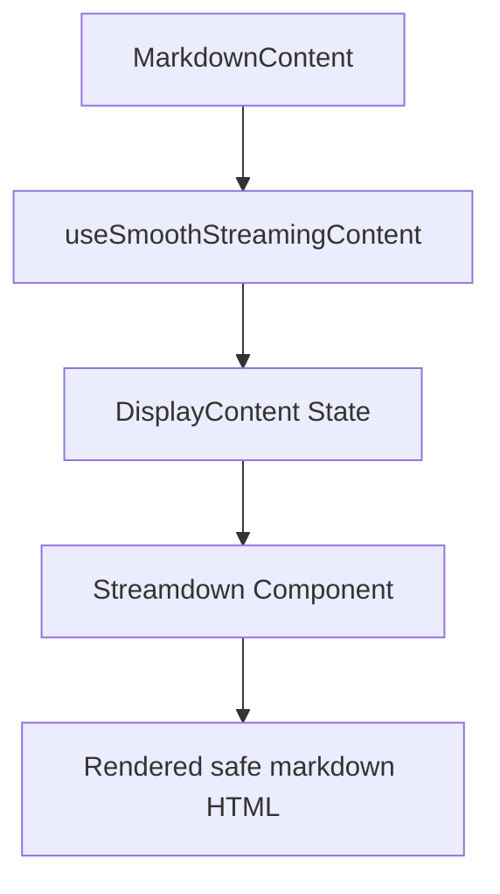
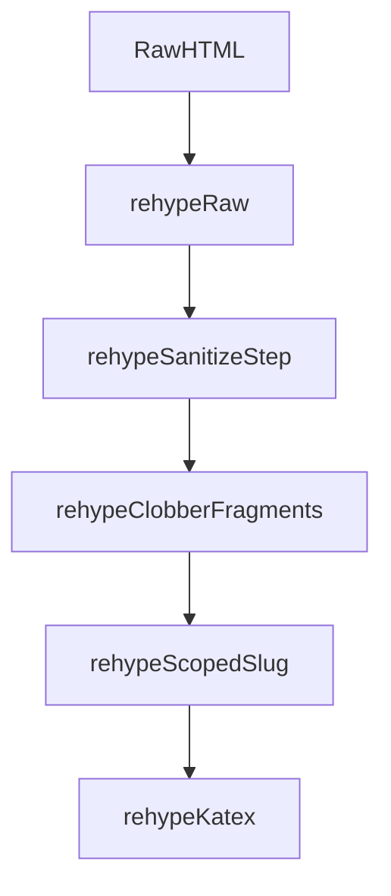
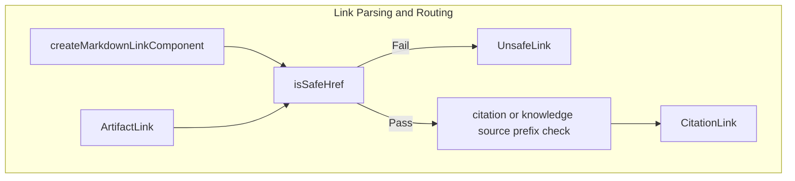
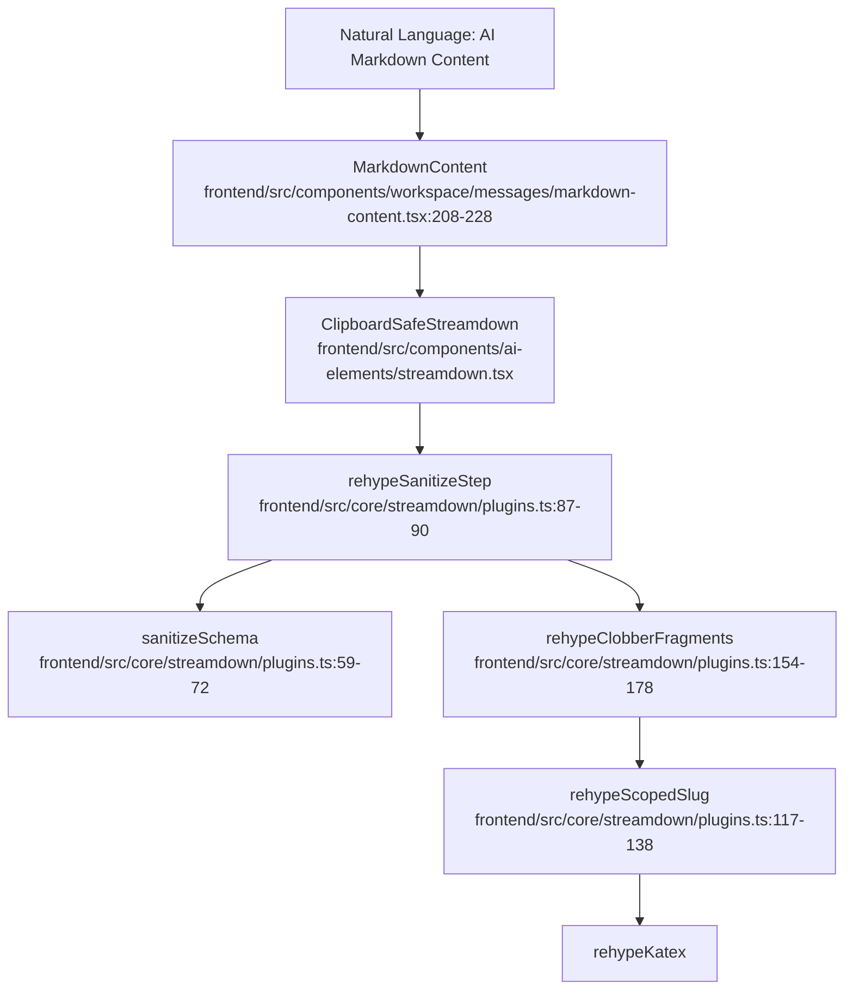
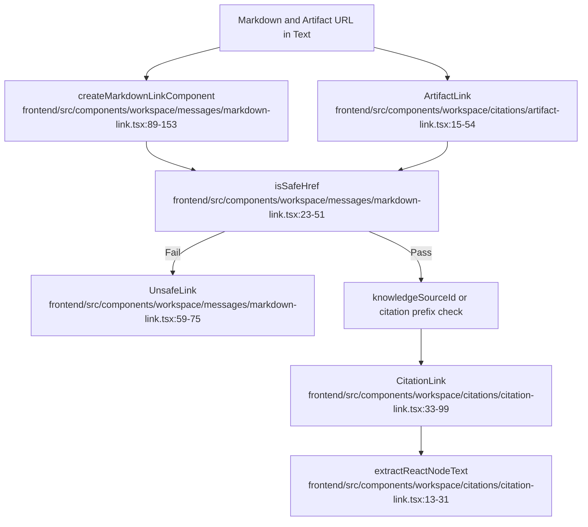

<!-- source: DeepWiki mcp.deepwiki.com · repo bytedance/deer-flow · page 4.11 Content Rendering and Link Handling · fetched 2026-10-29 -->

# Content Rendering and Link Handling

Relevant source files

The following files were used as context for generating this wiki page:

- [frontend/src/components/ai-elements/message.tsx](frontend/src/components/ai-elements/message.tsx)
- [frontend/src/components/ai-elements/reasoning.tsx](frontend/src/components/ai-elements/reasoning.tsx)
- [frontend/src/components/workspace/copy-button.tsx](frontend/src/components/workspace/copy-button.tsx)
- [frontend/src/components/workspace/messages/markdown-content.tsx](frontend/src/components/workspace/messages/markdown-content.tsx)
- [frontend/src/core/clipboard.ts](frontend/src/core/clipboard.ts)
- [frontend/src/core/streamdown/plugins.ts](frontend/src/core/streamdown/plugins.ts)
- [frontend/tests/unit/components/workspace/messages/markdown-content.dom.test.tsx](frontend/tests/unit/components/workspace/messages/markdown-content.dom.test.tsx)
- [frontend/tests/unit/components/workspace/messages/markdown-content.test.ts](frontend/tests/unit/components/workspace/messages/markdown-content.test.ts)
- [frontend/tests/unit/core/clipboard.test.ts](frontend/tests/unit/core/clipboard.test.ts)
- [frontend/tests/unit/core/reasoning-trigger.test.ts](frontend/tests/unit/core/reasoning-trigger.test.ts)
- [frontend/tests/unit/core/streamdown/plugins.test.ts](frontend/tests/unit/core/streamdown/plugins.test.ts)

## Purpose and Scope

DeerFlow uses markdown rendering extensively to display AI assistant responses, subtask details, and artifact previews in the frontend interface. This page describes the implementation of the markdown rendering engine, the Streamdown plugin ecosystem, and the related components handling citation and artifact links securely.

Key points include:

- Streaming markdown rendering with word-level incremental reveal and LaTeX math support [`frontend/src/components/workspace/messages/markdown-content.tsx:208-228`]()  
- Use of custom Streamdown plugin chains for parsing, sanitization, and enhanced content [`frontend/src/core/streamdown/plugins.ts:1-138`]()  
- Safe protocol checking and sanitization of links to prevent XSS and unsafe navigation [`frontend/src/components/workspace/messages/markdown-link.tsx:23-51`]()  
- Citation links (`CitationLink`) rendering with hover cards and badges for knowledge sources [`frontend/src/components/workspace/citations/citation-link.tsx:33-99`]()  
- Artifact links with filesystem path resolving to stable backend URLs [`frontend/src/components/workspace/citations/artifact-link.tsx:15-54`]() and [`frontend/src/core/artifacts/utils.ts:1-151`]()  

Sources:  
[frontend/src/components/workspace/messages/markdown-content.tsx:208-228]()  
[frontend/src/core/streamdown/plugins.ts:1-138]()  
[frontend/src/components/workspace/messages/markdown-link.tsx:23-51]()  
[frontend/src/components/workspace/citations/citation-link.tsx:33-99]()  
[frontend/src/components/workspace/citations/artifact-link.tsx:15-54]()  
[frontend/src/core/artifacts/utils.ts:1-151]()

---

## Streamdown Integration and Core Rendering Engine

At the core of DeerFlow’s content rendering pipeline is the open-source markdown parser and incremental rendering library **Streamdown**. This is wrapped by the `MarkdownContent` React component within the workspace.

### `MarkdownContent` Component

- Accepts `content` (markdown string) with optional streaming state `isLoading`.  
- Uses `useSmoothStreamingContent` to progressively reveal streamed text to smooth out incremental updates [`frontend/src/components/workspace/messages/markdown-content.tsx:53-148`]().  
- Preprocesses markdown content before rendering with `preprocessStreamdownMarkdown` to normalize edge cases [`frontend/src/components/workspace/messages/markdown-content.tsx:223-226`]().  
- Applies a configured set of `remarkPlugins` and `rehypePlugins` to parse markdown, parse raw HTML, sanitize content, and render math.  
- During streaming, code blocks render using `StreamingPre` and `StreamingCode` components which show escaped raw HTML rather than highlighted code [`frontend/src/components/workspace/messages/markdown-content.tsx:150-205]().  
- Switches back to full Streamdown code highlighting after streaming ends.  

### Smooth Streaming Reveal Hook

The hook `useSmoothStreamingContent` manages a timed progressive reveal of streamed content when the assistant response is loading, throttling the amount of new characters shown per render tick.

Sources:  
[frontend/src/components/workspace/messages/markdown-content.tsx:53-228]()  
[frontend/src/components/workspace/messages/markdown-content.tsx:150-205]()

---

## Preprocessing and Safety Mechanisms

DeerFlow enforces strong content safety measures within the markdown rendering process to mitigate XSS and DOM-clobbering risks from raw HTML in markdown:

### Sanitization Schema (`sanitizeSchema`)

Defined in [`frontend/src/core/streamdown/plugins.ts:59-72`](), `sanitizeSchema` extends GitHub-style HTML sanitization with:

- Allowing `tel:` schema in anchor links in addition to standard safe schemes.  
- Permitting special `className` values (`math-inline` and `math-display`) on `code` blocks to preserve math rendering styles.  
- Allowing `metastring` attribute on `code` blocks for Streamdown compatibility.  
- Removing executable elements and attributes such as `<script>`, `<iframe>`, `on*` handlers, and unsafe URI schemes (`javascript:` etc.).  

### Sanitization Step (`rehypeSanitizeStep`)

- Runs immediately after raw HTML parsing (`rehypeRaw`) but before math rendering (`rehypeKatex`) [`frontend/src/core/streamdown/plugins.ts:75-90`]().  
- Preserves necessary attributes for safe rendering while cleaning dangerous content.  

### DOM Clobbering Prevention

- `rehypeScopedSlug` plugin adds safe prefixed IDs to all headings (e.g., `user-content-heading`) to prevent attackers from injecting IDs that clash with browser-internal elements or scripts [`frontend/src/core/streamdown/plugins.ts:117-138`]().  
- `rehypeClobberFragments` normalizes fragment links and heading IDs to keep in-page anchor navigation consistent despite the sanitization prefixing [`frontend/src/core/streamdown/plugins.ts:154-178]().

Sources:  
[frontend/src/core/streamdown/plugins.ts:59-178]()

---

## Streamdown Plugin Configurations

The codebase defines tailored plugin bundles for Streamdown to handle different rendering contexts:

1. **`streamdownPlugins`** (default for markdown messages) includes:  
   - `remarkGfm` (GitHub Flavored Markdown) with single-tilde strikethrough disabled.  
   - `remarkMath` to parse LaTeX math formulas.  
   - `rehypeRaw` to parse raw embedded HTML.  
   - `rehypeSanitizeStep` for sanitization.  
   - `rehypeKatex` to render math to HTML.  
   - Rendering support plugins: `@streamdown/code` for syntax highlighting and `@streamdown/mermaid` for diagrams.  

2. **`reasoningPlugins`** (for internal AI reasoning display) excludes `rehypeRaw` to avoid executing raw HTML during reasoning visualization [`frontend/tests/unit/core/streamdown/plugins.test.ts:73-76`]().  

3. **`streamdownRenderingPlugins`** exports rendering helpers: just `code` and `mermaid` — shared between `streamdownPlugins` and `reasoningPlugins` [`frontend/tests/unit/core/streamdown/plugins.test.ts:42-46`]().  

Sources:  
[frontend/src/core/streamdown/plugins.ts:1-13]()  
[frontend/tests/unit/core/streamdown/plugins.test.ts:7-76]()

---

## Citation and Link Handling

To prevent security issues and enhance user navigation, DeerFlow enforces strict link processing:

### URL Safety Checks (`isSafeHref`)

- Accepts only these protocols: `http:`, `https:`, `mailto:`, `tel:` [`frontend/src/components/workspace/messages/markdown-link.tsx:21-21`]().  
- Accepts in-document anchors (`#section`), relative references (`./file.md`), and absolute same-origin paths (`/mnt/...`).  
- Rejects dangerous protocols (`javascript:`, `data:`, `file:`) and protocol-relative URLs (`//evil.com`) [`frontend/src/components/workspace/messages/markdown-link.tsx:23-51`]().  

### `UnsafeLink` Component

- Renders links that fail safety checks as stylized non-interactive `` elements with a tooltip explaining omission to users, avoiding any executable behavior [`frontend/src/components/workspace/messages/markdown-link.tsx:59-75`]().  

### `createMarkdownLinkComponent(threadId)`

- Factory producing the link renderer used in markdown content [`frontend/src/components/workspace/messages/markdown-link.tsx:89-153`]().  
- Stops unsafe hrefs from rendering as anchors, falling back to `UnsafeLink`.  
- Routes known knowledge source URLs and citations through `CitationLink`.  
- Maps local artifact file links beginning with `/mnt/` to backend HTTP URLs with the current `threadId` for loading artifact content securely.  
- External URLs open safely in new tabs with `rel="noopener noreferrer"`.  

### `ArtifactLink` Component

- Specialized link component used in artifact previews that applies the same safe link checks, citation detection, and external links handling [`frontend/src/components/workspace/citations/artifact-link.tsx:15-54`]().  

### `CitationLink` Component

- Enhances citation links with badge labeling, hover cards previewing source URLs, and click event stop propagation [`frontend/src/components/workspace/citations/citation-link.tsx:33-99`]().  

Sources:  
[frontend/src/components/workspace/messages/markdown-link.tsx:23-153]()  
[frontend/src/components/workspace/citations/artifact-link.tsx:15-54]()  
[frontend/src/components/workspace/citations/citation-link.tsx:33-99]()

---

## Artifact URL Handling

Artifact files produced during sandbox execution or tool runs are referred to by `/mnt/` paths inside markdown or message content. DeerFlow resolves these paths to actual URLs for the current thread so the frontend can fetch and display the artifact.

Key utilities in [`frontend/src/core/artifacts/utils.ts:1-151`]() handle:

- Decoding and encoding filesystem path segments, preserving literals like `%` for stable URI handling.  
- Constructing artifact URLs referencing backend APIs with encoded thread IDs and file paths.  
- Supporting static demo mode, where artifact URLs map to demo public files instead of the backend server.  
- Resolving markdown image URLs and links that may include query parameters and fragment suffixes while maintaining correct URL structure.  
- Extracting artifact paths from thread state.  

Sources:  
[frontend/src/core/artifacts/utils.ts:1-151]()  
[frontend/tests/unit/core/artifacts/utils.test.ts:1-214]()

---

## Natural Language to Code Entity Bridges

### Markdown Rendering Flow from AI Message to Sanitized HTML

Sources:  
[frontend/src/components/workspace/messages/markdown-content.tsx:208-228]()  
[frontend/src/core/streamdown/plugins.ts:59-178]()

---

### Link Rendering Decision Tree for Markdown and Artifact Links

Sources:  
[frontend/src/components/workspace/messages/markdown-link.tsx:23-153]()  
[frontend/src/components/workspace/citations/artifact-link.tsx:15-54]()  
[frontend/src/components/workspace/citations/citation-link.tsx:13-99]()

---

## Summary

DeerFlow implements a robust markdown rendering system anchored on the Streamdown library with significant customizations:

- Plugin chains for GitHub-flavored markdown, math support, mermaid diagrams, and syntax highlighting.  
- Explicit content sanitization preventing script injection and DOM spoofing from raw HTML.  
- Controlled streamed content reveal producing smooth user experience during assistant response generation.  
- Link handling that strictly filters unsafe URL protocols, intercepts citations, and translates local artifact paths into valid backend URLs.  
- Rich citation UI with badges and hover cards improving reference UX without compromising security.  

Sources: All cited files and line ranges above.

---

