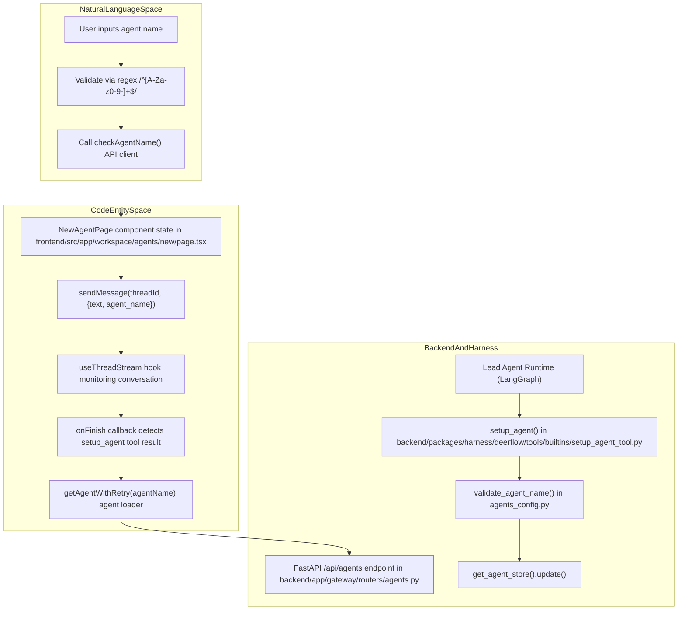
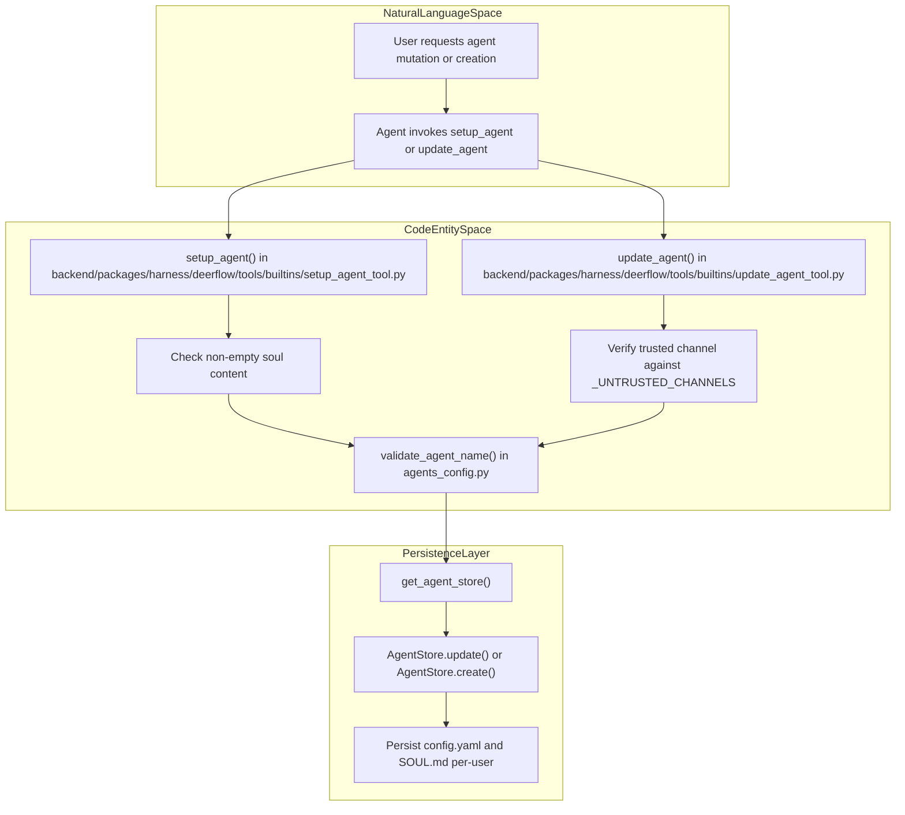

<!-- source: DeepWiki mcp.deepwiki.com · repo bytedance/deer-flow · page 4.12 Custom Agent Studio · fetched 2026-10-29 -->

# Custom Agent Studio

<details>
<summary>Relevant source files</summary>

The following files were used as context for generating this wiki page:

- [backend/app/gateway/routers/AGENTS.md](backend/app/gateway/routers/AGENTS.md)
- [backend/app/gateway/routers/agents.py](backend/app/gateway/routers/agents.py)
- [backend/packages/harness/deerflow/agents/memory/backends/deermem/deermem/core/paths.py](backend/packages/harness/deerflow/agents/memory/backends/deermem/deermem/core/paths.py)
- [backend/packages/harness/deerflow/config/agents_config.py](backend/packages/harness/deerflow/config/agents_config.py)
- [backend/packages/harness/deerflow/persistence/agents/__init__.py](backend/packages/harness/deerflow/persistence/agents/__init__.py)
- [backend/packages/harness/deerflow/tools/builtins/setup_agent_tool.py](backend/packages/harness/deerflow/tools/builtins/setup_agent_tool.py)
- [backend/packages/harness/deerflow/tools/builtins/update_agent_tool.py](backend/packages/harness/deerflow/tools/builtins/update_agent_tool.py)
- [backend/tests/blocking_io/test_agents_router.py](backend/tests/blocking_io/test_agents_router.py)
- [backend/tests/test_agent_storage_backend.py](backend/tests/test_agent_storage_backend.py)
- [backend/tests/test_agent_tool_groups_router.py](backend/tests/test_agent_tool_groups_router.py)
- [backend/tests/test_agents_router_write_drain.py](backend/tests/test_agents_router_write_drain.py)
- [backend/tests/test_custom_agent.py](backend/tests/test_custom_agent.py)
- [backend/tests/test_setup_agent_tool.py](backend/tests/test_setup_agent_tool.py)
- [backend/tests/test_update_agent_tool.py](backend/tests/test_update_agent_tool.py)
- [frontend/src/app/workspace/agents/new/page.tsx](frontend/src/app/workspace/agents/new/page.tsx)
- [frontend/src/components/workspace/agents/agent-capability-selection.tsx](frontend/src/components/workspace/agents/agent-capability-selection.tsx)
- [frontend/src/components/workspace/agents/agent-card.tsx](frontend/src/components/workspace/agents/agent-card.tsx)
- [frontend/src/components/workspace/agents/agent-settings-dialog.tsx](frontend/src/components/workspace/agents/agent-settings-dialog.tsx)
- [frontend/src/components/workspace/chats/chat-page.tsx](frontend/src/components/workspace/chats/chat-page.tsx)
- [frontend/src/core/agents/api.ts](frontend/src/core/agents/api.ts)
- [frontend/src/core/agents/hooks.ts](frontend/src/core/agents/hooks.ts)
- [frontend/src/core/agents/types.ts](frontend/src/core/agents/types.ts)
- [frontend/src/core/auth/permissions.ts](frontend/src/core/auth/permissions.ts)
- [frontend/tests/e2e/agent-chat.spec.ts](frontend/tests/e2e/agent-chat.spec.ts)
- [frontend/tests/e2e/agent-reasoning-settings.spec.ts](frontend/tests/e2e/agent-reasoning-settings.spec.ts)
- [frontend/tests/e2e/sidebar.spec.ts](frontend/tests/e2e/sidebar.spec.ts)
- [frontend/tests/e2e/utils/mock-api.ts](frontend/tests/e2e/utils/mock-api.ts)
- [frontend/tests/unit/components/workspace/agents/agent-display-name.dom.test.tsx](frontend/tests/unit/components/workspace/agents/agent-display-name.dom.test.tsx)
- [frontend/tests/unit/components/workspace/agents/agent-reasoning-settings.dom.test.tsx](frontend/tests/unit/components/workspace/agents/agent-reasoning-settings.dom.test.tsx)
- [frontend/tests/unit/components/workspace/input-box-send-gating.dom.test.tsx](frontend/tests/unit/components/workspace/input-box-send-gating.dom.test.tsx)
- [frontend/tests/unit/core/agents/api.test.ts](frontend/tests/unit/core/agents/api.test.ts)
- [frontend/tests/unit/core/auth/permissions.test.ts](frontend/tests/unit/core/auth/permissions.test.ts)

</details>


## Purpose and Scope
The **Custom Agent Studio** is a subsystem within DeerFlow dedicated to the natural-language-driven creation, management, and interaction with custom AI agents. It integrates frontend React components with backend FastAPI routes, configuration loaders, and harness tools (`setup_agent` and `update_agent`) to provide a full lifecycle environment for agent creation, configuration, persistence, and chat-driven evolution.

Sources: [frontend/src/app/workspace/agents/new/page.tsx:79-119](), [backend/app/gateway/routers/agents.py:1-69]()

---

## 1. Overview and Architecture

The Custom Agent Studio consists of the following major components spanning frontend and backend:

- **Agent Creation Wizard:** A guided React UI (`NewAgentPage`) that lets users name and bootstrap new custom agents, triggering backend tooling to persist them.
- **Agent Gallery UI:** Lists all custom agents owned by the user and provides management controls (`AgentCard`, `AgentSettingsDialog`) for editing, exporting, and deleting.
- **Agent-Specific Chat Threads:** Each agent gets distinct chat threads with runtime personality and configuration injection.
- **Backend CRUD API:** FastAPI routes under `backend/app/gateway/routers/agents.py` that manage agent lifecycle, validation, and persistence scoped per user.
- **Harness Tools (`setup_agent`, `update_agent`):** LangChain function tools (`setup_agent` and `update_agent`) that agents invoke to programmatically create and update their configuration and SOUL personality markdown.

This setup enables per-user isolated AI agents that can be dynamically provisioned and expanded during interaction, supporting a multi-tenant secure environment.

Sources: [frontend/src/app/workspace/agents/new/page.tsx:79-119](), [backend/app/gateway/routers/agents.py:20-131](), [frontend/src/components/workspace/agents/agent-card.tsx:111-157]()

---

## 2. Agent Creation Wizard and `NewAgentPage`

The main UI for creating an agent is the React component `NewAgentPage` under `frontend/src/app/workspace/agents/new/page.tsx`. It implements a two-step wizard:

### Step 1: Name Input and Validation
- User enters a candidate agent name (`nameInput`).
- Frontend validates the format using a regex `^[A-Za-z0-9-]+$` to allow letters, digits, and hyphens only.
- Calls the backend API client function `checkAgentName` to verify availability.
- Provides error feedback for invalid, unavailable, or API-disabled states (`AgentsApiDisabledError`, `AgentNameCheckError`).

### Step 2: Chat Bootstrap with Agent Context
- Upon successful validation, switches to a chat view (`step === "chat"`) that bootstraps the agent.
- Sends a first user message with the agent name in the context, prompting the runtime lead agent to invoke `setup_agent`.
- Uses the `useThreadStream` hook for reactive streaming of the conversation.
- Detects the completion of the `setup_agent` tool call in the chat stream via `hasToolResult(state.messages, "setup_agent")` to finalize creation.
- Polls the backend with `getAgentWithRetry` until the agent is persisted and visible.

### Key React States and Hooks
- `step`: `"name"` or `"chat"` controls wizard phase.
- `nameInput`, `nameError`: Track user input and validation errors.
- `agentName`, `agent`: Store confirmed agent ID and loaded metadata.
- `setupAgentStatus`: Bootstrap progress tracking (`"idle"`, `"requested"`, `"completed"`).
- `threadId`: A unique UUID generated via `uuid()` for the bootstrap chat thread.
- `sendMessage()`: Sends messages to the backend with context including `agent_name`.

### Data and Control Flow in Agent Creation



Sources: [frontend/src/app/workspace/agents/new/page.tsx:52-195](), [backend/packages/harness/deerflow/tools/builtins/setup_agent_tool.py:17-92]()

---

## 3. Agent Gallery and Management UI

The agent gallery UI displays a user's custom agents and enables browsing, editing, export, and chat initiation per agent. Key components include:

- **`AgentCard`**: Displays agent title, model badge, description, tool groups, and skills with truncated tooltips for overflowing text. Provides buttons for launching chats (`/workspace/agents/${agent.name}/chats/new`), exporting package (`exportAgentPackage`), and opening settings or deletion dialogs.
- **`AgentSettingsDialog`**: React component allowing editing of agent display name (Unicode validated), description, model overrides, tool/mcp plugin groups, skills, allowed subagents, and flags like thinking mode enabled and reasoning effort.
- **API Client (`frontend/src/core/agents/api.ts`)**: Provides typed wrapper methods:
  - `listAgents()`
  - `getAgent(name)`
  - `createAgent(request)`
  - `exportAgentPackage(name)`
  - `importAgentPackage(agentPackage, name)`
  - `updateAgent(name, request)`
  - `deleteAgent(name)`
  - `checkAgentName(name)`

Sources: [frontend/src/components/workspace/agents/agent-card.tsx:111-157](), [frontend/src/core/agents/api.ts:44-142]()

---

## 4. Backend Agent CRUD API (`app/gateway/routers/agents.py`)

The FastAPI backend exposes RESTful CRUD endpoints under `/api/agents` that implement agent management:

| Route | Method | Description |
|---|---|---|
| `/api/agents` | GET | List all custom agents for the effective user. |
| `/api/agents/{name}` | GET | Fetch full agent config and `SOUL.md` content. |
| `/api/agents` | POST | Create a custom agent with JSON config + `SOUL.md`. |
| `/api/agents/{name}` | PUT | Update agent config and/or `SOUL.md` partially. |
| `/api/agents/{name}` | DELETE | Delete the agent and all its persisted data. |
| `/api/agents/check` | GET | Check if an agent name is valid and available. |

### Backend Implementation Highlights
- **Agent name validation** uses the strict regex `^[A-Za-z0-9-]+$` defined in `AGENT_NAME_PATTERN`.
- Agents are stored per-user under `{base_dir}/users/{user_id}/agents/{name}/` via `get_agent_store()`.
- All blocking IO (filesystem or database access) is offloaded with `asyncio.to_thread` to prevent event loop blocking, verified by regression tests in `backend/tests/blocking_io/test_agents_router.py`.
- Persistent writes route through `run_drained_write` so client disconnects do not cancel queued persistence workers.

Sources: [backend/app/gateway/routers/agents.py:30-131](), [backend/tests/blocking_io/test_agents_router.py:43-142](), [backend/tests/test_agents_router_write_drain.py:55-74]()

---

## 5. Harness Tools: `setup_agent` and `update_agent`

Within the LangChain harness tools system, two key tools empower custom agent creation and updates programmatically:

### `setup_agent` Tool
- Location: `backend/packages/harness/deerflow/tools/builtins/setup_agent_tool.py`
- Called at bootstrap to create or update the agent's `config.yaml` and `SOUL.md`.
- Validates that the `soul` content is a non-empty string (rejecting empty or whitespace-only inputs to prevent data loss).
- Validates agent name using `validate_agent_name`.
- Persists agent config and SOUL via `get_agent_store()`, scoped per user via `resolve_runtime_user_id(runtime)`.
- Returns a LangGraph `Command` with success or error `ToolMessage`.

### `update_agent` Tool
- Location: `backend/packages/harness/deerflow/tools/builtins/update_agent_tool.py`
- Bound only inside a chat with a custom agent (when `runtime.context["agent_name"]` is set).
- Supports partial updates to `SOUL.md`, description, skills, tool groups, and model overrides.
- Disallows execution on untrusted webhook channels (e.g., `github`) via `_UNTRUSTED_CHANNELS` check.
- Validates model names against configured application models.

### Tool Execution and Persistence Flow



Sources: [backend/packages/harness/deerflow/tools/builtins/setup_agent_tool.py:17-95](), [backend/packages/harness/deerflow/tools/builtins/update_agent_tool.py:77-177](), [backend/tests/test_update_agent_tool.py:105-173](), [backend/tests/test_setup_agent_tool.py:49-76]()

---

## 6. Persistence Layer and User Isolation

The persistence model for custom agents enforces a per-user isolated directory structure:

```
{base_dir}/users/{user_id}/agents/{agent_name}/
    ├── config.yaml       # agent configuration file
    ├── SOUL.md           # agent personality and behavioral definition
    └── memory.json       # optional per-agent memory store (isolated)
```

### Configuration Model (`AgentConfig`)
- Pydantic models in `backend/packages/harness/deerflow/config/agents_config.py` validate configuration fields:
  - `name`: Required, lowercase, regex-validated identifier.
  - `display_name`: Optional Unicode string validated via `_validate_display_name` to prohibit control characters and invisible formatting controls.
  - `description`: One-line string description.
  - `model`, `tool_groups`, `mcp_plugins`, `skills`, `allowed_subagents`.
  - `model_settings`: Sampling overrides (temperature, max tokens).
  - Flags: `thinking_enabled`, `reasoning_effort`.
- Legacy shared paths at `{base_dir}/agents/{name}/` remain readable for backward compatibility until migrated, but new writes target the per-user layout exclusively.

Sources: [backend/packages/harness/deerflow/config/agents_config.py:1-41](), [backend/tests/test_custom_agent.py:54-78]()

---

