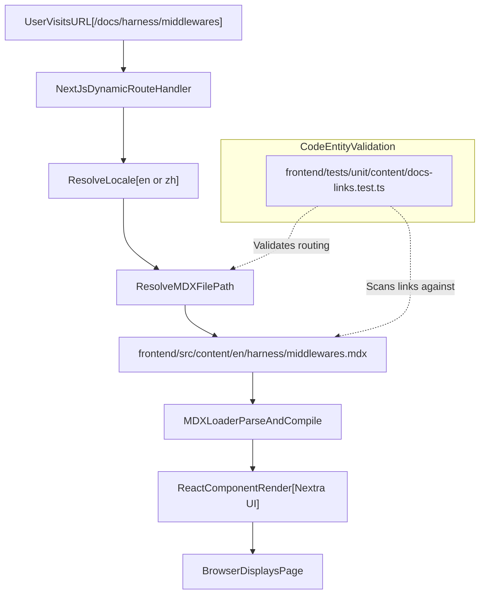
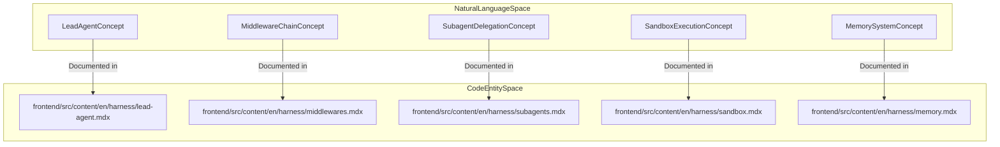
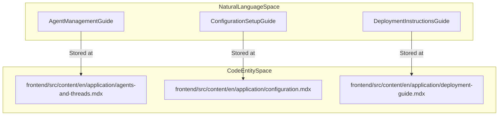

<!-- source: DeepWiki mcp.deepwiki.com · repo bytedance/deer-flow · page 4.14 Documentation Site Content · fetched 2026-10-29 -->

# Documentation Site Content

<details>
<summary>Relevant source files</summary>

The following files were used as context for generating this wiki page:

- [backend/CONTRIBUTING.md](backend/CONTRIBUTING.md)
- [backend/packages/harness/deerflow/agents/memory/tools.py](backend/packages/harness/deerflow/agents/memory/tools.py)
- [backend/tests/test_memory_get_tool.py](backend/tests/test_memory_get_tool.py)
- [backend/tests/test_memory_tools.py](backend/tests/test_memory_tools.py)
- [frontend/src/content/en/application/agents-and-threads.mdx](frontend/src/content/en/application/agents-and-threads.mdx)
- [frontend/src/content/en/application/configuration.mdx](frontend/src/content/en/application/configuration.mdx)
- [frontend/src/content/en/application/index.mdx](frontend/src/content/en/application/index.mdx)
- [frontend/src/content/en/application/operations-and-troubleshooting.mdx](frontend/src/content/en/application/operations-and-troubleshooting.mdx)
- [frontend/src/content/en/application/quick-start.mdx](frontend/src/content/en/application/quick-start.mdx)
- [frontend/src/content/en/application/workspace-usage.mdx](frontend/src/content/en/application/workspace-usage.mdx)
- [frontend/src/content/en/harness/configuration.mdx](frontend/src/content/en/harness/configuration.mdx)
- [frontend/src/content/en/harness/customization.mdx](frontend/src/content/en/harness/customization.mdx)
- [frontend/src/content/en/harness/design-principles.mdx](frontend/src/content/en/harness/design-principles.mdx)
- [frontend/src/content/en/harness/lead-agent.mdx](frontend/src/content/en/harness/lead-agent.mdx)
- [frontend/src/content/en/harness/memory.mdx](frontend/src/content/en/harness/memory.mdx)
- [frontend/src/content/en/harness/middlewares.mdx](frontend/src/content/en/harness/middlewares.mdx)
- [frontend/src/content/en/harness/quick-start.mdx](frontend/src/content/en/harness/quick-start.mdx)
- [frontend/src/content/en/harness/sandbox.mdx](frontend/src/content/en/harness/sandbox.mdx)
- [frontend/src/content/en/harness/skills.mdx](frontend/src/content/en/harness/skills.mdx)
- [frontend/src/content/en/tutorials/work-with-memory.mdx](frontend/src/content/en/tutorials/work-with-memory.mdx)
- [frontend/src/content/zh/application/agents-and-threads.mdx](frontend/src/content/zh/application/agents-and-threads.mdx)
- [frontend/src/content/zh/application/configuration.mdx](frontend/src/content/zh/application/configuration.mdx)
- [frontend/src/content/zh/application/index.mdx](frontend/src/content/zh/application/index.mdx)
- [frontend/src/content/zh/application/operations-and-troubleshooting.mdx](frontend/src/content/zh/application/operations-and-troubleshooting.mdx)
- [frontend/src/content/zh/application/quick-start.mdx](frontend/src/content/zh/application/quick-start.mdx)
- [frontend/src/content/zh/application/workspace-usage.mdx](frontend/src/content/zh/application/workspace-usage.mdx)
- [frontend/src/content/zh/harness/configuration.mdx](frontend/src/content/zh/harness/configuration.mdx)
- [frontend/src/content/zh/harness/customization.mdx](frontend/src/content/zh/harness/customization.mdx)
- [frontend/src/content/zh/harness/lead-agent.mdx](frontend/src/content/zh/harness/lead-agent.mdx)
- [frontend/src/content/zh/harness/memory.mdx](frontend/src/content/zh/harness/memory.mdx)
- [frontend/src/content/zh/harness/middlewares.mdx](frontend/src/content/zh/harness/middlewares.mdx)
- [frontend/src/content/zh/harness/sandbox.mdx](frontend/src/content/zh/harness/sandbox.mdx)
- [frontend/src/content/zh/harness/skills.mdx](frontend/src/content/zh/harness/skills.mdx)
- [frontend/src/content/zh/tutorials/work-with-memory.mdx](frontend/src/content/zh/tutorials/work-with-memory.mdx)
- [frontend/tests/unit/content/docs-links.test.ts](frontend/tests/unit/content/docs-links.test.ts)

</details>


This page documents the in-app MDX documentation content embedded in the DeerFlow frontend codebase. It describes the source locations of the harness and application guides in both English and Chinese, details the routing mechanism for these documentation pages, and explains the automated link-checking approach ensuring cross-reference validity.

---

## 1. MDX Documentation Structure in the Frontend

DeerFlow integrates rich technical documentation directly within the frontend user interface by using MDX files, stored under the following directory structure:

- `frontend/src/content/en/` for English-language documentation [frontend/src/content/en/application/configuration.mdx:1-4]()
- `frontend/src/content/zh/` for Chinese-language documentation [frontend/src/content/zh/application/configuration.mdx:1-4]()

Each language directory contains two primary sections:

- `harness/` — Documents the internal agent harness and runtime system architecture, including pages on Lead Agent, Middlewares, Subagents, Sandbox, Memory, and related developer-centric concepts [frontend/src/content/en/harness/middlewares.mdx:1-4]().
- `application/` — Contains operator-facing guides such as agent and thread management, configuration, deployment, and operational troubleshooting [frontend/src/content/en/application/configuration.mdx:1-4]().

This clear separation allows maintaining independent documentation streams focused on system internals (harness) versus usage and management (application).

### MDX Page Composition

Each documentation page is authored as an `.mdx` file containing:

- Frontmatter metadata defining `title` and `description` [frontend/src/content/en/application/configuration.mdx:1-4]()
- Markdown content enhanced with JSX React components imported from `nextra/components` for rich UI patterns such as `Callout`, `Tabs`, `Steps`, and `Cards` [frontend/src/content/en/application/configuration.mdx:6-7]().
- Structured technical explanations, code snippets, configuration examples, tables, and diagrams that illustrate system behavior or configuration [frontend/src/content/en/application/configuration.mdx:12-18]().

Example files include:

- English middleware guide: `frontend/src/content/en/harness/middlewares.mdx` [frontend/src/content/en/harness/middlewares.mdx:1-4]()
- Chinese middleware guide: `frontend/src/content/zh/harness/middlewares.mdx` [frontend/src/content/zh/harness/middlewares.mdx:1-4]()
- Configuration guide: `frontend/src/content/en/application/configuration.mdx` and its Chinese counterpart [frontend/src/content/en/application/configuration.mdx:1-4]()

These patterns are consistent across the entire documentation hierarchy, providing language parity and rich formatting.

Sources: `frontend/src/content/en/harness/middlewares.mdx:1-134()`, `frontend/src/content/en/application/configuration.mdx:1-18()`

---

## 2. Frontend MDX Routing and Page Resolution

The DeerFlow frontend is built on Next.js using the App Router and dynamic routing to load and render documentation pages based on URL paths and user locale.

### Routing Mechanism

- Documentation pages are accessible under URL path pattern:  
  ```
  /docs/:section/:page
  ```
  where `:section` is either `harness` or `application`, and `:page` corresponds to the MDX filename.

- The locale (`en` or `zh`) prefix is resolved from user preferences or browser settings.

- This resolves to a filesystem path like:  
  ```
  frontend/src/content/{lang}/{section}/{page}.mdx
  ```
  For example:  
  - `/docs/harness/middlewares` with locale `en` loads `frontend/src/content/en/harness/middlewares.mdx` [frontend/src/content/en/harness/middlewares.mdx:1-4]().  
  - `/docs/application/configuration` with locale `zh` loads `frontend/src/content/zh/application/configuration.mdx` [frontend/src/content/zh/application/configuration.mdx:1-4]().

- The MDX file is loaded dynamically via Next.js app directory support, parsed, and rendered with custom React components that provide UI features like sidebars, tabs, callouts, and code rendering [frontend/src/content/en/application/configuration.mdx:6-7]().

Sources: `frontend/src/content/en/harness/middlewares.mdx:1-134()`, `frontend/src/content/en/application/configuration.mdx:1-18()`

---

## 3. Link Checking and Integrity Validation in Docs

To ensure all internal cross-document references remain valid and to prevent broken links, DeerFlow employs automated link checking as part of its CI process:

- All Markdown/MDX links that reference other docs must match canonical routing paths and existing `.mdx` files [frontend/tests/unit/content/docs-links.test.ts:1-70]().
- The test suite parses all documentation MDX files, extracts internal links, and verifies each one points to an existing target page or anchor [frontend/tests/unit/content/docs-links.test.ts:1-70]().
- This guarantees that documentation URLs and references remain consistent with the actual codebase file structure, preventing user-facing 404s or stale references [frontend/tests/unit/content/docs-links.test.ts:1-70]().
- External URLs are allowed but validated minimally [frontend/tests/unit/content/docs-links.test.ts:1-70]().
- Link checking runs in all CI builds to catch errors before merge [frontend/tests/unit/content/docs-links.test.ts:1-70]().

Sources: `frontend/tests/unit/content/docs-links.test.ts:1-70()`

---

## 4. Data Flow Overview: Natural Language Space to Code Entity Space

The following diagram illustrates the flow from a user requesting a documentation page by URL, through the Next.js routing layer, to MDX content loading, rendering, and automated documentation validation.

Title: "Documentation Request and Validation Data Flow"


This flow bridges the **Natural Language Space** (URLs and page concepts) with the **Code Entity Space** (concrete MDX files and test suites).

Sources: `frontend/src/content/en/harness/middlewares.mdx:1-4()`, `frontend/tests/unit/content/docs-links.test.ts:1-70()`

---

## 5. Key Documentation Content Modules

### 5.1 Harness Documentation

These documentation pages cover the internal DeerFlow runtime system and harness components, explaining architecture and developer-focused building blocks:

- **Lead Agent** architecture and prompt strategies: `frontend/src/content/en/harness/lead-agent.mdx` [frontend/src/content/en/harness/lead-agent.mdx:1-10]()
- **Middleware Chain** including `MemoryMiddleware`, `LoopDetectionMiddleware`, and others: `frontend/src/content/en/harness/middlewares.mdx` [frontend/src/content/en/harness/middlewares.mdx:1-50]()
- Subagent lifecycle and delegation mechanisms: `frontend/src/content/en/harness/subagents.mdx` [frontend/src/content/en/harness/subagents.mdx:1-10]()
- Sandbox execution modes and sandbox provider interfaces: `frontend/src/content/en/harness/sandbox.mdx` [frontend/src/content/en/harness/sandbox.mdx:1-10]()
- Memory system design and runtime usage: `frontend/src/content/en/harness/memory.mdx` [frontend/src/content/en/harness/memory.mdx:1-20]()

Sources: `frontend/src/content/en/harness/lead-agent.mdx:1-10()`, `frontend/src/content/en/harness/middlewares.mdx:1-50()`, `frontend/src/content/en/harness/memory.mdx:1-20()`

### 5.2 Application Documentation

These pages contain operator- and user-centric guides describing how to use the DeerFlow App:

- Agent and thread management: `frontend/src/content/en/application/agents-and-threads.mdx` [frontend/src/content/en/application/agents-and-threads.mdx:1-10]()
- Application configuration (`config.yaml`, environment variables): `frontend/src/content/en/application/configuration.mdx` [frontend/src/content/en/application/configuration.mdx:1-18]()
- Deployment instructions (local development, Docker Compose, Kubernetes): `frontend/src/content/en/application/deployment-guide.mdx` [frontend/src/content/en/application/deployment-guide.mdx:1-20]()
- Operational troubleshooting and log management: `frontend/src/content/en/application/operations-and-troubleshooting.mdx` [frontend/src/content/en/application/operations-and-troubleshooting.mdx:1-20]()

Sources: `frontend/src/content/en/application/configuration.mdx:1-18()`, `frontend/src/content/en/application/deployment-guide.mdx:1-20()`

---

## 6. Natural Language to Code Entity Bridging Diagrams

The following diagrams map conceptual documentation topics directly to their corresponding code entities and file paths in the codebase.

Title: "Harness Topics to MDX Source Code Entities"


Sources: `frontend/src/content/en/harness/lead-agent.mdx:1-10()`, `frontend/src/content/en/harness/middlewares.mdx:1-50()`, `frontend/src/content/en/harness/memory.mdx:1-20()`

Title: "Application Topics to MDX Source Code Entities"


Sources: `frontend/src/content/en/application/agents-and-threads.mdx:1-10()`, `frontend/src/content/en/application/configuration.mdx:1-18()`, `frontend/src/content/en/application/deployment-guide.mdx:1-20()`

---

