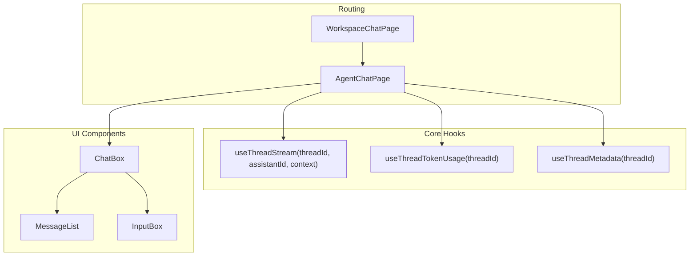
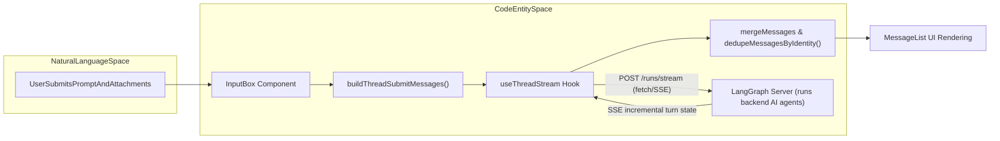
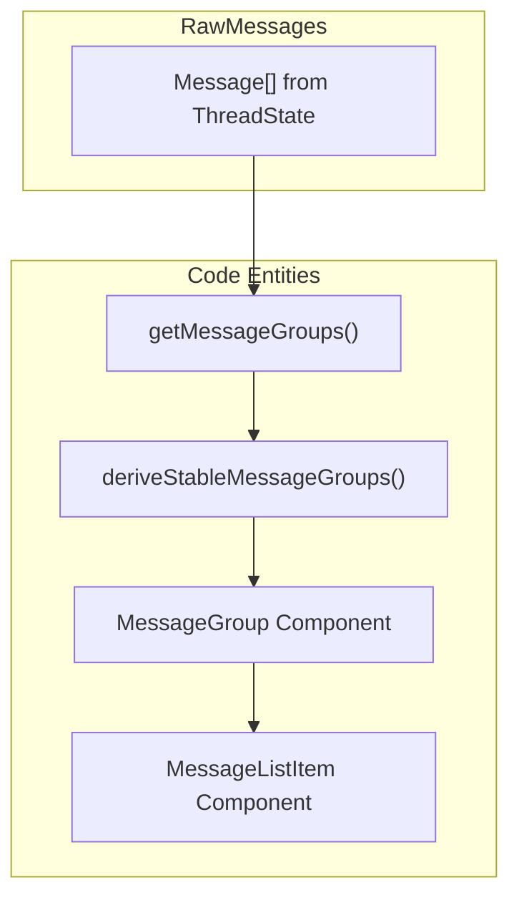
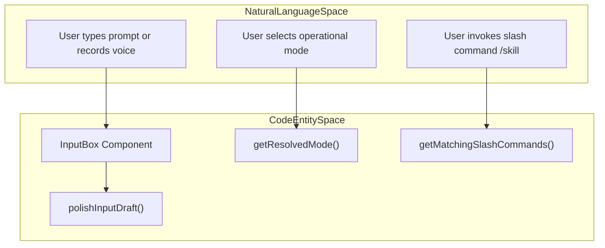

<!-- source: DeepWiki mcp.deepwiki.com · repo bytedance/deer-flow · page 4.2 Chat Interface and Thread Management · fetched 2026-10-29 -->

# Chat Interface and Thread Management

Relevant source files

The following files were used as context for generating this wiki page:

- [frontend/AGENTS.md](frontend/AGENTS.md)
- [frontend/eslint.config.js](frontend/eslint.config.js)
- [frontend/src/app/showcase/[thread_id]/page.tsx](frontend/src/app/showcase/[thread_id]/page.tsx)
- [frontend/src/app/workspace/agents/[agent_name]/chats/[thread_id]/page.tsx](frontend/src/app/workspace/agents/[agent_name]/chats/[thread_id]/page.tsx)
- [frontend/src/app/workspace/chats/[thread_id]/page.tsx](frontend/src/app/workspace/chats/[thread_id]/page.tsx)
- [frontend/src/components/workspace/artifacts/artifact-file-detail.tsx](frontend/src/components/workspace/artifacts/artifact-file-detail.tsx)
- [frontend/src/components/workspace/chats/chat-box.tsx](frontend/src/components/workspace/chats/chat-box.tsx)
- [frontend/src/components/workspace/chats/use-thread-chat.ts](frontend/src/components/workspace/chats/use-thread-chat.ts)
- [frontend/src/components/workspace/code-editor.tsx](frontend/src/components/workspace/code-editor.tsx)
- [frontend/src/components/workspace/input-box.tsx](frontend/src/components/workspace/input-box.tsx)
- [frontend/src/components/workspace/messages/message-group.tsx](frontend/src/components/workspace/messages/message-group.tsx)
- [frontend/src/components/workspace/messages/message-list-item.tsx](frontend/src/components/workspace/messages/message-list-item.tsx)
- [frontend/src/components/workspace/messages/message-list.tsx](frontend/src/components/workspace/messages/message-list.tsx)
- [frontend/src/core/i18n/locales/en-US.ts](frontend/src/core/i18n/locales/en-US.ts)
- [frontend/src/core/i18n/locales/types.ts](frontend/src/core/i18n/locales/types.ts)
- [frontend/src/core/i18n/locales/zh-CN.ts](frontend/src/core/i18n/locales/zh-CN.ts)
- [frontend/src/core/messages/utils.ts](frontend/src/core/messages/utils.ts)
- [frontend/src/core/threads/hooks.ts](frontend/src/core/threads/hooks.ts)
- [frontend/src/core/threads/static-demo.ts](frontend/src/core/threads/static-demo.ts)
- [frontend/src/core/uploads/api.ts](frontend/src/core/uploads/api.ts)
- [frontend/src/core/uploads/hooks.ts](frontend/src/core/uploads/hooks.ts)
- [frontend/tests/e2e/artifact-panel-resize.spec.ts](frontend/tests/e2e/artifact-panel-resize.spec.ts)
- [frontend/tests/e2e/artifact-stream-state.spec.ts](frontend/tests/e2e/artifact-stream-state.spec.ts)
- [frontend/tests/e2e/chat.spec.ts](frontend/tests/e2e/chat.spec.ts)
- [frontend/tests/e2e/thread-history.spec.ts](frontend/tests/e2e/thread-history.spec.ts)
- [frontend/tests/unit/components/workspace/messages/message-list-item.dom.test.tsx](frontend/tests/unit/components/workspace/messages/message-list-item.dom.test.tsx)
- [frontend/tests/unit/core/messages/utils.test.ts](frontend/tests/unit/core/messages/utils.test.ts)
- [frontend/tests/unit/core/threads/coalesce.test.ts](frontend/tests/unit/core/threads/coalesce.test.ts)
- [frontend/tests/unit/core/threads/local-turn-order.dom.test.tsx](frontend/tests/unit/core/threads/local-turn-order.dom.test.tsx)
- [frontend/tests/unit/core/threads/message-merge.test.ts](frontend/tests/unit/core/threads/message-merge.test.ts)
- [frontend/tests/unit/core/threads/send-message.test.ts](frontend/tests/unit/core/threads/send-message.test.ts)
- [frontend/tests/unit/core/uploads/api.test.ts](frontend/tests/unit/core/uploads/api.test.ts)

This page provides a deep technical dive into DeerFlow's chat interface and thread management systems. It explores the `ChatPage` component structure, the `useThreadStream` hook for real-time Server-Sent Events (SSE) streaming, thread lifecycle management, optimistic message reconciliation, message grouping (`MessageList`, `MessageGroup`, `MessageListItem`), and multi-modal input processing.

---

## Purpose and Scope

The chat interface is the primary user workspace where conversations with DeerFlow agents take place. Architecturally, it bridges the Next.js frontend with the LangGraph backend through the `@langchain/langgraph-sdk`, enabling streaming AI message threads with artifact and skill integrations. This documentation covers:

- The structure and data flow of the `ChatPage` component.
- The `useThreadStream` hook managing live conversation streams.
- Thread lifecycle including optimistic message handling and reconciliation with server history.
- Real-time streaming updates using SSE and message grouping.
- Input processing via `InputBox`.
- Interaction with localized internationalization (i18n) resources.

Sources: [frontend/AGENTS.md:1-63](), [frontend/src/core/threads/hooks.ts:1-13]()

---

## ChatPage Component and Initialization

The `ChatPage` component is the root container for the chat interface, responsible for setting up the data context, managing thread state streams, and rendering input and message list UI.

### Structure and Key Responsibilities

- **Routing:**  
  - Standard chat threads render at route `/workspace/chats/[thread_id]`, which invokes `ChatPage` [frontend/src/app/workspace/chats/[thread_id]/page.tsx:1-5]().  
  - Agent-specific chats reside under `/workspace/agents/[agent_name]/chats/[thread_id]`. This route supplies the `assistantId` (agent identity) into the thread stream and sets contextual parameters.

- **Thread and Token State Management:**  
  - Calls the `useThreadStream` hook passing in `threadId`, `assistantId`, `displayThreadId`, local context, and lifecycle callbacks such as `onSend`, `onStart`, and `onFinish` [frontend/src/core/threads/hooks.ts:81-96]().  
  - Tracks token usage statistics and monitors thread metadata (title, pinned status, sharing).

### ChatPage Architecture Diagram

Sources: [frontend/src/app/workspace/chats/[thread_id]/page.tsx:1-5](), [frontend/src/core/threads/hooks.ts:81-96]()

---

## useThreadStream Hook and Real-Time Streaming

### Functional Overview

The `useThreadStream` React hook is central to managing AI conversation thread lifecycle and real-time streaming updates from the backend.

- **Parameters and Options**:  
  Accepts a `ThreadStreamOptions` object with properties:  
  - `threadId`: identifies the chat thread.  
  - `displayThreadId`: optional display label for UI.  
  - `assistantId`: identity of the agent running, influencing backend runtime behavior.  
  - `context`: local user context settings.  
  - Lifecycle callbacks: `onSend`, `onStart`, `onFinish` for fine-grained control during message submission and thread state changes [frontend/src/core/threads/hooks.ts:81-96]().

- **Message Submission**:  
  Messages and attached files from input are converted to LangChain-compatible format using `buildThreadSubmitMessages` or `buildHumanMessageAdditionalKwargs`. The process uses client-generated unique human message IDs for optimistic UI state, allowing immediate local display before server confirmation [frontend/src/core/threads/hooks.ts:187-203]().

- **Stream Handling and Reconciliation**:  
  Incoming SSE chunks from LangGraph Server update the local state progressively. The hook merges these stream messages with any paginated history results using `mergeMessages`, deduplication via `dedupeMessagesByIdentity`, and trusted sequence verification (`insertByTrustedSeq`) [frontend/src/core/threads/hooks.ts:47-58]().

### Thread Stream Data Flow Diagram (Natural Language to Code Entity Space)

Sources: [frontend/src/core/threads/hooks.ts:47-96](), [frontend/src/core/threads/hooks.ts:187-203]()

---

## Message Grouping and Lifecycle Management

Message lists and groups organize conversational turns into structured visual blocks.

### Message Rendering Hierarchy

- **`MessageList`**: Coordinates message groups, pagination, virtualized list scrolling (`VirtualMessageList`), and sidecar/citation contexts [frontend/src/components/workspace/messages/message-list.tsx:1-124](). It uses `deriveStableMessageGroups` to prevent jitter during streaming.
- **`MessageGroup`**: Groups related messages (human turns, tool calls, reasoning steps, assistant responses, clarifications, and scheduled task events) into coherent UI blocks (`MessageGroupProps`, `convertToSteps`) [frontend/src/components/workspace/messages/message-group.tsx:60-82]().
- **`MessageListItem`**: Renders individual messages within a group, supplying feedback buttons (`FeedbackButtons`), copy utilities, inline editing, and regeneration handlers [frontend/src/components/workspace/messages/message-list-item.tsx:73-213]().

### Message Grouping Data Flow Diagram

Sources: [frontend/src/components/workspace/messages/message-list.tsx:1-171](), [frontend/src/components/workspace/messages/message-group.tsx:60-110](), [frontend/src/components/workspace/messages/message-list-item.tsx:140-180](), [frontend/src/core/messages/utils.ts:123-135]()

---

## Input System and Mode Selection

The `InputBox` component forms the user input interface supporting multi-modal input, file attachments, voice transcription, and run mode controls.

### Key Features

- **Prompt Input & Attachments:**  
  Uses Vercel AI SDK components such as `PromptInputTextarea` and `PromptInputAttachments` to enable text input plus drag-and-drop staging of files. Inputs are validated against upload limits (`useUploadLimits`) and drafts are stored in session storage via `writeComposerDraft` to preserve unsent content [frontend/src/components/workspace/input-box.tsx:38-127]().

- **Voice Transcription:**  
  Integrates browser speech recognition APIs (`getSpeechRecognitionConstructor`) to support live speech-to-text, accumulating partial transcripts [frontend/src/components/workspace/input-box.tsx:138-147]().

- **Mode Selection & Reasoning:**  
  The component supports various execution modes influencing model settings and reasoning effort resolved via `getResolvedMode` and `reasoningEffortForMode` [frontend/src/components/workspace/input-box.tsx:93-102]().

- **Skills and Slash Commands:**  
  Supports in-input slash commands (`/skill`) powering skill invocation and filtered skill suggestions in UI [frontend/src/components/workspace/input-box.tsx:112-113]().

### Natural Language to Code Entity Mapping: Input and Modes

Sources: [frontend/src/components/workspace/input-box.tsx:38-147](), [frontend/src/core/models/reasoning.ts:93-102]()

---

## Internationalization (i18n)

DeerFlow fully supports multi-language translation for the chat and thread management interface, including English (`en-US`) and Chinese (`zh-CN`) locales.

- All UI strings like placeholders, tooltips, status labels, and buttons in chat-related components pull text from translation dictionaries.
- Translation keys conform to the `Translations` TypeScript interface, defined strictly for type safety and completeness [frontend/src/core/i18n/locales/types.ts:3-12]().
- English and Chinese locale files provide comprehensive sets of translated strings for chat, thread, artifacts, and related UI elements [frontend/src/core/i18n/locales/en-US.ts:1-188](), [frontend/src/core/i18n/locales/zh-CN.ts:1-163]().

Sources: [frontend/src/core/i18n/locales/types.ts:3-12](), [frontend/src/core/i18n/locales/en-US.ts:1-188](), [frontend/src/core/i18n/locales/zh-CN.ts:1-163]()

# End of 4.2 Chat Interface and Thread Management

---

