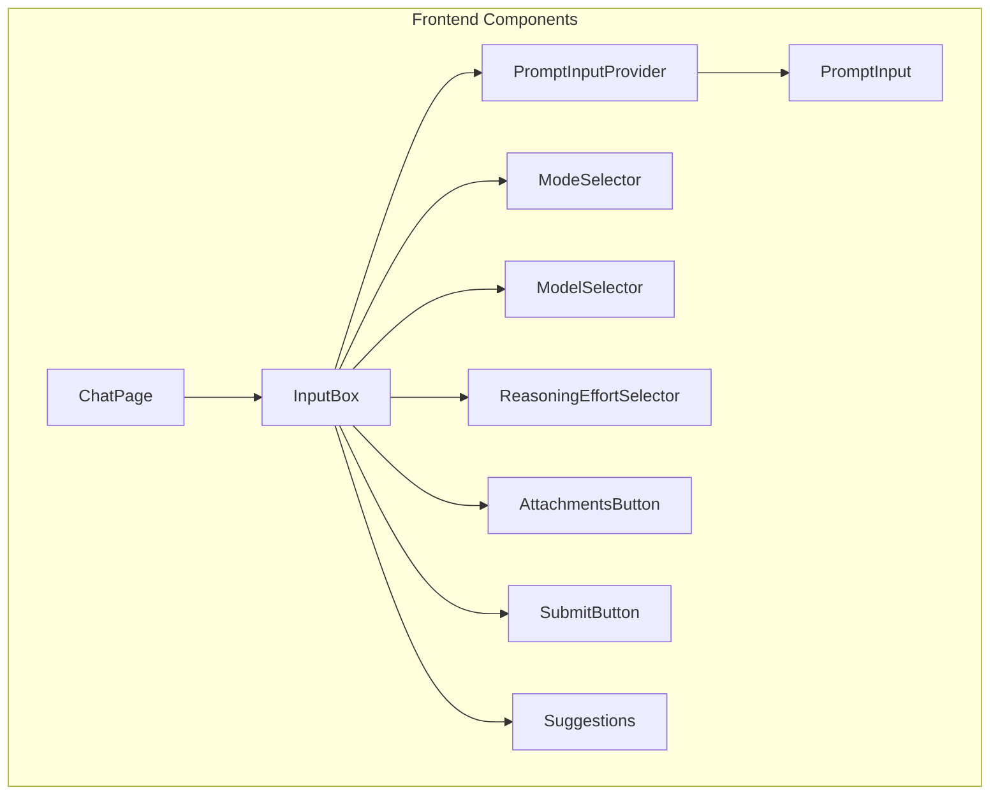
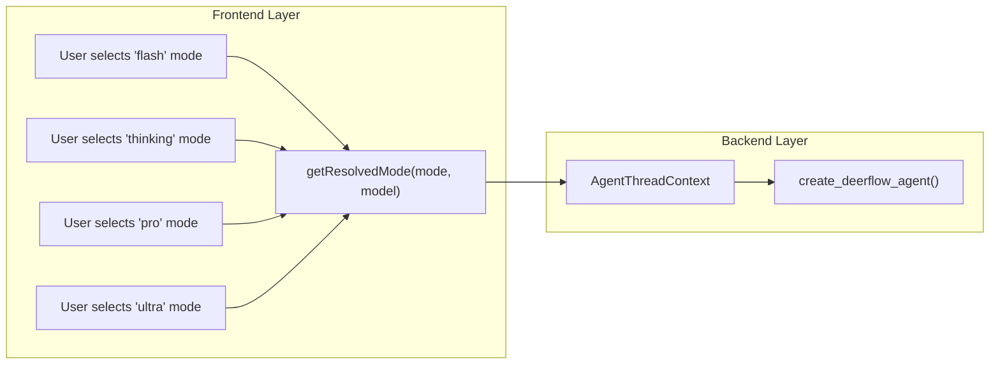
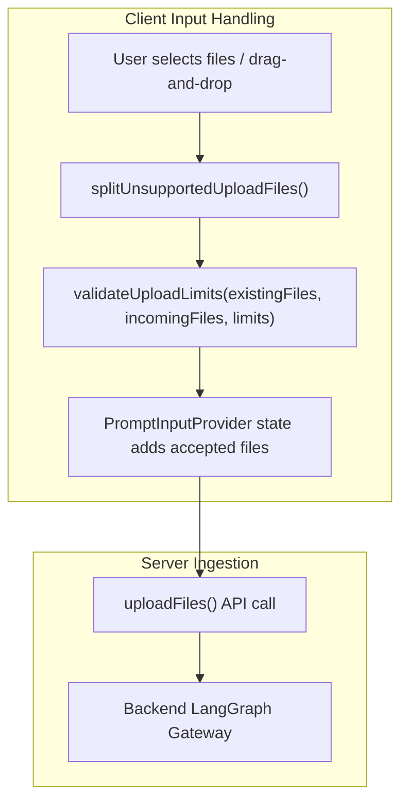
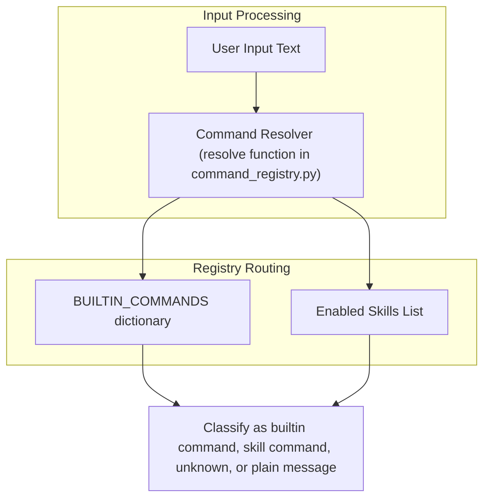

<!-- source: DeepWiki mcp.deepwiki.com · repo bytedance/deer-flow · page 4.3 Input System and Mode Selection · fetched 2026-10-29 -->

# Input System and Mode Selection

Relevant source files

The following files were used as context for generating this wiki page:

- [backend/app/gateway/routers/models.py](backend/app/gateway/routers/models.py)
- [backend/app/gateway/routers/suggestions.py](backend/app/gateway/routers/suggestions.py)
- [backend/packages/harness/deerflow/config/suggestions_config.py](backend/packages/harness/deerflow/config/suggestions_config.py)
- [backend/tests/test_models_authorization.py](backend/tests/test_models_authorization.py)
- [backend/tests/test_slash_skill_contract.py](backend/tests/test_slash_skill_contract.py)
- [backend/tests/test_suggestions_router.py](backend/tests/test_suggestions_router.py)
- [frontend/src/app/(auth)/layout.tsx](frontend/src/app/(auth)/layout.tsx)
- [frontend/src/app/workspace/workspace-content.tsx](frontend/src/app/workspace/workspace-content.tsx)
- [frontend/src/components/ai-elements/prompt-input.tsx](frontend/src/components/ai-elements/prompt-input.tsx)
- [frontend/src/components/workspace/model-load-error-banner.tsx](frontend/src/components/workspace/model-load-error-banner.tsx)
- [frontend/src/components/workspace/slash-skill-chip.tsx](frontend/src/components/workspace/slash-skill-chip.tsx)
- [frontend/src/core/api/errors.ts](frontend/src/core/api/errors.ts)
- [frontend/src/core/models/api.ts](frontend/src/core/models/api.ts)
- [frontend/src/core/models/hooks.ts](frontend/src/core/models/hooks.ts)
- [frontend/src/core/models/index.ts](frontend/src/core/models/index.ts)
- [frontend/src/core/models/types.ts](frontend/src/core/models/types.ts)
- [frontend/src/core/skills/index.ts](frontend/src/core/skills/index.ts)
- [frontend/src/core/suggestions/api.ts](frontend/src/core/suggestions/api.ts)
- [frontend/src/core/suggestions/hooks.ts](frontend/src/core/suggestions/hooks.ts)
- [frontend/src/core/uploads/file-validation.ts](frontend/src/core/uploads/file-validation.ts)
- [frontend/src/core/uploads/index.ts](frontend/src/core/uploads/index.ts)
- [frontend/src/core/workspace-changes/api.ts](frontend/src/core/workspace-changes/api.ts)
- [frontend/src/lib/ime.ts](frontend/src/lib/ime.ts)
- [frontend/tests/unit/components/workspace/model-load-error-banner.dom.test.tsx](frontend/tests/unit/components/workspace/model-load-error-banner.dom.test.tsx)
- [frontend/tests/unit/core/artifacts/loader.test.ts](frontend/tests/unit/core/artifacts/loader.test.ts)
- [frontend/tests/unit/core/skills/slash-contract.test.ts](frontend/tests/unit/core/skills/slash-contract.test.ts)
- [frontend/tests/unit/core/workspace-changes/api.test.ts](frontend/tests/unit/core/workspace-changes/api.test.ts)
- [frontend/tests/unit/lib/ime.test.ts](frontend/tests/unit/lib/ime.test.ts)

This document provides a detailed technical overview of DeerFlow's input system and mode selection features. It describes the `InputBox` component, file attachments management lifecycle, mode and model selection mechanisms, and the follow-up suggestion system which enriches the user experience.

---

## 1. Component Architecture and Input Provider

The `InputBox` component is the primary UI interface for user message composition in DeerFlow. It integrates various subcomponents and manages state related to user inputs, file attachments, mode selection, and suggestions.

### Key Components and Data Flow

- `InputBox` manages the overall message input environment and coordinates subcomponents.
- `PromptInputProvider` is a React context provider managing both textual input state and file attachment state.
- The `PromptInput` component is the text input field handling IME support, composition events, keyboard handling, and drag-and-drop of files [frontend/src/components/ai-elements/prompt-input.tsx:1-53]().
- `ModeSelector`, `ModelSelector`, and `ReasoningEffortSelector` allow users to pick conversation modes, underlying AI models, and reasoning effort levels respectively.
- `AttachmentsButton` opens file dialogs and shows attachment thumbnails.
- `SubmitButton` triggers message sending.
- `Suggestions` displays follow-up question prompts received from the backend.

### PromptInputProvider: Attachment Lifecycle Management

`PromptInputProvider` maintains an array of attachment objects with unique IDs, file metadata, and temporary blob URLs for previews [frontend/src/components/ai-elements/prompt-input.tsx:153-186](). It exposes functions:

- `add(files: File[] | FileList)`: Adds new attachments, assigns IDs, and creates preview URLs [frontend/src/components/ai-elements/prompt-input.tsx:168-186]().
- `remove(id: string)`: Removes a file by ID and revokes its blob URL [frontend/src/components/ai-elements/prompt-input.tsx:188-196]().
- `clear()`: Clears all attachments and revokes URLs [frontend/src/components/ai-elements/prompt-input.tsx:198-207]().
- `openFileDialog()`: Programmatically opens the hidden file input dialog [frontend/src/components/ai-elements/prompt-input.tsx:224-226]().

Blob URLs are revoked on component unmount to prevent memory leaks [frontend/src/components/ai-elements/prompt-input.tsx:214-222]().

Internal references (`fileInputRef` and `openRef`) hold DOM refs and open callbacks for file input control [frontend/src/components/ai-elements/prompt-input.tsx:165-166]().

This provider wraps child components, enabling any children to access attachment and text input state via React contexts [frontend/src/components/ai-elements/prompt-input.tsx:153-247]().

Sources:  
[frontend/src/components/ai-elements/prompt-input.tsx:1-247]()

---

## 2. Model Selection System

Model selection enables choosing from available backend language models that drive AI responses.

### Backend Model Listing & Authorization

The backend exposes `/api/models` returning available text generation models with metadata (supports reasoning, token limits, prices). Models are filtered by user authorization, ensuring access control over model usage [backend/app/gateway/routers/models.py:20-130]().

### Frontend Model Fetch and Hook

On the frontend, `useModels` React Query hook fetches the model list once per session with infinite stale time, caching results to reduce requests [frontend/src/core/models/hooks.ts:9-34]().

On load errors, `ModelLoadErrorBanner` displays a user-friendly error message [frontend/src/components/workspace/model-load-error-banner.tsx:18-83]().

`ModelSelector` renders model choices in a dropdown UI allowing switching models dynamically [frontend/src/core/models/api.ts:14-31]().

This system tightly couples backend configuration and frontend UI state to provide a responsive model selection experience.

Sources:  
[backend/app/gateway/routers/models.py:20-130]()  
[frontend/src/core/models/hooks.ts:9-34]()  
[frontend/src/core/models/api.ts:14-31]()  
[frontend/src/components/workspace/model-load-error-banner.tsx:18-83]()

---

## 3. Mode Selection System

DeerFlow provides multiple operational modes that influence the style and depth of AI reasoning applied during response generation.

### Supported Conversation Modes

| Mode    | Internal Code | Description                                                                                 |
|---------|---------------|---------------------------------------------------------------------------------------------|
| Flash   | `flash`       | Fast, minimal reasoning mode prioritizing speed over depth.                                |
| Thinking| `thinking`    | Intermediate mode with some reasoning before answering for better accuracy.                |
| Pro     | `pro`         | Deep reasoning and planning mode aimed at precise, high-quality responses.                  |
| Ultra   | `ultra`       | Advanced mode using orchestrated subagents for complex tasks and workflows.                 |

### Mode Resolution Flow

- `getResolvedMode` function validates the user-selected mode against model capabilities (checking if the model supports thinking or reasoning).
- The resolved mode is injected into the agent thread context.
- The lead agent factory method `create_deerflow_agent` applies runtime feature flags (`RuntimeFeatures`) based on the resolved mode to enable or disable functionalities.

Sources:  
[frontend/src/core/i18n/locales/en-US.ts:191-202]()  
[frontend/src/core/i18n/locales/zh-CN.ts:184-195]()

---

## 4. Reasoning Effort Configuration

Alongside modes, some models support additional configuration for "reasoning effort" that fine-tunes AI logical depth.

| Effort Level | Internal Key | Description                                                      |
|--------------|--------------|------------------------------------------------------------------|
| Minimal      | `minimal`    | Returns results immediately with minimal reasoning.             |
| Low          | `low`        | Performs basic logic checks and shallow reasoning.              |
| Medium       | `medium`     | Multi-layer logic analysis with basic result verification.      |
| High         | `high`       | Complex dimensional reasoning with multipath verification.      |

- The user can select effort level when the chosen model supports it.
- Effort levels influence prompt templates and backend pipeline behavior.
- Localized descriptions exist for UI representation.

Sources:  
[frontend/src/core/i18n/locales/en-US.ts:201-212]()  
[frontend/src/core/i18n/locales/zh-CN.ts:196-203]()

---

## 5. File Attachment System

DeerFlow supports attaching files to user inputs with comprehensive client-side validation, preview generation, and cleanup.

### Attachment Data Flow

### Validation and Handling

- The function `splitUnsupportedUploadFiles` filters out unsupported files such as macOS `.app` bundles, prompting the user to upload compressed archives instead.
- `validateUploadLimits` enforces constraints like max file count, per-file size, and total upload size limits matching backend restrictions.
- In `PromptInputProvider`, added files are wrapped with unique IDs and blob URLs created for previewing with `URL.createObjectURL()`. Removed files have their URLs revoked to avoid memory leaks [frontend/src/components/ai-elements/prompt-input.tsx:153-247]().
- The file input dialog is controlled programmatically via refs exposed by the provider [frontend/src/components/ai-elements/prompt-input.tsx:224-226]().
- On component unmount, all blob URLs are revoked to clean resources [frontend/src/components/ai-elements/prompt-input.tsx:214-222]().

This system ensures robust attachment support directly integrated into the input flow.

Sources:  
[frontend/src/components/ai-elements/prompt-input.tsx:153-247]()  
[frontend/src/core/uploads/api.ts:50-74]()

---

## 6. Follow-up Suggestions System

To assist users in continuing conversations, DeerFlow can generate follow-up question suggestions based on recent dialogue context.

### Backend Suggestion API

- The backend API endpoint `/api/threads/{thread_id}/suggestions` accepts recent conversation messages and requested suggestion count, calling an LLM to generate follow-up questions [backend/app/gateway/routers/suggestions.py:98-151]().
- The system uses prompt engineering with a system instruction guiding output formatting and constraints [backend/app/gateway/routers/suggestions.py:127-136]().
- Generated output is parsed to extract a JSON array of strings, stripping markdown code fences and `<think>` blocks for robustness [backend/app/gateway/routers/suggestions.py:44-66]().
- Configuration options like enabling suggestions and max suggestion count are exposed at `/api/suggestions/config` [backend/app/gateway/routers/suggestions.py:86-95]().

### Frontend Integration

- The frontend fetches and enforces suggestion configuration from backend.
- Suggestions are displayed dynamically below the input box, offering clickable follow-up questions that users can select to continue conversations.

### Parsing and Robustness

- Rigorous tests ensure parsing tolerates incomplete LLM outputs and maintains only valid, concise suggestions [backend/tests/test_suggestions_router.py:47-75]().

Sources:  
[backend/app/gateway/routers/suggestions.py:44-151]()  
[backend/tests/test_suggestions_router.py:47-75]()

---

# Appendix: Slash Command and Skill Activation Resolution

DeerFlow supports slash command syntax in inputs, enabling quick skill/environment activation.

### Command Resolution Flow

- The resolver identifies commands like `/goal`, `/model`, or `/help` as built-in commands.
- It recognizes `/skillname` references that match enabled skills.
- Unknown commands or no slash fallback to normal message.
- Slash skill names are validated against reserved names to prevent conflicts, except for some legacy exceptions (`context`).
- Frontend mirrors this logic to highlight and suggest slash skills, maintaining UI synchronization with backend command semantics.

Sources:  
[backend/packages/harness/deerflow/tui/command_registry.py:10-132]()  
[backend/packages/harness/deerflow/skills/slash.py:39-76]()

---

# Summary

DeerFlow's input system and mode selection encompass a rich feature set:

- A layered React UI input box with context providers for managing text input and file attachments.
- Model selection synchronized with backend for available LLMs and authorization.
- Mode system supporting Flash, Thinking, Pro, and Ultra modes with runtime feature flag injection.
- Reasoning effort levels for fine-grained control per model.
- Robust file attachment lifecycle with client validation and resource management.
- Slash command parsing and skill activation tightly coupled with backend command registry.
- Backend-powered follow-up suggestions improving user interaction continuity.

This integrated design supports flexible, responsive, and extensible agent interactions.

# End of 4.3 Input System and Mode Selection

---

