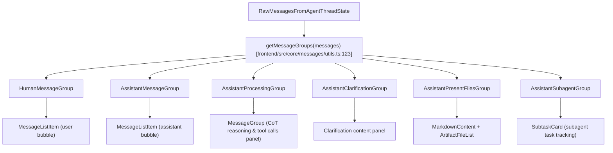
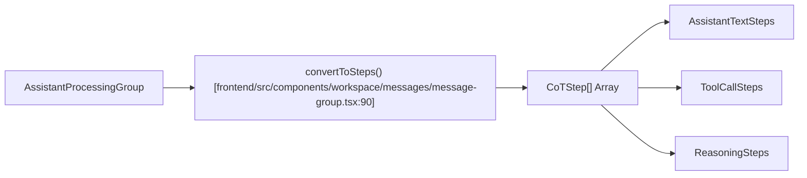
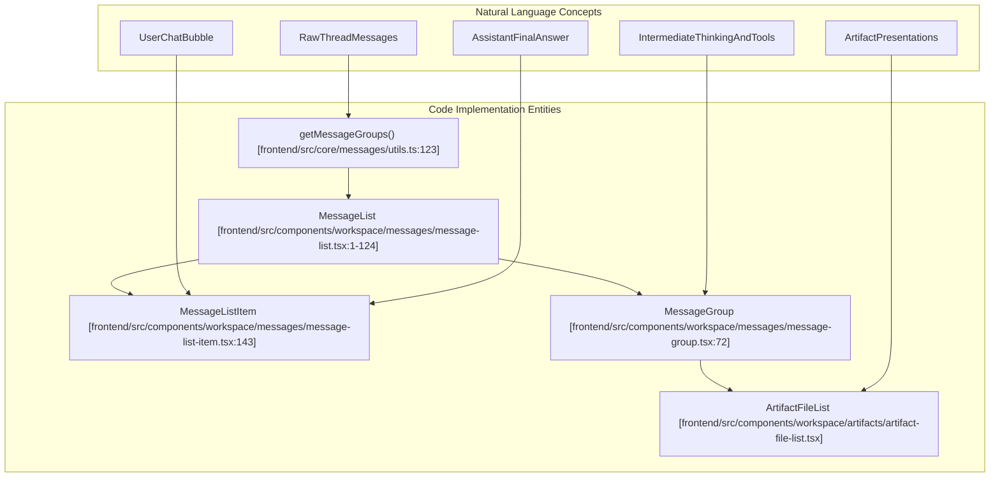
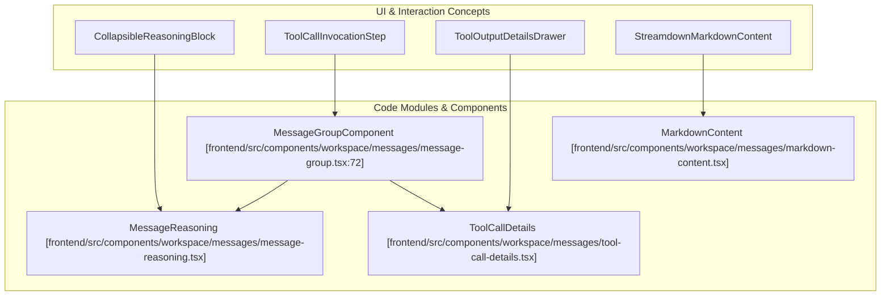

<!-- source: DeepWiki mcp.deepwiki.com · repo bytedance/deer-flow · page 4.4 Message Rendering System · fetched 2026-10-29 -->

# Message Rendering System

Relevant source files

The following files were used as context for generating this wiki page:

- [frontend/AGENTS.md](frontend/AGENTS.md)
- [frontend/src/app/layout.tsx](frontend/src/app/layout.tsx)
- [frontend/src/app/workspace/agents/[agent_name]/chats/[thread_id]/page.tsx](frontend/src/app/workspace/agents/[agent_name]/chats/[thread_id]/page.tsx)
- [frontend/src/app/workspace/chats/[thread_id]/page.tsx](frontend/src/app/workspace/chats/[thread_id]/page.tsx)
- [frontend/src/app/workspace/chats/page.tsx](frontend/src/app/workspace/chats/page.tsx)
- [frontend/src/components/ai-elements/suggestion.tsx](frontend/src/components/ai-elements/suggestion.tsx)
- [frontend/src/components/workspace/artifacts/artifact-file-detail.tsx](frontend/src/components/workspace/artifacts/artifact-file-detail.tsx)
- [frontend/src/components/workspace/input-box.tsx](frontend/src/components/workspace/input-box.tsx)
- [frontend/src/components/workspace/messages/index.ts](frontend/src/components/workspace/messages/index.ts)
- [frontend/src/components/workspace/messages/message-group.tsx](frontend/src/components/workspace/messages/message-group.tsx)
- [frontend/src/components/workspace/messages/message-list-item.tsx](frontend/src/components/workspace/messages/message-list-item.tsx)
- [frontend/src/components/workspace/messages/message-list.tsx](frontend/src/components/workspace/messages/message-list.tsx)
- [frontend/src/components/workspace/messages/skeleton.tsx](frontend/src/components/workspace/messages/skeleton.tsx)
- [frontend/src/components/workspace/messages/subtask-card.tsx](frontend/src/components/workspace/messages/subtask-card.tsx)
- [frontend/src/core/i18n/locales/en-US.ts](frontend/src/core/i18n/locales/en-US.ts)
- [frontend/src/core/i18n/locales/types.ts](frontend/src/core/i18n/locales/types.ts)
- [frontend/src/core/i18n/locales/zh-CN.ts](frontend/src/core/i18n/locales/zh-CN.ts)
- [frontend/src/core/messages/utils.ts](frontend/src/core/messages/utils.ts)
- [frontend/src/core/tasks/context.tsx](frontend/src/core/tasks/context.tsx)
- [frontend/src/core/tasks/types.ts](frontend/src/core/tasks/types.ts)
- [frontend/src/core/threads/hooks.ts](frontend/src/core/threads/hooks.ts)
- [frontend/src/core/tools/utils.ts](frontend/src/core/tools/utils.ts)
- [frontend/src/styles/globals.css](frontend/src/styles/globals.css)
- [frontend/tests/unit/components/workspace/messages/message-list-item.dom.test.tsx](frontend/tests/unit/components/workspace/messages/message-list-item.dom.test.tsx)
- [frontend/tests/unit/core/messages/utils.test.ts](frontend/tests/unit/core/messages/utils.test.ts)
- [frontend/tests/unit/core/threads/local-turn-order.dom.test.tsx](frontend/tests/unit/core/threads/local-turn-order.dom.test.tsx)
- [frontend/tests/unit/core/threads/message-merge.test.ts](frontend/tests/unit/core/threads/message-merge.test.ts)
- [frontend/tests/unit/core/threads/send-message.test.ts](frontend/tests/unit/core/threads/send-message.test.ts)

This page documents the detailed implementation of the message rendering system in DeerFlow's frontend UI. It explains how chat messages from the LangGraph thread stream are grouped by type, and how various React components—including `MessageList` [frontend/src/components/workspace/messages/message-list.tsx:1-124](), `MessageListItem` [frontend/src/components/workspace/messages/message-list-item.tsx:143-176](), and `MessageGroup` [frontend/src/components/workspace/messages/message-group.tsx:72-82]—render these groups. The page further describes the presentation of Chain of Thought (CoT) reasoning blocks and the visualization of tool calls embedded in assistant messages.

---

## Message Grouping

Messages received from LangGraph arrive as an ordered flat array of `Message` objects. The UI must group these messages into meaningful turns and clusters for coherent, user-friendly display.

### `getMessageGroups` Function

`getMessageGroups(messages: Message[], options?): MessageGroup[]` [frontend/src/core/messages/utils.ts:123-126]() is the core utility responsible for grouping messages. It:

- Filters out system or hidden control messages using `isHiddenFromUIMessage` [frontend/src/core/messages/utils.ts:158-160]() and `HIDDEN_CONTROL_MESSAGE_NAMES` [frontend/src/core/messages/utils.ts:116-121]() (such as summaries, loop warnings, and todo reminders).
- Splits human messages into separate groups (each human message is its own group).
- Aggregates assistant messages into different group types depending on their content, such as final answer text, intermediate reasoning, tool calls, clarified tools, or subagent tasks.
- Associates tool messages with their appropriate assistant processing groups, handling out-of-order and orphaned tool call results gracefully.

There are six main `MessageGroup` types [frontend/src/core/messages/utils.ts:48-55]():

| Group Type                | Condition in Messages                           | Rendered By                           |
|---------------------------|------------------------------------------------|-------------------------------------|
| `human`                   | `message.type === "human"`                      | `MessageListItem` (user bubble)      |
| `assistant`               | AI message with content and no tool calls      | `MessageListItem` (assistant bubble)|
| `assistant:processing`    | AI messages with intermediate reasoning, tool calls, or incomplete | `MessageGroup` (CoT reasoning & tool calls panel) |
| `assistant:clarification` | Tool messages marked as clarifications         | Rendered separately for clarifications |
| `assistant:present-files` | AI messages with `present_files` tool calls    | `MarkdownContent` + `ArtifactFileList` |
| `assistant:subagent`      | AI messages with subagent delegation tool calls| `SubtaskCard` component             |

Tool messages (`message.type === "tool"`) are appended to the preceding processing group whenever possible to maintain the relationship between tool calls and their results [frontend/src/core/messages/utils.ts:182]().

### Message Grouping Flow

Title: "Message Grouping Data Flow"

Sources: [frontend/src/core/messages/utils.ts:48-189](), [frontend/src/components/workspace/messages/message-list.tsx:153-171]()

---

## MessageList Component

`MessageList` (`frontend/src/components/workspace/messages/message-list.tsx`) is the top-level React component responsible for rendering the full sequence of grouped messages within a chat thread.

### Responsibilities

- **Compute stable message groups:** Uses the `useStableMessageGroups` hook that memoizes output from `deriveStableMessageGroups` to optimize rendering and avoid unnecessary React updates [frontend/src/components/workspace/messages/message-list.tsx:160-178]().
- **History loading UI:** Provides a `LoadMoreHistoryIndicator` at the top of the chat stream to support incremental loading of older messages.
- **Virtualized rendering:** Uses `VirtualMessageList` to only render visible messages for performance and smooth scrolling with large chat histories [frontend/src/components/workspace/messages/message-list.tsx:128-130]().
- **Render Message Groups:** Iterates over stable message groups and dispatches rendering to the correct component based on the group's type.
- **Token Usage Display:** Optionally renders usage summaries or debug views inline with messages using `MessageTokenUsageList` and `MessageTokenUsageDebugList` [frontend/src/components/workspace/messages/message-token-usage.tsx]().

Sources: [frontend/src/components/workspace/messages/message-list.tsx:1-124]()

---

## MessageListItem Component

`MessageListItem` (`frontend/src/components/workspace/messages/message-list-item.tsx`) renders individual message bubbles for terminal human or assistant messages.

### Key Features

- **Content Extraction:** Utilizes utilities such as `extractContentFromMessage` and `extractReasoningContentFromMessage` to separate user-visible content and embedded assistant reasoning [frontend/src/components/workspace/messages/message-list-item.tsx:46-52]().
- **Markdown Rendering:** Renders the main message content safely using `MarkdownContent` [frontend/src/components/workspace/messages/markdown-content.tsx]() integrated in `MessageListItem`.
- **Feedback Mechanism:** Displays feedback buttons allowing users to upvote or downvote assistant messages via `upsertFeedback` and `deleteFeedback` [frontend/src/components/workspace/messages/message-list-item.tsx:31-34]().
- **Editing:** Supports in-place editing of human messages with an edit textarea and submit handlers for regeneration of assistant responses [frontend/src/components/workspace/messages/message-list-item.tsx:183-213]().
- **Memoized Copy Data:** Implements memoization of message copy content data using `getMessageCopyData` to optimize performance [frontend/src/components/workspace/messages/message-list-item.tsx:185-191]().

Sources: [frontend/src/components/workspace/messages/message-list-item.tsx:1-213](), [frontend/src/core/messages/utils.ts:43-49]()

---

## MessageGroup and Chain of Thought (CoT) Rendering

`MessageGroup` (`frontend/src/components/workspace/messages/message-group.tsx`) renders assistant processing groups that usually contain intermediate reasoning, tool call invocations, and other composite steps as a Chain of Thought sequence.

### Internals of `MessageGroup`

- **Step Conversion:** The array of grouped messages is converted into an ordered sequence of CoT steps via `convertToSteps()` [frontend/src/components/workspace/messages/message-group.tsx:90-93](). Steps can be:
  - Assistant answer text segments (`assistantText` type).
  - Tool call invocations or results (`toolCall` type).
  - Reasoning or thinking content (`reasoning` type).
- **Partitioning Steps:** Steps prior to the last tool call can be collapsed into a summary to reduce UI clutter [frontend/src/components/workspace/messages/message-group.tsx:141-147]().
- **Rendering Steps:** Each CoT step is rendered using specific UI elements (`ChainOfThought`, `ChainOfThoughtStep`, `CodeBlock`, etc.) [frontend/src/components/workspace/messages/message-group.tsx:24-30]().

### CoT Step Pipeline

Title: "Chain of Thought Step Processing Pipeline"

Sources: [frontend/src/components/workspace/messages/message-group.tsx:60-165]()

---

## Chain of Thought (CoT) Display Details

The Chain of Thought UI provides a rich interactive visualization of the assistant's reasoning process:

- **Collapsible Reasoning Blocks:** Shows assistant reasoning content inside collapsible components (`MessageReasoning`) to allow user-controlled expansion [frontend/src/components/workspace/messages/message-reasoning.tsx]().
- **Streaming Indicators and Timers:** When assistant processing is ongoing, displays a live timer and dynamic status via reasoning trigger elements.
- **Iconography & Animation:** Uses streaming-friendly markdown rendering (`MarkdownContent`) with smooth transitions.

Sources: [frontend/src/components/workspace/messages/message-reasoning.tsx]()

---

## Tool Call Visualization

Tool calls initiated by the assistant are visually represented in the message group processing panel:

- **Individual Tool Steps:** Each tool call is a dedicated step in the CoT sequence showing tool name, icon, arguments, and outputs [frontend/src/components/workspace/messages/message-group.tsx:124-136]().
- **Message Association:** Tool response messages are attached to the closest preceding processing group [frontend/src/core/messages/utils.ts:182]().
- **Specialized Displays:** 
  - `present_files` tool calls render file artifact lists via `ArtifactFileList` [frontend/src/components/workspace/artifacts/artifact-file-list.tsx]().
  - Subagent delegation tool calls produce subtasks displayed by `SubtaskCard` components.
  - Tool call outputs can be expanded via `ToolCallDetails` [frontend/src/components/workspace/messages/tool-call-details.tsx]().

Sources: [frontend/src/core/messages/utils.ts:177-195](), [frontend/src/components/workspace/messages/message-group.tsx:58]()

---

## Summary Diagrams: Natural Language to Code Entity Space

The following two bridge diagrams associate natural language message concepts and UI display regions directly with their underlying code entities and modules.

### Bridge Diagram 1: Message Grouping Architecture

Title: "Natural Language Messages to Grouping Code Entities"

Sources: [frontend/src/core/messages/utils.ts:123-189](), [frontend/src/components/workspace/messages/message-list.tsx:1-171]()

### Bridge Diagram 2: Chain of Thought and Tool Visualization Components

Title: "CoT and Tool Call UI Mapping to Code Entities"

Sources: [frontend/src/components/workspace/messages/message-group.tsx:60-165](), [frontend/src/components/workspace/messages/message-reasoning.tsx]()

---

# End of Message Rendering System Documentation

---

