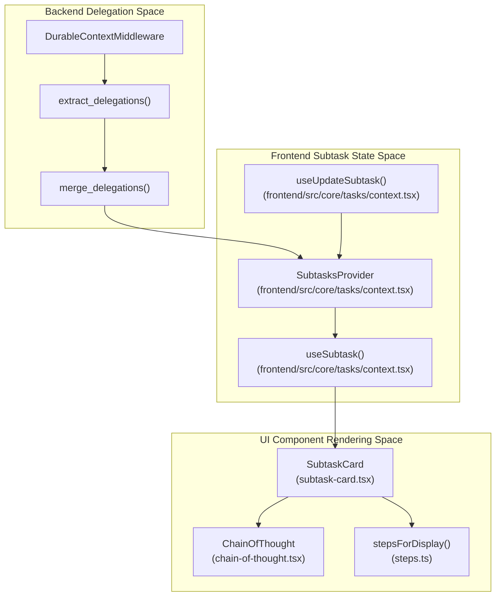
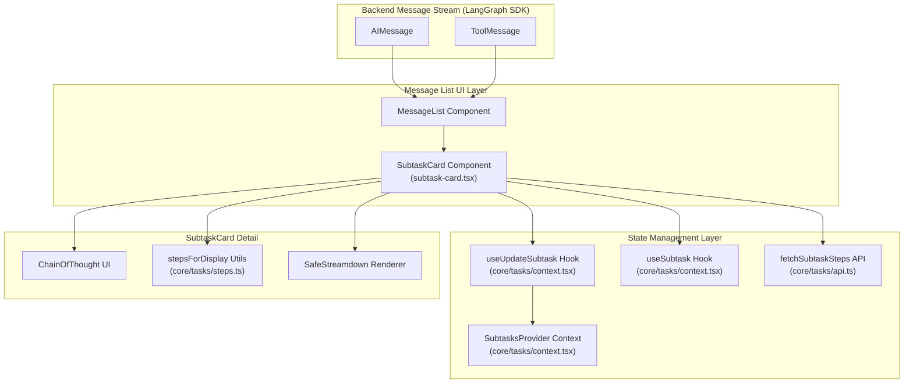
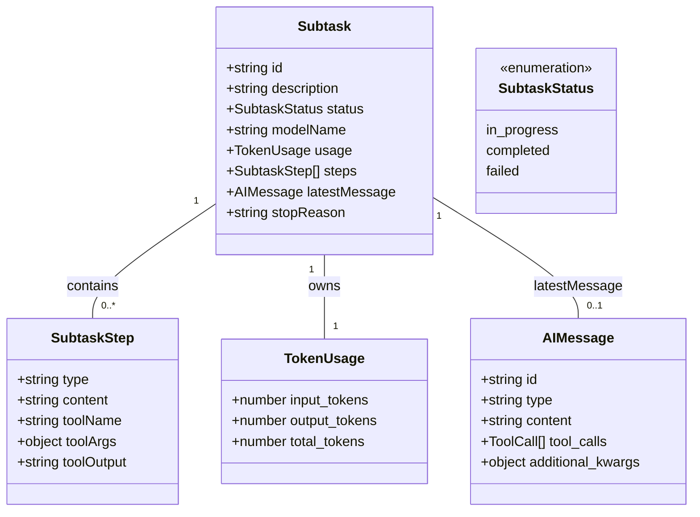
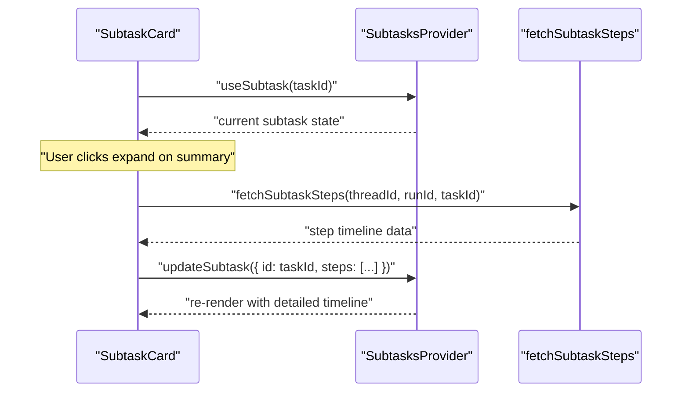

<!-- source: DeepWiki mcp.deepwiki.com · repo bytedance/deer-flow · page 4.5 Subtasks and Subagent Tracking · fetched 2026-10-29 -->

# Subtasks and Subagent Tracking

Relevant source files

The following files were used as context for generating this wiki page:

- [backend/packages/harness/deerflow/agents/middlewares/delegation_ledger.py](backend/packages/harness/deerflow/agents/middlewares/delegation_ledger.py)
- [backend/packages/harness/deerflow/agents/middlewares/durable_context_middleware.py](backend/packages/harness/deerflow/agents/middlewares/durable_context_middleware.py)
- [backend/packages/harness/deerflow/agents/middlewares/pii_redaction_middleware.py](backend/packages/harness/deerflow/agents/middlewares/pii_redaction_middleware.py)
- [backend/packages/harness/deerflow/config/pii_redaction_config.py](backend/packages/harness/deerflow/config/pii_redaction_config.py)
- [backend/packages/harness/deerflow/subagents/status_contract.py](backend/packages/harness/deerflow/subagents/status_contract.py)
- [backend/tests/test_delegation_ledger.py](backend/tests/test_delegation_ledger.py)
- [backend/tests/test_durable_context_middleware.py](backend/tests/test_durable_context_middleware.py)
- [backend/tests/test_pii_redaction_middleware.py](backend/tests/test_pii_redaction_middleware.py)
- [backend/tests/test_subagent_status_contract.py](backend/tests/test_subagent_status_contract.py)
- [contracts/subagent_status_contract.json](contracts/subagent_status_contract.json)
- [frontend/src/app/layout.tsx](frontend/src/app/layout.tsx)
- [frontend/src/app/workspace/chats/page.tsx](frontend/src/app/workspace/chats/page.tsx)
- [frontend/src/components/ai-elements/suggestion.tsx](frontend/src/components/ai-elements/suggestion.tsx)
- [frontend/src/components/workspace/messages/index.ts](frontend/src/components/workspace/messages/index.ts)
- [frontend/src/components/workspace/messages/skeleton.tsx](frontend/src/components/workspace/messages/skeleton.tsx)
- [frontend/src/components/workspace/messages/subtask-card.tsx](frontend/src/components/workspace/messages/subtask-card.tsx)
- [frontend/src/core/tasks/context.tsx](frontend/src/core/tasks/context.tsx)
- [frontend/src/core/tasks/subtask-result.ts](frontend/src/core/tasks/subtask-result.ts)
- [frontend/src/core/tasks/types.ts](frontend/src/core/tasks/types.ts)
- [frontend/src/core/tools/utils.ts](frontend/src/core/tools/utils.ts)
- [frontend/src/styles/globals.css](frontend/src/styles/globals.css)
- [frontend/tests/unit/core/tasks/subtask-result.test.ts](frontend/tests/unit/core/tasks/subtask-result.test.ts)

This document covers the frontend subsystem responsible for tracking and displaying subagent task execution in real-time within DeerFlow, alongside the backend delegation ledger integration. It explains the management of subtask lifecycle, handling of task progress events from the backend, and how the UI renders collapsible task cards with live updates.

For backend subagent execution and the `task` tool, refer to **5.5 Subagent System and Task Delegation**. For general message rendering details, see **4.4 Message Rendering System**.

---

## Purpose and Scope

The subtask tracking system provides real-time visibility into parallel subagent executions initiated by the lead agent. When work is delegated via the `task` tool:

1. A `Subtask` entry is created to track the task's lifecycle, state, and metadata [frontend/src/core/tasks/types.ts:7-33]().
2. The UI displays a collapsible `SubtaskCard`, showing task status, model info, token usage, and progress [frontend/src/components/workspace/messages/subtask-card.tsx:48-191]().
3. The subtask state is updated live as the backend streams messages and tool calls, via the `useUpdateSubtask` hook [frontend/src/core/tasks/context.tsx:58-101]().
4. Reasoning steps (AI-generated text) and tool executions interleave into a step timeline visualized in the card, using `stepsForDisplay` [frontend/src/components/workspace/messages/subtask-card.tsx:103-103]().
5. The card updates final results, stop reasons (budget cap, errors), and shows corresponding status icons [frontend/src/components/workspace/messages/subtask-card.tsx:128-136]().

Sources:
- [frontend/src/core/tasks/types.ts:7-33]()
- [frontend/src/components/workspace/messages/subtask-card.tsx:48-191]()
- [frontend/src/core/tasks/context.tsx:58-101]()

---

## Architecture Overview

The subtask tracking system bridges backend delegation state (captured by `DurableContextMiddleware` and `merge_delegations`) with frontend reactive rendering via React context and custom hooks.

### Natural Language to Code Entity Mapping: End-to-End Tracking Pipeline

Sources:
- [backend/packages/harness/deerflow/agents/middlewares/durable_context_middleware.py:1-48]()
- [frontend/src/core/tasks/context.tsx:30-101]()
- [frontend/src/components/workspace/messages/subtask-card.tsx:48-191]()

### Frontend Data Flow Architecture

Sources:
- [frontend/src/components/workspace/messages/subtask-card.tsx:31-37]()
- [frontend/src/core/tasks/context.tsx:30-41]()
- [frontend/src/core/tasks/context.tsx:58-68]()
- [frontend/src/core/tasks/types.ts:7-22]()

---

## Data Model

### Subtask Interface

The `Subtask` interface models a tracked subagent execution, holding properties for identification, status, steps, usage, and latest messaging.

- `status` reflects current execution state (`in_progress`, `completed`, `failed`) [frontend/src/core/tasks/types.ts:7-33]().
- `steps` represent chronological subagent reasoning and tool call events [frontend/src/core/tasks/types.ts:7-33]().
- `stopReason` captures why a run ended early (e.g., `token_capped`, `turn_capped`, `loop_capped`) while maintaining a terminal pill status [frontend/src/core/tasks/subtask-result.ts:53-57]().

Structured subagent metadata (such as `subagent_status`, `subagent_stop_reason`, `subagent_error`, `subagent_result_brief`, etc.) is stamped into `ToolMessage.additional_kwargs` by the backend delegation ledger and parsed by `parseSubtaskResult()` [frontend/src/core/tasks/subtask-result.ts:40-46]().

Sources:
- [frontend/src/core/tasks/types.ts:7-33]()
- [frontend/src/components/workspace/messages/subtask-card.tsx:61-74]()
- [frontend/src/core/tasks/subtask-result.ts:40-46]()

### Subtask Presentation Utilities

| Function Name              | Location                      | Purpose                                                     |
|----------------------------|-------------------------------|-------------------------------------------------------------|
| `resolveSubtaskModelLabel` | `core/tasks/presentation.ts`  | Maps raw model names to readable UI labels.                 |
| `formatSubtaskTokenUsage`   | `core/tasks/presentation.ts`  | Formats token usage summary display.                         |
| `stepsForDisplay`           | `core/tasks/steps.ts`          | Filters and prepares subtask steps for UI timeline rendering.|
| `explainLastToolCall`       | `core/tools/utils.ts`          | Produces human-readable explanation of the latest tool call.|

These utilities are used inside `SubtaskCard` to enhance the display experience. Specifically, the card shows the subagent's step timeline, interleaving reasoning turns and tool execution, with token usage and model info [frontend/src/components/workspace/messages/subtask-card.tsx:85-103]().

Sources:
- [frontend/src/components/workspace/messages/subtask-card.tsx:85-103]()
- [frontend/src/core/tools/utils.ts:7-29]()

---

## State Management

### SubtasksProvider: React Context

The `SubtasksProvider` maintains a map of subtasks keyed by their IDs and exposes this state via React Context. It also keeps a mutable ref `tasksRef` to the latest state, which allows async callbacks to merge updates safely without overwriting newer data (e.g., when backfilling historic step data) [frontend/src/core/tasks/context.tsx:30-40]().

This provider is the backbone allowing all parts of the app to read and update subtask state consistently.

### Hooks for Lifecycle Management

- **`useSubtask(id: string)`**  
  Retrieves the current subtask data by ID from context. Returns `undefined` if no data for the given ID exists [frontend/src/core/tasks/context.tsx:53-56]().

- **`useUpdateSubtask()`**  
  Returns a callback function for safely updating a subtask, merging incoming updates with prior state atomically. It uses `computeNextSubtask` to produce the next state version and checks if rendering notifications are needed (immediate or deferred) to avoid infinite update loops common with streaming and re-parsing [frontend/src/core/tasks/context.tsx:58-101]().

This pattern ensures subtask state is always consistent and reactive to real-time backend events.

### Subagent Status Mapping and UI States

The backend communicates subagent execution states through the `subagent_status` metadata key on task results. The frontend maps these backend states into UI states with appropriate iconography and visual feedback:

| Backend Status   | Frontend `Subtask.status` | Visual Treatment                                                                                  |
|------------------|---------------------------|--------------------------------------------------------------------------------------------------|
| `in_progress`    | `in_progress`             | Spinning loader icon; glowing colored border; shimmer text animation [frontend/src/components/workspace/messages/subtask-card.tsx:133-154]()|
| `completed`      | `completed`               | Green checkmark icon [frontend/src/components/workspace/messages/subtask-card.tsx:129-130]()                                                |
| `failed`         | `failed`                  | Red error icon [frontend/src/components/workspace/messages/subtask-card.tsx:131-132]()                                                     |

These states drive the card UI's real-time feedback, helping users monitor subtasks and detect failures or completion cleanly.

Sources:
- [frontend/src/core/tasks/context.tsx:58-101]()
- [frontend/src/components/workspace/messages/subtask-card.tsx:128-155]()

---

## Subtask Lifecycle and Real-Time Progress Updates

### Step History Backfilling

For historical subtasks that have no live streamed steps (e.g., prior executions), the detailed reasoning and tool call steps are backfilled on-demand:

- When a user expands a collapsed `SubtaskCard` and no steps are present, the component triggers a fetch to retrieve step history from the backend API via `fetchSubtaskSteps(threadId, runId, taskId)` [frontend/src/components/workspace/messages/subtask-card.tsx:109-127]().
- If the fetch succeeds with step data, `updateSubtask` merges the steps into state, rendering a detailed timeline of the subagent's operation.
- The backfill occurs only once per card expand to avoid redundant network requests (tracked with a ref).

This allows historical context to be lazily loaded and displayed when relevant while keeping the initial UI lightweight.

### Live Tool Call Explanation

When a subtask is `in_progress` and its latest message contains active tool calls, the card shows a natural language explanation of the current step instead of a simple status label. This uses `explainLastToolCall(...)` [frontend/src/core/tools/utils.ts:7-29]():

- Provides insight into the subagent's in-flight tool operation (e.g., what task is currently active).
- Displayed inline with a flip animation (`FlipDisplay` component) for smooth UI transitions.

This adds contextual clarity around subtask progress for the user.

Sources:
- [frontend/src/components/workspace/messages/subtask-card.tsx:109-127]()
- [frontend/src/core/tools/utils.ts:7-29]()

---

## UI Component Implementation

### `SubtaskCard` Component

Located at `frontend/src/components/workspace/messages/subtask-card.tsx`, the `SubtaskCard` is the primary UI unit visualizing a single subagent task’s lifecycle and activity timeline.

#### Key Features

- **Collapsible View:**  
  Summarizes the subtask when collapsed, showing description, status icon, model label, and token usage without detailed steps. Clicking the card toggles expansion to reveal the step timeline [frontend/src/components/workspace/messages/subtask-card.tsx:84-162]().

- **Step Timeline:**  
  When expanded, renders the subagent’s reasoning and tool call steps in chronological order using `ChainOfThought` [frontend/src/components/workspace/messages/subtask-card.tsx:138-141]().  
  This timeline interleaves assistant turns with tool calls, providing a comprehensive replay of the subagent’s execution.

- **Status Iconography:**  
  Shows relevant status icon for the subtask state: spinner for running, checkmark for completed, and cross icon for failures [frontend/src/components/workspace/messages/subtask-card.tsx:128-136]().

- **Glowing Border:**  
  Applies a multi-color animated border highlight (`ShineBorder` component) for in-progress tasks to draw attention visually [frontend/src/components/workspace/messages/subtask-card.tsx:148-155]().

#### Data Binding and Reactivity

The component accesses subtask data from the `useSubtask` hook and updates via `useUpdateSubtask`. It also backfills step data lazily on expansion as described above. The `isLoading` prop governs fallback UI during data acquisition [frontend/src/components/workspace/messages/subtask-card.tsx:51-67]().

#### Interaction Summary Diagram

Sources:
- [frontend/src/components/workspace/messages/subtask-card.tsx:48-191]()
- [frontend/src/core/tasks/context.tsx:53-56]()

---

## Summary

DeerFlow's frontend subtask tracking system provides detailed, real-time insight into each subagent task managed by the lead agent through robust state management, on-demand history fetching, and responsive UI components. This creates a rich user experience for monitoring delegate work within conversation threads.

Sources:
- [frontend/src/components/workspace/messages/subtask-card.tsx:48-191]()
- [frontend/src/core/tasks/context.tsx:30-101]()

---

