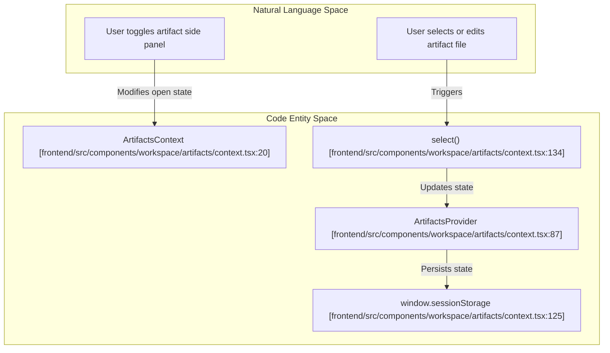
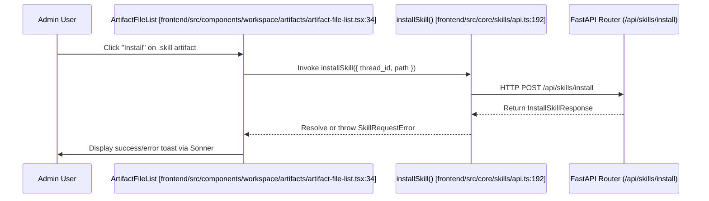

<!-- source: DeepWiki mcp.deepwiki.com · repo bytedance/deer-flow · page 4.6 Artifacts and File Display · fetched 2026-10-29 -->

# Artifacts and File Display

Relevant source files

The following files were used as context for generating this wiki page:

- [frontend/src/components/ai-elements/artifact.tsx](frontend/src/components/ai-elements/artifact.tsx)
- [frontend/src/components/ai-elements/chain-of-thought.tsx](frontend/src/components/ai-elements/chain-of-thought.tsx)
- [frontend/src/components/ai-elements/code-block.tsx](frontend/src/components/ai-elements/code-block.tsx)
- [frontend/src/components/ui/select.tsx](frontend/src/components/ui/select.tsx)
- [frontend/src/components/workspace/artifacts/artifact-file-list.tsx](frontend/src/components/workspace/artifacts/artifact-file-list.tsx)
- [frontend/src/components/workspace/artifacts/artifact-viewer.tsx](frontend/src/components/workspace/artifacts/artifact-viewer.tsx)
- [frontend/src/components/workspace/artifacts/context.tsx](frontend/src/components/workspace/artifacts/context.tsx)
- [frontend/src/components/workspace/flip-display.tsx](frontend/src/components/workspace/flip-display.tsx)
- [frontend/src/components/workspace/messages/context.ts](frontend/src/components/workspace/messages/context.ts)
- [frontend/src/core/artifacts/utils.ts](frontend/src/core/artifacts/utils.ts)
- [frontend/src/core/skills/api.ts](frontend/src/core/skills/api.ts)
- [frontend/src/core/utils/files.tsx](frontend/src/core/utils/files.tsx)
- [frontend/tests/e2e/artifact-markdown-images.spec.ts](frontend/tests/e2e/artifact-markdown-images.spec.ts)
- [frontend/tests/unit/components/workspace/artifacts/artifact-file-detail.dom.test.tsx](frontend/tests/unit/components/workspace/artifacts/artifact-file-detail.dom.test.tsx)
- [frontend/tests/unit/components/workspace/artifacts/artifact-markdown-images.dom.test.tsx](frontend/tests/unit/components/workspace/artifacts/artifact-markdown-images.dom.test.tsx)
- [frontend/tests/unit/components/workspace/artifacts/artifact-viewer.dom.test.tsx](frontend/tests/unit/components/workspace/artifacts/artifact-viewer.dom.test.tsx)
- [frontend/tests/unit/core/artifacts/utils.test.ts](frontend/tests/unit/core/artifacts/utils.test.ts)
- [frontend/tests/unit/core/utils/files-basename.test.ts](frontend/tests/unit/core/utils/files-basename.test.ts)
- [frontend/tests/unit/core/utils/files.test.ts](frontend/tests/unit/core/utils/files.test.ts)

This page details the artifact management and file display subsystem in DeerFlow. It covers the React context and persistence layer (`ArtifactsContext`), the file listing interface (`ArtifactFileList`), file type heuristics and icon utilities, artifact viewers, and skill installation workflows.

---

## 1. `ArtifactsContext` State Management and Persistence

The artifact subsystem relies on `ArtifactsContext` and its React provider implementation `ArtifactsProvider` to encapsulate global artifact state across the frontend workspace [frontend/src/components/workspace/artifacts/context.tsx:20-183]().

### Core State Properties and Types

- **`artifacts`**: `string[]` representing active artifact file paths in the thread [frontend/src/components/workspace/artifacts/context.tsx:21]().
- **`selectedArtifact`**: `string | null` tracking the file currently opened for detail viewing or editing [frontend/src/components/workspace/artifacts/context.tsx:24]().
- **`open` & `autoOpen`**: Booleans controlling the visibility of the artifact side panel and whether it auto-opens upon new generation [frontend/src/components/workspace/artifacts/context.tsx:29-30]().
- **`drafts`**: `Record<string, ArtifactDraftState>` storing unsaved inline edits keyed by file path [frontend/src/components/workspace/artifacts/context.tsx:33]().

### Session Persistence and Lifecycle

Panel state (`artifacts`, `selectedArtifact`, and `open`) is serialized and stored in browser session storage (`window.sessionStorage`) using a route-specific storage key generated by `storageKey(pathname)` [frontend/src/components/workspace/artifacts/context.tsx:51-53,124-132](). When navigation occurs, `useEffect` hooks hydrate this state to ensure continuity across client-side transitions [frontend/src/components/workspace/artifacts/context.tsx:105-118]().

### Diagram: Natural Language Space to Code Entity Space (Artifact State)

Sources: [frontend/src/components/workspace/artifacts/context.tsx:20-183]()

---

## 2. Artifact File List and Management UI

The `ArtifactFileList` component renders the collection of generated artifacts for a given thread, exposing interaction entry points for detail view selection, archive downloads, and administrative skill installation [frontend/src/components/workspace/artifacts/artifact-file-list.tsx:34-216]().

### Component Architecture and React Query

- **Manifest Fetching**: Uses TanStack React Query (`useQuery`) with `getArtifactArchiveManifest` to check archive size limits before enabling multi-file ZIP downloads [frontend/src/components/workspace/artifacts/artifact-file-list.tsx:54-61,134-140]().
- **Selection Handling**: Clicking any file card invokes `selectArtifact` from `useArtifacts()` to load the content viewer [frontend/src/components/workspace/artifacts/artifact-file-list.tsx:64-70]().
- **Skill Installation Integration**: For files ending in `.skill` where the authenticated user has an `admin` role, an installation action triggers `installSkill` from `core/skills/api.ts` with toast notifications reflecting success or failure states [frontend/src/components/workspace/artifacts/artifact-file-list.tsx:72-102,180-193]().

### Diagram: Natural Language Space to Code Entity Space (Skill Installation Flow)

Sources: [frontend/src/components/workspace/artifacts/artifact-file-list.tsx:34-216](), [frontend/src/core/skills/api.ts:192-219]()

---

## 3. File Type Utilities and Heuristics

File classification, iconography, and editor language mapping are driven by utility functions located in `frontend/src/core/utils/files.tsx`.

### Core Utility Functions

- **`checkCodeFile(filepath)`**: Evaluates file extensions against `extensionMap` to determine if a file is a source code asset, returning `{ isCodeFile: true, language }` or `{ isCodeFile: false, language: null }` [frontend/src/core/utils/files.tsx:179-196]().
- **`getFileIcon(filepath, className)`**: Maps file extensions to corresponding Lucide icons (`FileCogIcon`, `CompassIcon`, `BookOpenTextIcon`, `ImageIcon`, `FilePlayIcon`, `FileCodeIcon`, or `FileTextIcon`) [frontend/src/core/utils/files.tsx:224-268]().
- **`getFileExtensionDisplayName(filepath)`**: Normalizes human-readable names for UI chips (e.g., Markdown, Word, Excel) [frontend/src/core/utils/files.tsx:202-222]().
- **`canBrowserPreviewFile(filepath)`**: Checks `browserPreviewExtensions` to verify native browser rendering support for media and PDF formats [frontend/src/core/utils/files.tsx:148-200]().

Special hardening guards protect against prototype pollution issues (such as `constructor` or `__proto__` property names) when checking file extensions [frontend/src/core/utils/files.tsx:179-196]().

Sources: [frontend/src/core/utils/files.tsx:11-268]()

---

## 4. Artifact Viewer and File Display Integration

Artifact content viewing is supported through dedicated components like `ArtifactViewer` which manages layout, source links, downloads, and bounded content previews [frontend/src/components/workspace/artifacts/artifact-viewer.tsx:19-130]().

### `ArtifactViewer` Implementation

- **Standalone Preview**: Utilizes `useStandaloneArtifactContent` to fetch and render bounded previews or full file contents for Markdown, text, and tabular files [frontend/src/components/workspace/artifacts/artifact-viewer.tsx:32-42]().
- **Actions Toolbar**: Renders external links via `urlOfArtifact` and direct download buttons with proper headers [frontend/src/components/workspace/artifacts/artifact-viewer.tsx:60-82]().
- **Truncation Management**: Automatically detects truncated file payloads and provides triggers to load full contents on demand [frontend/src/components/workspace/artifacts/artifact-viewer.tsx:85-97]().

Sources: [frontend/src/components/workspace/artifacts/artifact-viewer.tsx:19-130]()

---

## 5. Skill Installation and Error Handling API

Backend communication for skill management and security scanning findings is handled via typed API wrappers in `frontend/src/core/skills/api.ts`.

### `SkillRequestError` Class

Custom error handling encapsulates HTTP status codes, targeted skill names, and structured security findings (`SkillSecurityFinding[]`) returned by `SkillScan` middleware [frontend/src/core/skills/api.ts:20-43]().

- **`isAdminRequired`**: Getter returning `true` on `403` status codes, allowing the UI to present administrator-specific error prompts [frontend/src/core/skills/api.ts:40-42]().
- **`uploadSkillArchive(archive: File)`**: Posts multipart form data to `/api/skills/install/upload` with enforcement of the `MAX_SKILL_ARCHIVE_UPLOAD_BYTES` threshold (100MB) [frontend/src/core/skills/api.ts:9,221-226]().

Sources: [frontend/src/core/skills/api.ts:1-226]()

---

