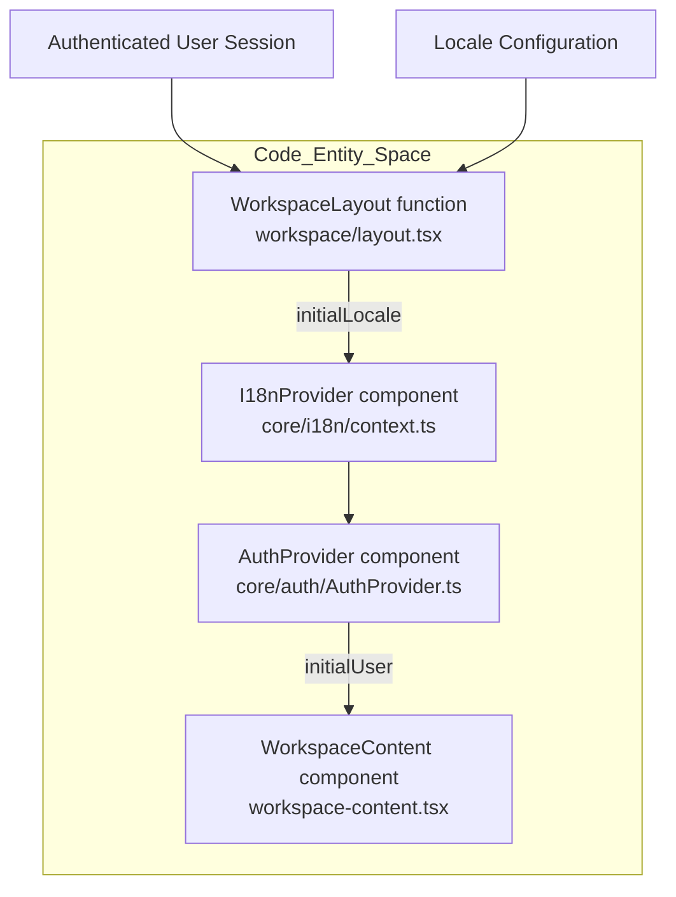
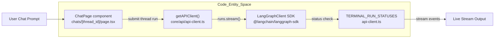
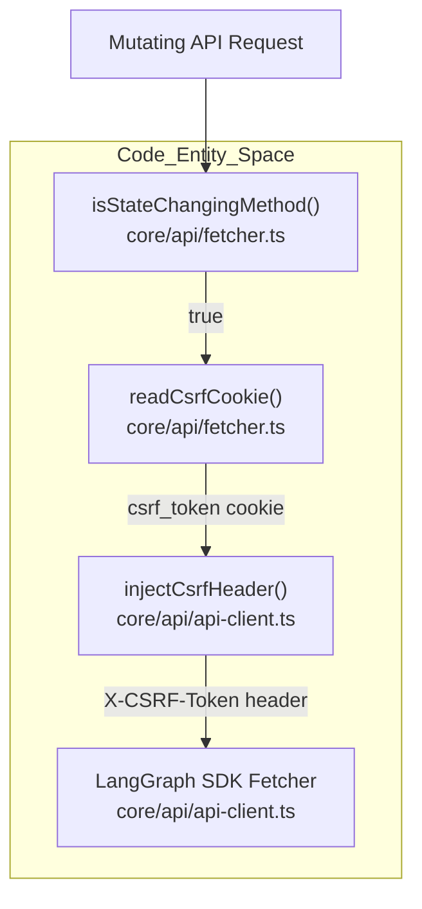

<!-- source: DeepWiki mcp.deepwiki.com · repo bytedance/deer-flow · page 4.8 State Management and Hooks · fetched 2026-10-29 -->

# State Management and Hooks

Relevant source files

The following files were used as context for generating this wiki page:

- [frontend/.env.example](frontend/.env.example)
- [frontend/README.md](frontend/README.md)
- [frontend/components.json](frontend/components.json)
- [frontend/src/AGENTS.md](frontend/src/AGENTS.md)
- [frontend/src/app/page.tsx](frontend/src/app/page.tsx)
- [frontend/src/app/workspace/layout.tsx](frontend/src/app/workspace/layout.tsx)
- [frontend/src/components/query-client-provider.tsx](frontend/src/components/query-client-provider.tsx)
- [frontend/src/components/theme-provider.tsx](frontend/src/components/theme-provider.tsx)
- [frontend/src/components/ui/aurora-text.tsx](frontend/src/components/ui/aurora-text.tsx)
- [frontend/src/components/ui/number-ticker.tsx](frontend/src/components/ui/number-ticker.tsx)
- [frontend/src/components/workspace/artifacts/artifact-file-preview.tsx](frontend/src/components/workspace/artifacts/artifact-file-preview.tsx)
- [frontend/src/components/workspace/recent-chat-list.tsx](frontend/src/components/workspace/recent-chat-list.tsx)
- [frontend/src/core/api/api-client.ts](frontend/src/core/api/api-client.ts)
- [frontend/src/core/api/stream-mode.ts](frontend/src/core/api/stream-mode.ts)
- [frontend/src/core/artifacts/html-assets.ts](frontend/src/core/artifacts/html-assets.ts)
- [frontend/src/core/auth/gateway-config.ts](frontend/src/core/auth/gateway-config.ts)
- [frontend/src/core/config/index.ts](frontend/src/core/config/index.ts)
- [frontend/src/core/settings/hooks.ts](frontend/src/core/settings/hooks.ts)
- [frontend/src/core/settings/index.ts](frontend/src/core/settings/index.ts)
- [frontend/src/core/settings/local.ts](frontend/src/core/settings/local.ts)
- [frontend/src/core/settings/store.ts](frontend/src/core/settings/store.ts)
- [frontend/src/core/threads/stream-state.ts](frontend/src/core/threads/stream-state.ts)
- [frontend/src/core/threads/types.ts](frontend/src/core/threads/types.ts)
- [frontend/src/core/threads/utils.ts](frontend/src/core/threads/utils.ts)
- [frontend/src/env.js](frontend/src/env.js)
- [frontend/tests/e2e/artifact-preview.spec.ts](frontend/tests/e2e/artifact-preview.spec.ts)
- [frontend/tests/unit/components/workspace/artifacts/artifact-file-preview.dom.test.tsx](frontend/tests/unit/components/workspace/artifacts/artifact-file-preview.dom.test.tsx)
- [frontend/tests/unit/core/api/api-client.test.ts](frontend/tests/unit/core/api/api-client.test.ts)
- [frontend/tests/unit/core/api/stream-mode.test.ts](frontend/tests/unit/core/api/stream-mode.test.ts)
- [frontend/tests/unit/core/artifacts/html-assets-auth.dom.test.ts](frontend/tests/unit/core/artifacts/html-assets-auth.dom.test.ts)
- [frontend/tests/unit/core/auth/gateway-config.test.ts](frontend/tests/unit/core/auth/gateway-config.test.ts)
- [frontend/tests/unit/core/threads/incremental-stream-state.dom.test.tsx](frontend/tests/unit/core/threads/incremental-stream-state.dom.test.tsx)
- [frontend/tests/unit/core/threads/utils.test.ts](frontend/tests/unit/core/threads/utils.test.ts)

This page provides a comprehensive technical overview of the state management architecture and React hooks utilized in the DeerFlow frontend. It details browser-persisted local user settings, core React context providers, thread lifecycle and streaming orchestration, artifact content handling, and the secure API client layer featuring stateful stream recovery and CSRF protection.

---

## 1. LocalSettings and Browser Persistence

The `LocalSettings` module manages user preferences and per-thread overrides, persisting them to the browser's `localStorage` while safely handling restricted contexts such as private browsing modes and quota limits.

### Implementation and Safe Storage

- **Settings Schema**: Defined in `frontend/src/core/settings/local.ts`, the `LocalSettings` interface defines application parameters including notification flags, token usage display modes, and thread context configurations [frontend/src/core/settings/local.ts:68-90]().
- **Safe Storage Facade**: `safeLocalStorage` wraps standard `localStorage` calls to catch `SecurityError` and `QuotaExceededError` exceptions thrown in strict privacy or embedded WebView environments, guaranteeing safe fallback execution [frontend/src/core/settings/local.ts:39-66]().
- **Settings Store & Synchronization**: React components consume these settings via custom synchronization hooks like `useLocalSettings()` and `useThreadSettings()`, built on top of `useSyncExternalStore` [frontend/src/core/settings/hooks.ts:17-59]().

| Field | Type | Description |
|---|---|---|
| `notification.enabled` | `boolean` | Controls browser push notifications. |
| `projectsDisplayMode` | `"flat" \| "grouped"` | Workspace project hierarchy layout style. |
| `tokenUsage.headerTotal` | `boolean` | Toggles display of token usage totals in headers. |
| `context.model_name` | `string \| undefined` | Per-thread model name override. |
| `context.mode` | `"flash" \| "thinking" \| "pro" \| "ultra" \| undefined` | Execution mode setting. |

Sources:
- `frontend/src/core/settings/local.ts:39-90`()
- `frontend/src/core/settings/hooks.ts:17-59`()

---

## 2. Workspace Layout and Context Providers

The frontend leverages Next.js App Router layout components to establish the global React context tree.

### Architecture Overview

The root workspace layout component, `WorkspaceLayout`, handles authentication and server-side locale resolution prior to mounting context providers [frontend/src/app/workspace/layout.tsx:17-56]().

#### Workspace Layout Data Flow

Sources:
- `frontend/src/app/workspace/layout.tsx:1-56`()

---

## 3. Thread Lifecycle and Streaming Management

Threads represent conversation sessions and agent execution loops managed via the LangGraph SDK client and real-time streaming handlers.

### Data Models & Terminal States

- **Core Types**: Defined in `frontend/src/core/threads/types.ts`, structures like `AgentThreadState`, `AgentThreadContext`, and `RunMessage` track messages, todos, goals, and execution metadata [frontend/src/core/threads/types.ts:67-106]().
- **Terminal Run Statuses**: The constant `TERMINAL_RUN_STATUSES` defines statuses (`"success"`, `"error"`, `"timeout"`, `"interrupted"`) where streaming has ended, preventing redundant reconnection attempts [frontend/src/core/api/api-client.ts:66-71]().

#### Thread Streaming Architecture

Sources:
- `frontend/src/core/threads/types.ts:67-106`()
- `frontend/src/core/api/api-client.ts:66-71`()

---

## 4. Core React Hooks and Contexts

DeerFlow relies on specialized hooks to encapsulate thread streaming, artifact management, subtasks, and user configuration.

- **`useThreadStream`**: Manages real-time SSE event consumption, state merging, throttling, and recovery for active thread runs using the LangGraph SDK client.
- **`useArtifacts`**: Tracks artifact collections, inline editing buffers, and view states across execution steps. Session storage persists panel UI state (`open`, selected path, and refresh cache).
- **`useSubtasks`**: Monitors subagent delegation trees, task completion states, and progress indicators.
- **`useLocalSettings` / `useThreadSettings`**: Exposes reactive access to global and per-thread settings via external stores [frontend/src/core/settings/hooks.ts:17-59]().

Sources:
- `frontend/src/core/settings/hooks.ts:17-59`()

---

## 5. Artifact Content Handling and Drafts

Artifacts handle large text files, tool outputs, and projections generated during agent execution.

- **Lazy Loading**: Regular artifact text loads request at most the first 1 MiB through an HTTP byte range. Truncated previews stay lightweight and expose an explicit full-file action before CodeMirror is mounted.
- **Draft Management**: Local client state stores unsaved edits to prevent data loss during quick switches between tools or tabs. UTF-8 outputs under `/mnt/user-data/outputs` are editable while idle.

Sources:
- `frontend/src/AGENTS.md:32-42`()

---

## 6. API Client Layer and CSRF Protection

The API client layer abstracts REST communication and streaming over the LangGraph SDK.

### CSRF Header Injection

Mutating requests (`POST`, `PATCH`, `DELETE`) pass through `injectCsrfHeader`, which extracts the live `csrf_token` cookie and injects it as the `X-CSRF-Token` header [frontend/src/core/api/api-client.ts:31-42]().

#### CSRF Protection Flow

Sources:
- `frontend/src/core/api/api-client.ts:31-42`()

---

