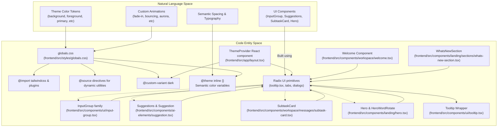
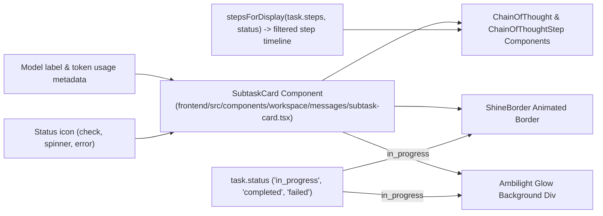
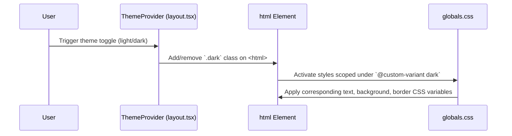

<!-- source: DeepWiki mcp.deepwiki.com · repo bytedance/deer-flow · page 4.9 Styling System and UI Components · fetched 2026-10-29 -->

# Styling System and UI Components

<details>
<summary>Relevant source files</summary>

The following files were used as context for generating this wiki page:

- [frontend/src/app/layout.tsx](frontend/src/app/layout.tsx)
- [frontend/src/app/workspace/chats/page.tsx](frontend/src/app/workspace/chats/page.tsx)
- [frontend/src/components/ai-elements/suggestion.tsx](frontend/src/components/ai-elements/suggestion.tsx)
- [frontend/src/components/landing/hero.tsx](frontend/src/components/landing/hero.tsx)
- [frontend/src/components/landing/sections/whats-new-section.tsx](frontend/src/components/landing/sections/whats-new-section.tsx)
- [frontend/src/components/ui/input-group.tsx](frontend/src/components/ui/input-group.tsx)
- [frontend/src/components/ui/tooltip.tsx](frontend/src/components/ui/tooltip.tsx)
- [frontend/src/components/workspace/messages/index.ts](frontend/src/components/workspace/messages/index.ts)
- [frontend/src/components/workspace/messages/skeleton.tsx](frontend/src/components/workspace/messages/skeleton.tsx)
- [frontend/src/components/workspace/messages/subtask-card.tsx](frontend/src/components/workspace/messages/subtask-card.tsx)
- [frontend/src/components/workspace/tooltip.tsx](frontend/src/components/workspace/tooltip.tsx)
- [frontend/src/components/workspace/welcome.tsx](frontend/src/components/workspace/welcome.tsx)
- [frontend/src/components/workspace/workspace-container.tsx](frontend/src/components/workspace/workspace-container.tsx)
- [frontend/src/core/tasks/context.tsx](frontend/src/core/tasks/context.tsx)
- [frontend/src/core/tasks/types.ts](frontend/src/core/tasks/types.ts)
- [frontend/src/core/tools/utils.ts](frontend/src/core/tools/utils.ts)
- [frontend/src/styles/globals.css](frontend/src/styles/globals.css)

</details>


This page documents the frontend styling system and UI components of DeerFlow. It details the Tailwind CSS v4 setup, inclusive of custom animations and theming, the integration of Radix UI component primitives, CodeMirror editor integration, and specialized landing page components. The guide explains how these parts collaborate, the data flow involved, and key React components and CSS declarations. Diagrams are included to bridge conceptual UI features with concrete code entities.

---

## Architecture Overview

The DeerFlow styling system bridges design tokens and theme variables declared in CSS with Tailwind CSS v4 utility classes and custom variants. These styles underpin a UI built primarily using **Radix UI** primitives, further extended with DeerFlow-specific React components for specialized UI needs such as input groups, suggestion lists, subtask cards, and landing page features like a hero banner and "What’s New" section.

The `ThemeProvider` component manages theming, toggling dark mode via CSS class manipulation, and supplies thematic context throughout the app. Custom keyframe animations enhance dynamic UI feedback for asynchronous processes, user interactions, and content transitions.

### Styling System & UI Components Entity Mapping



Sources:  
[frontend/src/styles/globals.css:1-232](),  
[frontend/src/app/layout.tsx:1-29](),  
[frontend/src/components/ui/input-group.tsx:11-170](),  
[frontend/src/components/ai-elements/suggestion.tsx:15-80](),  
[frontend/src/components/workspace/messages/subtask-card.tsx:40-191](),  
[frontend/src/components/landing/hero.tsx:1-143](),  
[frontend/src/components/ui/tooltip.tsx:1-60](),  
[frontend/src/components/workspace/welcome.tsx:21-72](),  
[frontend/src/components/landing/sections/whats-new-section.tsx:62-161]()

---

## Tailwind CSS v4 and Theme System

### Core Tailwind Setup

DeerFlow employs Tailwind CSS v4, which emphasizes a pure CSS configuration approach rather than a JavaScript config method.

- The core stylesheet `frontend/src/styles/globals.css` imports Tailwind's base utilities as well as the animation plugin:

  ```css
  @import "tailwindcss";
  @import "tw-animate-css";
  ```

- To include dynamic utility classes that appear in dependencies (`streamdown`, `@streamdown/code`, `@streamdown/mermaid`), multiple `@source` directives instruct the Tailwind compiler on scanning those paths:

  ```css
  @source "../../node_modules/streamdown/dist/index.js";
  @source "../../node_modules/@streamdown/code/dist/*.js";
  @source "../../node_modules/@streamdown/mermaid/dist/*.js";
  ```

- This ensures the Tailwind build captures style utilities used across third-party code, essential for dynamic content rendering.

- Dark mode styles are managed via a custom variant that scopes all dark mode selectors under `.dark` class:

  ```css
  @custom-variant dark (&:is(.dark *));
  ```

  This enables toggling dark mode simply by toggling the `.dark` class on the root element, with no need for additional props or inline styles.

Sources:  
[frontend/src/styles/globals.css:1-17,73]()

### Theming and Semantic Tokens

- The CSS `@theme inline {}` block in `globals.css` defines semantic tokens which map lower-level CSS variables (e.g. `--background`, `--foreground`) to more meaningful names consumed by components, promoting consistency and easy theming:

  ```css
  @theme inline {
    --color-background: var(--background);
    --color-foreground: var(--foreground);
    --color-card: var(--card);
    --color-primary: var(--primary);
    --color-muted: var(--muted);
    --color-accent: var(--accent);
    /*...more semantic colors and border-radius variables...*/
  }
  ```

- These tokens cover colors (backgrounds, text, borders, accents) and radii for border rounding — enabling consistent UI appearance across diverse elements.

- Coupled with Tailwind’s utility APIs, this system allows components to consume design tokens uniformly regardless of active theme.

Sources:  
[frontend/src/styles/globals.css:171-232]()

### Integration in React Layout

- The root app layout in `frontend/src/app/layout.tsx` imports the global styles and wraps the UI tree inside a `ThemeProvider` React component, enabling theme toggling and system preference detection:

  ```tsx
  <ThemeProvider attribute="class" enableSystem disableTransitionOnChange>
    {children}
  </ThemeProvider>
  ```

- This provider applies or removes the `.dark` class on the `<html>` element dynamically based on user preference or manual toggle, activating the CSS dark mode variant declared in the global stylesheet.

Sources:  
[frontend/src/app/layout.tsx:13-29]()

---

## Custom Animations

The styling system declares several keyframe animations inside `globals.css` to animate UI components and enhance user experience. These animations are aliased under semantic variables for easy reuse.

| Animation Name       | Description                                              | Usage Context                        | Key Details                                               |
|----------------------|----------------------------------------------------------|------------------------------------|-----------------------------------------------------------|
| `fade-in`            | Simple opacity fade-in                                   | General content entrance            | Opacity transitions from 0 to 1 over 1.1 seconds          |
| `loading-bar`        | Horizontal bar sliding for loading indicators           | Progress bars                      | Translates along X-axis from -100% to 400% repeatedly      |
| `fade-in-up`         | Upward fade-in with movement and scale                   | Suggestion buttons, quick content  | Starts offset below with scale 1.2, opacity 0 → 1         |
| `bouncing`           | Alternating vertical bounce with opacity flicker        | Spinners, loading dots             | Moves up 8px, opacity drops to 0.1 in alternate cycles    |
| `skeleton-entrance`  | Horizontal scaling and fade-in for skeleton loaders      | Loading placeholders              | Scales X from 0 → 1 with opacity 0 → 1 over 0.35 seconds  |
| `suggestion-in`      | Suggestion chip sliding in from above and fade           | Suggestions UI                     | Translates downward from above, opacity fade               |
| `wave`               | Rotational waving effect                                 | Waving emoji in welcome screens    | Rotates between 0° and 20° twice                            |
| `aurora`             | Background gradient pulse with rotation                   | Aurora UI backgrounds              | Cycles background-position and transforms over 8 seconds  |

Example for `fade-in-up` animation excerpt:

```css
@keyframes fade-in-up {
  0% {
    opacity: 0;
    transform: translateY(1rem) scale(1.2);
  }
  100% {
    opacity: 1;
    transform: translateY(0);
  }
}
```

These animations are bound to CSS variables prefixed with `--animate-`, such as `--animate-fade-in-up`, allowing components to invoke them with concise utility classes.

Sources:  
[frontend/src/styles/globals.css:90-168,211-232]()

---

## UI Component Library

### Radix UI Integration

DeerFlow leverages **Radix UI primitives** extensively as base building blocks for accessible, interactive UI patterns. Radix's unstyled components provide behaviors like focus management, keyboard navigation, and ARIA accessibility.

- The project wraps Radix primitives with custom lightweight wrappers for consistency and easier styling integration.

- For example, the tooltip system involves these components defined in `frontend/src/components/ui/tooltip.tsx`:

  - `TooltipProvider` sets default delay duration and context.
  - `Tooltip`, `TooltipTrigger`, and `TooltipContent` map directly to Radix's primitives but enforce consistent class names and animations through Tailwind CSS utilities.

- This approach ensures all tooltips have uniform interaction patterns and styling rules without repeating code in multiple places.

Sources:  
[frontend/src/components/ui/tooltip.tsx:1-60]()

### Input Group and Form Controls

The `InputGroup` family components aggregate multiple input-related elements into a cohesive, semantically grouped widget with consistent styling and accessibility:

- The main container `InputGroup` is a flexible div styled to form a bordered group with focus and error states visually distinguished.

- Child components include:
  - `InputGroupAddon` - side content addon (prefix/suffix) which focuses the linked input on click.
  - `InputGroupButton` - button integrated inside the input group with configurable size and variant.
  - `InputGroupText` - static text labels styled to harmonize with input content.
  - `InputGroupInput` and `InputGroupTextarea` - styled base input and textarea controls with transparent backgrounds and no borders, inheriting the group’s style.

- The components use `cva` (class-variance-authority) to manage complex conditional styling variants like alignment (`inline-start`, `block-end`) and sizing.

- These components enable consistent form UI building blocks usable throughout DeerFlow.

Sources:  
[frontend/src/components/ui/input-group.tsx:11-170]()

### Suggestions List for AI Inputs

- The `Suggestions` component displays a horizontally scrollable, wrapped list of interactive suggestion buttons:

  - Wrapped in a `ScrollArea` component to provide horizontal scrolling with hidden scrollbar.

  - Each suggestion child animates into view with a staggered `fade-in-up` effect, delayed sequentially for smooth cascade transitions.

- Individual `Suggestion` buttons render with configurable icon, variant, size, and click handler. They use muted foreground and background colors with rounded-full shape for pill-like appearance.

- These components are designed for AI-generated follow-up suggestions or quick actions in input UI.

Sources:  
[frontend/src/components/ai-elements/suggestion.tsx:15-80]()

---

## Subtask Tracking and Reasoning UI

### SubtaskCard Component

The `SubtaskCard` component provides an interface to display subagent subtasks with detailed chain-of-thought reasoning and tool usage timeline.



Sources:  
[frontend/src/components/workspace/messages/subtask-card.tsx:48-191]()

### Implementation Details

- Props:
  - `taskId`, optional `threadId` and `runId` for resolving subtask steps context.
  - Flags such as `isLoading` and fallback task data.

- Uses the `useSubtask` context hook to get reactive subtask state.

- Maintains an internal `collapsed` state to toggle detailed visibility.

- On expanding a collapsed card, asynchronously fetches missing step history data (for older runs) if not present locally, via `fetchSubtaskSteps` API, updating context with `useUpdateSubtask`.

- Displays an animated multi-color border (`ShineBorder`) and ambilight effect while the task is `in_progress`.

- The core chain of reasoning is presented via `ChainOfThought` and nested `ChainOfThoughtStep` components, which render AI text interleaved with tool calls.

- Displays model label and runtime token usage statistics if enabled.

- Shows a status icon (checkmark, spinner, or error) reflecting subtask state.

- Collapsed view presents a summary with these metadata to minimize UI noise.

Sources:  
[frontend/src/components/workspace/messages/subtask-card.tsx:48-191]()

---

## Landing Page and Specialized UI Components

### Hero Component

- The hero banner is implemented in `frontend/src/components/landing/hero.tsx`:

- Features:
  - A dynamic, lazy-loaded galaxy/starfield background (`Galaxy` component) with configurable star speed, glow, and twinkle effect.
  - A flickering grid effect masked by the DeerFlow SVG logo for subtle ambient motion.
  - The main headline with large bold text "DeerFlow" and a rotating set of descriptive words (`HeroWordRotate`) with smooth animated transitions using `motion/react`.
  - A prominent call-to-action button linking to `/workspace`.
  - An optional partnership badge rendered conditionally based on environment variable `NEXT_PUBLIC_STATIC_WEBSITE_ONLY`.

- The `HeroWordRotate` component cycles through an array of themed agent capabilities, animating each word's entrance and exit with fade and blur.

Sources:  
[frontend/src/components/landing/hero.tsx:1-143]()

### Welcome Banner Component

- The `Welcome` component (`frontend/src/components/workspace/welcome.tsx`) provides a greeting display on workspace load:

- Displays a waving emoji that animates only once per session using `animate-wave`.

- Supports display modes like "ultra," "pro," "thinking," and "flash" with color themes, using the `AuroraText` component for gradient text effects.

- Renders a localized greeting and descriptive paragraph.

Sources:  
[frontend/src/components/workspace/welcome.tsx:21-72]()

### What's New Section

- The `WhatsNewSection` (`frontend/src/components/landing/sections/whats-new-section.tsx`) shows a feature highlight panel:

- Uses `MagicBento` cards rendered with optional animations and pointer interaction glow effect on hover.

- The glow intensity and position respond dynamically to pointer movement within the container, spotlighting cards interactively.

- Honors user motion preferences and only enables animation/glow if not reduced motion.

Sources:  
[frontend/src/components/landing/sections/whats-new-section.tsx:62-161]()

---

## Theme and Layout Interaction

The root app layout uses the `ThemeProvider` component to coordinate theming via toggling a `.dark` CSS class. The `globals.css` applies dark mode styles scoped to this class.

### Theme Switching Data Flow



Sources:  
[frontend/src/app/layout.tsx:13-29](),  
[frontend/src/styles/globals.css:73,171-232]()

- The theme provider disables transition animations during theme changes to avoid flicker.

Sources:  
[frontend/src/app/layout.tsx:13-29](),  
[frontend/src/styles/globals.css:73,171-232]()

---

# Summary

DeerFlow's styling system uses Tailwind CSS v4 with CSS-based theming, semantic design tokens, and custom animations defined in `globals.css`. UI components are built on Radix UI primitives, extended by DeerFlow's own scalable React components such as `InputGroup`, `Suggestions`, and `SubtaskCard`. Landing page features leverage dynamic animations and pointer-based visual effects for engagement. The theme system seamlessly integrates with the React app's layout, toggling themes via CSS class control and cascading variables.

This design enables clear modular styling, accessibility, and rich interactive UI experiences making DeerFlow’s frontend maintainable and visually distinctive.

---

# References

- `frontend/src/styles/globals.css` (lines 1-232)  
- `frontend/src/app/layout.tsx` (lines 1-29)  
- `frontend/src/components/ui/input-group.tsx` (lines 11-170)  
- `frontend/src/components/ai-elements/suggestion.tsx` (lines 15-80)  
- `frontend/src/components/workspace/messages/subtask-card.tsx` (lines 48-191)  
- `frontend/src/components/ui/tooltip.tsx` (lines 1-60)  
- `frontend/src/components/landing/hero.tsx` (lines 1-143)  
- `frontend/src/components/workspace/welcome.tsx` (lines 21-72)  
- `frontend/src/components/landing/sections/whats-new-section.tsx` (lines 62-161)

---

