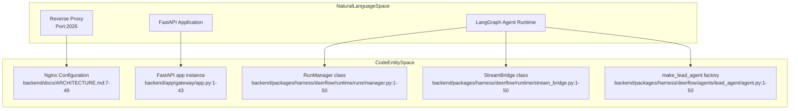
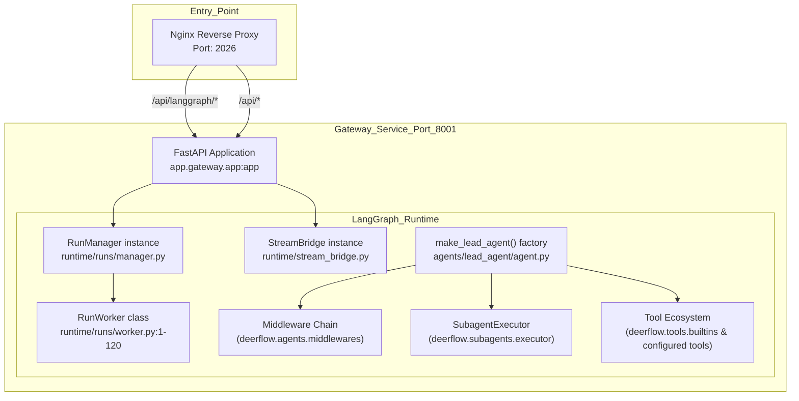

<!-- source: DeepWiki mcp.deepwiki.com · repo bytedance/deer-flow · page 5 Backend System · fetched 2026-10-29 -->

# Backend System

Relevant source files

The following files were used as context for generating this wiki page:

- [backend/CLAUDE.md](backend/CLAUDE.md)
- [backend/README.md](backend/README.md)
- [backend/app/gateway/AGENTS.md](backend/app/gateway/AGENTS.md)
- [backend/app/gateway/services.py](backend/app/gateway/services.py)
- [backend/docs/API.md](backend/docs/API.md)
- [backend/docs/ARCHITECTURE.md](backend/docs/ARCHITECTURE.md)
- [backend/docs/README.md](backend/docs/README.md)
- [backend/docs/SANDBOX_MEMORY_PROFILING.md](backend/docs/SANDBOX_MEMORY_PROFILING.md)
- [backend/docs/TODO.md](backend/docs/TODO.md)
- [backend/packages/harness/deerflow/runtime/runs/worker.py](backend/packages/harness/deerflow/runtime/runs/worker.py)
- [backend/packages/harness/deerflow/tracing/metadata.py](backend/packages/harness/deerflow/tracing/metadata.py)
- [backend/tests/test_client_langfuse_metadata.py](backend/tests/test_client_langfuse_metadata.py)
- [backend/tests/test_gateway_services.py](backend/tests/test_gateway_services.py)
- [backend/tests/test_goal_worker.py](backend/tests/test_goal_worker.py)
- [backend/tests/test_run_worker_rollback.py](backend/tests/test_run_worker_rollback.py)
- [backend/tests/test_sandbox_memory_profile_script.py](backend/tests/test_sandbox_memory_profile_script.py)
- [backend/tests/test_tracing_metadata.py](backend/tests/test_tracing_metadata.py)
- [backend/tests/test_worker_langfuse_metadata.py](backend/tests/test_worker_langfuse_metadata.py)
- [backend/tests/test_worker_stream_subgraph_namespace.py](backend/tests/test_worker_stream_subgraph_namespace.py)
- [scripts/sandbox_memory_profile.py](scripts/sandbox_memory_profile.py)

## Purpose and Scope

This page provides a high-level overview of the DeerFlow backend architecture, which primarily consists of a FastAPI Gateway hosting both REST API endpoints and an embedded LangGraph agent runtime. The backend system orchestrates AI agent execution, tool invocation, persistent memory, sandboxed code execution, subagent task delegation, and various APIs that serve the frontend and integration clients.

For deep technical details, see the child pages:
- [API Gateway](#5.1) — FastAPI Gateway endpoints, authentication, and the pluggable AuthorizationProvider system
- [LangGraph Agent Server](#5.2) — LangGraph Server setup, run lifecycle worker, event stores, and stream bridge
- [Lead Agent and System Prompt](#5.3) — Lead agent creation, system prompt templates, and runtime features
- [Middleware Pipeline](#5.4) — Full middleware chain, execution order, and responsibilities
- [Subagent System and Task Delegation](#5.5) — Task tool, SubagentExecutor, thread pools, and concurrency limits
- [Tool System](#5.6) — Tool assembly, built-in tools, MCP tools, and deferred loading
- [Skills System](#5.7) — Skill structure, archives, validation, SkillScan, and security scanning
- [Memory System](#5.8) — Long-term memory, user context, facts, and DeerMem backend
- [Thread State and Data Management](#5.9) — Thread state structure, checkpointer, project shelf, and uploads manager
- [Guardrails System](#5.10) — Pre-tool-call authorization, GuardrailProvider, and audit middlewares
- [Scheduled Tasks Backend](#5.11) — ScheduledTaskService, cron schedules, and lease-based claiming
- [MCP Background Tasks and Personal MCP](#5.12) — Long-running MCP task service, lease tokens, and personal MCP network access

Sources: [backend/docs/ARCHITECTURE.md:1-50]()

---

## Backend Services Architecture

DeerFlow's backend is delivered as a unified FastAPI application that both exposes REST API endpoints and embeds the LangGraph-based agent runtime responsible for AI execution. The backend is typically fronted by an Nginx reverse proxy that routes and rewrites incoming API requests to the appropriate handlers.

### Architecture Overview with Code Entity References

This diagram bridges the natural language description of the main backend components and the underlying code entities and modules where they reside:

Sources: [backend/docs/ARCHITECTURE.md:7-49](), [backend/app/gateway/app.py:1-43](), [backend/packages/harness/deerflow/runtime/runs/manager.py:1-50](), [backend/packages/harness/deerflow/runtime/stream_bridge.py:1-50](), [backend/packages/harness/deerflow/agents/lead_agent/agent.py:1-50]()

---

### Detailed Gateway to Runtime Mapping

The following diagram illustrates how incoming requests flow through the system, linking natural language components to concrete code entities:

Sources: [backend/docs/ARCHITECTURE.md:7-49](), [backend/app/gateway/app.py:1-179](), [backend/packages/harness/deerflow/runtime/runs/worker.py:1-120](), [backend/packages/harness/deerflow/subagents/executor.py:1-60]()

---

## Core Backend Subsystems

### API Gateway & Authentication

The FastAPI Gateway is the primary API entrance exposing REST endpoints for models, skills, memory, artifacts, uploads, and suggestions. It implements an authentication system supporting JWT sessions, cookie-based auth with CSRF protection, Single Sign-On (SSO), and Personal Access Tokens (PATs).

For details, see [API Gateway](#5.1).

Sources: [backend/app/gateway/app.py:1-179](), [backend/app/gateway/auth_middleware.py:1-70]()

---

### LangGraph Agent Server & Runtime

Embedded within the Gateway is the LangGraph runtime managing agent execution lifecycles, concurrency, event streaming, and distributed state persistence.

For details, see [LangGraph Agent Server](#5.2).

Sources: [backend/app/gateway/deps.py:20-54](), [backend/packages/harness/deerflow/runtime/runs/manager.py:1-50](), [backend/packages/harness/deerflow/runtime/stream_bridge.py:1-50]()

---

### Lead Agent and System Prompt

The lead agent is created via the factory function `make_lead_agent`, combining dynamic model selection, system prompt templates, dynamic context assembly, and runtime feature flags.

For details, see [Lead Agent and System Prompt](#5.3).

Sources: [backend/packages/harness/deerflow/agents/lead_agent/agent.py:1-50]()

---

### Middleware Pipeline

Agent execution unfolds within a middleware chain handling cross-cutting concerns like thread workspace isolation, sandbox acquisition, summarization, title generation, and memory extraction.

For details, see [Middleware Pipeline](#5.4).

Sources: [backend/README.md:53-68]()

---

### Subagent System and Task Delegation

DeerFlow supports background subagents for task delegation, managed via `SubagentExecutor` with thread pools, concurrency limits, and status tracking.

For details, see [Subagent System and Task Delegation](#5.5).

Sources: [backend/packages/harness/deerflow/subagents/executor.py:1-60]()

---

### Tool System

The tool system exposes built-in sandbox commands, config-defined tools, MCP tools, and community web tools with deferred loading via `tool_search`.

For details, see [Tool System](#5.6).

Sources: [backend/README.md:47-52]()

---

### Skills System

Skills package agent capabilities modularly as `.skill` archives with frontmatter validation, SkillScan, projection, and security scanning.

For details, see [Skills System](#5.7).

Sources: [backend/docs/API.md:7-12]()

---

### Memory System

The memory system provides persistent context retention across conversations via automated fact extraction, confidence scoring, and background updates.

For details, see [Memory System](#5.8).

Sources: [backend/README.md:99-106]()

---

### Thread State and Data Management

The thread state subsystem manages isolated thread-local workspaces, project document shelves, uploads, persistence checkpointers, and run journals.

For details, see [Thread State and Data Management](#5.9).

Sources: [backend/docs/ARCHITECTURE.md:100-105]()

---

### Guardrails Systems

This subsystem provides pre-tool-call authorization and auditing via `GuardrailProvider`, `AllowlistProvider`, `GuardrailMiddleware`, and sandbox audit middlewares.

For details, see [Guardrails System](#5.10).

Sources: [backend/app/gateway/app.py:1-43]()

---

### Scheduled Tasks Backend

The scheduled task service supports once/cron schedules, lease-based claiming, manual triggers, run history, and REST APIs.

For details, see [Scheduled Tasks Backend](#5.11).

Sources: [backend/app/gateway/routers/scheduled_tasks.py:10-60]()

---

## Service Lifecycle and Configuration

### Configuration Hot-Reload Boundary

The system uses an `AppConfig` configuration object supporting hot reloading of non-persistent elements like models, prompts, and tools without process restarts. Persistent subsystems like databases and checkpointers require restarts.

Sources: [backend/app/gateway/deps.py:6-13]()

---

### Multi-Worker Deployment Safeguards

To run the Gateway with multiple workers safely, DeerFlow enforces critical runtime constraints:
- PostgreSQL is required as the primary database backend.
- Run event storage must be database-backed (`db`).
- Run ownership heartbeats must be enabled.
- Process-local browser tools must be disabled.
- Scheduler multi-instance leasing must be configured.

Sources: [backend/app/gateway/deps.py:58-130]()

---

# Summary

The DeerFlow backend combines a FastAPI Gateway and an embedded LangGraph agent runtime into a cohesive system orchestrating AI execution, extensible tools, sandboxed environments, persistent memory, and subtasks.

For detailed technical documentation on subcomponents, please visit the child pages linked above.

---

