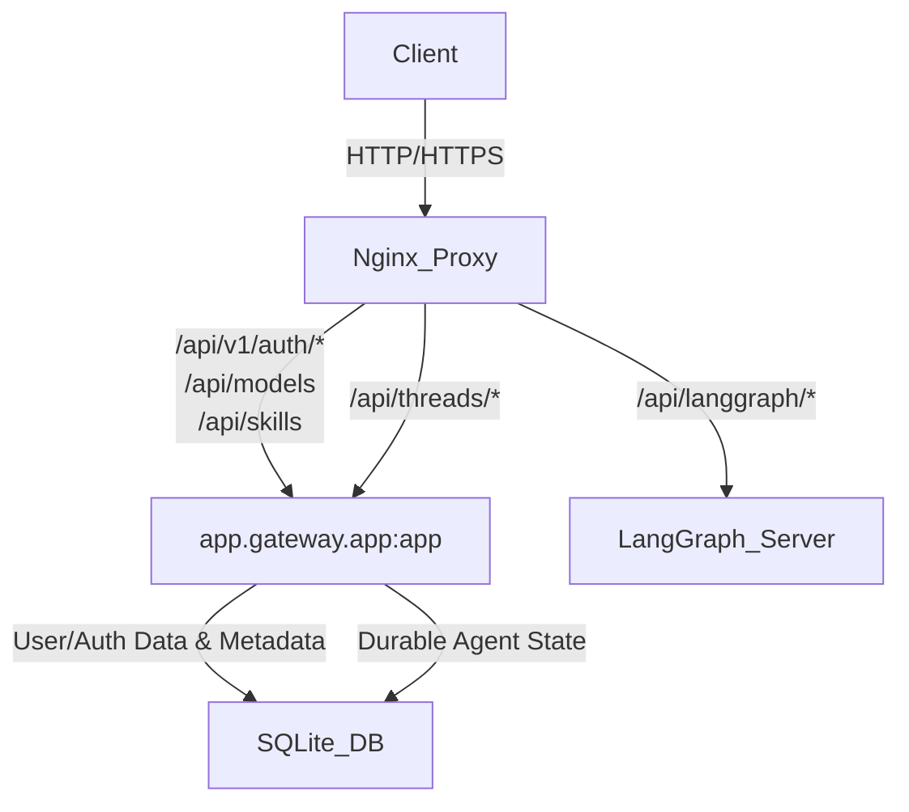
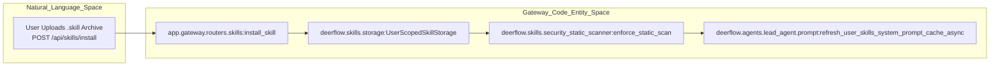

<!-- source: DeepWiki mcp.deepwiki.com · repo bytedance/deer-flow · page 5.1 API Gateway · fetched 2026-10-29 -->

# API Gateway

Relevant source files

The following files were used as context for generating this wiki page:

- [backend/app/gateway/app.py](backend/app/gateway/app.py)
- [backend/app/gateway/auth/errors.py](backend/app/gateway/auth/errors.py)
- [backend/app/gateway/auth/local_provider.py](backend/app/gateway/auth/local_provider.py)
- [backend/app/gateway/auth/models.py](backend/app/gateway/auth/models.py)
- [backend/app/gateway/auth/pat.py](backend/app/gateway/auth/pat.py)
- [backend/app/gateway/auth/repositories/base.py](backend/app/gateway/auth/repositories/base.py)
- [backend/app/gateway/auth/repositories/sqlite.py](backend/app/gateway/auth/repositories/sqlite.py)
- [backend/app/gateway/auth_disabled.py](backend/app/gateway/auth_disabled.py)
- [backend/app/gateway/auth_middleware.py](backend/app/gateway/auth_middleware.py)
- [backend/app/gateway/authz.py](backend/app/gateway/authz.py)
- [backend/app/gateway/csrf_middleware.py](backend/app/gateway/csrf_middleware.py)
- [backend/app/gateway/deps.py](backend/app/gateway/deps.py)
- [backend/app/gateway/langgraph_auth.py](backend/app/gateway/langgraph_auth.py)
- [backend/app/gateway/path_utils.py](backend/app/gateway/path_utils.py)
- [backend/app/gateway/routers/admin_users.py](backend/app/gateway/routers/admin_users.py)
- [backend/app/gateway/routers/artifacts.py](backend/app/gateway/routers/artifacts.py)
- [backend/app/gateway/routers/auth.py](backend/app/gateway/routers/auth.py)
- [backend/app/gateway/routers/runs.py](backend/app/gateway/routers/runs.py)
- [backend/docs/AUTH_DESIGN.md](backend/docs/AUTH_DESIGN.md)
- [backend/langgraph.json](backend/langgraph.json)
- [backend/packages/harness/deerflow/authz/__init__.py](backend/packages/harness/deerflow/authz/__init__.py)
- [backend/packages/harness/deerflow/authz/adapter.py](backend/packages/harness/deerflow/authz/adapter.py)
- [backend/packages/harness/deerflow/authz/provider.py](backend/packages/harness/deerflow/authz/provider.py)
- [backend/packages/harness/deerflow/authz/rbac.py](backend/packages/harness/deerflow/authz/rbac.py)
- [backend/packages/harness/deerflow/authz/runtime.py](backend/packages/harness/deerflow/authz/runtime.py)
- [backend/packages/harness/deerflow/authz/sandbox_authz.py](backend/packages/harness/deerflow/authz/sandbox_authz.py)
- [backend/packages/harness/deerflow/config/authorization_config.py](backend/packages/harness/deerflow/config/authorization_config.py)
- [backend/packages/harness/deerflow/config/reload_boundary.py](backend/packages/harness/deerflow/config/reload_boundary.py)
- [backend/packages/harness/deerflow/utils/text_detection.py](backend/packages/harness/deerflow/utils/text_detection.py)
- [backend/tests/blocking_io/test_artifacts_router.py](backend/tests/blocking_io/test_artifacts_router.py)
- [backend/tests/blocking_io/test_login_local_throttle.py](backend/tests/blocking_io/test_login_local_throttle.py)
- [backend/tests/blocking_io/test_sandbox_authorization.py](backend/tests/blocking_io/test_sandbox_authorization.py)
- [backend/tests/test_admin_users_router.py](backend/tests/test_admin_users_router.py)
- [backend/tests/test_artifacts_router.py](backend/tests/test_artifacts_router.py)
- [backend/tests/test_auth.py](backend/tests/test_auth.py)
- [backend/tests/test_auth_middleware.py](backend/tests/test_auth_middleware.py)
- [backend/tests/test_auth_type_system.py](backend/tests/test_auth_type_system.py)
- [backend/tests/test_authorization_provider.py](backend/tests/test_authorization_provider.py)
- [backend/tests/test_authorization_route_permissions.py](backend/tests/test_authorization_route_permissions.py)
- [backend/tests/test_authorization_runtime.py](backend/tests/test_authorization_runtime.py)
- [backend/tests/test_compose_auth_trusted_proxies.py](backend/tests/test_compose_auth_trusted_proxies.py)
- [backend/tests/test_ensure_admin.py](backend/tests/test_ensure_admin.py)
- [backend/tests/test_gateway_lifespan_shutdown.py](backend/tests/test_gateway_lifespan_shutdown.py)
- [backend/tests/test_gateway_run_drain_shutdown.py](backend/tests/test_gateway_run_drain_shutdown.py)
- [backend/tests/test_gateway_run_recovery.py](backend/tests/test_gateway_run_recovery.py)
- [backend/tests/test_initialize_admin.py](backend/tests/test_initialize_admin.py)
- [backend/tests/test_langgraph_auth.py](backend/tests/test_langgraph_auth.py)
- [backend/tests/test_langgraph_studio_routes.py](backend/tests/test_langgraph_studio_routes.py)
- [backend/tests/test_memory_storage_user_isolation.py](backend/tests/test_memory_storage_user_isolation.py)
- [backend/tests/test_memory_updater_user_isolation.py](backend/tests/test_memory_updater_user_isolation.py)
- [backend/tests/test_multi_worker_postgres_gate.py](backend/tests/test_multi_worker_postgres_gate.py)
- [backend/tests/test_personal_access_tokens_repository.py](backend/tests/test_personal_access_tokens_repository.py)
- [backend/tests/test_rbac_authorization_provider.py](backend/tests/test_rbac_authorization_provider.py)
- [backend/tests/test_run_event_store_pagination.py](backend/tests/test_run_event_store_pagination.py)
- [backend/tests/test_runs_api_endpoints.py](backend/tests/test_runs_api_endpoints.py)
- [backend/tests/test_sandbox_authorization.py](backend/tests/test_sandbox_authorization.py)
- [backend/tests/test_thread_run_messages_pagination.py](backend/tests/test_thread_run_messages_pagination.py)
- [backend/tests/test_thread_run_query_validation.py](backend/tests/test_thread_run_query_validation.py)
- [backend/tests/test_user_context.py](backend/tests/test_user_context.py)
- [deploy/helm/deer-flow/README.md](deploy/helm/deer-flow/README.md)
- [deploy/helm/deer-flow/templates/gateway-deployment.yaml](deploy/helm/deer-flow/templates/gateway-deployment.yaml)
- [deploy/helm/deer-flow/values.yaml](deploy/helm/deer-flow/values.yaml)
- [docs/plans/2026-07-10-pluggable-authorization-implementation-notes.md](docs/plans/2026-07-10-pluggable-authorization-implementation-notes.md)
- [docs/plans/2026-07-10-pluggable-authorization-rfc.md](docs/plans/2026-07-10-pluggable-authorization-rfc.md)
- [frontend/playwright.config.ts](frontend/playwright.config.ts)
- [frontend/src/app/(auth)/login/page.tsx](frontend/src/app/(auth)/login/page.tsx)
- [frontend/src/app/(auth)/setup/page.tsx](frontend/src/app/(auth)/setup/page.tsx)
- [frontend/src/core/auth/auth-disabled-user.ts](frontend/src/core/auth/auth-disabled-user.ts)
- [frontend/src/core/auth/server.ts](frontend/src/core/auth/server.ts)
- [frontend/src/core/auth/types.ts](frontend/src/core/auth/types.ts)

The API Gateway is a FastAPI-based HTTP service providing RESTful endpoints for DeerFlow’s administrative management, including models, skills, memory, artifacts, uploads, suggestions, user authentication, and personal access tokens (PATs). It serves as the central facade for frontend and external clients while separating operational agent execution, which is handled by the LangGraph Server. The Gateway enforces robust security with JWT sessions stored in HttpOnly cookies, CSRF protection, request tracing via correlation IDs, and supports flexible authorization through a pluggable `AuthorizationProvider` system.

---

## 1. Overview and Architecture

The Gateway API forms the management and user-facing control plane of DeerFlow. It differs from the LangGraph Server, which handles AI agent run execution. The Gateway FastAPI app listens on port `8001` and exposes health endpoints (`/health` and `/health/ready`) [backend/app/gateway/app.py:1-60](). Nginx routes incoming requests between the API Gateway, LangGraph Server, and static assets.

Every HTTP response from Gateway includes an `X-Trace-Id` header for distributed request correlation managed via trace middleware [backend/app/gateway/app.py:63-63]().

Sources:  
[backend/app/gateway/app.py:1-63]()

---

## 2. Authentication Architecture

DeerFlow Gateway uses a multi-mode authentication architecture that supports:

- **JWT Sessions and Secure Cookies**  
  The Gateway issues JWT access tokens embedding user ID and expiry. Tokens are signed with server secrets. Stored in `HttpOnly` cookies named `access_token`, tokens are extracted on every request by `AuthMiddleware` which populates the request context with the authenticated principal [backend/app/gateway/auth_middleware.py:1-170](). Session cookie duration is set according to a `remember_me` flag; cookies use secure attributes based on HTTPS and proxy headers.

- **CSRF Protection**  
  State-changing HTTP methods (`POST`, `PUT`, `DELETE`, `PATCH`) require a valid CSRF token delivered using a double-submit cookie approach managed by `CSRFMiddleware` [backend/app/gateway/csrf_middleware.py:1-181](). The CSRF token cookie is named `csrf_token`, paired with the `X-CSRF-Token` header. The middleware bypasses verification on safe methods, explicit authentication routes, and certain inbound webhooks [backend/app/gateway/csrf_middleware.py:41-62]().

- **Local User Authentication**  
  Enables email/password login with live reloading of rate limits (`auth.local.max_login_attempts`, `auth.local.lockout_seconds`) and rejects weak passwords using an in-memory blacklist [backend/app/gateway/routers/auth.py:64-128]().

- **SSO / OpenID Connect Integration**  
  Supports OIDC providers (Google, Azure, Okta, Keycloak) via Authorization Code flow with PKCE. User accounts are provisioned automatically on successful login callbacks [backend/app/gateway/routers/auth.py:24-38]().

- **Personal Access Tokens (PATs)**  
  Programmatic API access is provided through bearer tokens (`Authorization: Bearer dfp_...`). PATs are stored as SHA-256 digests only. Invalid tokens produce immediate `401 Unauthorized` responses with no fallback to cookie sessions.

Sources:  
[backend/app/gateway/auth_middleware.py:1-170](), [backend/app/gateway/csrf_middleware.py:1-181](), [backend/app/gateway/routers/auth.py:24-128]()

---

## 3. Pluggable AuthorizationProvider System

DeerFlow’s authorization system is abstracted by an interface allowing pluggable providers, providing flexible and fine-grained access control to all Gateway and agent operations.

- **Principal Object**  
  The `Principal` represents authenticated identity: user ID, role (`admin`, `user`, etc.), permissions, and other auth attributes.

- **Authorization Requests and Decisions**  
  The system uses `AuthzRequest` objects detailing the resource type, action, resource identifiers, and principal. Decisions (`ALLOW`, `DENY`) are calculated by the provider implementations [backend/app/gateway/authz.py:48-50]().

- **Runtime Provider Resolution**  
  The Gateway resolves an `AuthorizationProvider` instance from the configuration on startup or config reload. The resolved provider is cached per config snapshot for performance [backend/app/gateway/app.py:114-165]().

- **Router-Level Enforcement**  
  Route handlers use declarative decorators such as `@require_permission(resource, action)` which query the current principal’s authorization for the requested resource. Unauthorized attempts respond with standard HTTP errors [backend/app/gateway/authz.py:1-32]().

Sources:  
[backend/app/gateway/app.py:114-165](), [backend/app/gateway/authz.py:1-50]()

---

## 4. Gateway API Endpoints

### Models (`/api/models`)
- Returns a list of available models with metadata such as reasoning capabilities and token usage policies. Models are configured via declarative specs that the Gateway loads at startup [backend/app/gateway/app.py:24-62]().

### Skills (`/api/skills`)
- Lists, installs, and uninstalls skills. Skill installation processes `.skill` archives, validates frontmatter, runs static security scans, and places files into user-scoped skill storage [backend/app/gateway/app.py:24-62]().

### Memory (`/api/memory`)
- Returns long-term memory data, facts, and their confidence scores scoped per user. Supports clearing memory facts [backend/app/gateway/app.py:24-62]().

### Artifacts (`/api/artifacts`)
- Manages thread-scoped files accessed through virtualized paths. Supports atomic file edits with exclusive reservation locks (`reserve_artifact_write`), writing content via temporary files (`_replace_artifact_atomically`) that replace the original safely with `os.replace` [backend/app/gateway/routers/artifacts.py:44-164]().

### Uploads (`/api/uploads`)
- Supports multipart uploads including multiple files, enforcing quota limits on file count, single file sizes, and total request size. Stale partial uploads are cleaned up automatically [backend/app/gateway/app.py:24-62]().

### Suggestions (`/api/suggestions`)
- Provides dynamic generation of follow-up questions and prompt suggestions based on thread context, filtering out internal thinking blocks [backend/app/gateway/app.py:24-62]().

### Runs (`/api/runs`)
- Provides stateless execution and waiting endpoints (`/api/runs/stream`, `/api/runs/wait`) as well as run-scoped message pagination (`/api/runs/{run_id}/messages`) and feedback collection (`/api/runs/{run_id}/feedback`) [backend/app/gateway/routers/runs.py:40-150]().

Sources:  
[backend/app/gateway/app.py:24-62](), [backend/app/gateway/routers/artifacts.py:44-164](), [backend/app/gateway/routers/runs.py:40-150]()

---

## 5. Natural Language Space to Code Entity Space Bridges

### Bridge Diagram 1: Skill Installation & Security Scanning

Sources:  
[backend/app/gateway/app.py:24-62]()

### Bridge Diagram 2: Artifact Update & Atomic Replacement

```mermaid
graph LR
    subgraph "Natural_Language_Space"
        ClientUpdate["Client Updates File Content<br/>PUT /api/threads/{id}/artifacts/{path}"]
    end

    subgraph "Gateway_Code_Entity_Space"
        ArtifactsRouter["app.gateway.routers.artifacts:update_artifact"]
        ReserveWrite["app.gateway.routers.artifacts:reserve_artifact_write"]
        LoadArtifact["app.gateway.routers.artifacts:_load_editable_artifact"]
        AtomicReplace["app.gateway.routers.artifacts:_replace_artifact_atomically"]
        SandboxSync["app.gateway.routers.artifacts:_sync_artifact_to_sandbox"]
    end

    ClientUpdate --> ArtifactsRouter
    ArtifactsRouter --> ReserveWrite
    ReserveWrite --> LoadArtifact
    LoadArtifact --> AtomicReplace
    AtomicReplace --> SandboxSync
```

Sources:  
[backend/app/gateway/routers/artifacts.py:44-164]()

---

