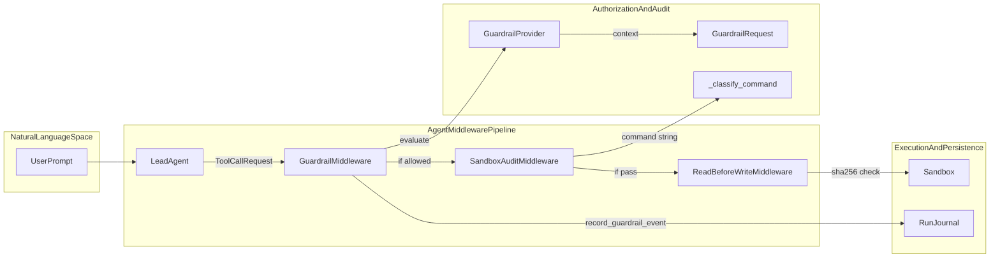
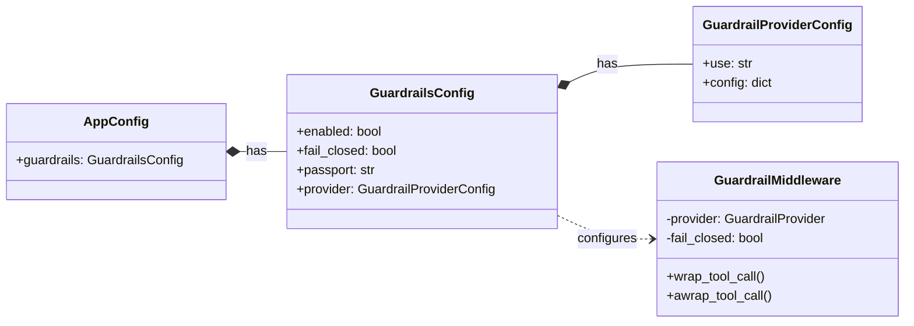
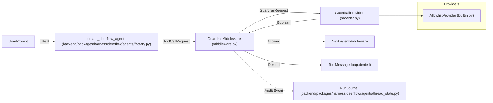
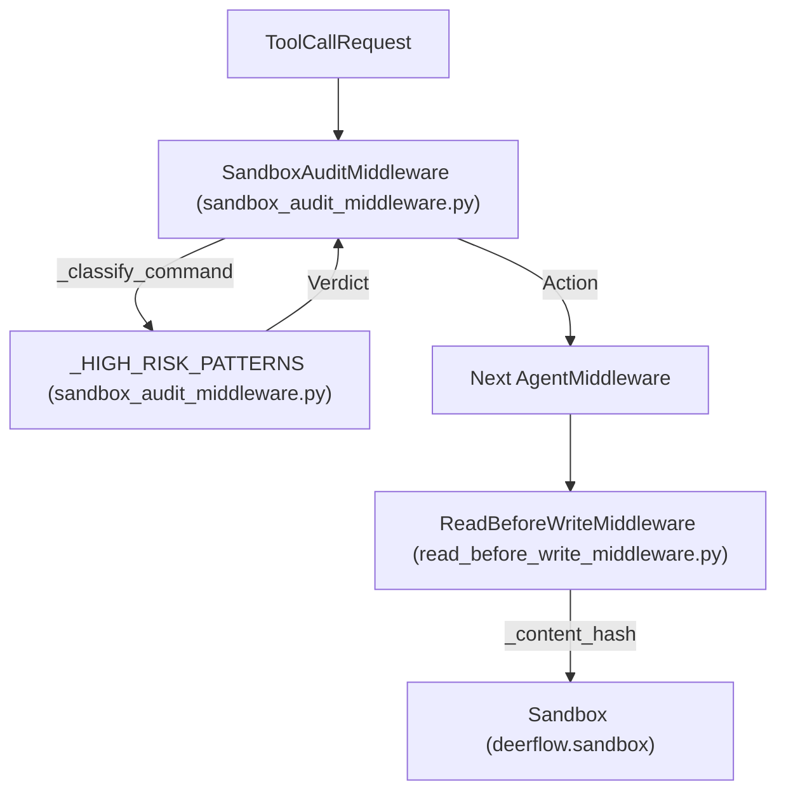

<!-- source: DeepWiki mcp.deepwiki.com · repo bytedance/deer-flow · page 5.10 Guardrails System · fetched 2026-10-29 -->

# Guardrails System

<details>
<summary>Relevant source files</summary>

The following files were used as context for generating this wiki page:

- [.github/copilot-instructions.md](.github/copilot-instructions.md)
- [backend/app/gateway/auth/pat.py](backend/app/gateway/auth/pat.py)
- [backend/app/gateway/authz.py](backend/app/gateway/authz.py)
- [backend/app/scheduler/notification_text.py](backend/app/scheduler/notification_text.py)
- [backend/packages/harness/deerflow/agents/middlewares/TOOL_OUTPUT_PERSISTENCE.md](backend/packages/harness/deerflow/agents/middlewares/TOOL_OUTPUT_PERSISTENCE.md)
- [backend/packages/harness/deerflow/agents/middlewares/read_before_write_middleware.py](backend/packages/harness/deerflow/agents/middlewares/read_before_write_middleware.py)
- [backend/packages/harness/deerflow/agents/middlewares/sandbox_audit_middleware.py](backend/packages/harness/deerflow/agents/middlewares/sandbox_audit_middleware.py)
- [backend/packages/harness/deerflow/agents/middlewares/tool_output_budget_middleware.py](backend/packages/harness/deerflow/agents/middlewares/tool_output_budget_middleware.py)
- [backend/packages/harness/deerflow/agents/middlewares/tool_output_synopsis.py](backend/packages/harness/deerflow/agents/middlewares/tool_output_synopsis.py)
- [backend/packages/harness/deerflow/authz/__init__.py](backend/packages/harness/deerflow/authz/__init__.py)
- [backend/packages/harness/deerflow/authz/adapter.py](backend/packages/harness/deerflow/authz/adapter.py)
- [backend/packages/harness/deerflow/authz/provider.py](backend/packages/harness/deerflow/authz/provider.py)
- [backend/packages/harness/deerflow/authz/rbac.py](backend/packages/harness/deerflow/authz/rbac.py)
- [backend/packages/harness/deerflow/authz/runtime.py](backend/packages/harness/deerflow/authz/runtime.py)
- [backend/packages/harness/deerflow/authz/sandbox_authz.py](backend/packages/harness/deerflow/authz/sandbox_authz.py)
- [backend/packages/harness/deerflow/config/authorization_config.py](backend/packages/harness/deerflow/config/authorization_config.py)
- [backend/packages/harness/deerflow/config/tool_output_config.py](backend/packages/harness/deerflow/config/tool_output_config.py)
- [backend/packages/harness/deerflow/sandbox/read_file_contract.py](backend/packages/harness/deerflow/sandbox/read_file_contract.py)
- [backend/packages/harness/deerflow/skills/AGENTS.md](backend/packages/harness/deerflow/skills/AGENTS.md)
- [backend/packages/harness/deerflow/skills/installer.py](backend/packages/harness/deerflow/skills/installer.py)
- [backend/packages/harness/deerflow/skills/skillscan/orchestrator.py](backend/packages/harness/deerflow/skills/skillscan/orchestrator.py)
- [backend/packages/harness/deerflow/skills/storage/local_skill_storage.py](backend/packages/harness/deerflow/skills/storage/local_skill_storage.py)
- [backend/packages/harness/deerflow/skills/storage/skill_storage.py](backend/packages/harness/deerflow/skills/storage/skill_storage.py)
- [backend/packages/harness/deerflow/skills/storage/user_scoped_skill_storage.py](backend/packages/harness/deerflow/skills/storage/user_scoped_skill_storage.py)
- [backend/tests/blocking_io/test_sandbox_authorization.py](backend/tests/blocking_io/test_sandbox_authorization.py)
- [backend/tests/blocking_io/test_skills_install.py](backend/tests/blocking_io/test_skills_install.py)
- [backend/tests/test_authorization_provider.py](backend/tests/test_authorization_provider.py)
- [backend/tests/test_authorization_route_permissions.py](backend/tests/test_authorization_route_permissions.py)
- [backend/tests/test_authorization_runtime.py](backend/tests/test_authorization_runtime.py)
- [backend/tests/test_client_e2e.py](backend/tests/test_client_e2e.py)
- [backend/tests/test_externalize_failure_cleanup.py](backend/tests/test_externalize_failure_cleanup.py)
- [backend/tests/test_notification_text.py](backend/tests/test_notification_text.py)
- [backend/tests/test_personal_access_tokens_repository.py](backend/tests/test_personal_access_tokens_repository.py)
- [backend/tests/test_rbac_authorization_provider.py](backend/tests/test_rbac_authorization_provider.py)
- [backend/tests/test_read_before_write_cancellation.py](backend/tests/test_read_before_write_cancellation.py)
- [backend/tests/test_read_before_write_coordination.py](backend/tests/test_read_before_write_coordination.py)
- [backend/tests/test_read_before_write_middleware.py](backend/tests/test_read_before_write_middleware.py)
- [backend/tests/test_remote_read_file_line_numbers.py](backend/tests/test_remote_read_file_line_numbers.py)
- [backend/tests/test_sandbox_audit_middleware.py](backend/tests/test_sandbox_audit_middleware.py)
- [backend/tests/test_sandbox_authorization.py](backend/tests/test_sandbox_authorization.py)
- [backend/tests/test_skill_history_jsonl.py](backend/tests/test_skill_history_jsonl.py)
- [backend/tests/test_skills_installer.py](backend/tests/test_skills_installer.py)
- [backend/tests/test_skillscan_fork_bomb.py](backend/tests/test_skillscan_fork_bomb.py)
- [backend/tests/test_skillscan_native.py](backend/tests/test_skillscan_native.py)
- [backend/tests/test_tool_output_budget_middleware.py](backend/tests/test_tool_output_budget_middleware.py)
- [backend/tests/test_tool_output_config_limits.py](backend/tests/test_tool_output_config_limits.py)
- [backend/tests/test_tool_output_externalized_filename.py](backend/tests/test_tool_output_externalized_filename.py)
- [backend/tests/test_tool_output_synopsis_budget.py](backend/tests/test_tool_output_synopsis_budget.py)
- [backend/tests/test_user_scoped_skill_storage.py](backend/tests/test_user_scoped_skill_storage.py)
- [docs/plans/2026-07-10-pluggable-authorization-implementation-notes.md](docs/plans/2026-07-10-pluggable-authorization-implementation-notes.md)
- [docs/plans/2026-07-10-pluggable-authorization-rfc.md](docs/plans/2026-07-10-pluggable-authorization-rfc.md)

</details>


The purpose of this page is to document the pre-tool-call authorization and security layer in DeerFlow, known as the Guardrails System. This system intercepts agent tool invocations, validates them against pluggable authorization providers, audits shell commands for security risks, and enforces strict data integrity rules like the read-before-write version gate.

---

## 1. Overview and Implementation

Guardrails operate primarily as middleware within the agent's tool execution pipeline. Tool call requests flow through one or more middleware layers that inspect, authorize, and audit them before actual execution. The system employs a *fail-closed* approach where authorization evaluation errors or provider failures block tool execution by default unless explicitly configured otherwise.

The core components include:
- **GuardrailMiddleware**: Intercepts every tool call request; invokes the configured `GuardrailProvider`, enforces allow/deny policies with fail-closed behavior, and records guardrail events in the run journal. Implements both synchronous and asynchronous interception points [backend/packages/harness/deerflow/guardrails/middleware.py:25-105]().
- **GuardrailProvider**: An abstract protocol interface implemented by pluggable providers that evaluate tool calls against authorization policies with contextual runtime identity (user, agent, OAuth, run ID) [backend/packages/harness/deerflow/guardrails/provider.py:52-68]().
- **AllowlistProvider**: A built-in static allow/deny provider that accepts explicit lists of allowed or denied tool names. This zero-dependency provider enforces simple tool call policies without any external dependencies [backend/packages/harness/deerflow/guardrails/builtin.py:6-19]().
- **SandboxAuditMiddleware**: Inspects `bash` tool invocations and classifies command strings into risk tiers using regex-based patterns. It can block or warn about dangerous commands like destructive file operations, command substitutions that execute fetched content, and network exfiltration attempts [backend/packages/harness/deerflow/agents/middlewares/sandbox_audit_middleware.py:1-143]().
- **ReadBeforeWriteMiddleware**: Implements a deterministic version gate protecting file-modifying tools (`write_file`, `str_replace`) by requiring an earlier read of the file's current content. Uses thread-safe locking to serialize gate checks and stamps read version hashes in tool messages for integrity [backend/packages/harness/deerflow/agents/middlewares/read_before_write_middleware.py:1-157]().

### Key Components Table

| Component | Description | Code Entity |
|---|---|---|
| GuardrailMiddleware | Core middleware enforcing guardrail policies, gatekeeper on tool calls. | `GuardrailMiddleware` [backend/packages/harness/deerflow/guardrails/middleware.py:25-36]() |
| GuardrailProvider | Interface protocol for synchronous/asynchronous tool call evaluation. | `GuardrailProvider` [backend/packages/harness/deerflow/guardrails/provider.py:52-68]() |
| GuardrailRequest | Encapsulates user and tool call context fields for policy evaluation. | `GuardrailRequest` [backend/packages/harness/deerflow/guardrails/provider.py:9-31]() |
| AllowlistProvider | Built-in static allow/deny list tool authorization. | `AllowlistProvider` [backend/packages/harness/deerflow/guardrails/builtin.py:6-19]() |
| SandboxAuditMiddleware | Regex-based security audit of bash commands to classify and block risks. | `SandboxAuditMiddleware` [backend/packages/harness/deerflow/agents/middlewares/sandbox_audit_middleware.py:1-143]() |
| ReadBeforeWriteMiddleware | Enforces read-before-write file version gate for file-modifying tools. | `ReadBeforeWriteMiddleware` [backend/packages/harness/deerflow/agents/middlewares/read_before_write_middleware.py:1-157]() |

Sources:
- [backend/packages/harness/deerflow/guardrails/middleware.py:25-105]()
- [backend/packages/harness/deerflow/guardrails/provider.py:9-68]()
- [backend/packages/harness/deerflow/guardrails/builtin.py:6-19]()
- [backend/packages/harness/deerflow/agents/middlewares/sandbox_audit_middleware.py:1-143]()
- [backend/packages/harness/deerflow/agents/middlewares/read_before_write_middleware.py:1-157]()

---

## 2. Data Flow and Interaction Diagram

### Guardrails Security and Authorization Pipeline



Sources:
- [backend/packages/harness/deerflow/guardrails/middleware.py:25-105]()
- [backend/packages/harness/deerflow/agents/middlewares/sandbox_audit_middleware.py:1-143]()
- [backend/packages/harness/deerflow/agents/middlewares/read_before_write_middleware.py:1-157]()

---

## 3. GuardrailProvider and GuardrailRequest

`GuardrailProvider` defines the contract for authorization evaluation of tool calls. It requires:

- `evaluate(request: GuardrailRequest) -> GuardrailDecision`: Synchronous evaluation that returns a decision to allow or deny the tool call.
- `aevaluate(request: GuardrailRequest) -> Awaitable[GuardrailDecision]`: Asynchronous evaluation supporting event-loop compatible call patterns [backend/packages/harness/deerflow/guardrails/provider.py:52-68]().

`GuardrailRequest` encapsulates detailed context used in policy evaluation, including `user_id`, `user_role`, `oauth_provider`, `oauth_id`, `run_id`, `tool_call_id`, `agent_id`, `tool_name`, `tool_input`, and `authz_attributes` [backend/packages/harness/deerflow/guardrails/provider.py:9-31]().

Sources:
- [backend/packages/harness/deerflow/guardrails/provider.py:9-68]()

---

## 4. GuardrailMiddleware and Fail-Closed Behavior

`GuardrailMiddleware` intercepts tool call requests using `wrap_tool_call` and `awrap_tool_call` hooks [backend/packages/harness/deerflow/guardrails/middleware.py:25-37]():
1. Extracts runtime identity and authorization context.
2. Constructs a `GuardrailRequest`.
3. Calls the configured `GuardrailProvider`.
4. If allowed, passes the request forward. If denied, returns a `ToolMessage` with a guardrail denial error.
5. **Fail-Closed**: If evaluation raises an exception and `fail_closed` is `True` (default), blocks the tool call. If `fail_closed` is `False`, logs the error and allows the call [backend/packages/harness/deerflow/guardrails/middleware.py:50-95]().

Sources:
- [backend/packages/harness/deerflow/guardrails/middleware.py:25-105]()

---

## 5. AllowlistProvider

`AllowlistProvider` enforces static allow and deny lists of tool names without external dependencies [backend/packages/harness/deerflow/guardrails/builtin.py:6-19](). Example configuration:

```yaml
guardrails:
  enabled: true
  provider:
    use: deerflow.guardrails.builtin:AllowlistProvider
    config:
      denied_tools: ["bash", "write_file"]
```

Sources:
- [backend/packages/harness/deerflow/guardrails/builtin.py:6-19]()

---

## 6. SandboxAuditMiddleware

`SandboxAuditMiddleware` audits `bash` tool invocations by examining the `command` argument, splitting compound commands, and classifying each command string as `"block"`, `"warn"`, or `"pass"` using regex patterns [backend/packages/harness/deerflow/agents/middlewares/sandbox_audit_middleware.py:50-115](). High-risk commands are blocked immediately with an error `ToolMessage`.

Sources:
- [backend/packages/harness/deerflow/agents/middlewares/sandbox_audit_middleware.py:1-143]()

---

## 7. ReadBeforeWriteMiddleware

`ReadBeforeWriteMiddleware` enforces a deterministic gate on file-modifying tools (`write_file`, `str_replace`) requiring an earlier `read_file` of the file's current version [backend/packages/harness/deerflow/agents/middlewares/read_before_write_middleware.py:1-157](). 
- Stamps `deerflow_read_mark` on successful reads containing the SHA256 hash of the content.
- Uses thread-safe per-(scope, path) locks to serialize checks.
- Elides payload arguments in model requests when blocked to prevent prompt bloat.

Sources:
- [backend/packages/harness/deerflow/agents/middlewares/read_before_write_middleware.py:1-157]()

---

## 8. Configuration

Guardrails configuration is managed under `AppConfig.guardrails` [backend/packages/harness/deerflow/config/guardrails_config.py:6-24]().

### Guardrails Configuration Class Diagram



Sources:
- [backend/packages/harness/deerflow/config/guardrails_config.py:6-24]()
- [backend/packages/harness/deerflow/config/app_config.py:10-24]()

---

## 9. Natural Language Space to Code Entity Space Mappings

### 1. Guardrails Authorization Path



Sources:
- [backend/packages/harness/deerflow/guardrails/middleware.py:25-105]()
- [backend/packages/harness/deerflow/guardrails/builtin.py:6-19]()

### 2. Bash Command Security Evaluation



Sources:
- [backend/packages/harness/deerflow/agents/middlewares/sandbox_audit_middleware.py:1-143]()
- [backend/packages/harness/deerflow/agents/middlewares/read_before_write_middleware.py:1-157]()

---

