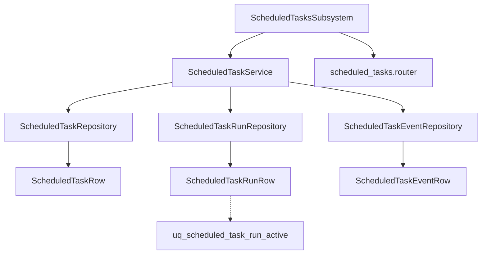
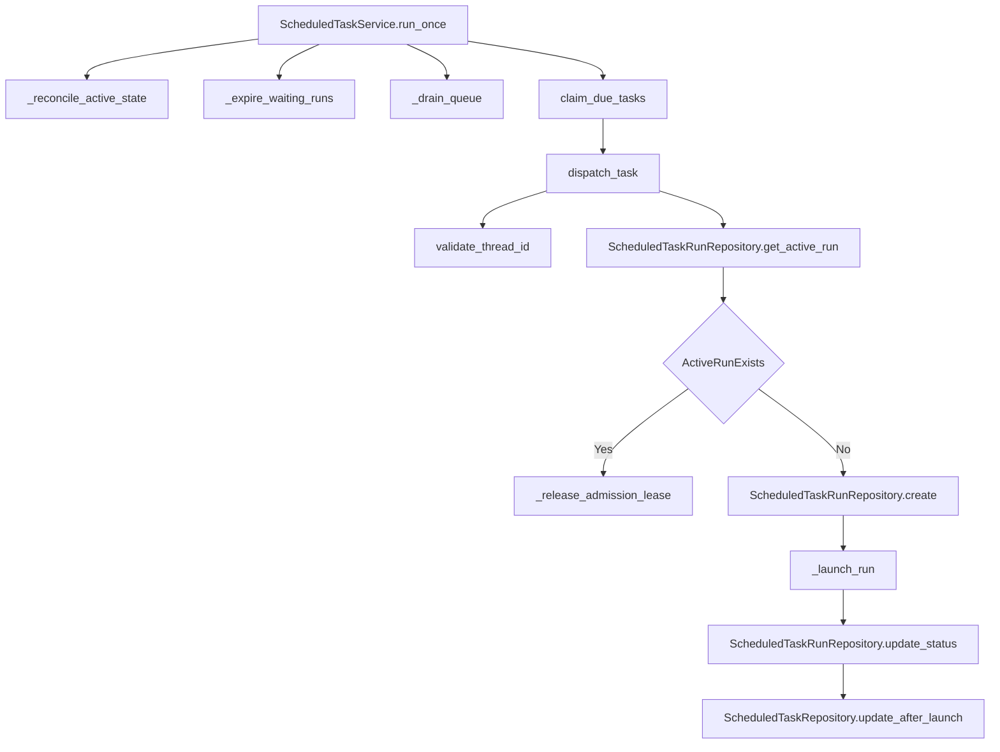
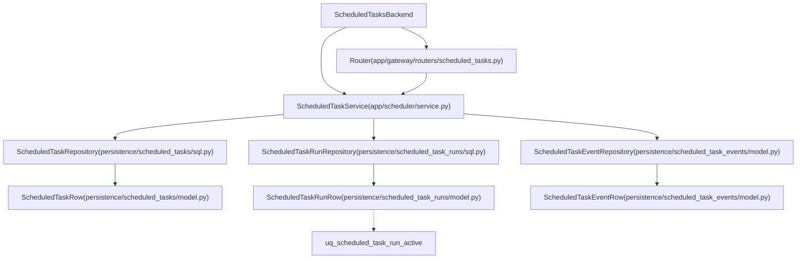
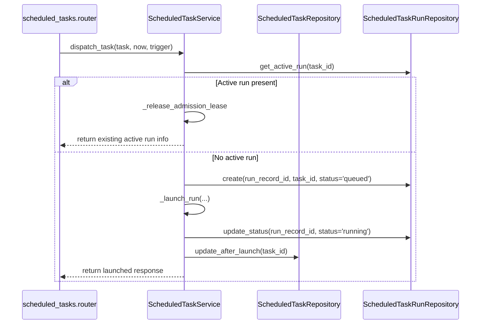

<!-- source: DeepWiki mcp.deepwiki.com · repo bytedance/deer-flow · page 5.11 Scheduled Tasks Backend · fetched 2026-10-29 -->

# Scheduled Tasks Backend

Relevant source files

The following files were used as context for generating this wiki page:

- [backend/app/channels/capabilities.py](backend/app/channels/capabilities.py)
- [backend/app/gateway/routers/channel_connections.py](backend/app/gateway/routers/channel_connections.py)
- [backend/app/scheduler/notification_delivery.py](backend/app/scheduler/notification_delivery.py)
- [backend/app/scheduler/service.py](backend/app/scheduler/service.py)
- [backend/packages/harness/deerflow/persistence/scheduled_task_runs/finalization.py](backend/packages/harness/deerflow/persistence/scheduled_task_runs/finalization.py)
- [backend/packages/harness/deerflow/persistence/scheduled_task_runs/projection.py](backend/packages/harness/deerflow/persistence/scheduled_task_runs/projection.py)
- [backend/packages/harness/deerflow/persistence/scheduled_task_runs/sql.py](backend/packages/harness/deerflow/persistence/scheduled_task_runs/sql.py)
- [backend/packages/harness/deerflow/persistence/scheduled_tasks/model.py](backend/packages/harness/deerflow/persistence/scheduled_tasks/model.py)
- [backend/packages/harness/deerflow/persistence/scheduled_tasks/sql.py](backend/packages/harness/deerflow/persistence/scheduled_tasks/sql.py)
- [backend/tests/test_channel_capabilities.py](backend/tests/test_channel_capabilities.py)
- [backend/tests/test_channel_connections_router.py](backend/tests/test_channel_connections_router.py)
- [backend/tests/test_feishu_notifications.py](backend/tests/test_feishu_notifications.py)
- [backend/tests/test_notification_delivery_worker.py](backend/tests/test_notification_delivery_worker.py)
- [backend/tests/test_scheduled_task_dispatch_race.py](backend/tests/test_scheduled_task_dispatch_race.py)
- [backend/tests/test_scheduled_task_repository.py](backend/tests/test_scheduled_task_repository.py)
- [backend/tests/test_scheduled_task_service.py](backend/tests/test_scheduled_task_service.py)
- [backend/tests/test_scheduler_manual_once_trial.py](backend/tests/test_scheduler_manual_once_trial.py)
- [backend/tests/test_scheduler_occurrence_ordering.py](backend/tests/test_scheduler_occurrence_ordering.py)

## Purpose and Scope

This page documents the backend implementation of scheduled tasks in DeerFlow. It covers the `ScheduledTaskService` class which manages scheduling, claiming, and dispatching tasks based on once or cron schedules. It explains context modes for thread reuse, lease-based multi-instance coordination, execution concurrency control, per-owner run budgets, reactivation choke points, manual triggering, run history, event tracking (`scheduled_task_events`), REST API exposure, scheduler configuration, and persistence schema migrations.

Sources: [backend/app/scheduler/service.py:1-41](), [backend/packages/harness/deerflow/persistence/scheduled_tasks/sql.py:86-116]()

---

## System Architecture

The scheduled task backend is composed around several key components and data layers:

- **`ScheduledTaskService`**: Core scheduler service that periodically polls for due tasks, applies concurrency limits, manages leases, and dispatches new runs [backend/app/scheduler/service.py:1-41]().
- **Repositories for persistent storage**:
    - `ScheduledTaskRepository`: Provides CRUD, task-claiming, and single reactivation choke points (`ScheduledTaskRepository.update`) [backend/packages/harness/deerflow/persistence/scheduled_tasks/sql.py:86-116]().
    - `ScheduledTaskRunRepository`: Tracks individual run occurrences, statuses, leases, execution attempts, and owner-fair FIFO queue draining (`list_queued_runs`) [backend/packages/harness/deerflow/persistence/scheduled_task_runs/sql.py:149-174]().
    - `ScheduledTaskEventRepository`: Records transition audit events into `scheduled_task_events` [backend/packages/harness/deerflow/persistence/scheduled_task_events/model.py:1-25]().
- **Persistence Models**:
    - `ScheduledTaskRow`: ORM model describing scheduled tasks [backend/packages/harness/deerflow/persistence/scheduled_tasks/model.py:12-43]().
    - `ScheduledTaskRunRow`: ORM model tracking each execution occurrence [backend/packages/harness/deerflow/persistence/scheduled_task_runs/model.py:11-54]().
- **REST API via FastAPI Gateway Router**: Exposes endpoints for managing tasks and manually triggering runs [backend/app/gateway/routers/scheduled_tasks.py:34-115]().

### Components Diagram

Sources: [backend/app/scheduler/service.py:1-41](), [backend/packages/harness/deerflow/persistence/scheduled_tasks/sql.py:57-66](), [backend/packages/harness/deerflow/persistence/scheduled_task_runs/sql.py:59-68](), [backend/app/gateway/routers/scheduled_tasks.py:34-115]()

---

## ScheduledTaskService Implementation and Dispatch Loop

The `ScheduledTaskService` class drives core scheduling execution. It executes periodic polling cycles that reconcile leases, expire waiting runs, drain queued occurrences via owner-fair ranking, and claim due tasks under global and per-owner concurrency caps [backend/app/scheduler/service.py:1-163]().

### Initialization Parameters & Queued Run Draining
- `list_queued_runs` ranks same-thread FIFO heads per owner using partition logic so the drain remains owner-fair even when global caps are disabled [backend/packages/harness/deerflow/persistence/scheduled_task_runs/sql.py:103-124]().
- The per-owner run cap evaluates as `min(per_user, max_concurrent_runs)` (where 0 disables it) and is checked inside `claim_queued_run` right after the global count under the same budget lock [backend/packages/harness/deerflow/persistence/scheduled_task_runs/sql.py:28-30]().

### Dispatch Flow Diagram

Sources: [backend/app/scheduler/service.py:1-163](), [backend/packages/harness/deerflow/persistence/scheduled_task_runs/sql.py:146-174]()

---

## Schedule Types, Context Modes, and Reactivation Rules

### Schedule Types and Context Modes
- **`once`**: Single occurrence at `run_at`. Terminal mappings use `ONCE_TASK_STATUS_BY_RUN_STATUS` [backend/packages/harness/deerflow/persistence/scheduled_tasks/model.py:78-83]().
- **`cron`**: Repeated execution per cron expression.
- **`context_mode`**: Either `reuse_thread` (persistent thread ID) or `fresh_thread_per_run` (unique UUID per execution) [backend/packages/harness/deerflow/persistence/scheduled_tasks/model.py:12-43]().

### Reactivation Choke Points and Limits
`ScheduledTaskRepository.update` acts as the single reactivation choke point [backend/packages/harness/deerflow/persistence/scheduled_tasks/sql.py:86-116]():
- Any transition from non-enabled to `status = "enabled"` re-checks termination conditions after applying renewal fields and raises `ScheduledTaskLimitsExhausted` if safety caps are met [backend/packages/harness/deerflow/persistence/scheduled_tasks/sql.py:32-45]().
- User-created task quota is capped at 20 live conversation-created scheduled tasks per user, enforced via `ScheduledTaskRepository._check_owner_quota` raising `ScheduledTaskQuotaExceeded` [backend/packages/harness/deerflow/persistence/scheduled_tasks/sql.py:25-30,127-130]().

Sources: [backend/packages/harness/deerflow/persistence/scheduled_tasks/sql.py:25-45,127-130]()

---

## Lease-Based Task Claiming and Multi-Instance Coordination

Multiple gateway instances coordinate task executions by obtaining leases for ownership [backend/packages/harness/deerflow/persistence/scheduled_tasks/sql.py:160-182]() via `lease_owner` and `lease_expires_at` fields. 
- Recovery locks task/run pairs in task-id/run-id order and restores `run_id`, `started_at`, and live errors before releasing launch claims [backend/packages/harness/deerflow/persistence/scheduled_task_runs/sql.py:149-174]().
- Launch/failure/timeout updates use a single parent-first transaction to prevent interleaved claims [backend/packages/harness/deerflow/persistence/scheduled_tasks/sql.py:86-116]().

Sources: [backend/packages/harness/deerflow/persistence/scheduled_tasks/sql.py:160-182](), [backend/packages/harness/deerflow/persistence/scheduled_task_runs/sql.py:149-174]()

---

## Run Lifecycle, Concurrency Control, and Uniqueness Constraints

- Run statuses: `queued`, `launching`, `running` (active) and terminal states `success`, `failed`, `skipped`, `interrupted` [backend/packages/harness/deerflow/persistence/scheduled_task_runs/model.py:11-54]().
- The unique partial index `uq_scheduled_task_run_active` on `task_id` where status is active prevents more than one active occurrence per task [backend/packages/harness/deerflow/persistence/scheduled_tasks/sql.py:23-28]().
- Mutations enforce transactional checks raising `ActiveScheduledTaskMutationConflict` if an active run exists [backend/packages/harness/deerflow/persistence/scheduled_tasks/sql.py:47-53]().

Sources: [backend/packages/harness/deerflow/persistence/scheduled_tasks/sql.py:23-53](), [backend/packages/harness/deerflow/persistence/scheduled_task_runs/model.py:11-54]()

---

## Manual Triggering, REST API, and Validation

The FastAPI gateway router exposes endpoints under `/api/scheduled-tasks` [backend/app/gateway/routers/scheduled_tasks.py:34-115](). REST and capability validation share validation helpers conforming to structured error contracts [backend/app/gateway/routers/scheduled_tasks.py:34-176]().

Sources: [backend/app/gateway/routers/scheduled_tasks.py:34-176]()

---

## Run History, Event Tracking, and Persistence Migrations

- The `scheduled_task_events` table logs lifecycle transition events [backend/tests/test_migration_0032_activity_and_task_events.py:1-32]().
- Migrations chain from baseline handling additive columns and outbox models idempotently via bootstrap routines [backend/packages/harness/deerflow/persistence/scheduled_tasks/sql.py:86-116]().

Sources: [backend/tests/test_migration_0032_activity_and_task_events.py:1-32]()

---

## Natural Language to Code Entity Mapping

### 1. Overview Entity Map

Sources: [backend/app/scheduler/service.py:1-41](), [backend/app/gateway/routers/scheduled_tasks.py:34-115](), [backend/packages/harness/deerflow/persistence/scheduled_tasks/sql.py:86-116](), [backend/packages/harness/deerflow/persistence/scheduled_task_runs/sql.py:149-174]()

### 2. Dispatch Task Flow (Manual or Scheduled Trigger)

Sources: [backend/app/scheduler/service.py:1-163](), [backend/packages/harness/deerflow/persistence/scheduled_task_runs/sql.py:146-174](), [backend/app/gateway/routers/scheduled_tasks.py:34-115]()

# END OF PAGE

---

