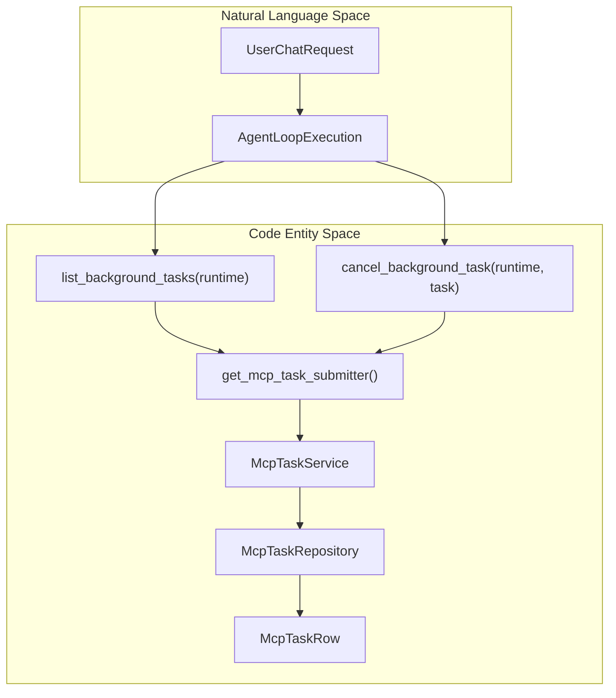
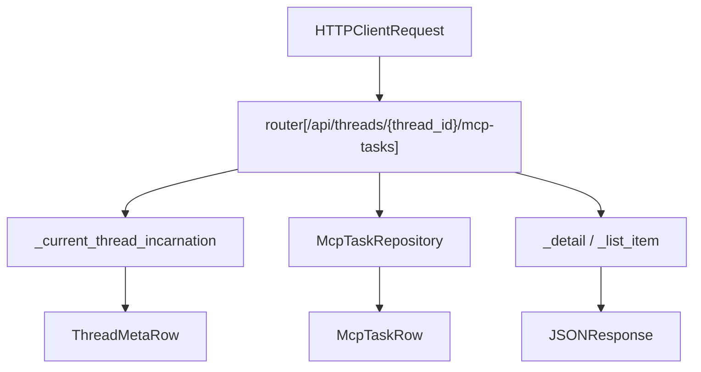
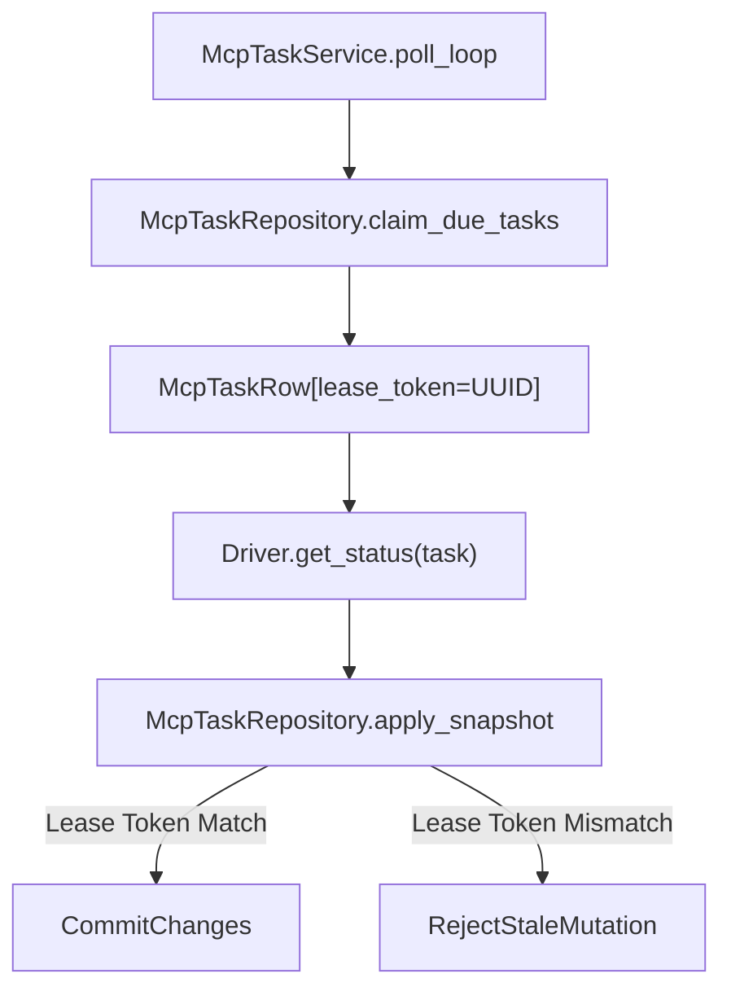

<!-- source: DeepWiki mcp.deepwiki.com · repo bytedance/deer-flow · page 5.12 MCP Background Tasks and Personal MCP · fetched 2026-10-29 -->

# MCP Background Tasks and Personal MCP

Relevant source files

The following files were used as context for generating this wiki page:

- [backend/app/gateway/routers/mcp_tasks.py](backend/app/gateway/routers/mcp_tasks.py)
- [backend/app/mcp_tasks/service.py](backend/app/mcp_tasks/service.py)
- [backend/packages/harness/deerflow/mcp/AGENTS.md](backend/packages/harness/deerflow/mcp/AGENTS.md)
- [backend/packages/harness/deerflow/mcp/cache.py](backend/packages/harness/deerflow/mcp/cache.py)
- [backend/packages/harness/deerflow/mcp/session_pool.py](backend/packages/harness/deerflow/mcp/session_pool.py)
- [backend/packages/harness/deerflow/mcp/task_tool_caller.py](backend/packages/harness/deerflow/mcp/task_tool_caller.py)
- [backend/packages/harness/deerflow/mcp/tasks/ordinary.py](backend/packages/harness/deerflow/mcp/tasks/ordinary.py)
- [backend/packages/harness/deerflow/mcp/tasks/runtime.py](backend/packages/harness/deerflow/mcp/tasks/runtime.py)
- [backend/packages/harness/deerflow/mcp/tools.py](backend/packages/harness/deerflow/mcp/tools.py)
- [backend/packages/harness/deerflow/persistence/mcp_tasks/model.py](backend/packages/harness/deerflow/persistence/mcp_tasks/model.py)
- [backend/packages/harness/deerflow/persistence/mcp_tasks/sql.py](backend/packages/harness/deerflow/persistence/mcp_tasks/sql.py)
- [backend/packages/harness/deerflow/persistence/migrations/versions/0026_mcp_task_lease_tokens.py](backend/packages/harness/deerflow/persistence/migrations/versions/0026_mcp_task_lease_tokens.py)
- [backend/packages/harness/deerflow/tools/builtins/background_tasks_tool.py](backend/packages/harness/deerflow/tools/builtins/background_tasks_tool.py)
- [backend/tests/test_background_task_status_filter.py](backend/tests/test_background_task_status_filter.py)
- [backend/tests/test_mcp_binding_fencing.py](backend/tests/test_mcp_binding_fencing.py)
- [backend/tests/test_mcp_cache.py](backend/tests/test_mcp_cache.py)
- [backend/tests/test_mcp_cache_discovery.py](backend/tests/test_mcp_cache_discovery.py)
- [backend/tests/test_mcp_cache_reconciliation.py](backend/tests/test_mcp_cache_reconciliation.py)
- [backend/tests/test_mcp_file_migration.py](backend/tests/test_mcp_file_migration.py)
- [backend/tests/test_mcp_lifecycle_invalid.py](backend/tests/test_mcp_lifecycle_invalid.py)
- [backend/tests/test_mcp_session_pool.py](backend/tests/test_mcp_session_pool.py)
- [backend/tests/test_mcp_session_pool_active_calls.py](backend/tests/test_mcp_session_pool_active_calls.py)
- [backend/tests/test_mcp_session_pool_loop_isolation.py](backend/tests/test_mcp_session_pool_loop_isolation.py)
- [backend/tests/test_mcp_task_ordinary_driver.py](backend/tests/test_mcp_task_ordinary_driver.py)
- [backend/tests/test_mcp_task_postgres.py](backend/tests/test_mcp_task_postgres.py)
- [backend/tests/test_mcp_task_repository.py](backend/tests/test_mcp_task_repository.py)
- [backend/tests/test_mcp_task_service.py](backend/tests/test_mcp_task_service.py)
- [backend/tests/test_mcp_task_tool_caller.py](backend/tests/test_mcp_task_tool_caller.py)
- [backend/tests/test_mcp_tasks_router.py](backend/tests/test_mcp_tasks_router.py)

## Purpose and Scope
This document details the architecture and implementation of DeerFlow's durable Model Context Protocol (MCP) background task service, its thread-scoped API gateway router, lease-based task execution tracking, natural-language tool integrations, and user-scoped Personal MCP network configurations.

Sources:
- `backend/app/mcp_tasks/service.py` [backend/app/mcp_tasks/service.py:1-]
- `backend/app/gateway/routers/mcp_tasks.py` [backend/app/gateway/routers/mcp_tasks.py:1-]
- `backend/packages/harness/deerflow/tools/builtins/background_tasks_tool.py` [backend/packages/harness/deerflow/tools/builtins/background_tasks_tool.py:1-]

---

## 1. Long-Running MCP Task Service (`McpTaskService`)
The `McpTaskService` class (`backend/app/mcp_tasks/service.py`) manages the lifecycle of asynchronous, long-running MCP tasks outside the direct synchronous LangGraph agent execution loop. It interacts with remote task drivers via a registry (`McpTaskDriverRegistry`), claims due tasks using lease tokens, coordinates background polling intervals with exponential backoffs, and handles user cancellation requests safely.

Sources:
- `backend/app/mcp_tasks/service.py` [backend/app/mcp_tasks/service.py:93-132]
- `backend/packages/harness/deerflow/tools/builtins/background_tasks_tool.py` [backend/packages/harness/deerflow/tools/builtins/background_tasks_tool.py:51-92]

---

## 2. API Gateway Router (`mcp_tasks`)
The FastAPI router defined in `backend/app/gateway/routers/mcp_tasks.py` exposes a thread-scoped REST API under `/api/threads/{thread_id}/mcp-tasks`. It provides endpoints to list durable background tasks, inspect detailed execution states, and trigger task cancellations. 

Key validation checks include thread incarnation verification via `_current_thread_incarnation` to prevent cross-incarnation data corruption, and error payload truncation via `_short_error` to prevent internal leakage of raw remote driver handles.

Sources:
- `backend/app/gateway/routers/mcp_tasks.py` [backend/app/gateway/routers/mcp_tasks.py:15-174]
- `backend/packages/harness/deerflow/persistence/mcp_tasks/sql.py` [backend/packages/harness/deerflow/persistence/mcp_tasks/sql.py:104-160]

---

## 3. Lease Tokens and Database Persistence
Durable task states are stored using `McpTaskRepository` backed by SQLAlchemy models (`McpTaskRow`). Workers acquire exclusive execution rights on tasks via lease tokens (`lease_token`, `notification_lease_token`) and unique lease owners. 

To prevent split-brain conditions or stale worker updates after a timeout reclaims a row, database operations use conditional updates that verify matching lease tokens before applying snapshots or releasing claims.

Sources:
- `backend/packages/harness/deerflow/persistence/mcp_tasks/sql.py` [backend/packages/harness/deerflow/persistence/mcp_tasks/sql.py:162-184]
- `backend/tests/test_mcp_task_repository.py` [backend/tests/test_mcp_task_repository.py:127-174]

---

## 4. Background Tasks Tool (`background_tasks_tool`)
Agent runtimes interact with durable background tasks using natural-language tools defined in `backend/packages/harness/deerflow/tools/builtins/background_tasks_tool.py`:
- `list_background_tasks`: Retrieves active or completed background tasks for the current chat thread.
- `cancel_background_task`: Requests cancellation of an active background task by name or task ID.

These functions resolve the active thread and user identity using `_resolve_thread_id` and `_resolve_user_id`, delegating execution to the process-local `McpTaskSubmitter` interface.

Sources:
- `backend/packages/harness/deerflow/tools/builtins/background_tasks_tool.py` [backend/packages/harness/deerflow/tools/builtins/background_tasks_tool.py:1-92]
- `backend/packages/harness/deerflow/mcp/tasks/runtime.py` [backend/packages/harness/deerflow/mcp/tasks/runtime.py:17-46]

---

## 5. Personal MCP Network Access and Configuration
Personal MCP networks allow individual users to configure isolated, user-specific MCP server definitions via the `/api/mcp/personal/config` endpoints implemented in `backend/app/gateway/routers/personal_mcp.py`. 

The system validates and persists personal configurations using `load_user_mcp_config` and `user_mcp_config_path`, enforcing strict owner-only file permissions (e.g., `0o600` on POSIX systems) to protect API keys and bearer tokens from cross-user inspection.

Sources:
- `backend/app/gateway/routers/personal_mcp.py` [backend/app/gateway/routers/personal_mcp.py:1-]
- `backend/tests/test_personal_mcp.py` [backend/tests/test_personal_mcp.py:1-144]

---

