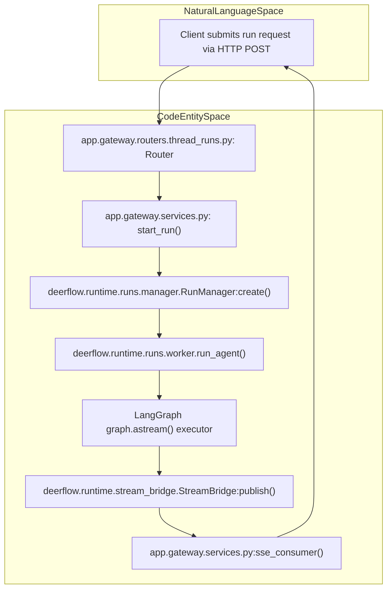
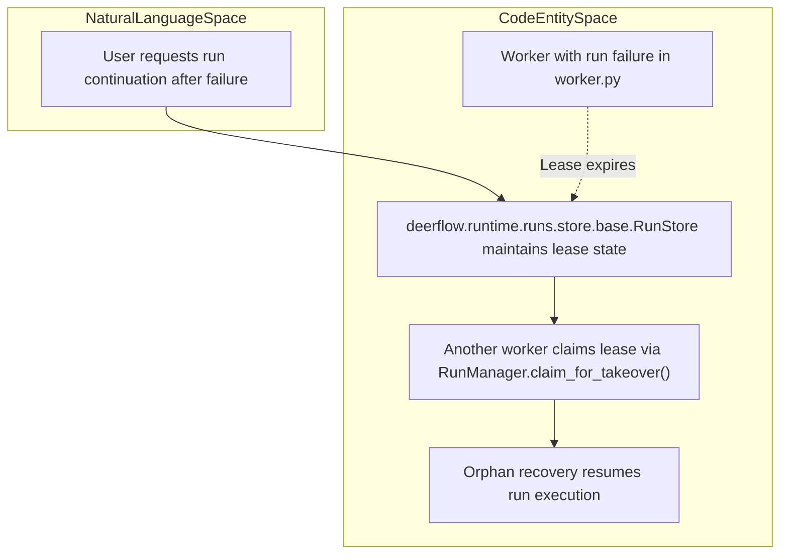

<!-- source: DeepWiki mcp.deepwiki.com · repo bytedance/deer-flow · page 5.2 LangGraph Agent Server · fetched 2026-10-29 -->

# LangGraph Agent Server

Relevant source files

The following files were used as context for generating this wiki page:

- [backend/app/gateway/AGENTS.md](backend/app/gateway/AGENTS.md)
- [backend/app/gateway/routers/thread_runs.py](backend/app/gateway/routers/thread_runs.py)
- [backend/app/gateway/services.py](backend/app/gateway/services.py)
- [backend/docs/STREAMING.md](backend/docs/STREAMING.md)
- [backend/packages/harness/deerflow/config/stream_bridge_config.py](backend/packages/harness/deerflow/config/stream_bridge_config.py)
- [backend/packages/harness/deerflow/persistence/migrations/versions/0034_run_event_seq_watermark.py](backend/packages/harness/deerflow/persistence/migrations/versions/0034_run_event_seq_watermark.py)
- [backend/packages/harness/deerflow/persistence/models/run_event.py](backend/packages/harness/deerflow/persistence/models/run_event.py)
- [backend/packages/harness/deerflow/persistence/run/sql.py](backend/packages/harness/deerflow/persistence/run/sql.py)
- [backend/packages/harness/deerflow/runtime/AGENTS.md](backend/packages/harness/deerflow/runtime/AGENTS.md)
- [backend/packages/harness/deerflow/runtime/events/store/__init__.py](backend/packages/harness/deerflow/runtime/events/store/__init__.py)
- [backend/packages/harness/deerflow/runtime/events/store/base.py](backend/packages/harness/deerflow/runtime/events/store/base.py)
- [backend/packages/harness/deerflow/runtime/events/store/db.py](backend/packages/harness/deerflow/runtime/events/store/db.py)
- [backend/packages/harness/deerflow/runtime/events/store/jsonl.py](backend/packages/harness/deerflow/runtime/events/store/jsonl.py)
- [backend/packages/harness/deerflow/runtime/events/store/memory.py](backend/packages/harness/deerflow/runtime/events/store/memory.py)
- [backend/packages/harness/deerflow/runtime/journal.py](backend/packages/harness/deerflow/runtime/journal.py)
- [backend/packages/harness/deerflow/runtime/runs/manager.py](backend/packages/harness/deerflow/runtime/runs/manager.py)
- [backend/packages/harness/deerflow/runtime/runs/store/base.py](backend/packages/harness/deerflow/runtime/runs/store/base.py)
- [backend/packages/harness/deerflow/runtime/runs/store/memory.py](backend/packages/harness/deerflow/runtime/runs/store/memory.py)
- [backend/packages/harness/deerflow/runtime/runs/worker.py](backend/packages/harness/deerflow/runtime/runs/worker.py)
- [backend/packages/harness/deerflow/runtime/stream_bridge/base.py](backend/packages/harness/deerflow/runtime/stream_bridge/base.py)
- [backend/packages/harness/deerflow/runtime/stream_bridge/memory.py](backend/packages/harness/deerflow/runtime/stream_bridge/memory.py)
- [backend/packages/harness/deerflow/runtime/stream_bridge/redis.py](backend/packages/harness/deerflow/runtime/stream_bridge/redis.py)
- [backend/packages/harness/deerflow/tracing/metadata.py](backend/packages/harness/deerflow/tracing/metadata.py)
- [backend/tests/test_client_langfuse_metadata.py](backend/tests/test_client_langfuse_metadata.py)
- [backend/tests/test_client_stream_usage.py](backend/tests/test_client_stream_usage.py)
- [backend/tests/test_db_event_store_lock_lifecycle.py](backend/tests/test_db_event_store_lock_lifecycle.py)
- [backend/tests/test_gateway_services.py](backend/tests/test_gateway_services.py)
- [backend/tests/test_goal_worker.py](backend/tests/test_goal_worker.py)
- [backend/tests/test_jsonl_event_store_async_io.py](backend/tests/test_jsonl_event_store_async_io.py)
- [backend/tests/test_jsonl_event_store_cancellation.py](backend/tests/test_jsonl_event_store_cancellation.py)
- [backend/tests/test_jsonl_event_store_seq_watermark.py](backend/tests/test_jsonl_event_store_seq_watermark.py)
- [backend/tests/test_multi_worker_run_ownership.py](backend/tests/test_multi_worker_run_ownership.py)
- [backend/tests/test_persistence_timezone.py](backend/tests/test_persistence_timezone.py)
- [backend/tests/test_redis_stream_cleanup_gap.py](backend/tests/test_redis_stream_cleanup_gap.py)
- [backend/tests/test_redis_stream_future_cursor.py](backend/tests/test_redis_stream_future_cursor.py)
- [backend/tests/test_run_event_store.py](backend/tests/test_run_event_store.py)
- [backend/tests/test_run_event_store_by_run_index.py](backend/tests/test_run_event_store_by_run_index.py)
- [backend/tests/test_run_journal.py](backend/tests/test_run_journal.py)
- [backend/tests/test_run_manager.py](backend/tests/test_run_manager.py)
- [backend/tests/test_run_repository.py](backend/tests/test_run_repository.py)
- [backend/tests/test_run_worker_rollback.py](backend/tests/test_run_worker_rollback.py)
- [backend/tests/test_stream_bridge.py](backend/tests/test_stream_bridge.py)
- [backend/tests/test_thread_regenerate_prepare.py](backend/tests/test_thread_regenerate_prepare.py)
- [backend/tests/test_tracing_metadata.py](backend/tests/test_tracing_metadata.py)
- [backend/tests/test_worker_langfuse_metadata.py](backend/tests/test_worker_langfuse_metadata.py)
- [backend/tests/test_worker_stream_subgraph_namespace.py](backend/tests/test_worker_stream_subgraph_namespace.py)
- [backend/tests/test_worker_subagent_persistence.py](backend/tests/test_worker_subagent_persistence.py)

## Purpose and Scope

This page provides a comprehensive technical explanation of the LangGraph Agent Server component within DeerFlow. The LangGraph Server is embedded inside the FastAPI-based Gateway and manages the execution lifecycle of agent graphs triggered by client requests. It handles run management, worker execution, event streaming, durable persistence, and integration with the Gateway API for streaming responses.

Key responsibilities include:

- Setting up new runs and managing run state and concurrency via `RunManager` [backend/packages/harness/deerflow/runtime/runs/manager.py:1-184]()
- Running asynchronous background workers that execute agent graphs with `run_agent` [backend/packages/harness/deerflow/runtime/runs/worker.py:1-112]()
- Publishing real-time event streams through `StreamBridge` implementations [backend/packages/harness/deerflow/runtime/stream_bridge/base.py]()
- Persisting run events and checkpoints through event stores and run stores [backend/packages/harness/deerflow/runtime/events/store/jsonl.py:1-27]()
- Orchestrating unsynchronized execution scenarios such as lease-based run ownership and orphan recovery [backend/packages/harness/deerflow/runtime/runs/manager.py:39-78]()
- Coordinating event delivery and SSE response construction in the Gateway API [backend/app/gateway/services.py:1-172]()

Sources: [backend/app/gateway/services.py:1-172](), [backend/packages/harness/deerflow/runtime/runs/worker.py:1-112](), [backend/packages/harness/deerflow/runtime/runs/manager.py:1-184](), [backend/packages/harness/deerflow/runtime/events/store/jsonl.py:1-27]()

---

## LangGraph Server Architecture

DeerFlow’s LangGraph Agent Server implements the LangGraph Platform API internally on top of an asynchronous graph execution runtime and a stateful run registry. It accepts incoming requests on the Gateway and executes agent graphs in dedicated background workers. Events generated by the graph are published to an event stream bridge and delivered to clients over server-sent events (SSE).

### Core Components and Responsibilities

| Component                | Code Entity / Class                                   | Responsibility                                                                                                   |
|--------------------------|------------------------------------------------------|----------------------------------------------------------------------------------------------------------------|
| **Gateway API**           | `app.gateway.routers.thread_runs.py` (Router)        | Exposes RESTful endpoints implementing LangGraph Platform runs API, provision runs, and stream responses [backend/app/gateway/routers/thread_runs.py:1-88]() |
| **RunManager**            | `deerflow.runtime.runs.manager.RunManager`           | Maintains run lifecycle records, concurrency locks, ownership leases, and run persistence [backend/packages/harness/deerflow/runtime/runs/manager.py:1-184]() |
| **Worker Executor**       | `deerflow.runtime.runs.worker.run_agent` coroutine   | Executes agent graphs asynchronously, driving LangGraph streams, publishing events [backend/packages/harness/deerflow/runtime/runs/worker.py:1-112]() |
| **StreamBridge**          | `deerflow.runtime.stream_bridge.StreamBridge`        | Publishes live event frames to attached consumers (SSE clients), manages replay, gaps, and backpressure [backend/packages/harness/deerflow/runtime/stream_bridge/base.py]() |
| **RunEventStore / RunStore** | `deerflow.runtime.events.store.*`, `runtime.runs.store.*` | Durable storage of run events and run state, supporting recovery and audit trails [backend/packages/harness/deerflow/runtime/events/store/jsonl.py:1-27]() |

### Diagram: High-Level Data Flow

Sources: [backend/app/gateway/routers/thread_runs.py:1-88](), [backend/app/gateway/services.py:1-172](), [backend/packages/harness/deerflow/runtime/runs/manager.py:1-184](), [backend/packages/harness/deerflow/runtime/runs/worker.py:1-112]()

---

## LangGraph Server Setup and Run Lifecycle

### RunManager: Run Lifecycle Control

The `RunManager` class manages run lifecycle and concurrency control:

- **Run creation and bookkeeping**: Creates unique `run_id` instances linked to `thread_id`. Run records track state, metadata, and leased ownership [backend/packages/harness/deerflow/runtime/runs/manager.py:1-184]().
- **Concurrency control**: Uses async reservation contexts (`reserve_thread_operation`) to serialize checkpoint writes, cancellation, or other thread-exclusive operations [backend/app/gateway/services.py:123-139]().
- **Lease management**: Supports multi-worker architectures by issuing timed leases to workers owning runs [backend/packages/harness/deerflow/runtime/runs/manager.py:39-78]().
- **Status management**: Tracks run statuses such as `pending`, `running`, `success`, `error`, `timeout`, and `interrupted` [backend/packages/harness/deerflow/runtime/runs/schemas.py]().
- **Persistence interfacing**: Integrates with backends via `RunStore` for durable run record storage [backend/packages/harness/deerflow/runtime/runs/store/base.py]().
- **Conflict resolution and cleanup**: Handles conflicts and uses cancellation and orphan recovery strategies to maintain consistent run state [backend/packages/harness/deerflow/runtime/runs/manager.py:40-45]().

Key methods include:
- `async create(thread_id, ...)` — Registers and persists a new run record [backend/packages/harness/deerflow/runtime/runs/manager.py]()
- `async reserve_thread_operation(thread_id, kind, ...)` — Async context manager for exclusive thread operation reservation [backend/app/gateway/services.py:123-139]()
- `async set_status(run_id, status, ...)` — Updates run status with concurrency control [backend/packages/harness/deerflow/runtime/runs/manager.py]()

The worker ID format, used for ownership leases, is generated as `hostname:hex_uuid` (`_generate_worker_id`) [backend/packages/harness/deerflow/runtime/runs/manager.py:64-66]().

Sources: [backend/packages/harness/deerflow/runtime/runs/manager.py:1-184](), [backend/app/gateway/services.py:123-139]()

---

### Worker Execution with `run_agent`

The `run_agent` function encapsulates the worker routine that executes an agent graph as an asynchronous task:

- Invoked per run, it consumes `graph.astream()` to produce streams of agent graph execution events [backend/packages/harness/deerflow/runtime/runs/worker.py:1-12]()
- Handles `values` mode for stable state snapshots and `messages` mode for incremental streaming [backend/packages/harness/deerflow/runtime/runs/worker.py:1-12]()
- Publishes streamed events to the `StreamBridge` [backend/packages/harness/deerflow/runtime/runs/worker.py:95-96]()
- Manages cancellation propagation on run abort or client disconnect [backend/packages/harness/deerflow/runtime/runs/worker.py:116-132]()
- Integrates checkpoint snapshotting via `CheckpointStateAccessor` [backend/packages/harness/deerflow/runtime/checkpoint_state.py]()
- Manages contextual user identity and runtime metadata [backend/packages/harness/deerflow/runtime/user_context.py]()

Sources: [backend/packages/harness/deerflow/runtime/runs/worker.py:1-112]()

---

### StreamBridge: Real-Time Event Publication

`StreamBridge` is the abstracted event delivery hub responsible for:

- Receiving events published by the worker during a run [backend/packages/harness/deerflow/runtime/stream_bridge/base.py]()
- Handling event queues and backpressure for multiple consumers [backend/packages/harness/deerflow/runtime/stream_bridge/memory.py]()
- Supporting different stream backends, such as `MemoryStreamBridge` and `RedisStreamBridge` [backend/packages/harness/deerflow/runtime/stream_bridge/memory.py](), [backend/packages/harness/deerflow/runtime/stream_bridge/redis.py]()
- Coordinating event replay, gap detection, and delivery guarantees [backend/app/gateway/services.py:92-146]()
- Enabling the Gateway API to consume the event stream for Server-Sent Events (SSE) responses [backend/app/gateway/services.py:60-100]()

Core interface operations:
- `publish(run_id, event_type, data)` — Dispatches run events [backend/packages/harness/deerflow/runtime/stream_bridge/base.py]()

Sources: [backend/packages/harness/deerflow/runtime/stream_bridge/base.py](), [backend/packages/harness/deerflow/runtime/stream_bridge/memory.py](), [backend/packages/harness/deerflow/runtime/stream_bridge/redis.py]()

---

### Event Storage and Durable Persistence

To ensure durability and allow recovery and audit of LangGraph runs, DeerFlow stores run events and metadata persistently:

- **RunEventStore** — Interface for per-run event storage. Events include messages, system traces, middleware state changes, and tool outputs [backend/packages/harness/deerflow/runtime/events/store/base.py]().
  - Implementations:
    - `MemoryRunEventStore` for ephemeral testing and local use [backend/packages/harness/deerflow/runtime/events/store/memory.py]().
    - `JsonlRunEventStore` writes JSONL files per run under the workspace directory, suitable for lightweight single-node use [backend/packages/harness/deerflow/runtime/events/store/jsonl.py:1-27]().
    - `DbRunEventStore` stores events in SQL databases for robust multi-worker setups [backend/packages/harness/deerflow/runtime/events/store/db.py]().
- **RunStore** — Interface for storing run metadata and state, status, lease information, and ownership [backend/packages/harness/deerflow/runtime/runs/store/base.py]().
  - Implemented by `MemoryRunStore` and backed by SQL repositories in production [backend/packages/harness/deerflow/persistence/run/sql.py]().

Sources: [backend/packages/harness/deerflow/runtime/events/store/jsonl.py:1-27](), [backend/packages/harness/deerflow/runtime/events/store/memory.py](), [backend/packages/harness/deerflow/runtime/runs/store/base.py]()

---

## Gateway API Integration and SSE Stream Handling

The Gateway provides the HTTP REST API surface that clients interact with:

- Primary API under `/api/threads/{thread_id}/runs` supports run creation, streaming, cancellation, and status polling [backend/app/gateway/routers/thread_runs.py:1-88]().
- Implemented as thin routers in `app.gateway.routers.thread_runs.py`, delegating core logic to `app.gateway.services` [backend/app/gateway/routers/thread_runs.py:1-10]().

### Run Request Lifecycle in Gateway

1. **Request Handling**: The router receives run creation or streaming requests [backend/app/gateway/routers/thread_runs.py:1-60]().
2. **Run Creation**: Calls `RunManager.create()` to record the new run [backend/packages/harness/deerflow/runtime/runs/manager.py]().
3. **Worker Launch**: Starts `run_agent` coroutine in the background to execute the run [backend/packages/harness/deerflow/runtime/runs/worker.py]().
4. **Event Streaming**: Uses `StreamBridge` to collect run events [backend/packages/harness/deerflow/runtime/stream_bridge/base.py]().
5. **SSE Response**: Async generator `sse_consumer` converts events to Server-Sent Events format and streams them to clients [backend/app/gateway/services.py:60-100]().

### SSE Consumer

- The `sse_consumer` function in `app.gateway.services.py` consumes event streams from `StreamBridge` [backend/app/gateway/services.py:60-146]().
- It formats wire-compatible SSE frames per LangGraph Platform protocol using `format_sse(event, data, event_id=None)` [backend/app/gateway/services.py:60-90]().
- Handles replay events and gaps for clients reconnecting with last seen event IDs [backend/app/gateway/services.py:92-146]().

Sources: [backend/app/gateway/routers/thread_runs.py:1-88](), [backend/app/gateway/services.py:60-172]()

---

## Multi-Worker Run Ownership and Orphan Recovery

DeerFlow supports horizontally scaled deployments via multi-worker concurrency coordination:

### Worker Identification and Lease Management

- Each worker generates a unique worker ID (`hostname:hex_uuid`) [backend/packages/harness/deerflow/runtime/runs/manager.py:64-66]().
- Runs are assigned to owning workers via leases that limit ownership duration [backend/packages/harness/deerflow/runtime/runs/manager.py:39-78]().
- Workers renew leases periodically to affirm ownership [backend/packages/harness/deerflow/runtime/runs/manager.py]().

### Run Takeover and Orphan Recovery

- On worker crashes or disconnection, leases expire [backend/packages/harness/deerflow/runtime/runs/manager.py:43-45]().
- Other workers detect expired leases and attempt takeover atomically by claiming leases [backend/packages/harness/deerflow/runtime/runs/manager.py]().
- The new owner resumes running the orphaned runs transparently [backend/packages/harness/deerflow/runtime/runs/manager.py]().

Sources: [backend/packages/harness/deerflow/runtime/runs/manager.py:39-78]()

---

### Diagram: Multi-Worker Run Takeover Flow

Sources: [backend/packages/harness/deerflow/runtime/runs/manager.py:39-78](), [backend/packages/harness/deerflow/runtime/runs/store/base.py]()

---

