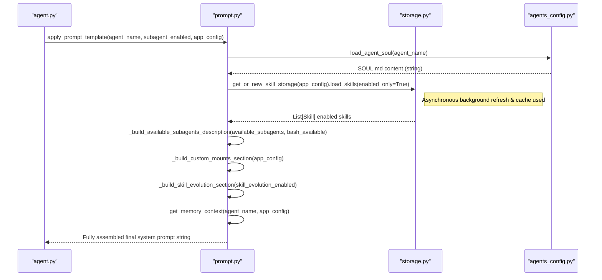
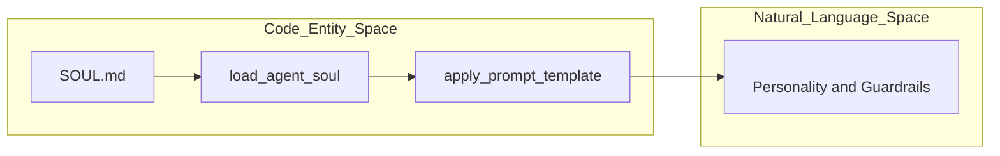
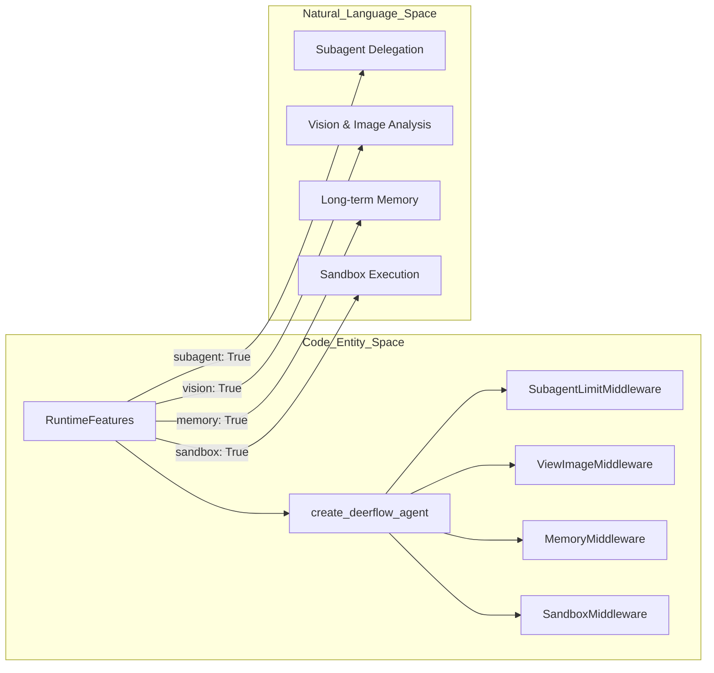
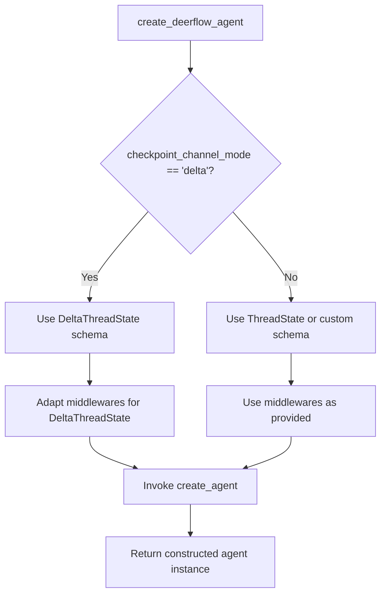
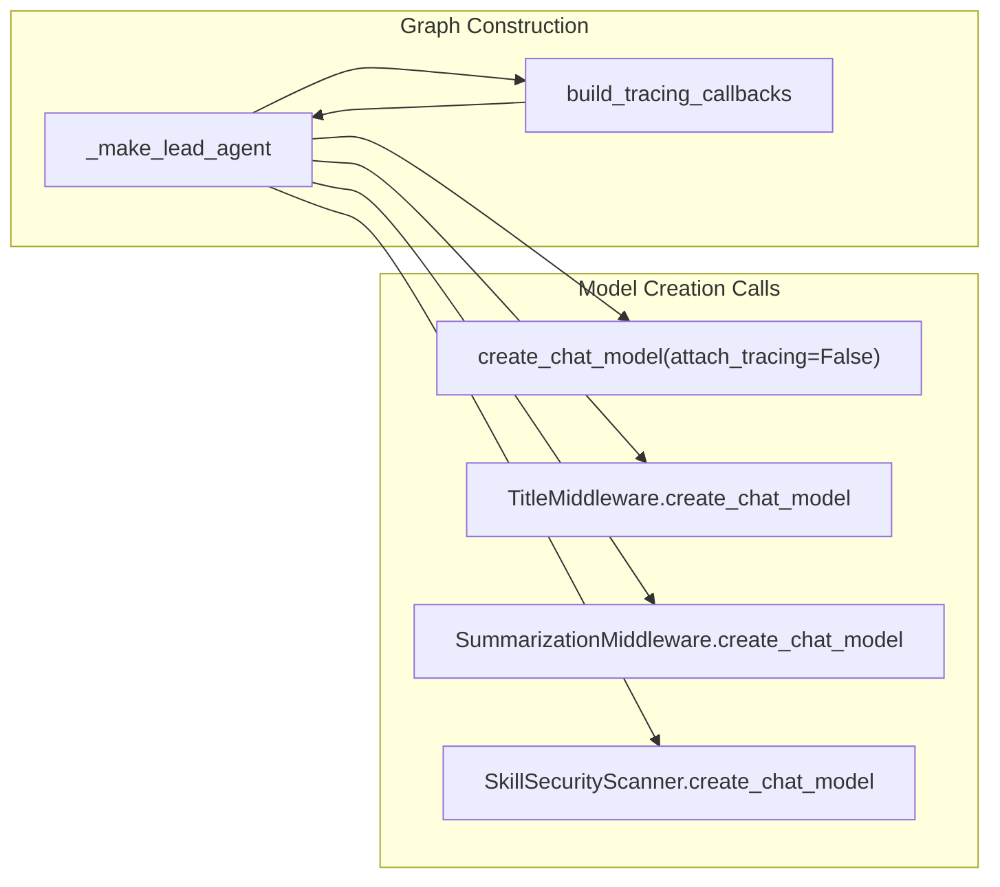

<!-- source: DeepWiki mcp.deepwiki.com · repo bytedance/deer-flow · page 5.3 Lead Agent and System Prompt · fetched 2026-10-29 -->

# Lead Agent and System Prompt

<details>
<summary>Relevant source files</summary>

The following files were used as context for generating this wiki page:

- [backend/packages/harness/deerflow/agents/factory.py](backend/packages/harness/deerflow/agents/factory.py)
- [backend/packages/harness/deerflow/agents/features.py](backend/packages/harness/deerflow/agents/features.py)
- [backend/packages/harness/deerflow/agents/lead_agent/agent.py](backend/packages/harness/deerflow/agents/lead_agent/agent.py)
- [backend/packages/harness/deerflow/agents/lead_agent/prompt.py](backend/packages/harness/deerflow/agents/lead_agent/prompt.py)
- [backend/packages/harness/deerflow/agents/middlewares/configured_extensions.py](backend/packages/harness/deerflow/agents/middlewares/configured_extensions.py)
- [backend/packages/harness/deerflow/agents/middlewares/model_content_compatibility_middleware.py](backend/packages/harness/deerflow/agents/middlewares/model_content_compatibility_middleware.py)
- [backend/packages/harness/deerflow/agents/middlewares/tool_error_handling_middleware.py](backend/packages/harness/deerflow/agents/middlewares/tool_error_handling_middleware.py)
- [backend/packages/harness/deerflow/config/app_config.py](backend/packages/harness/deerflow/config/app_config.py)
- [backend/packages/harness/deerflow/config/memory_config.py](backend/packages/harness/deerflow/config/memory_config.py)
- [backend/packages/harness/deerflow/config/token_budget_config.py](backend/packages/harness/deerflow/config/token_budget_config.py)
- [backend/packages/harness/deerflow/skills/tool_policy.py](backend/packages/harness/deerflow/skills/tool_policy.py)
- [backend/packages/harness/deerflow/tools/resource_placeholder.py](backend/packages/harness/deerflow/tools/resource_placeholder.py)
- [backend/tests/test_app_config_reload.py](backend/tests/test_app_config_reload.py)
- [backend/tests/test_create_deerflow_agent.py](backend/tests/test_create_deerflow_agent.py)
- [backend/tests/test_lead_agent_model_resolution.py](backend/tests/test_lead_agent_model_resolution.py)
- [backend/tests/test_lead_agent_prompt.py](backend/tests/test_lead_agent_prompt.py)
- [backend/tests/test_lead_agent_skills.py](backend/tests/test_lead_agent_skills.py)
- [backend/tests/test_tool_error_handling_middleware.py](backend/tests/test_tool_error_handling_middleware.py)

</details>


This page provides a detailed technical explanation of the Lead Agent’s creation, dynamic system prompt assembly, agent soul/personality management, and the factory method `create_deerflow_agent` which leverages `RuntimeFeatures` flags to configure the Lead Agent’s tools and middlewares. It also documents the critical invariant regarding tracing callbacks placement for consistent observability.

For complementary details, see the middleware pipeline [backend/packages/harness/deerflow/agents/lead_agent/agent.py:1-55]() and subagent system [backend/packages/harness/deerflow/subagents/executor.py:1-150]().

Sources: [backend/packages/harness/deerflow/agents/lead_agent/agent.py:1-55]()

---

## Overview

The **Lead Agent** is the primary agent process within DeerFlow, orchestrating user interactions, tool invocation, memory management, and optional delegation to subagents via tools like `task`. It manages complex workflows by dynamically assembling a richly structured system prompt that integrates configurable personality, enabled skills, memory context, and sandbox/environment guidance.

Key components involved in the lead agent lifecycle include:

- **Agent Factory (`_make_lead_agent`)**: Builds the agent graph, attaches authorized middlewares, chooses the model, and configures runtime limits [backend/packages/harness/deerflow/agents/lead_agent/agent.py:1-125]().
- **System Prompt Assembly (`apply_prompt_template`)**: Dynamically composes the system prompt XML-like template with sections like `<soul>`, `<skill_system>`, and `<memory>`, using skill storage, app configuration, and user context [backend/packages/harness/deerflow/agents/lead_agent/prompt.py:1-151]().
- **Agent Soul Loader**: Loads and manages the agent personality or soul from `SOUL.md` files, shaping the agent's guardrails, tone, and domain knowledge [backend/packages/harness/deerflow/config/agents_config.py:15-104]().
- **Enabled Skills & Deferred Tools Cache**: Efficiently caches and serves enabled skills to inject skill documentation and activation guidance into the prompt [backend/packages/harness/deerflow/agents/lead_agent/prompt.py:62-151]().
- **Agent Factory (`create_deerflow_agent`)**: A pure Python arguments-based factory for creating agents with middleware and tools configured by declarative `RuntimeFeatures` [backend/packages/harness/deerflow/agents/factory.py:67-149]().
- **Tracing Callbacks Invariant**: Ensures tracing callbacks for observability are attached strictly at the graph invocation root to prevent duplicate spans and allow attribute propagation [backend/packages/harness/deerflow/agents/lead_agent/agent.py:3-23]().

Sources: [backend/packages/harness/deerflow/agents/lead_agent/agent.py:1-125](), [backend/packages/harness/deerflow/agents/lead_agent/prompt.py:1-151](), [backend/packages/harness/deerflow/agents/factory.py:67-149]()

---

## System Prompt Template and Structure

The system prompt is composed of multiple XML-like tagged sections to formally organize and separate different aspects of the agent’s instructions. This structure helps systematically inject runtime data and configuration-guided content.

### Prompt Sections and Their Roles

| Tag                     | Purpose                                                        | Source Module & Lines                                   |
|-------------------------|----------------------------------------------------------------|--------------------------------------------------------|
| `<role>`                | Identifies the agent's core role and high-level identity       | [backend/packages/harness/deerflow/agents/lead_agent/prompt.py:1-50]() |
| `<soul>`                | Contains the agent's personality, style, domain-specific guardrails loaded from a `SOUL.md` file | [backend/packages/harness/deerflow/config/agents_config.py:15-104]()  |
| `<memory>`              | Injects relevant user memory facts and conversation context    | [backend/packages/harness/deerflow/agents/lead_agent/prompt.py:1-100]() |
| `<skill_system>`        | Documentation and usage instructions for enabled skills        | [backend/packages/harness/deerflow/agents/lead_agent/prompt.py:62-151]() |
| `<subagent_system>`     | Describes task delegation boundaries and subagent capabilities  | [backend/packages/harness/deerflow/agents/lead_agent/prompt.py:1-100]() |
| `<working_directory>`   | Provides sandbox environment guidance for file system interactions | [backend/packages/harness/deerflow/agents/lead_agent/prompt.py:1-100]() |
| `<response_style>`      | Defines rules on the style and format of output responses      | [backend/packages/harness/deerflow/agents/lead_agent/prompt.py:1-100]() |
| `<clarification_system>`| Instructions on interacting with clarification questions       | [backend/packages/harness/deerflow/agents/factory.py:47-60]()           |

This modular design allows easy extension of the prompt by appending new sections.

### Architecture Diagram: System Prompt Sections and Code Entities

```mermaid
graph TB
    subgraph "Code_Entity_Space"
        APT["apply_prompt_template"]
        LAS["load_agent_soul"]
        GCES["_get_enabled_skills"]
        GDT["get_deferred_tools_prompt_section"]
    end

    subgraph "Natural_Language_Space"
        ROLE[""<role>\nDefines agent identity""]
        SOUL[""<soul>\nCustom personality (SOUL.md)""]
        MEMORY[""<memory>\nUser context and memory facts""]
        SKILLS[""<skill_system>\nEnabled skills & descriptions""]
        SUBAGENT[""<subagent_system>\nTask delegation rules""]
    end

    APT --> ROLE
    APT --> SOUL
    APT --> MEMORY
    APT --> SKILLS
    APT --> SUBAGENT
    
    LAS --> SOUL
    GCES --> SKILLS
    GDT --> SKILLS
```
Sources: [backend/packages/harness/deerflow/agents/lead_agent/prompt.py:1-151](), [backend/packages/harness/deerflow/config/agents_config.py:15-104]()

---

## Dynamic Prompt Assembly Flow

The core function responsible for assembling the full system prompt is `apply_prompt_template()`. It reads configuration, enabled skills, agent soul, subagent availability, and app environment to produce a comprehensive prompt.

### Assembly Steps

1. **Load Agent Soul**: Uses `load_agent_soul(agent_name)` to retrieve personality markdown (`SOUL.md`) content [backend/packages/harness/deerflow/config/agents_config.py:15-104]().

2. **Gather Enabled Skills**: Retrieves the currently enabled skills asynchronously from the skill storage cache, ensuring cold starts do not block and prompt cache warming happens in the background [backend/packages/harness/deerflow/agents/lead_agent/prompt.py:62-151]().

3. **Build Subagent Description**: Enumerates available subagent types and their capabilities, including whether bash tools are available [backend/packages/harness/deerflow/agents/lead_agent/prompt.py:1-100]().

4. **Add Custom Mount Points**: Lists any custom mounted directories injected via sandbox configuration for agent awareness [backend/packages/harness/deerflow/agents/lead_agent/prompt.py:1-100]().

5. **Add Skill Self-Evolution Rules**: Optionally injects skill evolution system details if enabled [backend/packages/harness/deerflow/agents/lead_agent/prompt.py:125-141]().

6. **Inject Memory Context**: Adds current user facts from memory middleware to the `<memory>` section when memory is enabled [backend/packages/harness/deerflow/agents/lead_agent/prompt.py:1-100]().

7. **Include Deferred Tools**: Appends prompt guidance regarding deferred tools activation (`@tool_search`) [backend/packages/harness/deerflow/agents/lead_agent/prompt.py:27]().

The final output is a fully rendered XML-like string ready to be sent as the system prompt to the conversation LLM.

### Dynamic Prompt Assembly Diagram


Sources: [backend/packages/harness/deerflow/agents/lead_agent/prompt.py:1-151](), [backend/packages/harness/deerflow/config/agents_config.py:15-104]()

---

## Agent Soul and Personality

The **agent soul** embodies a specific personality, domain expertise, guardrails, and tone for the lead agent—effectively shaping its reasoning style.

### Soul File Location and Structure

- Located under user-specific or global agent directories, in `SOUL.md`.
- Contains markdown text with detailed instructions, behavioral guardrails, and personality definitions.
- The soul content is embedded directly within the `<soul>` tag of the system prompt, allowing the LLM to adapt responses accordingly.

### Loading Mechanism

- The function `load_agent_soul(name)` reads and returns the soul content as a string [backend/packages/harness/deerflow/config/agents_config.py:15-104]().
- Soul content is cached and reloaded on updates.
- Absence of a soul file results in an empty personality section (default behavior).

### Management

- Souls are authored and updated via the agent creation wizard, gallery, or the `update_agent` tool.
- Souls allow owners to customize their agent's behavior and thematic boundaries explicitly.

### Architectural Relation Diagram: Agent Soul and Prompt Assembly


Sources: [backend/packages/harness/deerflow/config/agents_config.py:15-104](), [backend/packages/harness/deerflow/agents/lead_agent/prompt.py:1-50]()

---

## Agent Factory and `create_deerflow_agent`

DeerFlow provides the `create_deerflow_agent` function as a flexible pure-Python factory to assemble agent graphs dynamically [backend/packages/harness/deerflow/agents/factory.py:67-149](). This factory abstracts away complex config loading and runtime state, optimizing for embedding, testing, or custom runtime usage.

### Core Responsibilities

- **Model and Tool Binding**: Accepts a chat model plus optional user tools.
- **Middleware Assembly**: Middlewares can be fully customized by caller via `middleware` or assembled from `features` flags plus `extra_middleware`.
- **System Prompt Injection**: Accepts an explicit system prompt or uses minimal defaults.
- **Thread State Schema Handling**: Selects `ThreadState` by default or adapts to `DeltaThreadState` when `checkpoint_channel_mode="delta"` is specified [backend/packages/harness/deerflow/agents/factory.py:67-149]().
- **Checkpoint Mode Validation**: Rejects invalid combinations like delta mode with persistent checkpointer due to incompatibility [backend/packages/harness/deerflow/agents/factory.py:140-149]().
- **Runtime Features Driven Configuration**: `RuntimeFeatures` flags enable capabilities including subagents, sandboxing, interactive clarification, or vision tools, injecting corresponding middleware automatically [backend/packages/harness/deerflow/agents/features.py:1-70]().
- **PII Redaction Policy**: Optionally injects PII redaction middleware into the chain [backend/packages/harness/deerflow/agents/factory.py:82-133]().
- **Subagent Runtime Integration**: Allows explicit subagent runtime to support native isolated subagents or durable batch workers [backend/packages/harness/deerflow/agents/factory.py:81-128]().

### RuntimeFeatures to Middleware Injection Mapping


Sources: [backend/packages/harness/deerflow/agents/factory.py:67-149](), [backend/packages/harness/deerflow/agents/features.py:1-70]()

### Thread State Schema and Checkpoint Mode Adaptations

The factory function adapts the thread state schema and middleware state schemas depending on the checkpoint channel mode:

- If `checkpoint_channel_mode == "delta"`:
  - Uses the specialized `DeltaThreadState` schema for state representation [backend/packages/harness/deerflow/agents/factory.py:110-118]().
  - Wraps or adjusts middlewares accordingly to work with delta-specific schemas.
  - Validates that a `checkpointer` is **not** provided, preventing persistent store corruption because delta mode is ephemeral [backend/packages/harness/deerflow/agents/factory.py:140-149]().
- Else (full mode or any other value):
  - Uses the provided `state_schema` or defaults to `ThreadState` [backend/packages/harness/deerflow/agents/factory.py:108]().
  - Middleware state schemas are normalized correspondingly [backend/packages/harness/deerflow/agents/factory.py:26]().

### Factory Workflow Diagram for State Schema Handling


Sources: [backend/packages/harness/deerflow/agents/factory.py:67-149]()

### Model Resolution and Authorization

`create_deerflow_agent` optionally relies on app config (if injected or loaded) for model resolution and authorization decision integration:

- Reads the configured model profiles and selects one by name or default.
- Uses the authorization provider system to filter authorized tools and capabilities [backend/packages/harness/deerflow/authz/runtime.py:1-50]().

These features ensure agents comply with configured organizational policies and security requirements.

Sources: [backend/packages/harness/deerflow/agents/factory.py:67-149](), [backend/packages/harness/deerflow/agents/features.py:1-70](), [backend/tests/test_create_deerflow_agent.py:47-175]()

---

## Tracing Callback Placement Invariant

DeerFlow rigorously enforces a tracing callback placement invariant to maintain high-quality observability and distributed tracing with Langfuse, LangSmith, and other tracing frameworks:

- **Callbacks must be attached exclusively once at the graph invocation root** inside `_make_lead_agent()`. This is done by appending callbacks from `build_tracing_callbacks()` to the `config["callbacks"]` explicitly in that function [backend/packages/harness/deerflow/agents/lead_agent/agent.py:3-23]().

- **Every call to `create_chat_model(...)` internally, including those inside middlewares (e.g., `TitleMiddleware`), MUST specify `attach_tracing=False`.** [backend/packages/harness/deerflow/agents/lead_agent/agent.py:9-12]()

Failure to apply this rule results in duplicate tracing spans — one rooted at the graph and another at the model — which prevents proper attribute propagation (e.g., `session_id` and `user_id`) up the trace hierarchy [backend/packages/harness/deerflow/agents/lead_agent/agent.py:13-15]().

The invariant covers all graph-reachable internal model creations: bootstrap agent, default agents, middlewares like `TitleMiddleware`, summarization middleware, and skill security scanning tools [backend/packages/harness/deerflow/agents/lead_agent/agent.py:16-22]().

### Tracing Placement Diagram


Sources: [backend/packages/harness/deerflow/agents/lead_agent/agent.py:3-23]()

---

## Sources

- [backend/packages/harness/deerflow/agents/lead_agent/agent.py:1-125]()
- [backend/packages/harness/deerflow/agents/lead_agent/prompt.py:1-151]()
- [backend/packages/harness/deerflow/config/agents_config.py:15-104]()
- [backend/packages/harness/deerflow/agents/factory.py:67-149]()
- [backend/packages/harness/deerflow/agents/features.py:1-70]()
- [backend/tests/test_create_deerflow_agent.py:47-175]()

---

