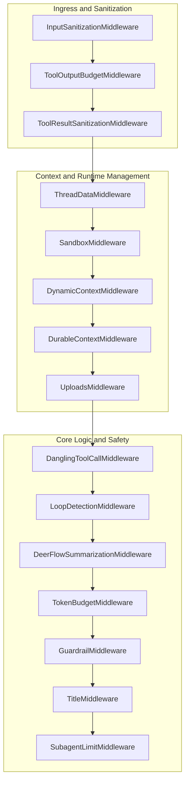
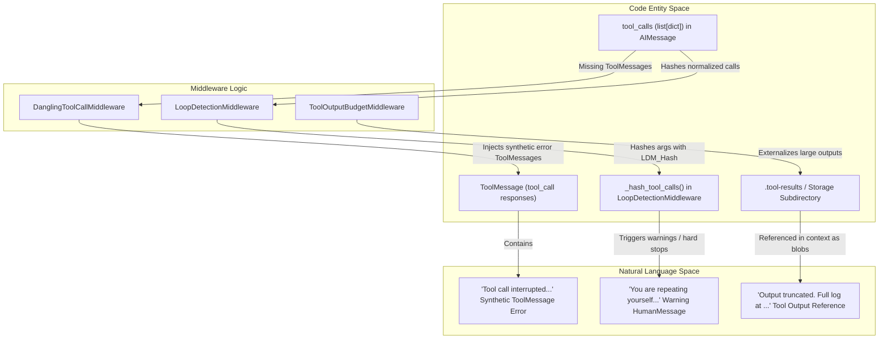
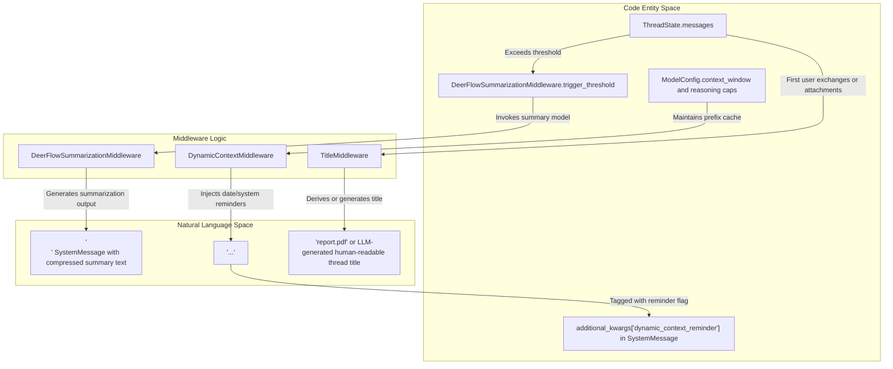
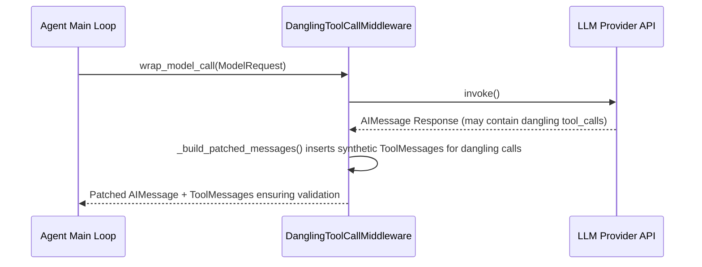

<!-- source: DeepWiki mcp.deepwiki.com · repo bytedance/deer-flow · page 5.4 Middleware Pipeline · fetched 2026-10-29 -->

# Middleware Pipeline

Relevant source files

The following files were used as context for generating this wiki page:

- [backend/app/gateway/context_usage.py](backend/app/gateway/context_usage.py)
- [backend/docs/AUTO_TITLE_GENERATION.md](backend/docs/AUTO_TITLE_GENERATION.md)
- [backend/docs/TITLE_GENERATION_IMPLEMENTATION.md](backend/docs/TITLE_GENERATION_IMPLEMENTATION.md)
- [backend/docs/blob-storage.md](backend/docs/blob-storage.md)
- [backend/docs/summarization.md](backend/docs/summarization.md)
- [backend/packages/harness/deerflow/agents/middlewares/TOOL_OUTPUT_PERSISTENCE.md](backend/packages/harness/deerflow/agents/middlewares/TOOL_OUTPUT_PERSISTENCE.md)
- [backend/packages/harness/deerflow/agents/middlewares/dangling_tool_call_middleware.py](backend/packages/harness/deerflow/agents/middlewares/dangling_tool_call_middleware.py)
- [backend/packages/harness/deerflow/agents/middlewares/dynamic_context_middleware.py](backend/packages/harness/deerflow/agents/middlewares/dynamic_context_middleware.py)
- [backend/packages/harness/deerflow/agents/middlewares/input_sanitization_middleware.py](backend/packages/harness/deerflow/agents/middlewares/input_sanitization_middleware.py)
- [backend/packages/harness/deerflow/agents/middlewares/loop_detection_middleware.py](backend/packages/harness/deerflow/agents/middlewares/loop_detection_middleware.py)
- [backend/packages/harness/deerflow/agents/middlewares/model_length_finish_reason_middleware.py](backend/packages/harness/deerflow/agents/middlewares/model_length_finish_reason_middleware.py)
- [backend/packages/harness/deerflow/agents/middlewares/model_length_termination_detectors.py](backend/packages/harness/deerflow/agents/middlewares/model_length_termination_detectors.py)
- [backend/packages/harness/deerflow/agents/middlewares/model_response.py](backend/packages/harness/deerflow/agents/middlewares/model_response.py)
- [backend/packages/harness/deerflow/agents/middlewares/read_before_write_middleware.py](backend/packages/harness/deerflow/agents/middlewares/read_before_write_middleware.py)
- [backend/packages/harness/deerflow/agents/middlewares/summarization_middleware.py](backend/packages/harness/deerflow/agents/middlewares/summarization_middleware.py)
- [backend/packages/harness/deerflow/agents/middlewares/title_middleware.py](backend/packages/harness/deerflow/agents/middlewares/title_middleware.py)
- [backend/packages/harness/deerflow/agents/middlewares/todo_middleware.py](backend/packages/harness/deerflow/agents/middlewares/todo_middleware.py)
- [backend/packages/harness/deerflow/agents/middlewares/token_budget_middleware.py](backend/packages/harness/deerflow/agents/middlewares/token_budget_middleware.py)
- [backend/packages/harness/deerflow/agents/middlewares/token_usage_middleware.py](backend/packages/harness/deerflow/agents/middlewares/token_usage_middleware.py)
- [backend/packages/harness/deerflow/agents/middlewares/tool_output_budget_middleware.py](backend/packages/harness/deerflow/agents/middlewares/tool_output_budget_middleware.py)
- [backend/packages/harness/deerflow/agents/middlewares/tool_output_synopsis.py](backend/packages/harness/deerflow/agents/middlewares/tool_output_synopsis.py)
- [backend/packages/harness/deerflow/agents/middlewares/tool_progress_middleware.py](backend/packages/harness/deerflow/agents/middlewares/tool_progress_middleware.py)
- [backend/packages/harness/deerflow/agents/middlewares/tool_result_meta.py](backend/packages/harness/deerflow/agents/middlewares/tool_result_meta.py)
- [backend/packages/harness/deerflow/agents/middlewares/view_image_middleware.py](backend/packages/harness/deerflow/agents/middlewares/view_image_middleware.py)
- [backend/packages/harness/deerflow/agents/thread_state.py](backend/packages/harness/deerflow/agents/thread_state.py)
- [backend/packages/harness/deerflow/config/subagents_config.py](backend/packages/harness/deerflow/config/subagents_config.py)
- [backend/packages/harness/deerflow/config/summarization_config.py](backend/packages/harness/deerflow/config/summarization_config.py)
- [backend/packages/harness/deerflow/config/tool_output_config.py](backend/packages/harness/deerflow/config/tool_output_config.py)
- [backend/packages/harness/deerflow/config/tool_progress_config.py](backend/packages/harness/deerflow/config/tool_progress_config.py)
- [backend/packages/harness/deerflow/sandbox/read_file_contract.py](backend/packages/harness/deerflow/sandbox/read_file_contract.py)
- [backend/packages/harness/deerflow/storage/AGENTS.md](backend/packages/harness/deerflow/storage/AGENTS.md)
- [backend/packages/harness/deerflow/subagents/builtins/bash_agent.py](backend/packages/harness/deerflow/subagents/builtins/bash_agent.py)
- [backend/packages/harness/deerflow/subagents/builtins/general_purpose.py](backend/packages/harness/deerflow/subagents/builtins/general_purpose.py)
- [backend/packages/harness/deerflow/subagents/config.py](backend/packages/harness/deerflow/subagents/config.py)
- [backend/packages/harness/deerflow/subagents/context_snapshot.py](backend/packages/harness/deerflow/subagents/context_snapshot.py)
- [backend/packages/harness/deerflow/subagents/registry.py](backend/packages/harness/deerflow/subagents/registry.py)
- [backend/packages/harness/deerflow/tools/builtins/review_skill_package_tool.py](backend/packages/harness/deerflow/tools/builtins/review_skill_package_tool.py)
- [backend/packages/harness/deerflow/tools/builtins/view_image_tool.py](backend/packages/harness/deerflow/tools/builtins/view_image_tool.py)
- [backend/tests/blocking_io/test_dynamic_context_middleware.py](backend/tests/blocking_io/test_dynamic_context_middleware.py)
- [backend/tests/test_command_tool_result_semantics.py](backend/tests/test_command_tool_result_semantics.py)
- [backend/tests/test_dangling_tool_call_middleware.py](backend/tests/test_dangling_tool_call_middleware.py)
- [backend/tests/test_delta_channel_state.py](backend/tests/test_delta_channel_state.py)
- [backend/tests/test_dynamic_context_middleware.py](backend/tests/test_dynamic_context_middleware.py)
- [backend/tests/test_extension_system_model_calls.py](backend/tests/test_extension_system_model_calls.py)
- [backend/tests/test_externalize_failure_cleanup.py](backend/tests/test_externalize_failure_cleanup.py)
- [backend/tests/test_input_sanitization_middleware.py](backend/tests/test_input_sanitization_middleware.py)
- [backend/tests/test_jev_context_extension.py](backend/tests/test_jev_context_extension.py)
- [backend/tests/test_lead_token_budget.py](backend/tests/test_lead_token_budget.py)
- [backend/tests/test_loop_detection_middleware.py](backend/tests/test_loop_detection_middleware.py)
- [backend/tests/test_model_length_finish_reason_middleware.py](backend/tests/test_model_length_finish_reason_middleware.py)
- [backend/tests/test_model_length_responses.py](backend/tests/test_model_length_responses.py)
- [backend/tests/test_model_length_termination_detectors.py](backend/tests/test_model_length_termination_detectors.py)
- [backend/tests/test_model_response.py](backend/tests/test_model_response.py)
- [backend/tests/test_read_before_write_cancellation.py](backend/tests/test_read_before_write_cancellation.py)
- [backend/tests/test_read_before_write_coordination.py](backend/tests/test_read_before_write_coordination.py)
- [backend/tests/test_read_before_write_middleware.py](backend/tests/test_read_before_write_middleware.py)
- [backend/tests/test_remote_read_file_line_numbers.py](backend/tests/test_remote_read_file_line_numbers.py)
- [backend/tests/test_review_skill_package_tool.py](backend/tests/test_review_skill_package_tool.py)
- [backend/tests/test_shared_reset_marker.py](backend/tests/test_shared_reset_marker.py)
- [backend/tests/test_subagent_context_snapshot.py](backend/tests/test_subagent_context_snapshot.py)
- [backend/tests/test_subagent_prompt_security.py](backend/tests/test_subagent_prompt_security.py)
- [backend/tests/test_subagent_routing_prompt.py](backend/tests/test_subagent_routing_prompt.py)
- [backend/tests/test_subagent_skills_config.py](backend/tests/test_subagent_skills_config.py)
- [backend/tests/test_subagent_timeout_config.py](backend/tests/test_subagent_timeout_config.py)
- [backend/tests/test_subagents_acp_boolean_backstops.py](backend/tests/test_subagents_acp_boolean_backstops.py)
- [backend/tests/test_summarization_chunk_cooldown.py](backend/tests/test_summarization_chunk_cooldown.py)
- [backend/tests/test_summarization_middleware.py](backend/tests/test_summarization_middleware.py)
- [backend/tests/test_summarization_summary_text.py](backend/tests/test_summarization_summary_text.py)
- [backend/tests/test_thread_state_reducers.py](backend/tests/test_thread_state_reducers.py)
- [backend/tests/test_thread_token_usage.py](backend/tests/test_thread_token_usage.py)
- [backend/tests/test_title_middleware_core_logic.py](backend/tests/test_title_middleware_core_logic.py)
- [backend/tests/test_todo_middleware.py](backend/tests/test_todo_middleware.py)
- [backend/tests/test_token_budget_middleware.py](backend/tests/test_token_budget_middleware.py)
- [backend/tests/test_token_usage_middleware.py](backend/tests/test_token_usage_middleware.py)
- [backend/tests/test_tool_output_budget_middleware.py](backend/tests/test_tool_output_budget_middleware.py)
- [backend/tests/test_tool_output_config_limits.py](backend/tests/test_tool_output_config_limits.py)
- [backend/tests/test_tool_output_externalized_filename.py](backend/tests/test_tool_output_externalized_filename.py)
- [backend/tests/test_tool_output_synopsis_budget.py](backend/tests/test_tool_output_synopsis_budget.py)
- [backend/tests/test_tool_progress_middleware.py](backend/tests/test_tool_progress_middleware.py)
- [backend/tests/test_tool_result_meta.py](backend/tests/test_tool_result_meta.py)
- [backend/tests/test_view_image_middleware.py](backend/tests/test_view_image_middleware.py)
- [backend/tests/test_view_image_provider_error_classification.py](backend/tests/test_view_image_provider_error_classification.py)
- [backend/tests/test_view_image_remote_sandbox.py](backend/tests/test_view_image_remote_sandbox.py)
- [backend/tests/test_view_image_tool.py](backend/tests/test_view_image_tool.py)
- [backend/tests/test_view_image_tool_cancellation.py](backend/tests/test_view_image_tool_cancellation.py)
- [backend/tests/test_web_fetch_error_shell_meta.py](backend/tests/test_web_fetch_error_shell_meta.py)
- [frontend/public/demo/threads/7f9dc56c-e49c-4671-a3d2-c492ff4dce0c/thread.json](frontend/public/demo/threads/7f9dc56c-e49c-4671-a3d2-c492ff4dce0c/thread.json)
- [frontend/public/demo/threads/7f9dc56c-e49c-4671-a3d2-c492ff4dce0c/user-data/outputs/leica-master-photography-article.md](frontend/public/demo/threads/7f9dc56c-e49c-4671-a3d2-c492ff4dce0c/user-data/outputs/leica-master-photography-article.md)
- [frontend/public/demo/threads/7f9dc56c-e49c-4671-a3d2-c492ff4dce0c/user-data/outputs/leica-nyc-candid.jpg](frontend/public/demo/threads/7f9dc56c-e49c-4671-a3d2-c492ff4dce0c/user-data/outputs/leica-nyc-candid.jpg)
- [frontend/public/demo/threads/7f9dc56c-e49c-4671-a3d2-c492ff4dce0c/user-data/outputs/leica-paris-decisive-moment.jpg](frontend/public/demo/threads/7f9dc56c-e49c-4671-a3d2-c492ff4dce0c/user-data/outputs/leica-paris-decisive-moment.jpg)
- [frontend/public/demo/threads/7f9dc56c-e49c-4671-a3d2-c492ff4dce0c/user-data/outputs/leica-tokyo-night.jpg](frontend/public/demo/threads/7f9dc56c-e49c-4671-a3d2-c492ff4dce0c/user-data/outputs/leica-tokyo-night.jpg)
- [frontend/src/components/workspace/messages/message-token-usage.tsx](frontend/src/components/workspace/messages/message-token-usage.tsx)
- [frontend/src/components/workspace/token-usage-indicator.tsx](frontend/src/components/workspace/token-usage-indicator.tsx)
- [frontend/src/content/en/introduction/_meta.ts](frontend/src/content/en/introduction/_meta.ts)
- [frontend/src/content/en/introduction/index.mdx](frontend/src/content/en/introduction/index.mdx)
- [frontend/src/content/zh/introduction/_meta.ts](frontend/src/content/zh/introduction/_meta.ts)
- [frontend/src/content/zh/introduction/index.mdx](frontend/src/content/zh/introduction/index.mdx)
- [frontend/src/core/messages/usage.ts](frontend/src/core/messages/usage.ts)
- [frontend/src/core/threads/token-usage.ts](frontend/src/core/threads/token-usage.ts)
- [frontend/tests/unit/core/messages/usage.test.ts](frontend/tests/unit/core/messages/usage.test.ts)
- [frontend/tests/unit/core/threads/token-usage.test.ts](frontend/tests/unit/core/threads/token-usage.test.ts)

This page documents the middleware pipeline used by agents in the DeerFlow harness. It explains the full middleware chain, execution order, and each middleware’s responsibility in managing thread isolation, safety, tool error handling, resource management, and state normalization.

---

## Overview

DeerFlow’s agent framework leverages the `AgentMiddleware` interface from `langchain.agents.middleware` to build modular middleware components that plug into the agent runtime lifecycle [backend/packages/harness/deerflow/agents/middlewares/loop_detection_middleware.py:75-76](). These middlewares are composed into a linear chain that intercepts and modifies the agent's input state, model invocations, and tool calls.

Each middleware addresses specific runtime concerns such as:

- Sanitizing and normalizing input messages
- Handling and correcting tool call errors
- Detecting and breaking infinite tool call loops
- Managing concurrency and resource budgets for subagents
- Enforcing guardrails and authorization policies
- Deferring tool loading and filtering tool sets
- Auditing and sandbox execution supervision
- Tracking token usage and enforcing output budgets
- Injecting dynamic context and reminders
- Automatic title generation

The middleware chain allows precise interception at multiple hook points before and after model calls, as well as around tool invocations, enabling cross-cutting concerns to be cleanly separated and composed.

### Agent Middleware Hook Points

| Hook               | Execution Time                        | Purpose                                                       | Return Type                              |
|--------------------|------------------------------------|---------------------------------------------------------------|-----------------------------------------|
| `before_agent`      | Once, before agent loop execution  | Initialize or mutate agent state before any model or tool call | Partial state dict or `None`             |
| `after_agent`       | Once, after agent loop finishes    | Final cleanup or reporting after loop completion              | Partial state dict or `None`             |
| `before_model`      | Before each LLM call               | Modify/promote state, inject reminders, filter tools          | Partial state dict or `None`             |
| `after_model`       | After each LLM call                | Inspect output, handle finish reasons, update token budgets   | Partial state dict or `None`             |
| `wrap_model_call`   | Around LLM invocation              | Wrap or replace model call with retry, injection, or patching | `ModelCallResult` (possibly wrapped)    |
| `wrap_tool_call`    | Around tool invocation             | Add error handling, enforce policies, monitor tooling         | ToolMessage or equivalent result         |

Sources: [backend/packages/harness/deerflow/agents/middlewares/dangling_tool_call_middleware.py:28-30](), [backend/packages/harness/deerflow/agents/middlewares/loop_detection_middleware.py:75-76]()

---

## Pipeline Assembly and Execution Order

The middleware chain is constructed per-agent at runtime primarily in the agent factory and tool error handling modules. This assembly orders middleware to follow a logical sequence of data validation, context enrichment, output sanitization, safety checks, summarization, resource enforcement, and final output polishing.

### Middleware Pipeline Execution Order Diagram

Title: Middleware Pipeline Execution Order

Sources: [backend/packages/harness/deerflow/agents/middlewares/dangling_tool_call_middleware.py:1-19](), [backend/packages/harness/deerflow/agents/middlewares/summarization_middleware.py:100-150]()

---

## Middleware Responsibilities Detail

### 1. ToolOutputBudgetMiddleware
- **Hook:** `wrap_tool_call`
- **Role:** Enforces a per-tool-result size budget to prevent very large tool outputs from bloating prompt contexts. Oversized outputs are persisted externally under the thread workspace `.tool-results` directory, and replaced with compact typed synopses referencing these blobs [backend/packages/harness/deerflow/agents/middlewares/tool_output_budget_middleware.py:1-22]().

Sources: [backend/packages/harness/deerflow/agents/middlewares/tool_output_budget_middleware.py:1-22]()

### 2. DanglingToolCallMiddleware
- **Hook:** `wrap_model_call`
- **Role:** Detects `AIMessage` instances that list tool calls without accompanying `ToolMessage` responses—so-called "dangling" tool calls—and injects synthetic error `ToolMessage` objects to satisfy strict API contracts enforced by providers like OpenAI and Anthropic [backend/packages/harness/deerflow/agents/middlewares/dangling_tool_call_middleware.py:1-19]().
- **Implementation Highlights:**
  - Scans `AIMessage` tool calls and cross-references them with existing `ToolMessage` entries [backend/packages/harness/deerflow/agents/middlewares/dangling_tool_call_middleware.py:90-120]().
  - Builds patched message sequences by inserting synthetic `ToolMessage` error blocks immediately after `AIMessage` turns where calls are dangling [backend/packages/harness/deerflow/agents/middlewares/dangling_tool_call_middleware.py:90-160]().
  - Sanitizes malformed or invalid tool call names and arguments with stable fallbacks [backend/packages/harness/deerflow/agents/middlewares/dangling_tool_call_middleware.py:132-151]().

Sources: [backend/packages/harness/deerflow/agents/middlewares/dangling_tool_call_middleware.py:1-160]()

### 3. LoopDetectionMiddleware
- **Hooks:** `wrap_model_call`, `after_model`
- **Role:** Tracks repetitive tool call patterns during a single run scoped by `(thread_id, run_id)` to prevent infinite loops of identical tool calls [backend/packages/harness/deerflow/agents/middlewares/loop_detection_middleware.py:40-48]().
- **Implementation Highlights:**
  - Normalizes tool call arguments with defensive JSON parsing and canonical forms via `_normalize_tool_call_args` [backend/packages/harness/deerflow/agents/middlewares/loop_detection_middleware.py:113-137]().
  - In `after_model`, hashes the current call set, records frequencies, and triggers warnings or hard stops when configured thresholds are exceeded [backend/packages/harness/deerflow/agents/middlewares/loop_detection_middleware.py:6-17]().
  - Injects human-readable warning messages (`HumanMessage`) at `wrap_model_call` after detecting repeated call patterns [backend/packages/harness/deerflow/agents/middlewares/loop_detection_middleware.py:9-14]().
  - Enforces a hard stop by stripping `tool_calls` from the AI response when the hard limit is reached [backend/packages/harness/deerflow/agents/middlewares/loop_detection_middleware.py:15-17]().

Sources: [backend/packages/harness/deerflow/agents/middlewares/loop_detection_middleware.py:1-60]()

### 4. DeerFlowSummarizationMiddleware
- **Hook:** `before_model`
- **Role:** Compresses long message histories surpassing configured triggers to reduce token usage while maintaining important context [backend/packages/harness/deerflow/agents/middlewares/summarization_middleware.py:1-22]().
- **Implementation Highlights:**
  - Uses a no-streaming tagged model copy via `TAG_NOSTREAM` to avoid UI message artifacts during summary generation [backend/packages/harness/deerflow/agents/middlewares/summarization_middleware.py:154-160]().
  - Dispatches pre-summarization hooks (`BeforeSummarizationHook`) to inspect message sets before compression [backend/packages/harness/deerflow/agents/middlewares/summarization_middleware.py:87-94]().

Sources: [backend/packages/harness/deerflow/agents/middlewares/summarization_middleware.py:1-160]()

### 5. TitleMiddleware
- **Hooks:** `before_agent`, `after_model`
- **Role:** Automatically generates human-friendly conversation thread titles after the first user message or when only uploads are included [backend/packages/harness/deerflow/agents/middlewares/title_middleware.py:1-37]().
- **Features:**
  - Normalizes user message content including dict and list content shapes [backend/packages/harness/deerflow/agents/middlewares/title_middleware.py:64-81]().
  - Detects and excludes dynamic context reminders from title calculation [backend/packages/harness/deerflow/agents/middlewares/title_middleware.py:110-112]().
  - Sanitizes attachment filenames to produce clean fallback titles [backend/packages/harness/deerflow/agents/middlewares/title_middleware.py:130-141]().

Sources: [backend/packages/harness/deerflow/agents/middlewares/title_middleware.py:1-160]()

### 6. DynamicContextMiddleware
- **Hooks:** `before_agent`, `before_model`
- **Role:** Injects dynamic context messages such as the current date (with optional timezone awareness via `DEER_FLOW_DATE_TIMEZONE`) and memory facts as `<system-reminder>` `SystemMessage` instances [backend/packages/harness/deerflow/agents/middlewares/dynamic_context_middleware.py:1-39]().
- **Behavior:**
  - Detects date boundaries across turns and sends lightweight date-update reminders [backend/packages/harness/deerflow/agents/middlewares/dynamic_context_middleware.py:9-13]().
  - Reads timezone configuration from the `DEER_FLOW_DATE_TIMEZONE` environment variable [backend/packages/harness/deerflow/agents/middlewares/dynamic_context_middleware.py:102-118]().

Sources: [backend/packages/harness/deerflow/agents/middlewares/dynamic_context_middleware.py:1-39]()

### 7. ViewImageMiddleware
- **Hook:** `wrap_model_call`
- **Role:** Injected image details into model requests when `view_image` tool calls have completed, ensuring models receive base64 encoded payloads in transient request messages without bloating persistent state checkpointer records [backend/packages/harness/deerflow/agents/middlewares/view_image_middleware.py:32-51]().

Sources: [backend/packages/harness/deerflow/agents/middlewares/view_image_middleware.py:32-51]()

Sources: [backend/packages/harness/deerflow/agents/middlewares/tool_output_budget_middleware.py:1-22](), [backend/packages/harness/deerflow/agents/middlewares/dangling_tool_call_middleware.py:1-160](), [backend/packages/harness/deerflow/agents/middlewares/loop_detection_middleware.py:1-60](), [backend/packages/harness/deerflow/agents/middlewares/summarization_middleware.py:1-160](), [backend/packages/harness/deerflow/agents/middlewares/title_middleware.py:1-160](), [backend/packages/harness/deerflow/agents/middlewares/dynamic_context_middleware.py:1-39](), [backend/packages/harness/deerflow/agents/middlewares/view_image_middleware.py:32-51]()

---

## Natural Language to Code Entity Associations

The middleware chain bridges the **Natural Language Space** (user/system prompts, messages, LLM outputs) and the **Code Entity Space** (filesystem, sandbox environments, persistent thread state, logs, provenance records).

### Association Diagram 1: Tool Calls, Dangling Calls, and Loop Detection

Title: Tool Call Processing and Loop Detection Mapping

Sources: [backend/packages/harness/deerflow/agents/middlewares/dangling_tool_call_middleware.py:1-15](), [backend/packages/harness/deerflow/agents/middlewares/loop_detection_middleware.py:130-160]()

### Association Diagram 2: Summarization, Dynamic Context, and Title Generation

Title: Summarization, Dynamic Context, and Title Generation Mapping

Sources: [backend/packages/harness/deerflow/agents/middlewares/summarization_middleware.py:90-130](), [backend/packages/harness/deerflow/agents/middlewares/dynamic_context_middleware.py:13-27](), [backend/packages/harness/deerflow/agents/middlewares/title_middleware.py:30-130]()

---

## LLM Call Lifecycle with Error Handling

This sequence diagram illustrates how `DanglingToolCallMiddleware` wraps around the agent's LLM call and fixes any missing tool call responses post-LLM invocation:

Title: Dangling Tool Call Wrapping Sequence

Sources: [backend/packages/harness/deerflow/agents/middlewares/dangling_tool_call_middleware.py:200-210]()

---

## Summary

The DeerFlow middleware pipeline offers a robust, modular foundation for building safe, extensible super agent executions. By splitting concerns into focused middleware units indexed by lifecycle hooks, it ensures agents maintain data integrity, resource governance, and execution safety across runs.

Sources: [backend/packages/harness/deerflow/agents/middlewares/dangling_tool_call_middleware.py:1-19]()

---

## References

- `backend/packages/harness/deerflow/agents/middlewares/dangling_tool_call_middleware.py`
- `backend/packages/harness/deerflow/agents/middlewares/loop_detection_middleware.py`
- `backend/packages/harness/deerflow/agents/middlewares/summarization_middleware.py`
- `backend/packages/harness/deerflow/agents/middlewares/dynamic_context_middleware.py`
- `backend/packages/harness/deerflow/agents/middlewares/title_middleware.py`
- `backend/packages/harness/deerflow/agents/middlewares/tool_output_budget_middleware.py`
- `backend/packages/harness/deerflow/agents/middlewares/view_image_middleware.py`

---

