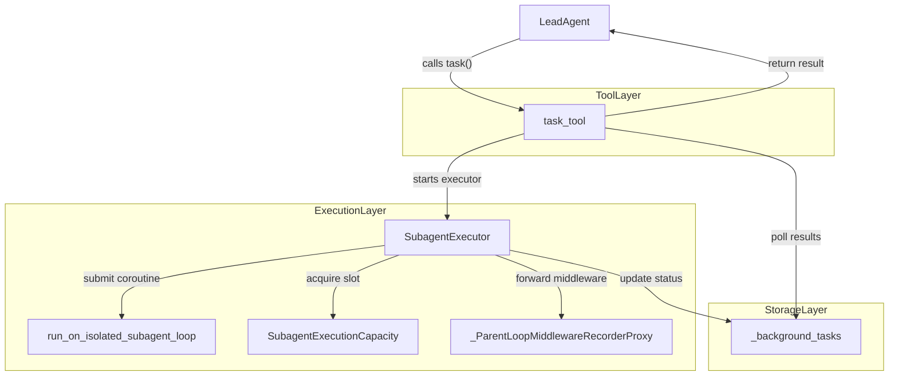
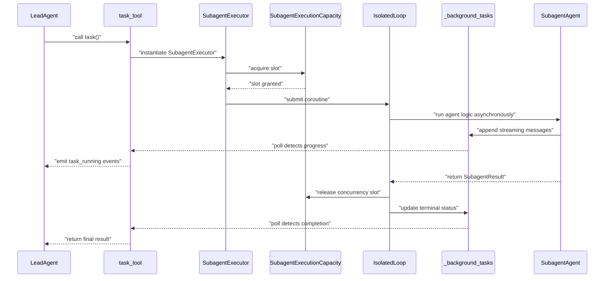

<!-- source: DeepWiki mcp.deepwiki.com · repo bytedance/deer-flow · page 5.5 Subagent System and Task Delegation · fetched 2026-10-29 -->

# Subagent System and Task Delegation

<details>
<summary>Relevant source files</summary>

The following files were used as context for generating this wiki page:

- [backend/app/gateway/routers/subagent_batches.py](backend/app/gateway/routers/subagent_batches.py)
- [backend/app/subagent_batches/__init__.py](backend/app/subagent_batches/__init__.py)
- [backend/app/subagent_batches/service.py](backend/app/subagent_batches/service.py)
- [backend/packages/harness/deerflow/agents/middlewares/input_sanitization_middleware.py](backend/packages/harness/deerflow/agents/middlewares/input_sanitization_middleware.py)
- [backend/packages/harness/deerflow/config/subagents_config.py](backend/packages/harness/deerflow/config/subagents_config.py)
- [backend/packages/harness/deerflow/persistence/subagent_batches/sql.py](backend/packages/harness/deerflow/persistence/subagent_batches/sql.py)
- [backend/packages/harness/deerflow/subagents/AGENTS.md](backend/packages/harness/deerflow/subagents/AGENTS.md)
- [backend/packages/harness/deerflow/subagents/acceptance_checks.py](backend/packages/harness/deerflow/subagents/acceptance_checks.py)
- [backend/packages/harness/deerflow/subagents/batch_lease.py](backend/packages/harness/deerflow/subagents/batch_lease.py)
- [backend/packages/harness/deerflow/subagents/batch_service.py](backend/packages/harness/deerflow/subagents/batch_service.py)
- [backend/packages/harness/deerflow/subagents/builtins/bash_agent.py](backend/packages/harness/deerflow/subagents/builtins/bash_agent.py)
- [backend/packages/harness/deerflow/subagents/builtins/general_purpose.py](backend/packages/harness/deerflow/subagents/builtins/general_purpose.py)
- [backend/packages/harness/deerflow/subagents/config.py](backend/packages/harness/deerflow/subagents/config.py)
- [backend/packages/harness/deerflow/subagents/executor.py](backend/packages/harness/deerflow/subagents/executor.py)
- [backend/packages/harness/deerflow/subagents/registry.py](backend/packages/harness/deerflow/subagents/registry.py)
- [backend/packages/harness/deerflow/tools/builtins/batch_task_tool.py](backend/packages/harness/deerflow/tools/builtins/batch_task_tool.py)
- [backend/packages/harness/deerflow/tools/builtins/task_tool.py](backend/packages/harness/deerflow/tools/builtins/task_tool.py)
- [backend/tests/blocking_io/test_task_tool_acceptance_checklist.py](backend/tests/blocking_io/test_task_tool_acceptance_checklist.py)
- [backend/tests/blocking_io/test_tool_assembly_offloop.py](backend/tests/blocking_io/test_tool_assembly_offloop.py)
- [backend/tests/test_acceptance_build_summaries.py](backend/tests/test_acceptance_build_summaries.py)
- [backend/tests/test_acceptance_checks.py](backend/tests/test_acceptance_checks.py)
- [backend/tests/test_batch_acceptance.py](backend/tests/test_batch_acceptance.py)
- [backend/tests/test_batch_extension_snapshot.py](backend/tests/test_batch_extension_snapshot.py)
- [backend/tests/test_batch_lease_lifecycle.py](backend/tests/test_batch_lease_lifecycle.py)
- [backend/tests/test_batch_task_tool.py](backend/tests/test_batch_task_tool.py)
- [backend/tests/test_csv_acceptance.py](backend/tests/test_csv_acceptance.py)
- [backend/tests/test_custom_events.py](backend/tests/test_custom_events.py)
- [backend/tests/test_extension_task_store_runtime.py](backend/tests/test_extension_task_store_runtime.py)
- [backend/tests/test_go_acceptance.py](backend/tests/test_go_acceptance.py)
- [backend/tests/test_input_sanitization_middleware.py](backend/tests/test_input_sanitization_middleware.py)
- [backend/tests/test_json_acceptance.py](backend/tests/test_json_acceptance.py)
- [backend/tests/test_node_test_acceptance.py](backend/tests/test_node_test_acceptance.py)
- [backend/tests/test_subagent_batch_repository.py](backend/tests/test_subagent_batch_repository.py)
- [backend/tests/test_subagent_batch_service.py](backend/tests/test_subagent_batch_service.py)
- [backend/tests/test_subagent_batch_shutdown_timeout.py](backend/tests/test_subagent_batch_shutdown_timeout.py)
- [backend/tests/test_subagent_batches_router.py](backend/tests/test_subagent_batches_router.py)
- [backend/tests/test_subagent_executor.py](backend/tests/test_subagent_executor.py)
- [backend/tests/test_subagent_prompt_security.py](backend/tests/test_subagent_prompt_security.py)
- [backend/tests/test_subagent_routing_prompt.py](backend/tests/test_subagent_routing_prompt.py)
- [backend/tests/test_subagent_skills_config.py](backend/tests/test_subagent_skills_config.py)
- [backend/tests/test_subagent_timeout_config.py](backend/tests/test_subagent_timeout_config.py)
- [backend/tests/test_subagents_acp_boolean_backstops.py](backend/tests/test_subagents_acp_boolean_backstops.py)
- [backend/tests/test_task_tool_core_logic.py](backend/tests/test_task_tool_core_logic.py)
- [backend/tests/test_unittest_acceptance.py](backend/tests/test_unittest_acceptance.py)

</details>


## Purpose and Scope

This document provides a detailed technical overview of DeerFlow's subagent system and task delegation mechanisms. It covers the `task` tool, the `SubagentExecutor` class and its execution model, thread pool architecture with concurrency limits, `SubagentLimitMiddleware` enforcement, batch task support via `SubagentBatchService`, deterministic acceptance criteria validation, background execution paradigms, and input sanitization guardrails.

The subagent system enables lead agents to decompose complex tasks into subtasks delegated to specialized subagents running in isolated contexts, while applying strict resource management, token budgeting, policy enforcement, and provenance tracking to ensure robust and secure operation.

For related system components, see:  
- Lead Agent and Prompt System (page 5.3)  
- Middleware Pipeline (page 5.4)  
- Tool System (page 5.6)  

Sources: [backend/packages/harness/deerflow/subagents/executor.py:1-88](), [backend/packages/harness/deerflow/tools/builtins/task_tool.py:1-53](), [backend/packages/harness/deerflow/subagents/AGENTS.md:1-45]()

---

## System Overview

DeerFlow's subagent system orchestrates decomposition and autonomous execution of subtasks by specialized agents with strong isolation and resource governance.

Key characteristics:  
- **Parallel Decomposition:** The lead agent initiates subagents via the `task` tool interface, delegating subtasks with tailored prompts, operator-owned prompt overlays, and parent context snapshots.  
- **Execution Isolation:** Each subagent runs in an isolated execution context with filtered tool/skill access and sandboxed environment state, maintaining upload-state and knowledge-scope boundaries.  
- **Concurrency Limits & Admission Control:** A process-global FIFO admission controller (`SubagentExecutionCapacity`) enforces max concurrent subagent executions and queue depth; `SubagentLimitMiddleware` enforces per-turn and per-run subagent invocation limits.  
- **Background Execution & Polling:** Subagent coroutines run on a dedicated persistent isolated asyncio event loop (`run_on_isolated_subagent_loop`). Progress and results are periodically polled and streamed back to callers.  
- **Batch Task Support:** For cases involving many independent subtasks, the `batch_task` tool and backing `SubagentBatchService` coordinate explicit durable batch submissions with lease-based recovery and acceptance criteria checks.  
- **Cost and Safety Controls:** Subagents respect configurable timeouts, max turn counts, token budgets, and guardrail stop reasons to avoid runaway or unsafe executions, accompanied by input sanitization (`input_sanitization_middleware.py`) to block prompt injection attacks.

Sources: [backend/packages/harness/deerflow/subagents/executor.py:116-154](), [backend/packages/harness/deerflow/tools/builtins/task_tool.py:188-282](), [backend/packages/harness/deerflow/subagents/AGENTS.md:1-45](), [backend/packages/harness/deerflow/agents/middlewares/input_sanitization_middleware.py:1-43]()

---

## Architecture

The subagent system integrates multiple components into a cohesive execution pipeline:

### Component Interaction Diagram


*Title: Subagent System Component Interaction*

The lead agent calls the `task` tool (`[backend/packages/harness/deerflow/tools/builtins/task_tool.py]()`), which instantiates a `SubagentExecutor` (`[backend/packages/harness/deerflow/subagents/executor.py]()`). The executor requests an available concurrency slot from `SubagentExecutionCapacity` (`[backend/packages/harness/deerflow/subagents/capacity.py]()`). Upon approval, it submits asynchronous coroutines directly to a persistent isolated asyncio event loop (`run_on_isolated_subagent_loop`). Execution progress, tool receipts, and final results are recorded in the process-global `_background_tasks` registry. Middleware events are safely bridged back to the parent event loop using `_ParentLoopMiddlewareRecorderProxy`.

Sources: [backend/packages/harness/deerflow/tools/builtins/task_tool.py:90-160](), [backend/packages/harness/deerflow/subagents/executor.py:140-320]()

---

### Natural Language to Code Entity Mapping

This diagram bridges natural language terms to their precise codebase entities and modules:

```mermaid
graph LR
    NL1["\"Delegation Request\""] --> CE1["\"task_tool() in tools/builtins/task_tool.py\""]
    NL2["\"Subagent Executor\""] --> CE2["\"SubagentExecutor in subagents/executor.py\""]
    NL3["\"Concurrency Capacity\""] --> CE3["\"SubagentExecutionCapacity in subagents/capacity.py\""]
    NL4["\"Isolated Event Loop\""] --> CE4["\"run_on_isolated_subagent_loop in subagents/executor.py\""]
    NL5["\"Batch Task Service\""] --> CE5["\"SubagentBatchService in subagents/batch_service.py\""]
    NL6["\"Acceptance Criteria Engine\""] --> CE6["\"check_acceptance_criteria() in subagents/acceptance_checks.py\""]
    NL7["\"Input Sanitization\""] --> CE7["\"InputSanitizationMiddleware in agents/middlewares/input_sanitization_middleware.py\""]
```
*Title: Natural Language to Code Mapping for Subagent System*

Sources: [backend/packages/harness/deerflow/tools/builtins/task_tool.py:1-53](), [backend/packages/harness/deerflow/subagents/executor.py:1-88](), [backend/packages/harness/deerflow/subagents/batch_service.py:77-120](), [backend/packages/harness/deerflow/subagents/acceptance_checks.py:1-60](), [backend/packages/harness/deerflow/agents/middlewares/input_sanitization_middleware.py:1-43]()

---

## Task Tool Interface

The `task` tool is the primary mechanism for delegating subtasks to subagents, registered as an async LangChain tool (`@tool("task")`) in `[backend/packages/harness/deerflow/tools/builtins/task_tool.py]()`.

### Tool Signature and Execution Flow

The main lifecycle steps of `task_tool` include:

1. **Configuration Resolution**: Calls `get_subagent_config(subagent_type)` to retrieve prompt overlays, skill/permission restrictions, timeout, and model settings (`[backend/packages/harness/deerflow/subagents/registry.py]()`).
2. **Context Snapshotting**: Captures the parent thread state, including `ThreadState.uploaded_files`, workspace paths, and authorization attributes (`[backend/packages/harness/deerflow/subagents/context_snapshot.py]()`).
3. **Tool and Skill Filtering**: Enforces subagent-specific tool and skill allowlists and disables the `task` tool inside subagents (`disallowed_tools`) to prevent recursive delegation (`[backend/packages/harness/deerflow/config/subagents_config.py]()`).
4. **SubagentExecutor Creation**: Instantiates a `SubagentExecutor` with the resolved configuration, context, and knowledge scope (`[backend/packages/harness/deerflow/subagents/executor.py]()`).
5. **Admission Control and Execution**: Acquires a concurrency slot from `SubagentExecutionCapacity` and submits the subagent coroutine to the process-global persistent isolated event loop (`[backend/packages/harness/deerflow/subagents/capacity.py]()`).
6. **Result Polling and Streaming**: Concurrently polls the shared `_background_tasks` registry every 5 seconds to stream incremental AI messages, tool receipts, and RAG knowledge sources (`[backend/packages/harness/deerflow/subagents/AGENTS.md]()`).
7. **Completion Handling**: Returns the final subagent output, knowledge sources, or structured error message back to the lead agent caller.

Sources: [backend/packages/harness/deerflow/tools/builtins/task_tool.py:1-282](), [backend/packages/harness/deerflow/subagents/AGENTS.md:1-45]()

---

## SubagentExecutor and Persistent Isolated Event Loop

### Execution Model

Unlike spawning OS threads or using standard thread pools, subagents submit asynchronous coroutines directly to a **persistent isolated asyncio event loop** maintained process-wide (`run_on_isolated_subagent_loop`).

Key characteristics:
- Runs in a dedicated background thread, isolating thread-local context, trace metadata, and lifecycle ownership.
- Admission concurrency slots are managed by `SubagentExecutionCapacity`, enforcing FIFO queueing on limits (default max 3 concurrent subagents).
- State and progress messages are stored in a shared `_background_tasks` dictionary keyed by a unique `task_id`.
- Knowledge sources (such as RAG snapshots) are accumulated in `SubagentResult.knowledge_sources` (up to 100 sources deduplicated by evidence ID) and survive message compaction and terminal publication (`[backend/packages/harness/deerflow/subagents/AGENTS.md:1-14]()`).

### Execution Result State

Execution outcomes and diagnostics are captured in the `SubagentResult` dataclass (`[backend/packages/harness/deerflow/subagents/executor.py:118-200]()`):

| Attribute           | Description                                                                                             |
|---------------------|---------------------------------------------------------------------------------------------------------|
| `task_id`           | Server-generated identifier that owns this execution.                                                    |
| `external_task_id`  | Optional provider correlation ID for tracing.                                                        |
| `trace_id`          | Distributed trace ID linking parent and subagent logs.                                                |
| `status`            | Enum `SubagentStatus`: `PENDING`, `RUNNING`, `COMPLETED`, `FAILED`, `CANCELLED`, `TIMED_OUT`.         |
| `result`            | Final textual output of the subagent.                                                                 |
| `error`             | Error message if the subagent run failed unexpectedly.                                                |
| `stop_reason`       | Guardrail trigger for early termination (`token_capped`, `turn_capped`, `loop_capped`) or `None`.     |
| `started_at`        | UTC timestamp when execution began.                                                                    |
| `completed_at`      | UTC timestamp when execution finished.                                                                 |
| `ai_messages`       | List of complete AI message dicts generated during execution.                                          |
| `admission_failure` | Boolean: true if subagent was rejected before execution due to capacity limits.                        |
| `tool_receipts`     | Child's tool receipts harvested from its terminal message stream.                                      |
| `bash_executions`   | Bounded bash command/output evidence accumulated from streamed chunks for acceptance verification.      |
| `knowledge_sources` | Validated tool message knowledge sources (RAG snapshots) retained through compaction.                   |

Sources: [backend/packages/harness/deerflow/subagents/executor.py:118-200](), [backend/packages/harness/deerflow/subagents/AGENTS.md:1-14]()

---

## Execution Lifecycle

### Subagent Execution Sequence


*Title: Subagent Execution Lifecycle Sequence*

Sources: [backend/packages/harness/deerflow/tools/builtins/task_tool.py:188-282](), [backend/packages/harness/deerflow/subagents/executor.py:140-320]()

---

## Configuration and Overrides

Subagent configuration is layered to provide base default behaviors and allow operator overrides:
1. **Built-in Agents:** Static definitions such as `"general-purpose"` and `"bash"` (`[backend/packages/harness/deerflow/subagents/builtins/]`).
2. **Custom Agents:** Declared in the `custom_agents` section of `config.yaml`.
3. **Managed Subagents:** Persistent administrator-managed subagent definitions stored via centralized storage backend.
4. **Agent Overrides:** Per-agent overrides (`timeout_seconds`, `max_turns`, `model`, `skills`, prompt overlays) applied last.

The final effective `SubagentConfig` is resolved via `get_subagent_config(name, app_config)`.

Sources: [backend/packages/harness/deerflow/subagents/registry.py:1-125](), [backend/packages/harness/deerflow/config/subagents_config.py:89-162]()

---

## Concurrency, Capacity, and Timeout Limits

- **SubagentExecutionCapacity:** A global FIFO admission controller limiting simultaneous subagent runs to a configured maximum (`max_running`, default 3) (`[backend/packages/harness/deerflow/subagents/capacity.py]()`).
- **SubagentLimitMiddleware:** Enforced inside the agent middleware pipeline, limiting concurrent calls per turn and total subagents per run (`max_total_per_run`, default 6) (`[backend/packages/harness/deerflow/config/subagents_config.py:13-57]()`).
- **Recursive Delegation Prevention:** Subagents disallow use of the `task` tool internally via `disallowed_tools`, blocking recursive nesting.
- **Timeout and Token Budgets:** Default timeout is 900-1800 seconds. Token budgets adapt based on summarization: 1M tokens if summarization is active, else 2M tokens (`[backend/packages/harness/deerflow/config/subagents_config.py:59-87]()`).

Sources: [backend/packages/harness/deerflow/subagents/capacity.py:1-50](), [backend/packages/harness/deerflow/config/subagents_config.py:1-162]()

---

## Background Execution and Middleware Event Forwarding

Subagent executions run asynchronously on the dedicated persistent isolated event loop (`run_on_isolated_subagent_loop()`) and are tracked via the `_background_tasks` registry.

**Middleware Event Forwarding (`_ParentLoopMiddlewareRecorderProxy`):**
Because SQL event stores and journaling clients are loop-bound to the parent thread's event loop, subagents executing on an isolated loop cannot call `RunJournal` directly. `_ParentLoopMiddlewareRecorderProxy` safely forwards narrowly-scoped subagent middleware events (such as loop detection, tool progress, and tool promotion) by scheduling thread-safe callbacks via `loop.call_soon_threadsafe()` on the parent run's event loop (`[backend/packages/harness/deerflow/tools/builtins/task_tool.py:98-160]()`).

Sources: [backend/packages/harness/deerflow/tools/builtins/task_tool.py:90-160](), [backend/packages/harness/deerflow/subagents/executor.py:90-160]()

---

## Batch Task Service and Lease Supervision

For scenarios involving many independent subtasks, DeerFlow provides `SubagentBatchService` (`[backend/packages/harness/deerflow/subagents/batch_service.py]()`), backed by `SubagentBatchRepository` (`[backend/packages/harness/deerflow/persistence/subagent_batches/sql.py]()`):
- **Lease-Based Claiming:** Background workers lease (`BatchItemLease`) and execute queued batch items safely across distributed workers using fenced database updates.
- **Durable Batch Specs:** Execution specs and prompt overlays are stored as JSON and restored before worker execution (`[backend/packages/harness/deerflow/subagents/AGENTS.md:22-24]()`).
- **Batch Evidence:** Successful results persist nullable `result_artifact` RAG snapshots under the same lease fence (`[backend/packages/harness/deerflow/subagents/AGENTS.md:25-30]()`).

Sources: [backend/packages/harness/deerflow/subagents/batch_service.py:1-164](), [backend/packages/harness/deerflow/persistence/subagent_batches/sql.py:1-182](), [backend/packages/harness/deerflow/subagents/AGENTS.md:22-33]()

---

## Deterministic Acceptance Criteria Validation

Layer 2 of the verification stack (`[backend/packages/harness/deerflow/subagents/acceptance_checks.py]()`) checks decidable criteria *in code* once a subagent or batch item completes, ensuring self-reports cannot silently pass unverified requirements:
- **File Leaves:** `file:<path> exists`, `file:<path> non-empty`, and `file_written:<path>` verify file presence, byte boundaries, and read-back contents scoped to the shared thread workspace (`/mnt/user-data/...`).
- **Format Leaves:** `file:<path> json-valid` (capped at 50,000 bytes) and `file:<path> csv-columns:["id","name"]` check syntax and required CSV headers.
- **Test Leaves:** `tests_passed:<command>` anchors to a specific recorded bash execution matching successful test output tails.
- Undecidable criteria remain `UNVERIFIED` (`checked=False`) and are never implicitly accepted (`[backend/packages/harness/deerflow/subagents/AGENTS.md:52-60]()`).

Sources: [backend/packages/harness/deerflow/subagents/acceptance_checks.py:1-140](), [backend/packages/harness/deerflow/subagents/AGENTS.md:52-60]()

---

## Input Safety and Sanitization Guardrails

To defend against prompt-injection attacks (issue #3630), `InputSanitizationMiddleware` (`[backend/packages/harness/deerflow/agents/middlewares/input_sanitization_middleware.py]()`) scans and escapes blocked system-reserved and injection tags (e.g., `<system>`, `<memory>`, `<instruction>`) in user messages across the conversation history. Both lead agents and subagents share this sanitization pipeline, preventing untrusted input from mimicking trusted framework authority blocks.

Sources: [backend/packages/harness/deerflow/agents/middlewares/input_sanitization_middleware.py:1-132](), [backend/packages/harness/deerflow/subagents/AGENTS.md:19-20]()

---

## Appendix: Glossary of Key Classes and Concepts

| Name                                    | Description                                                                                         |
|----------------------------------------|-------------------------------------------------------------------------------------------------|
| `task_tool`                            | Async tool enabling lead agent to delegate subtasks (`tools/builtins/task_tool.py`).            |
| `SubagentExecutor`                     | Orchestrates subagent lifecycle, coroutine management, cancellation, and result collation.       |
| `run_on_isolated_subagent_loop`       | Scheduler submitting coroutines to persistent isolated asyncio event loop (`executor.py`).       |
| `SubagentExecutionCapacity`            | Global FIFO capacity manager controlling concurrent subagent slots (`capacity.py`).              |
| `SubagentLimitMiddleware`              | Middleware enforcing per-turn and per-lead-run subagent delegation limits (`subagent_limit_middleware.py`). |
| `SubagentResult`                      | Dataclass capturing subagent execution status, messages, tool receipts, and knowledge sources.   |
| `SubagentBatchService`                | Background worker service managing durable batch item leasing and execution (`batch_service.py`). |
| `_ParentLoopMiddlewareRecorderProxy` | Thread-safe proxy forwarding subagent middleware events to parent asyncio event loop.            |
| `check_acceptance_criteria`           | Deterministic code-level verification function for file, json, csv, and test criteria (`acceptance_checks.py`). |
| `InputSanitizationMiddleware`         | Guardrail middleware escaping blocked XML authority tags to defend against prompt injection.     |

Sources: [backend/packages/harness/deerflow/tools/builtins/task_tool.py:1-282](), [backend/packages/harness/deerflow/subagents/executor.py:1-154](), [backend/packages/harness/deerflow/subagents/batch_service.py:42-120](), [backend/packages/harness/deerflow/subagents/acceptance_checks.py:1-85](), [backend/packages/harness/deerflow/agents/middlewares/input_sanitization_middleware.py:1-50]()

---

