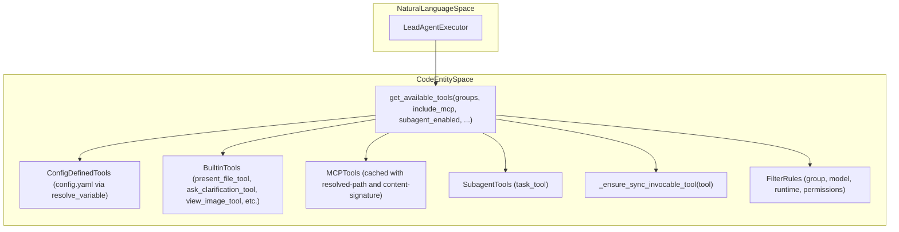
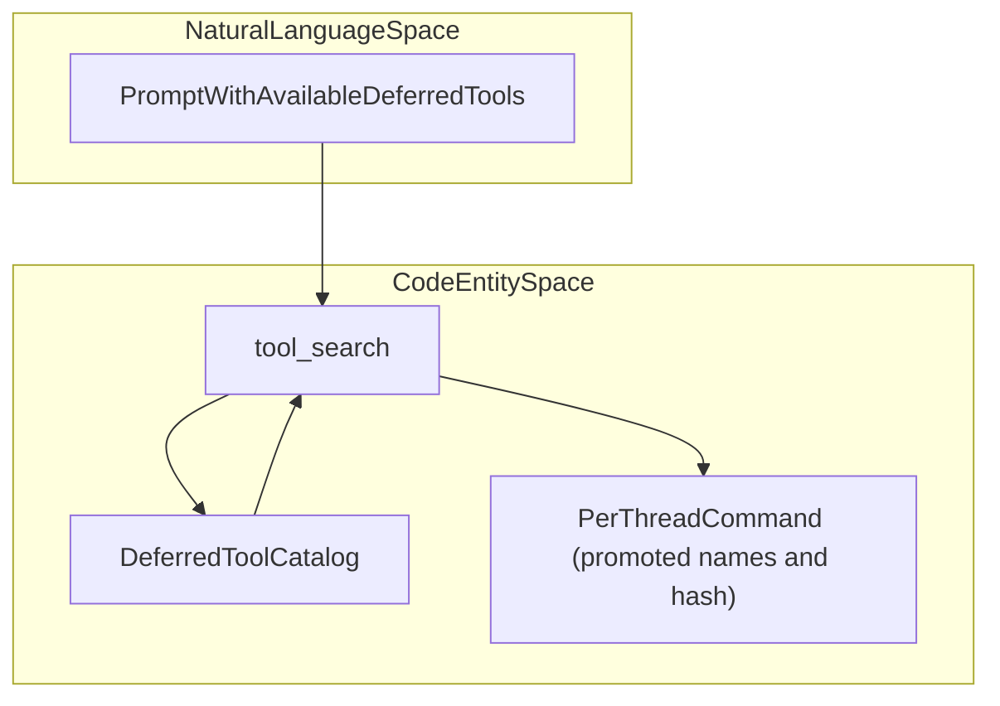

<!-- source: DeepWiki mcp.deepwiki.com · repo bytedance/deer-flow · page 5.6 Tool System · fetched 2026-10-29 -->

# Tool System

Relevant source files

The following files were used as context for generating this wiki page:

- [backend/app/gateway/routers/browser.py](backend/app/gateway/routers/browser.py)
- [backend/packages/harness/deerflow/agents/middlewares/deferred_tool_filter_middleware.py](backend/packages/harness/deerflow/agents/middlewares/deferred_tool_filter_middleware.py)
- [backend/packages/harness/deerflow/community/brave/AGENTS.md](backend/packages/harness/deerflow/community/brave/AGENTS.md)
- [backend/packages/harness/deerflow/community/brave/tools.py](backend/packages/harness/deerflow/community/brave/tools.py)
- [backend/packages/harness/deerflow/community/browser_automation/__init__.py](backend/packages/harness/deerflow/community/browser_automation/__init__.py)
- [backend/packages/harness/deerflow/community/browser_automation/session.py](backend/packages/harness/deerflow/community/browser_automation/session.py)
- [backend/packages/harness/deerflow/community/browser_automation/tools.py](backend/packages/harness/deerflow/community/browser_automation/tools.py)
- [backend/packages/harness/deerflow/community/browserless/__init__.py](backend/packages/harness/deerflow/community/browserless/__init__.py)
- [backend/packages/harness/deerflow/community/browserless/browserless_client.py](backend/packages/harness/deerflow/community/browserless/browserless_client.py)
- [backend/packages/harness/deerflow/community/browserless/tools.py](backend/packages/harness/deerflow/community/browserless/tools.py)
- [backend/packages/harness/deerflow/community/crawl4ai/tools.py](backend/packages/harness/deerflow/community/crawl4ai/tools.py)
- [backend/packages/harness/deerflow/community/ddg_search/AGENTS.md](backend/packages/harness/deerflow/community/ddg_search/AGENTS.md)
- [backend/packages/harness/deerflow/community/ddg_search/__init__.py](backend/packages/harness/deerflow/community/ddg_search/__init__.py)
- [backend/packages/harness/deerflow/community/ddg_search/tools.py](backend/packages/harness/deerflow/community/ddg_search/tools.py)
- [backend/packages/harness/deerflow/community/fastcrw/tools.py](backend/packages/harness/deerflow/community/fastcrw/tools.py)
- [backend/packages/harness/deerflow/community/firecrawl/tools.py](backend/packages/harness/deerflow/community/firecrawl/tools.py)
- [backend/packages/harness/deerflow/community/image_search/AGENTS.md](backend/packages/harness/deerflow/community/image_search/AGENTS.md)
- [backend/packages/harness/deerflow/community/image_search/tools.py](backend/packages/harness/deerflow/community/image_search/tools.py)
- [backend/packages/harness/deerflow/community/jina_ai/AGENTS.md](backend/packages/harness/deerflow/community/jina_ai/AGENTS.md)
- [backend/packages/harness/deerflow/community/jina_ai/jina_client.py](backend/packages/harness/deerflow/community/jina_ai/jina_client.py)
- [backend/packages/harness/deerflow/community/jina_ai/request_admission.py](backend/packages/harness/deerflow/community/jina_ai/request_admission.py)
- [backend/packages/harness/deerflow/community/jina_ai/tools.py](backend/packages/harness/deerflow/community/jina_ai/tools.py)
- [backend/packages/harness/deerflow/community/serper/AGENTS.md](backend/packages/harness/deerflow/community/serper/AGENTS.md)
- [backend/packages/harness/deerflow/community/serper/tools.py](backend/packages/harness/deerflow/community/serper/tools.py)
- [backend/packages/harness/deerflow/community/url_safety.py](backend/packages/harness/deerflow/community/url_safety.py)
- [backend/packages/harness/deerflow/config/acp_config.py](backend/packages/harness/deerflow/config/acp_config.py)
- [backend/packages/harness/deerflow/env.py](backend/packages/harness/deerflow/env.py)
- [backend/packages/harness/deerflow/mcp/oauth.py](backend/packages/harness/deerflow/mcp/oauth.py)
- [backend/packages/harness/deerflow/tools/AGENTS.md](backend/packages/harness/deerflow/tools/AGENTS.md)
- [backend/packages/harness/deerflow/tools/builtins/invoke_acp_agent_tool.py](backend/packages/harness/deerflow/tools/builtins/invoke_acp_agent_tool.py)
- [backend/packages/harness/deerflow/tools/builtins/tool_search.py](backend/packages/harness/deerflow/tools/builtins/tool_search.py)
- [backend/packages/harness/deerflow/tools/sync.py](backend/packages/harness/deerflow/tools/sync.py)
- [backend/packages/harness/deerflow/tools/tools.py](backend/packages/harness/deerflow/tools/tools.py)
- [backend/packages/harness/deerflow/utils/atomic_write.py](backend/packages/harness/deerflow/utils/atomic_write.py)
- [backend/tests/blocking_io/test_image_search.py](backend/tests/blocking_io/test_image_search.py)
- [backend/tests/blocking_io/test_invoke_acp_agent_tool.py](backend/tests/blocking_io/test_invoke_acp_agent_tool.py)
- [backend/tests/blocking_io/test_web_tool_url_validation.py](backend/tests/blocking_io/test_web_tool_url_validation.py)
- [backend/tests/test_agent_guidance_check.py](backend/tests/test_agent_guidance_check.py)
- [backend/tests/test_browser_automation.py](backend/tests/test_browser_automation.py)
- [backend/tests/test_browser_outputs_atomic.py](backend/tests/test_browser_outputs_atomic.py)
- [backend/tests/test_browser_readonly_security.py](backend/tests/test_browser_readonly_security.py)
- [backend/tests/test_browser_router.py](backend/tests/test_browser_router.py)
- [backend/tests/test_browserless_capture_name_reservation.py](backend/tests/test_browserless_capture_name_reservation.py)
- [backend/tests/test_browserless_client.py](backend/tests/test_browserless_client.py)
- [backend/tests/test_crawl4ai_tools.py](backend/tests/test_crawl4ai_tools.py)
- [backend/tests/test_ddg_image_search_urls.py](backend/tests/test_ddg_image_search_urls.py)
- [backend/tests/test_ddg_search_tools.py](backend/tests/test_ddg_search_tools.py)
- [backend/tests/test_deferred_catalog.py](backend/tests/test_deferred_catalog.py)
- [backend/tests/test_deferred_keyword_search.py](backend/tests/test_deferred_keyword_search.py)
- [backend/tests/test_deferred_promotion_integration.py](backend/tests/test_deferred_promotion_integration.py)
- [backend/tests/test_deferred_setup.py](backend/tests/test_deferred_setup.py)
- [backend/tests/test_deferred_tool_crosscontext.py](backend/tests/test_deferred_tool_crosscontext.py)
- [backend/tests/test_deferred_tool_promotion_real_llm.py](backend/tests/test_deferred_tool_promotion_real_llm.py)
- [backend/tests/test_doctor.py](backend/tests/test_doctor.py)
- [backend/tests/test_env_file.py](backend/tests/test_env_file.py)
- [backend/tests/test_fastcrw_tools.py](backend/tests/test_fastcrw_tools.py)
- [backend/tests/test_firecrawl_tools.py](backend/tests/test_firecrawl_tools.py)
- [backend/tests/test_image_result_idna_hosts.py](backend/tests/test_image_result_idna_hosts.py)
- [backend/tests/test_image_search.py](backend/tests/test_image_search.py)
- [backend/tests/test_invoke_acp_agent_tool.py](backend/tests/test_invoke_acp_agent_tool.py)
- [backend/tests/test_jina_client.py](backend/tests/test_jina_client.py)
- [backend/tests/test_jina_request_admission.py](backend/tests/test_jina_request_admission.py)
- [backend/tests/test_jina_response_limit.py](backend/tests/test_jina_response_limit.py)
- [backend/tests/test_jina_retries.py](backend/tests/test_jina_retries.py)
- [backend/tests/test_mcp_custom_interceptors.py](backend/tests/test_mcp_custom_interceptors.py)
- [backend/tests/test_mcp_oauth.py](backend/tests/test_mcp_oauth.py)
- [backend/tests/test_mcp_per_server_discovery.py](backend/tests/test_mcp_per_server_discovery.py)
- [backend/tests/test_mcp_routing_prompt.py](backend/tests/test_mcp_routing_prompt.py)
- [backend/tests/test_mcp_sync_wrapper.py](backend/tests/test_mcp_sync_wrapper.py)
- [backend/tests/test_mcp_task_oauth.py](backend/tests/test_mcp_task_oauth.py)
- [backend/tests/test_mcp_tool_name_validation.py](backend/tests/test_mcp_tool_name_validation.py)
- [backend/tests/test_personal_mcp_network.py](backend/tests/test_personal_mcp_network.py)
- [backend/tests/test_serper_tools.py](backend/tests/test_serper_tools.py)
- [backend/tests/test_tool_deduplication.py](backend/tests/test_tool_deduplication.py)
- [backend/tests/test_tool_search.py](backend/tests/test_tool_search.py)
- [backend/tests/test_url_safety.py](backend/tests/test_url_safety.py)
- [backend/tests/test_write_file_tool_budget_annotation.py](backend/tests/test_write_file_tool_budget_annotation.py)
- [docs/ARCHITECTURE.md](docs/ARCHITECTURE.md)
- [docs/superpowers/plans/2026-06-29-community-browserless-web-capture.md](docs/superpowers/plans/2026-06-29-community-browserless-web-capture.md)
- [frontend/src/content/en/harness/tools.mdx](frontend/src/content/en/harness/tools.mdx)
- [frontend/src/content/zh/harness/tools.mdx](frontend/src/content/zh/harness/tools.mdx)
- [scripts/check_agent_guidance.py](scripts/check_agent_guidance.py)
- [scripts/doctor.py](scripts/doctor.py)
- [scripts/wizard/providers.py](scripts/wizard/providers.py)

## Purpose and Scope

The Tool System in DeerFlow is responsible for assembling and delivering a comprehensive set of callable tools to language agents during runtime. It integrates multiple sources of tools including built-in utilities, configuration-defined tools, Model Context Protocol (MCP) server tools, and community-contributed web tools. The system also supports filtering tools by categories, runtime features, and model capabilities. Furthermore, it enables deferred loading and promotion of tools using the `tool_search` mechanism to manage large tool catalogs efficiently, especially in MCP settings.

This page provides a detailed technical overview of the tool assembly logic, the distinct tool categories, deferred tool loading, tool filtering, and community web tool integrations.

Sources:  
[backend/packages/harness/deerflow/tools/AGENTS.md:1-69](),  
[backend/packages/harness/deerflow/tools/builtins/tool_search.py:1-171]()

---

## Tool Aggregation Architecture

### Overview

The central orchestration of tool assembly is performed by the function `get_available_tools()` defined in `deerflow.tools.tools` [backend/packages/harness/deerflow/tools/tools.py:102-142](). This function returns the set of tools available to an agent instance, filtered by specified criteria such as tool groups, whether MCP tools or subagent tools are enabled, model name, and runtime configuration.

**Tool Sources included in Aggregation:**

- **Config-Defined Tools:** Tools declared in `config.yaml` and resolved with `deerflow.reflection.resolve_variable()` into LangChain `BaseTool` instances [backend/packages/harness/deerflow/tools/AGENTS.md:61-61](), [backend/packages/harness/deerflow/tools/tools.py:143-162]().
- **Built-in Tools:** Core utilities embedded in DeerFlow including `present_file_tool`, `ask_clarification_tool`, `view_image_tool`, `review_skill_package` and agent setup/update tools [backend/packages/harness/deerflow/tools/tools.py:17-26](), [backend/packages/harness/deerflow/tools/AGENTS.md:63-68]().
- **MCP Tools:** Tools served by Model Context Protocol servers, identified by MCP metadata tags and injected when `include_mcp=True` is set [backend/packages/harness/deerflow/tools/builtins/tool_search.py:35-36]() and [backend/packages/harness/deerflow/tools/tools.py:102-142]().
- **Subagent Tools:** Tools for task delegation (`task_tool`), conditionally assembled if subagent support is enabled [backend/packages/harness/deerflow/tools/AGENTS.md:69-69](), [backend/packages/harness/deerflow/tools/tools.py:38-41]().

### Filtering Criteria

Filtering rules applied during tool assembly include:

- Exclusion of the "knowledge" group tools unless knowledge base is enabled in configuration [backend/packages/harness/deerflow/tools/tools.py:151-156]().
- Removal of "host bash" tools when the sandbox configuration forbids host bash execution (`is_host_bash_allowed`) [backend/packages/harness/deerflow/tools/tools.py:158-160]().
- Omission of the conversation reader tool unless explicitly allowed and host capabilities are present [backend/packages/harness/deerflow/tools/tools.py:148-150]().
- Upload-related tools (e.g. `list_uploaded_files`) included conditionally based on runtime context.
- Subagent tools are included only when subagent features are enabled [backend/packages/harness/deerflow/tools/tools.py:102-142]().
- MCP tools inclusion depends on `include_mcp=True` [backend/packages/harness/deerflow/tools/tools.py:102-142]().

### Sync Wrapping for Async Tools

Because some tools are asynchronous, a wrapper `_ensure_sync_invocable_tool()` wraps async-only tools so synchronous callers can invoke them safely. It uses thread locks to ensure singleton wrapper instances for concurrent invocations [backend/packages/harness/deerflow/tools/tools.py:55-71]().

### Tool Assembly Flow Diagram

Title: Tool Assembly Flow

Sources:  
[backend/packages/harness/deerflow/tools/tools.py:1-162](),  
[backend/packages/harness/deerflow/tools/AGENTS.md:59-69]()

---

## Tool Categories

### Built-in Tools

DeerFlow includes several built-in tools implemented internally to support key system capabilities. These tools are always available unless filtered out by runtime configuration.

| Tool Name           | Purpose                                                                                                                                                                     | Reference                                                  |
|---------------------|-----------------------------------------------------------------------------------------------------------------------------------------------------------------------------|------------------------------------------------------------|
| `present_files`     | Make output files visible to user under `/mnt/user-data/outputs`. Validates virtual paths using runtime user IDs.                                                          | [backend/packages/harness/deerflow/tools/AGENTS.md:64](), [backend/packages/harness/deerflow/tools/tools.py:22]() |
| `ask_clarification` | Request clarification from users. Intercepted by `ClarificationMiddleware` supporting text, single choice, and v2 structured form cards.                                    | [backend/packages/harness/deerflow/tools/AGENTS.md:65](), [backend/packages/harness/deerflow/tools/tools.py:18]() |
| `view_image`        | Read image bytes for vision-capable models. Requires `sandbox:execute` permission and validates path/MIME types.                                                           | [backend/packages/harness/deerflow/tools/AGENTS.md:66](), [backend/packages/harness/deerflow/tools/tools.py:25]() |
| `setup_agent`       | Bootstrap-only: persist a custom agent's `SOUL.md` and `config.yaml`. Bound only when `is_bootstrap=True`.                                                                    | [backend/packages/harness/deerflow/tools/AGENTS.md:67]()   |
| `update_agent`      | Custom-agent-only: persist self-updates to current agent config from inside normal chat. Bound when `agent_name` is set and `is_bootstrap=False`.                            | [backend/packages/harness/deerflow/tools/AGENTS.md:68]()   |

Built-in tools are declared in registries like `BUILTIN_TOOLS` and conditionally merged at runtime [backend/packages/harness/deerflow/tools/tools.py:32-36]().

Sources:  
[backend/packages/harness/deerflow/tools/tools.py:17-36](),  
[backend/packages/harness/deerflow/tools/AGENTS.md:63-68]()

---

### Configuration-Defined Tools

Tools can also be declared in the user's `config.yaml` under the `tools` section. These are resolved at runtime via the dynamic import and reflection function `resolve_variable()` which maps the configuration `use` string to an actual LangChain `BaseTool` instance [backend/packages/harness/deerflow/tools/AGENTS.md:61](), [backend/packages/harness/deerflow/tools/tools.py:143-162]().

Filtered by the same group, host/bash, conversation reader, and knowledge base flags as built-in tools, these user-configured tools enable extending the agent's capabilities specifically for a deployment environment.

Sources:  
[backend/packages/harness/deerflow/tools/tools.py:102-162](),  
[backend/packages/harness/deerflow/tools/AGENTS.md:61]()

---

### MCP Tools (Model Context Protocol)

MCP is a system for serving tools remotely with standardized metadata and schema representations. MCP tools carrying the `deerflow_mcp` metadata tag are recognized and fetched lazily on demand [backend/packages/harness/deerflow/tools/builtins/tool_search.py:35-36]().

Key properties:

- Tools from MCP servers are lazy initialized and cached with resolved-path + content-signature invalidation [backend/packages/harness/deerflow/tools/AGENTS.md:62]().
- MCP tools are dynamically enabled by setting `include_mcp=True` in `get_available_tools()` [backend/packages/harness/deerflow/tools/tools.py:102-142]().
- MCP routing metadata supports auto-promotion and dynamic tool exposure [backend/packages/harness/deerflow/tools/builtins/tool_search.py:9-11]().

Integration of MCP tools is transparent to the rest of the tool system, appearing as normal LangChain tools once loaded.

Sources:  
[backend/packages/harness/deerflow/tools/builtins/tool_search.py:1-36](),  
[backend/packages/harness/deerflow/tools/tools.py:102-142](),  
[backend/packages/harness/deerflow/tools/AGENTS.md:62]()

---

### Subagent System Tools

DeerFlow supports delegation via the subagent system. Special tools enable launching subagent tasks.

| Tool Name     | Purpose                                                                                                      | Reference                 |
|---------------|--------------------------------------------------------------------------------------------------------------|---------------------------|
| `task`        | Delegate prompt-driven task runs to subagents with optional acceptance criteria and descriptions.             | [backend/packages/harness/deerflow/tools/AGENTS.md:69]() |

These tools only appear when subagent features are enabled [backend/packages/harness/deerflow/tools/tools.py:38-41](), [backend/packages/harness/deerflow/tools/AGENTS.md:69]().

Sources:  
[backend/packages/harness/deerflow/tools/AGENTS.md:69](),  
[backend/packages/harness/deerflow/tools/tools.py:38-41]()

---

### Community Web Tools

DeerFlow includes a rich set of community-maintained web tools primarily for web search, scraping, and browsing. These are implemented as extensions under `deerflow.community` and wired through configuration [backend/packages/harness/deerflow/tools/AGENTS.md:23-30](). Examples include:

| Provider        | Tool Category       | Description                                                                                          | Source File Reference                         |
|-----------------|---------------------|--------------------------------------------------------------------------------------------------|-----------------------------------------------|
| Tavily          | Web Search & Fetch  | Web search and fetch tools, with configurable result counts and time range filters.               | [backend/packages/harness/deerflow/community/tavily/tools.py:1-81]() |
| DDG Search      | Web Search          | DuckDuckGo-based web search and fetch tools without requiring API keys.                          | [backend/packages/harness/deerflow/community/ddg_search/tools.py:1-178]() |
| Browserless     | Web Fetch & Capture | Headless Chromium browser fetch, screenshot, and interactive capture tools with URL safety.     | [backend/packages/harness/deerflow/community/browserless/tools.py:1-181]() |
| Firecrawl       | Web Scraping        | Async web crawling and scraping API with configurable API keys and result limits.                | [backend/packages/harness/deerflow/community/firecrawl/tools.py:1-117]() |
| Jina AI         | Web Fetch           | Web fetch via Jina API with content extraction and readability features.                          | [backend/packages/harness/deerflow/community/jina_ai/jina_client.py:1-130]() |

These community tools wrap their respective SDKs/clients and use `get_app_config()` to access runtime configuration parameters such as API keys, URLs, and timeout values. They implement conservative URL validation and error handling for safe web access.

Sources:  
[backend/packages/harness/deerflow/community/tavily/tools.py:1-81](),  
[backend/packages/harness/deerflow/community/ddg_search/tools.py:1-178](),  
[backend/packages/harness/deerflow/community/browserless/tools.py:1-181](),  
[backend/packages/harness/deerflow/community/firecrawl/tools.py:1-117](),  
[backend/packages/harness/deerflow/community/jina_ai/jina_client.py:1-130]()

---

## Deferred Tool Loading via Tool Search

### Motivation

Large MCP tool catalogs can be expensive and heavy to load eagerly. To handle this, DeerFlow introduces **deferred tool loading**:

- At startup, only the names of deferred tools appear in the agent's system prompt under `<available-deferred-tools>` [backend/packages/harness/deerflow/tools/builtins/tool_search.py:13-17]().
- The agent calls the special `tool_search` built-in tool to fetch full schema definitions of selected tools on demand [backend/packages/harness/deerflow/tools/builtins/tool_search.py:5-8]().
- Only after promotion by querying `tool_search` does the tool become callable.

This allows dynamic, demand-driven exposure of tool schemas and controlled memory/resource usage.

### DeferredToolCatalog

The `DeferredToolCatalog` dataclass encapsulates an immutable tuple of deferred tools (`tools: tuple[BaseTool, ...]`) and implements search capabilities using regex and substring matching [backend/packages/harness/deerflow/tools/builtins/tool_search.py:113-120](). It supports query forms like:

- `select:` — exact name selection without caps [backend/packages/harness/deerflow/tools/builtins/tool_search.py:133-139],
- `keywords:` — keyword search path [backend/packages/harness/deerflow/tools/builtins/tool_search.py:141-142],
- free-text regex or substring search across name and description capped at `MAX_RESULTS` [backend/packages/harness/deerflow/tools/builtins/tool_search.py:44]().

The catalog computes a deterministic hash over sorted tool schemas for change tracking and promotion scope (`hash`) [backend/packages/harness/deerflow/tools/builtins/tool_search.py:122-126](). 

### `tool_search` Tool

The `tool_search` tool executes search queries against the catalog and returns matched tool schemas as JSON-serialized OpenAI function specs wrapped in LangGraph `Command` messages [backend/packages/harness/deerflow/tools/builtins/tool_search.py:5-8,35](). It updates graph state with promoted tool names and the catalog hash for persistence within the current thread's graph [backend/packages/harness/deerflow/tools/builtins/tool_search.py:13-17]().

### Deferred Tool Loading Diagram

Title: Deferred Tool Loading Flow

Sources:  
[backend/packages/harness/deerflow/tools/builtins/tool_search.py:1-171]()

---

## Tool Filtering Mechanisms

Multiple filtering rules ensure tools presented to agents meet security, capability, and runtime constraints:

- **Group filtering:** Knowledge-base tools require explicit feature flag enablement in `config.yaml` [backend/packages/harness/deerflow/tools/tools.py:151-156]().
- **Host Bash Filtering:** Tools marked as host bash execution surfaces are removed if sandbox configuration forbids host bash execution (`is_host_bash_allowed`) [backend/packages/harness/deerflow/tools/tools.py:44-52,158-160]().
- **Conversation Reader:** Only enabled when the host exposes authorized capabilities and when subagents are not calling [backend/packages/harness/deerflow/tools/AGENTS.md:40-46]().
- **Vision Tool Inclusion:** Vision tools like `view_image` require model capability support and appropriate token budget limits [backend/packages/harness/deerflow/tools/AGENTS.md:66]().
- **Subagent Tools:** Included only when subagent features are enabled [backend/packages/harness/deerflow/tools/tools.py:102-142]().
- **Sync Wrapping:** Asynchronous tools are wrapped via `_ensure_sync_invocable_tool()` for safe synchronous invocation [backend/packages/harness/deerflow/tools/tools.py:58-71]().

These filters are applied eagerly to the tool configuration list and MCP tool cache during `get_available_tools()` execution [backend/packages/harness/deerflow/tools/tools.py:102-162]().

Sources:   
[backend/packages/harness/deerflow/tools/tools.py:44-71,102-162](),  
[backend/packages/harness/deerflow/tools/AGENTS.md:40-46,66]()

---

## Summary

The DeerFlow Tool System is a robust and flexible framework that consolidates diverse tool sources, filters them by runtime and model characteristics, supports deferred discovery for large catalogs via `DeferredToolCatalog`, and integrates community web tools to enrich agent capabilities. The system relies on `get_available_tools()` for aggregation and uses the `tool_search` built-in tool to enable on-demand, dynamic tool loading, particularly for MCP-provided tools. This design accommodates extensibility and scalability of the super-agent ecosystem.

Sources:  
[backend/packages/harness/deerflow/tools/tools.py:102-162](),  
[backend/packages/harness/deerflow/tools/builtins/tool_search.py:1-171]()

---

